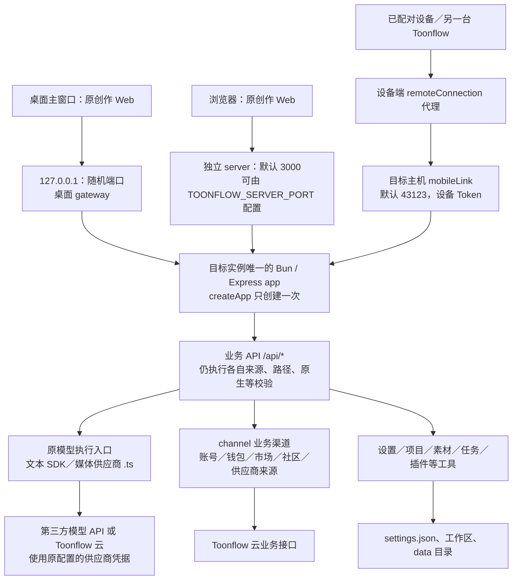
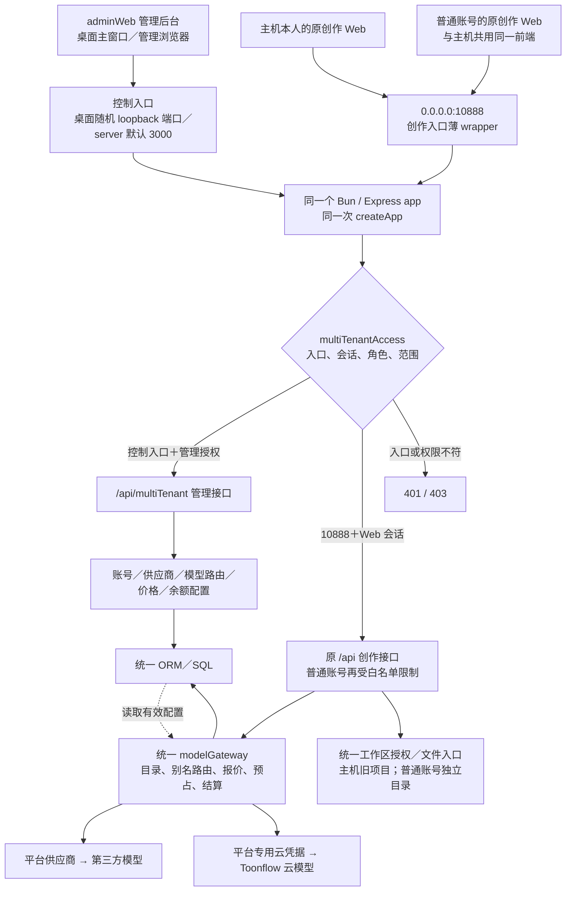
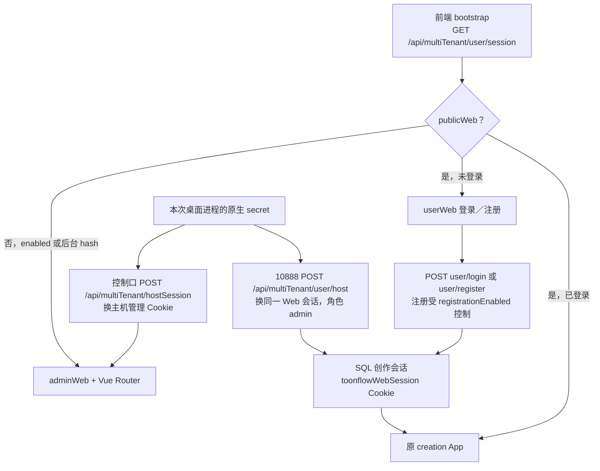
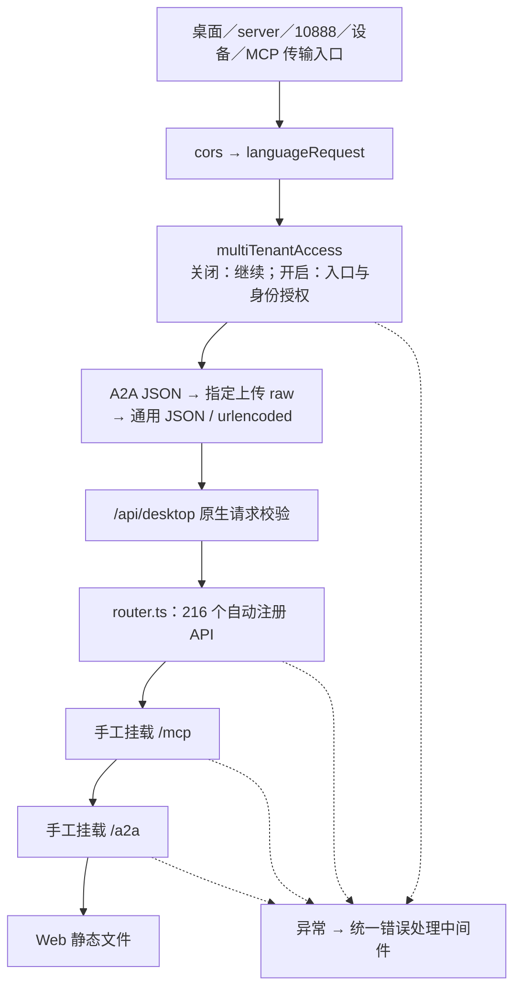
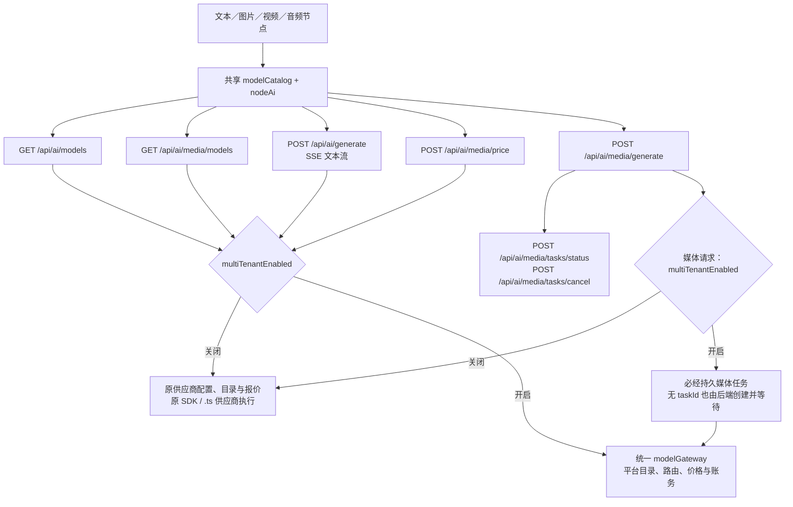
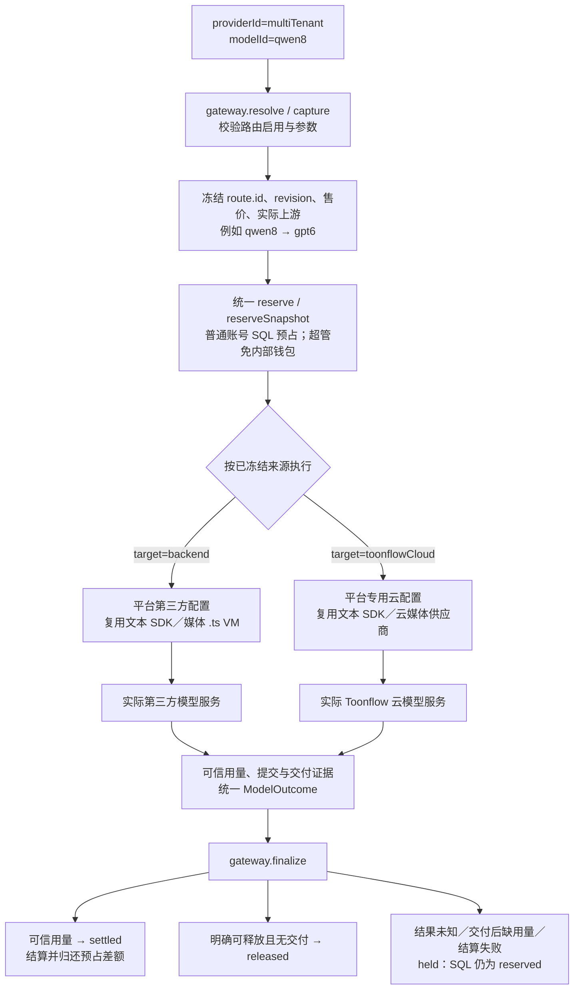
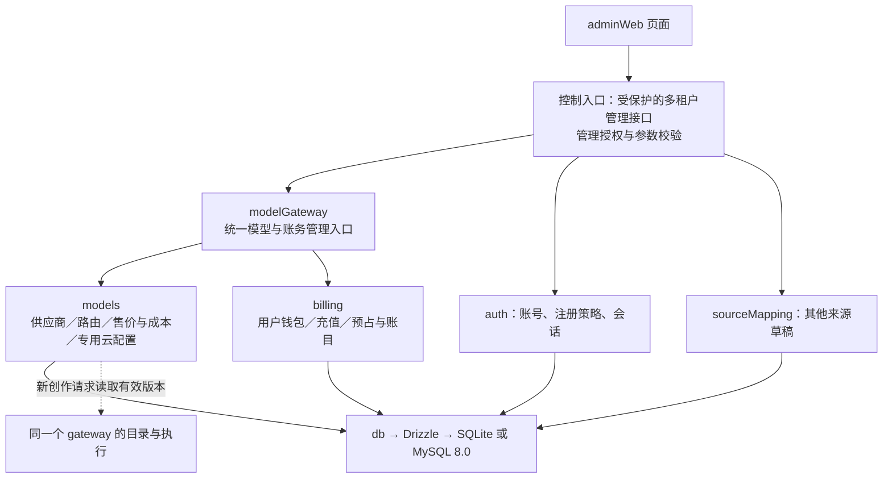
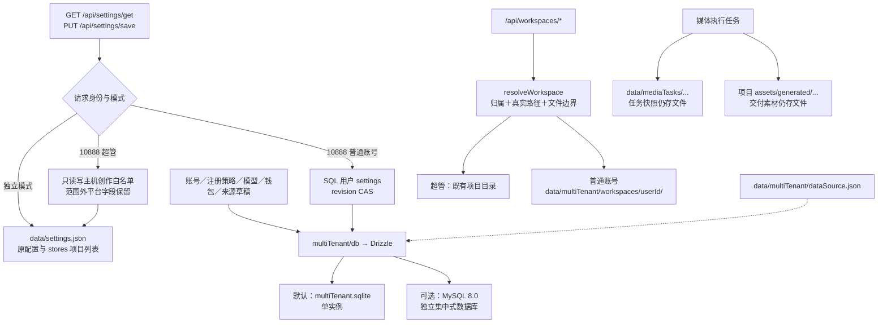

# 当前 API Router 图谱

根据 2026-11-05 当前工作区源码整理。描述实际代码分支，不把规划当作已经实现的能力。本次只生成文档，没有启动服务、调用模型或修改业务代码。

若要判断“哪些功能真正接入多租户、哪些仍走旧链路”，请先看 [多租户功能接入清单](multiTenantCoverage.md)。本页只描述连接和调用走向，不能用 URL 前缀判断功能是否已完成租户化。

**主线：创作 Web → 同一 Bun 应用 → 业务 API → 模型网关／业务工具 → 上游服务或存储。adminWeb 通过管理 API 修改配置，不执行或转发创作请求。**

- [未开启多租户](#未开启多租户)
- [开启多租户](#开启多租户)
- [请求进入后的路由顺序](#请求进入后的路由顺序)
- [全部业务路由分组](#全部业务路由分组)
- [模型目录路由报价与扣费](#模型目录路由报价与扣费)
- [后台配置如何生效](#后台配置如何生效)
- [数据最终存在哪里](#数据最终存在哪里)
- [开启后的访问矩阵](#开启后的访问矩阵)
- [完整 HTTP 接口清单](apiRouterRoutes.md)：216 个自动注册 API，以及自动路由之外的协议／宿主入口。

当前发布设置页的“多租户能力”仍加载 `developmentNotice.vue`，显示“正在开发”。下面的“开启后”描述仓库中已经保留的 enabled 分支，不代表本次重新开放了启用入口。

## 未开启多租户

- 此时 `multiTenantAccess` 直接放行到旧业务链；各接口原有校验仍存在，不能理解为所有 API 无鉴权。
- 四类模型已通过 Bun API 请求上游，浏览器不会因关闭多租户就直接调用付费模型。
- 文本供应商来自 `settings.customProviders / toonflowProvider`；媒体复用 `data/providers/*.ts` 与 `mediaProviderConfigs`。没有多租户 SQL 钱包扣费，第三方／云端自己的收费照常存在。
- 设备互联共享目标后端的既有能力和获准目录，不等同于用户／租户隔离。连接目标实例时，处理业务的是目标 app。
- 开发环境的 Vite `/api`、`/mcp`、`/a2a` 代理指向默认 `3000`，也不另实现业务后端。

入口代码：[独立 server](../apps/server/src/index.ts)、[桌面连接](../apps/desktop/src/connection.ts)、[设备互联](../apps/server/src/utils/mobileLink/index.ts)、[remoteConnection](../apps/server/src/remoteConnection.ts)。

## 开启多租户

这里的“控制入口”是职责名称。桌面端明确绑定 `127.0.0.1`；独立 server 的 `app.listen(realPort)` 没有限定 loopback，不能把默认 `3000` 画成天然仅本机可达。`10888` wrapper 只标记公开创作请求并转交同一个 app，不是第二套服务、网关数据库或业务实现。

**登录走向：**

- 手工访问 `10888` 的浏览器走账号密码登录，位于本机不代表超管。仅携带主机管理 Cookie 不能访问公开创作 API。
- 管理密码登录使用 `POST /api/multiTenant/login`，与创作 `user/login` 分开。管理会话绑定服务进程；创作会话存 SQL，普通账号还校验禁用状态和 `authVersion`。
- 主机本人仍走同一套创作 API，超管可访问旧项目，内部钱包免扣；普通账号进入隔离工作区。
- 开启时停止旧 mobileLink listener，并忽略桌面旧远端连接，配置保留。桌面本进程一旦晋升后台，关闭开关后仍显示后台，退出后再以关闭状态启动才恢复独立创作；关闭时 `10888` 停止，后端 enabled 权限分支也随之停用，不能把窗口状态当作权限开关。

代码：[前端分流](../apps/web/src/bootstrap/multiTenant.ts)、[公共运行时与权限](../apps/server/src/utils/multiTenant/runtime.ts)、[认证适配](../apps/server/src/utils/multiTenant/index.ts)、[认证领域](../packages/multiTenant/auth/index.ts)。

## 请求进入后的路由顺序

图中的纵向顺序是 Express 挂载顺序；匹配的处理器返回后，请求不会把所有模块逐一执行一遍。流式接口发出响应头后，继续使用自身流内错误协议。

自动路由规则为：`routes/<业务>/<动作>.ts` → `/api/<业务>/<动作>`，HTTP 方法由文件中的 `router.get/post/put/delete` 等注册决定；`index.ts` 对应目录自身。`core.ts` 生成 `router.ts`，不是前端 Vue Router，也不是模型别名路由。

**三个 router 的职责不同：**

| Router | 输入 | 决定什么 |
| --- | --- | --- |
| Vue Router | `#/multiTenant/models` 等页面地址 | 打开哪个前端页面，不发送数据库或模型请求 |
| HTTP Router | HTTP 方法＋`/api/...` | 调用哪个服务端处理器 |
| Model Gateway 的路由 | 模型类型＋公开模型标识 | 使用哪个真实模型、上游来源和价格快照 |

代码：[应用装配](../apps/server/src/app.ts)、[路由生成器](../apps/server/src/core.ts)、[生成产物](../apps/server/src/router.ts)、[后台 Vue Router](../packages/multiTenant/adminWeb/routes.ts)。

## 全部业务路由分组

以下 21 个家族合计 **216 个自动注册接口**。表中的家族名称都是 `/api/` 后的第一段；逐条方法、完整路径和源码见[完整清单](apiRouterRoutes.md)。这些是功能归属，不代表多租户所有角色都可访问。

| 家族 | 数量 | 业务走向 |
| --- | ---: | --- |
| `agent` | 14 | 服务端 Agent 会话、执行、流与控制 → Agent runtime → 文本／工具能力 |
| `agents` | 9 | 团队插件与 A2A 配置 → 插件文件、配置与运行时 |
| `ai` | 9 | 文本／媒体目录、生成、媒体报价、余额与任务 → AI／媒体工具 → 多租户时统一 gateway |
| `assets` | 6 | 全局素材读写与预览 → 素材目录；普通账号未开放 |
| `browser` | 2 | 浏览器工具状态与控制 → 服务端浏览器运行时 |
| `channel` | 37 | 账号、社区、模型、供应商、插件、子账号、用户与钱包 → getChannel → Toonflow 云业务 |
| `desktop` | 16 | 窗口、目录选择、更新等 → 桌面宿主能力与原生请求校验 |
| `ext` | 6 | 扩展插件列表、内容、安装与控制 → 扩展目录与插件工具 |
| `ffmpeg` | 6 | 媒体处理 → 共享 FFmpeg 能力与工作区文件 |
| `mcp` | 13 | 页面连接、资源、工具与外部 MCP 配置 → MCP runtime；与协议 `/mcp` 区分 |
| `media` | 1 | 二进制媒体预览 → mediaPreview；不是音频生成模型路由 |
| `mobileLink` | 6 | 设备互联配置、配对、设备管理 → mobileLink runtime |
| `multiTenant` | 30 | 管理认证、账号、路由、供应商、计费、策略与创作认证 → 对应独立领域包 |
| `nodes` | 6 | 节点插件列表、文件、安装与控制 → 节点目录与插件工具 |
| `plugins` | 2 | 插件开发、构建／安装预览与导出 → 插件工具及本机权限校验 |
| `providers` | 11 | 原文本／媒体供应商安装、源码、配置与调试 → 原供应商抽象；公开多租户入口拒绝 |
| `settings` | 5 | 设置、个性化及系统提示词 → settings；普通账号仅 get/save 放行 |
| `singleAgent` | 5 | 单 Agent 会话与流 → 同一 Agent runtime／模型执行能力 |
| `skills` | 10 | 技能内容、安装与控制 → 技能目录与工具 |
| `tools` | 7 | 工具插件与执行 → 工具运行时；模型工具继续进入统一模型／媒体链 |
| `workspaces` | 14 | 项目目录、文件、预览等 → resolveWorkspace → 文件边界 → @toonflow/file |

另外有手工协议 `/mcp`、`/a2a/:name`，桌面／移动端壳层 `/api/connection/*`，移动端本地能力与独立 updateServer；它们不计入上述 216 个，详见清单附录。当前移动壳未调用 `startMultiTenantRuntime`，不能将它画成已支持晋升多租户主机。

## 模型目录路由报价与扣费

### 前端入口始终统一

媒体关闭模式：传入 `taskId` 时仍走已有持久任务；不传时沿用直接 `generateMedia`。图中“开启时必经”是多租户付费调用的强制路径，不表示独立模式没有任务系统。

共享目录使用 30 秒 TTL，读取、窗口聚焦、恢复可见或展开时检查，没有目录 interval 轮询；在途媒体任务仍有状态查询。平台模型选择保留永久 `routeId`，真正提交前解析当前 `publicId`。

### 开启后的统一执行链

`backend` 表示 Bun 直接请求平台配置的供应商，不代表模型在本机计算。真实上游费用由平台供应商账号／专用云凭据承担；内部用户售价与上游成本是两个字段。

| 环节 | 文本 | 图片／视频／音频 |
| --- | --- | --- |
| 目录与售价 | `GET /api/ai/models` 含公开模型、费率及价格文案 | `GET /api/ai/media/models` 含公开模型、能力及售价 |
| 请求报价 | 没有 `/api/ai/price`；执行后 `publicAiMessage` 返回 `priceQuote` | `POST /api/ai/media/price` → gateway.quoteRequest |
| 执行编排 | gateway.run：reserve → SDK stream → finalize | capture → 持久任务意图 → reserveSnapshot → 持久化 chargeId → 供应商 → finalize |
| 计价单位 | 每百万 token：输入、输出、缓存读、缓存写 | 图片／音频按次；视频按次或秒 |
| 实际计费证据 | SDK 可信 usage | 可信交付文件；按秒视频还探测实际时长 |
| 返回 | SSE text／reasoning／done／error | taskId＋状态查询；兼容不传 taskId 的等待响应 |

报价和结算共用 `models.calculateModelPrice`，没有页面各自计价。余额预占是短 SQL 原子操作，不在数据库事务中等待模型响应。明确取消并不等于立即退款；未知上游结果或已交付但缺用量时保留预占。实际费用超过预占时对用户封顶，差额由平台承担。

服务端 Agent 的每个 SDK turn（含摘要、子 Agent、singleAgent、A2A 路径）也复用 gateway.run，模型工具复用媒体任务；**这不扩大普通账号的 API 权限，普通账号 Agent／MCP 等仍被拒绝。** 多租户下直接供应商 debug、专用 DeepSeek 模型搜索由 guard 拒绝；非模型网页搜索保留原行为。

代码：[前端 nodeAi](../packages/nodeScaffold/src/nodeAi.ts)、[共享目录](../packages/nodeScaffold/src/modelCatalog.ts)、[文本入口](../apps/server/src/routes/ai/generate.ts)、[媒体入口](../apps/server/src/routes/ai/media/generate.ts)、[媒体任务](../apps/server/src/utils/media/tasks.ts)、[领域网关](../packages/multiTenant/gateway/index.ts)、[宿主协议适配](../apps/server/src/utils/multiTenant/modelAdapters.ts)、[Agent turn](../apps/server/src/agent/runtime/requests.ts)。

## 后台配置如何生效

| 后台页面／功能 | 实际 HTTP 入口 | 生效范围 |
| --- | --- | --- |
| 总览／系统配置 | `GET state`、`PUT enabled`、`PUT registration` | 服务状态、多租户启停、是否允许注册 |
| 用户管理 | `GET users/list`、`POST users/create`、`PUT users/state`、`PUT users/password` | 普通账号列表、新增、启禁用、密码重置；不会分配旧项目 |
| 供应商管理 | `GET providers/get`、`POST providers/inspect`、`PUT providers/save` | 平台供应商 source/config，沿用原供应商抽象 |
| 专用云凭据 | `POST models/cloud` | 经 channel 获取／校验云供应商能力后加密持久化，无个人云 token 回退 |
| 模型路由 | `GET models/get`、`GET models/available`、`PUT models/save` | 对外别名 → 实际模型／来源 |
| 价格配置 | 同一 `models/get`、`models/save` | 路由的 salePrice／costPrice，不是另一套价格系统 |
| 用户余额与账目 | `GET billing/user`、`POST billing/credit`、`POST billing/release` | 幂等充值、查询、带审计原因释放预占 |
| 数据源映射 | `GET sourceMapping/get`、`PUT sourceMapping/save` | 供应商来源／插件／社区草稿，当前 `applied:false` |

本表省略共同前缀 `/api/multiTenant/`，准确路径以[完整接口清单](apiRouterRoutes.md)为准。

供应商、路由、价格和平台云配置共用全局 `revision` CAS。修改对新请求生效；既有执行及任务沿用冻结版本，不因改价／改绑而重算或改派。`sourceMapping` 的历史 `models` 字段仅兼容保存，实际模型使用独立 `modelRouting`，不能把来源草稿画成已应用的分流器。

adminWeb 当前管理上述已经接入的内容，并不等于所有旧平台设置都有对应后台页面。被禁止的旧 providers、插件安装或 MCP 配置 API，不会自动获得一个新的管理 UI。

代码：[管理转发与授权](../apps/server/src/utils/multiTenant/management.ts)、[模型配置领域](../packages/multiTenant/models/index.ts)、[账务领域](../packages/multiTenant/billing/index.ts)、[来源草稿](../packages/multiTenant/sourceMapping/index.ts)。

## 数据最终存在哪里

| 存储 | 当前内容 |
| --- | --- |
| `settings.json` | 独立配置、平台启停、主机旧 stores；超管创作白名单沿原文件保存 |
| SQL `multiTenantAdmin / multiTenantUser / multiTenantWebSession` | 超管、普通账号、创作会话；用户 settings 与 settingsRevision 在 User 表；管理会话另绑定当前进程 |
| SQL `multiTenantSettings` | 平台注册策略 registrationEnabled，不是用户偏好表 |
| SQL `multiTenantModelRouting` | 路由、售价／成本、加密供应商／云配置、共享 revision |
| SQL `multiTenantWallet / multiTenantBillingLedger` | 钱包、幂等充值、预占、结算、释放及审计 |
| SQL `multiTenantSourceMapping` | 业务来源草稿与 revision，不是数据库连接信息 |
| 工作区与 `data/mediaTasks` | 画布、素材、对话、任务文件；没有全量改为 SQL |

主机创作白名单是 `ui/general/privacy/stores/helloCompleted/agentSystemPrompt/agentNodeTools`；普通账号只取前五项。主机保存有进程内队列但没有新增 CAS，不能把用户 SQL CAS 推广成“全部文件与配置都支持并发冲突检测”。

当前实现是超管＋普通账号隔离，尚无组织租户／成员／项目共享／稳定 projectId 登记的完整模型。MySQL 适配不等于已有分布式任务调度；媒体任务文件、进程内运行态和共享文件协调仍有单实例边界。

代码：[数据源生命周期](../packages/multiTenant/db/index.ts)、[SQL 表](../packages/multiTenant/db/schema.ts)、[工作区授权](../apps/server/src/utils/workspace/index.ts)、[设置读取](../apps/server/src/routes/settings/get.ts)、[设置保存](../apps/server/src/routes/settings/save.ts)。

## 开启后的访问矩阵

“允许”只指可通过多租户外层，仍执行接口自己的来源、参数、路径、任务归属或协议鉴权。匿名创作业务请求通常为 401；管理路径与平台禁区会先按入口拒绝为 403。

| 能力 | 控制入口 | 10888 超管创作 | 10888 普通账号 |
| --- | --- | --- | --- |
| `/multiTenant` 管理 API | 管理身份授权 | 403 | 403 |
| `user/session` | 启动分流 | 查询 Web 会话 | 查询 Web 会话 |
| `user/login/register/logout/host` | 403 | 账号入口自身校验；host 需原生 proof | 登录／注册／退出；无 proof 不能使用 host |
| 统一模型目录、生成、媒体报价 | 403 | 允许，内部免扣 | 允许，消费本人钱包 |
| 设置 get/save | 403 | 主机创作白名单 | 本人 SQL 白名单＋CAS |
| 工作区文件 | 403 | 旧项目及获准目录 | 仅本人根目录；reveal 不开放 |
| 本人余额 | 403 | 返回空内部钱包 | 本人钱包／安全账目 |
| nodes get/files、ext list/read、tools get | 403 | 允许 | 精确只读入口允许 |
| 社区六个只读接口 | 403 | 允许 | 精确只读入口允许 |
| Agent、singleAgent、全局素材、FFmpeg、媒体预览等旧创作能力 | 403 | 仍受各自业务条件约束 | 403 |
| 旧供应商／个人云账户钱包／插件安装／MCP servers 配置 | 403 | 403 | 403 |
| `/api/desktop/*` | ready 及获准原生能力 | 403 | 403 |
| 旧 mobileLink | listener 停止；控制路径也不用于创作 | 403 | 403 |
| 协议 `/mcp`、`/a2a` | 403 | 还需协议自身开关／Token／配置；不代表完整多租户协议支持 | 403 |

普通账号的精确白名单集中在 [runtime.ts](../apps/server/src/utils/multiTenant/runtime.ts)，没有在各页面复制一套权限表。

**额外 MCP 监听要单独理解：** 默认从 `127.0.0.1:10588` 起最多尝试 32 个端口，只把 `/mcp` 转到同一 app。开启多租户后，该 wrapper 没有公开创作标记，因此被控制入口边界拦截为 403；不能画成仍然可用的租户 MCP 接入。

本图谱是静态源码快照，接口清单与路由注册已交叉核对。未据此宣称真实上游付费调用、MySQL 实连、原生桌面或多实例运行已经验证。
