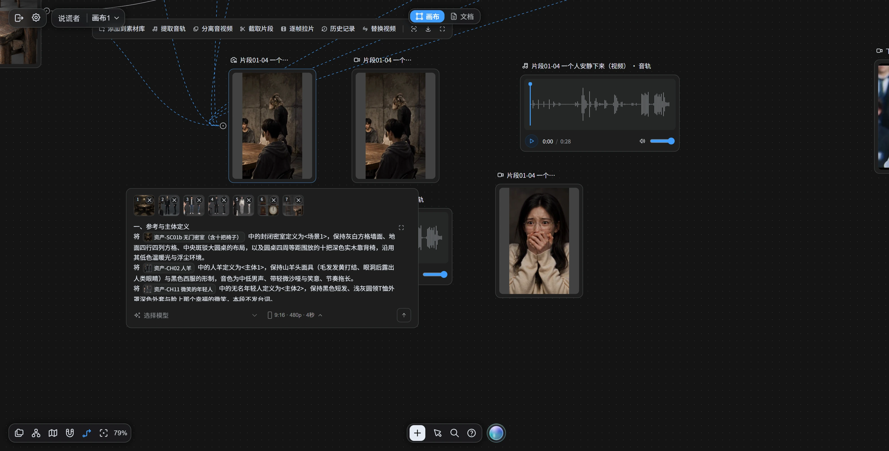

<p>
  <a href="https://github.com/HBAI-Ltd/Toonflow-app">
    
  </a>
  &nbsp;|&nbsp;
  <a href="https://gitee.com/HBAI-Ltd/Toonflow-app">
    
  </a>
  &nbsp;|&nbsp;
  <a href="https://atomgit.com/HBAI-Ltd/Toonflow-app">
    
  </a>
</p>

<p align="center">
  <strong>简体中文</strong> |
  <a href="./docs/readme/readmeZhTw.md">繁體中文</a> |
  <a href="./docs/readme/readmeEn.md">English</a> |
  <a href="./docs/readme/readmeJa.md">日本語</a> |
  <a href="./docs/readme/readmeRu.md">Русский</a> |
  <a href="./docs/readme/readmeVi.md">Tiếng Việt</a> |
  <a href="./docs/readme/readmeTh.md">ไทย</a>
  <br />
  <a href="./docs/readme/readmeKo.md">한국어</a> |
  <a href="./docs/readme/readmeHi.md">हिन्दी</a> |
  <a href="./docs/readme/readmeId.md">Bahasa Indonesia</a> |
  <a href="./docs/readme/readmeMs.md">Bahasa Melayu</a> |
  <a href="./docs/readme/readmeFil.md">Filipino</a> |
  <a href="./docs/readme/readmeBn.md">বাংলা</a> |
  <a href="./docs/readme/readmeUr.md">اردو</a>
  <br />
  <a href="./docs/readme/readmeTa.md">தமிழ்</a> |
  <a href="./docs/readme/readmeTe.md">తెలుగు</a> |
  <a href="./docs/readme/readmeMr.md">मराठी</a> |
  <a href="./docs/readme/readmePa.md">ਪੰਜਾਬੀ</a> |
  <a href="./docs/readme/readmeAr.md">العربية</a> |
  <a href="./docs/readme/readmeFa.md">فارسی</a> |
  <a href="./docs/readme/readmeTr.md">Türkçe</a>
</p>

> 🌐 **支持 22 种界面语言** · [查看支持的语言](#languages)

<div align="center">

<p align="center">
  
</p>

<h1 align="center">Toonflow｜开源 AI 短剧、漫剧与视频创作平台</h1>

<a href="https://git.io/typing-svg">
  <picture>
    <source media="(prefers-color-scheme: dark)" srcset="https://readme-typing-svg.demolab.com?font=Fira+Code&size=40&duration=3000&pause=1000&color=FFFFFF&center=true&vCenter=true&width=600&lines=Toonflow;AI%E7%9F%AD%E5%89%A7%E5%B7%A5%E5%8E%82;%E8%AE%A9%E7%81%B5%E6%84%9F%E6%88%90%E4%B8%BA%E7%9C%8B%E5%BE%97%E8%A7%81%E7%9A%84%E6%95%85%E4%BA%8B" />
    
  </picture>
</a>

<p align="center">
  <a href="https://github.com/HBAI-Ltd/Toonflow-app/stargazers">
    
  </a>
  <a href="./LICENSE">
    
  </a>
  <a href="https://github.com/HBAI-Ltd/Toonflow-app/releases">
    
  </a>
</p>
<p align="center">
  <a href="https://github.com/HBAI-Ltd/Toonflow-app/network/members">
    
  </a>
  <a href="https://atomgit.com/HBAI-Ltd/Toonflow-app">
    
  </a>
  <a href="https://discord.gg/HEjKmpNpAZ">
    
  </a>
</p>
<p align="center">
  <a href="https://github.com/HBAI-Ltd/Toonflow-app/issues">
    
  </a>
  <a href="https://github.com/HBAI-Ltd/Toonflow-app/graphs/contributors">
    
  </a>
  <a href="https://github.com/HBAI-Ltd/Toonflow-app/commits">
    
  </a>
</p>
<p align="center">
  &nbsp;
  &nbsp;
  &nbsp;
  
</p>

<p align="center">
  <a href="https://trendshift.io/repositories/24197?utm_source=trendshift-badge&amp;utm_medium=badge&amp;utm_campaign=badge-trendshift-24197#achievements" target="_blank" rel="noopener noreferrer">
    
  </a>
  <a href="https://trendshift.io/repositories/24197?utm_source=trendshift-badge&amp;utm_medium=badge&amp;utm_campaign=badge-trendshift-24197#achievements" target="_blank" rel="noopener noreferrer">
    
  </a>
  <a href="https://trendshift.io/repositories/24197?utm_source=trendshift-badge&amp;utm_medium=badge&amp;utm_campaign=badge-trendshift-24197#achievements" target="_blank" rel="noopener noreferrer">
    
  </a>
</p>
<p align="center">
  <a href="https://trendshift.io/repositories/24197?utm_source=trendshift-badge&amp;utm_medium=badge&amp;utm_campaign=badge-trendshift-24197#achievements" target="_blank" rel="noopener noreferrer">
    
  </a>
  <a href="https://trendshift.io/repositories/24197?utm_source=trendshift-badge&amp;utm_medium=badge&amp;utm_campaign=badge-trendshift-24197#achievements" target="_blank" rel="noopener noreferrer">
    
  </a>
  <a href="https://trendshift.io/repositories/24197?utm_source=trendshift-badge&amp;utm_medium=badge&amp;utm_campaign=badge-trendshift-24197#achievements" target="_blank" rel="noopener noreferrer">
    
  </a>
</p>
<p align="center">
  <a href="https://trendshift.io/repositories/24197?utm_source=trendshift-badge&amp;utm_medium=badge&amp;utm_campaign=badge-trendshift-24197#achievements" target="_blank" rel="noopener noreferrer">
    
  </a>
</p>

Toonflow 是免费开源的 AI 短剧、AI 漫剧与 AI 视频创作工具：无限画布写剧本分镜，3D 白模预演搭景排机位，按镜头生成视频，可本地部署。<br />
<sub>Open-source AI short drama &amp; comic video studio · infinite canvas · 3D previs · AI video generation</sub>

</div>

<div align="center">
  <table>
    <tr>
      <td width="50%" align="center">
        <a href="./docs/images/gStar.png">
          
        </a>
      </td>
      <td width="50%" align="center">
        <a href="./docs/images/gvp.jpg">
          
        </a>
      </td>
    </tr>
  </table>
</div>

<p align="center">
  <a href="https://github.com/HBAI-Ltd/Toonflow-app/releases">下载客户端</a> ·
  <a href="https://qcn7xdsqgc4z.feishu.cn/docx/RXFqdgR2Xo0dXZxGfd0cZCGgnwf">使用教程</a> ·
  <a href="https://api.toonflow.net/console/plugIn">插件市场</a> ·
  <a href="https://qcn7xdsqgc4z.feishu.cn/docx/KNBNd9naqolsy6xjAOCcEAkqnRd">开发者文档</a> ·
  <a href="https://api.toonflow.net/">官方模型平台</a>
</p>

<p align="center">
  📺 <a href="https://www.bilibili.com/video/BV1hbpb6xETF">产品介绍视频</a> ·
  <a href="https://www.bilibili.com/video/BV1z4sS6NEA3">白模预演演示视频</a>
</p>

<p align="center">🔥 基于 Toonflow 打造的短剧已在红果收获百万、千万到过亿播放。<a href="#works">看作品</a></p>

https://github.com/user-attachments/assets/56d81114-7521-454c-9ec9-972567eddda9

---

## 1. 💛 赞助与支持

感谢以下合作伙伴对 Toonflow 开源项目的支持。

<table>
  <tr>
    <td width="50%" valign="top">
      <a href="https://metaso.cn/minimax-h3/?s=toon"> <strong>秘塔</strong></a>
      <br />
      <sub>秘塔科技提供高性价比的 MiniMax H3 视频生成服务：768P 仅 0.09 元/秒，2K 仅 0.15 元/秒。支持原生 2K、音画同步，API 兼容 OpenAI 协议，同时支持 ComfyUI、无限画布，无需自行部署 GPU。</sub>
      <br /><br />
      <sub>🎁 通过 <a href="https://metaso.cn/minimax-h3/?s=toon">专属链接注册</a>，即可领取赠送额度及专属优惠。商务对接可加微信：metasota12</sub>
    </td>
    <td width="50%" valign="top">
      <a href="https://go.apimart.ai/gh-toonflow-app"> <strong>APIMart</strong></a>
      <br />
      <sub>感谢 APIMart 赞助了本项目！APIMart 是专注 AI 图片/视频生成的低价 API 平台，GPT-Image-2 低至 $0.006/张，1 美元可出图 160+ 张。图片、视频一套异步 API 通吃，提交任务拿 ID、回调取结果，跑批万张不超时、换模型不改代码。按量付费、无月费，通过此<a href="https://go.apimart.ai/gh-toonflow-app">注册链接</a>注册即可开用。</sub>
    </td>
  </tr>
  <tr>
    <td width="50%" valign="top">
      <a href="https://www.compshare.cn/video-studio?ytag=GPU_YY_YX_git_toonflow"> <strong>优云智算</strong></a>
      <br />
      <sub>优云智算提供高性价比 H3 视频生成服务，涵盖文生视频、首尾帧及全能参考。支持最长 30s 视频、原生 2K 画质，768P 仅 0.08 元/秒。支持 API 调用、企业高并发、自助开票。</sub>
      <br /><br />
      <sub>🎁 通过 <a href="https://www.compshare.cn/video-studio?ytag=GPU_YY_YX_git_toonflow">专属链接注册</a>，可得免费 5 元平台体验金！</sub>
    </td>
    <td width="50%" valign="top">
      <a href="https://weimeta.cn/console/invite/accept?aff=INV202611191734123p9JeY"> <strong>唯元智创（WEIMETA AI）</strong></a>
      <br />
      <sub>唯元智创提供高性价比 AI 文本、图像与视频生成服务，聚合 DeepSeek、GLM、Kimi、Seedream、Seedance、Wan、MiniMax H3 等主流模型，支持文生图、图生图、文生视频、图生视频。提供统一 API 接入，支持多模型灵活调用，满足企业级 AI 内容创作需求。平台采用企业级数据加密传输与多租户隔离技术，通过等保三级安全测评，保障企业数据安全与隐私。</sub>
      <br /><br />
      <sub>🎁 通过 <a href="https://weimeta.cn/console/invite/accept?aff=INV202611191734123p9JeY">专属链接注册</a>，即可体验 WEIMETA AI 多模态模型服务，限时充值100送15。商务对接加微信：WeiMeta_AI666</sub>
    </td>
  </tr>
</table>

<details>
<summary><strong>👉成为赞助商👈</strong></summary>

<p align="center">
  
</p>

<p align="center"><sub>此联系方式仅用于商务合作接洽，不提供问题答疑。使用问题欢迎在交流群交流，需求与 BUG 可通过反馈表提交。感谢理解。</sub></p>

</details>

---

## 2. 🌟 亮点

| 能力 | 说明 |
| --- | --- |
| 🎬 **白模预演** | 粘贴剧本，一键 3D 搭景、分镜、排走位。 |
| 🖼️ **无限画布** | 剧本、角色、场景、视频片段连线复用。 |
| 🎥 **AI 视频生成** | @ 引用资产，按镜头出片。 |
| 🤖 **AI 助手** | 直接读写画布，支持 MCP 与 A2A。 |
| 🔧 **自由接入模型** | 在线供应商、第三方 API、本地大模型、ComfyUI。 |
| 🧩 **插件市场** | 节点、工具、技能一键安装。 |
| 🏠 **本地部署** | Windows、macOS、Linux、Android、Docker。 |
| 🌐 **多语言** | 22 种界面语言。 |

**创作流程**：剧本分镜 → 角色与场景 → 白模预演 → 按镜头生成视频 → 剪辑下载。

### 常见问题

**Toonflow 是什么？** 开源的 AI 短剧、AI 漫剧与 AI 视频创作平台。

**免费吗？** MIT 开源，可免费自部署；第三方模型 API 可能收费。

**支持哪些模型？** 内置 Seedance、Seedream、MiniMax、Wan 等，也能接第三方 API、本地大模型和 ComfyUI，详见[使用教程](https://qcn7xdsqgc4z.feishu.cn/docx/RXFqdgR2Xo0dXZxGfd0cZCGgnwf)。

**支持哪些系统？** Windows、macOS、Linux、Android，以及 Docker 和服务器部署。

<a id="languages"></a>

<sub>🌐 支持的语言：简体中文、繁體中文、English、日本語、Русский、Tiếng Việt、ไทย、한국어、हिन्दी、Bahasa Indonesia、Bahasa Melayu、Filipino、বাংলা、اردو、தமிழ்、తెలుగు、मराठी、ਪੰਜਾਬੀ、العربية、فارسی、Türkçe、Português (Brasil)。</sub>

---

## 3. 📸 十大看点

<a id="trumanmap"></a>

### 看点 1｜粘贴剧本，一键 3D 预演

按台词自动分镜、排走位，监看窗实时出画面和字幕。📺 [看演示视频](https://www.bilibili.com/video/BV1z4sS6NEA3)

https://github.com/user-attachments/assets/bb2f7bfe-46de-44ff-b3b3-95379f9d4b20

<p align="center">
  <a href="./docs/images/screenshots/trumanMapTimeline.webp"></a>
</p>

<table>
  <tr>
    <td width="50%"><a href="./docs/images/screenshots/trumanMapShot.webp"></a></td>
    <td width="50%"><a href="./docs/images/screenshots/trumanMapStreet.webp"></a></td>
  </tr>
</table>

### 看点 2｜一座看不到边的江南古镇

城墙、街巷、水乡、寺庙、远山，1500 多件物体。

<p align="center">
  <a href="./docs/images/screenshots/trumanMapTown.webp"></a>
</p>

<table>
  <tr>
    <td width="50%"><a href="./docs/images/screenshots/trumanMapAerial.webp"></a></td>
    <td width="50%"><a href="./docs/images/screenshots/trumanMapTemple.webp"></a></td>
  </tr>
</table>

### 看点 3｜64 套整套景 + 8 万多件素材

<table>
  <tr>
    <td width="50%"><a href="./docs/images/screenshots/trumanMapSets.webp"></a></td>
    <td width="50%"><a href="./docs/images/screenshots/trumanMapAssets.webp"></a></td>
  </tr>
</table>

### 看点 4｜天气、时间、地形随手改

<table>
  <tr>
    <td width="50%"><a href="./docs/images/screenshots/trumanMapRain.webp"></a></td>
    <td width="50%"><a href="./docs/images/screenshots/trumanMapBrush.webp"></a></td>
  </tr>
  <tr>
    <td width="50%"><a href="./docs/images/screenshots/trumanMapWorld.webp"></a></td>
    <td width="50%"><a href="./docs/images/screenshots/trumanMapHome.webp"></a></td>
  </tr>
</table>

### 看点 5｜预演直接导出给视频生成

分镜图、四视图、白模视频、预演小样、镜头表，一键导回画布。

### 看点 6｜无限画布 + AI 助手

<table>
  <tr>
    <td width="50%"><a href="./docs/images/screenshots/canvasNodeMenu.webp"></a></td>
    <td width="50%"><a href="./docs/images/screenshots/canvasAgent.webp"></a></td>
  </tr>
</table>

### 看点 7｜多参考视频生成

<p align="center">
  <a href="./docs/images/screenshots/videoGenerationNode.webp"></a>
</p>

### 看点 8｜剧本文档与工作区

<p align="center">
  <a href="./docs/images/screenshots/canvasDocument.webp"></a>
</p>

### 看点 9｜首页与素材库

<table>
  <tr>
    <td width="50%"><a href="./docs/images/screenshots/home.webp"></a></td>
    <td width="50%"><a href="./docs/images/screenshots/assetLibrary.webp"></a></td>
  </tr>
</table>

### 看点 10｜插件市场

更多插件见[网页版插件市场](https://api.toonflow.net/console/plugIn)。

<p align="center">
  <a href="./docs/images/screenshots/pluginMarket.webp"></a>
</p>

---

## 4. 🚀 下载并安装

### 4.1 客户端安装

| 操作系统 | GitHub                                                       |
| -------- | ------------------------------------------------------------ |
| Windows x64 | [EXE 安装包](https://github.com/HBAI-Ltd/Toonflow-app/releases) |
| Windows ARM64 | [EXE 安装包](https://github.com/HBAI-Ltd/Toonflow-app/releases) |
| macOS Apple Silicon（ARM64，macOS 14 及以上） | [PKG 安装包](https://github.com/HBAI-Ltd/Toonflow-app/releases) |
| macOS Intel（x64，macOS 14 及以上） | [PKG 安装包](https://github.com/HBAI-Ltd/Toonflow-app/releases) |
| Linux x64（Debian / Ubuntu） | [DEB 安装包](https://github.com/HBAI-Ltd/Toonflow-app/releases) |
| Linux ARM64（Debian / Ubuntu） | [DEB 安装包](https://github.com/HBAI-Ltd/Toonflow-app/releases) |
| Android ARM64 | [APK 下载](https://github.com/HBAI-Ltd/Toonflow-app/releases/latest) |

- **Windows**：Intel / AMD 选 `toonflow-版本号-Setup.exe`，ARM64 选 `toonflow-版本号-win-arm64-Setup.exe`。打开闪退请手动安装 [WebView2](https://developer.microsoft.com/microsoft-edge/webview2/)。
- **macOS**：按架构选 `toonflow-版本号-macos-arm64.pkg` 或 `-macos-x64.pkg`，双击安装，安装时需联网准备运行时。旧版 Intel Mac 客户端须下载完整 PKG 覆盖安装，安装前先退出应用并备份数据目录。
- **Linux**：按架构下载 `.deb`，执行 `sudo apt install ./安装包文件名.deb`，安装需联网。
- **Android**：仅支持 ARM64，内置本地后端可独立运行，也可在首页「设备互联」连接电脑或远程后端。

<details>
<summary><strong>macOS 无法安装或打开时的处理方法</strong></summary>

**1. 在“隐私与安全性”中允许 Toonflow**

如果提示“无法验证开发者”或“Apple 无法检查 App 是否包含恶意软件”，先尝试打开 Toonflow，再前往“系统设置 → 隐私与安全性”，找到 Toonflow 被阻止的提示，点击“仍要打开”，并按提示确认。详见 [Apple 官方说明](https://support.apple.com/zh-cn/102445)。

**2. 仍因系统隔离限制无法打开时，再尝试移除隔离属性**

确认应用来自官方发布页，并已放入“应用程序”后，在终端执行以下命令，再重新打开。应用名称或安装位置不同时，请调整路径。

```bash
sudo xattr -rd com.apple.quarantine /Applications/toonflow.app
```

**3. 最后手段：临时允许任何来源的 App**

前两种方法均无效且确认应用来源可信时，可尝试在终端执行：

```bash
sudo spctl --master-disable
```

随后打开“系统设置 → 隐私与安全性”，在“安全性”中的“允许从以下位置下载的 App”选择“任何来源”（如果系统提供该选项），并按提示确认。不同 macOS 版本的选项与命令支持可能不同。

此操作会放宽所有 App 的安全限制。完成后建议将允许来源恢复为“App Store 和被认可的开发者”。

</details>

更多操作说明请查看 [使用教程](https://qcn7xdsqgc4z.feishu.cn/docx/RXFqdgR2Xo0dXZxGfd0cZCGgnwf)。

---

### 4.2 Docker 安装

先安装 Git、[Docker Engine](https://docs.docker.com/engine/install/) 和 Docker Compose；Windows / macOS 可使用 Docker Desktop 的 Linux 容器模式。仓库提供 [Dockerfile](./Dockerfile)、[Compose 配置](./compose.yaml) 和 [构建排除规则](./.dockerignore)，基于 Bun 1.4.5 构建，镜像内包含 FFmpeg。

<details>
<summary><strong>展开 Docker 安装步骤</strong></summary>

克隆源码后，在仓库根目录执行：

```sh
git clone https://github.com/HBAI-Ltd/Toonflow-app.git
cd Toonflow-app
docker compose up -d --build
```

首次构建会安装依赖并编译内置节点、工具、Web 与 Server。启动后访问 `http://127.0.0.1:3000`；远程主机可按下方“访问与数据说明”通过 SSH 隧道访问。首次启动会初始化内置插件，并提供 `myProject` 工作目录。

配置、插件和项目文件保存在 Docker 命名卷 `toonflowData` 中，挂载至容器的 `/app/data/`。卷的实际名称带有 Compose 项目前缀；停止或重建容器会保留数据，**请勿使用 `docker compose down -v`，该命令会删除数据卷**。

```sh
docker compose logs -f toonflow  # 查看日志
docker compose stop             # 停止服务
docker compose start            # 再次启动
docker compose down             # 删除容器，保留数据卷
```

需要增加项目目录时，可在页面的“选择服务器工作目录”弹窗中点击“新建文件夹”。弹窗也支持文件和文件夹的重命名、删除。也可在服务运行期间通过命令行创建：

```sh
docker compose exec toonflow mkdir -p /app/data/workspaces/newProject
```

备份时先停止服务，复制完成后再启动：

```sh
docker compose stop
docker compose cp toonflow:/app/data ./toonflowBackup
docker compose start
```

</details>

---

### 4.3 服务器安装

适用于直接在 Linux 服务器上运行 Web 与 Server。以下以 Ubuntu / Debian 为例，使用项目指定的 [Bun 1.4.5](https://bun.sh/docs/installation)。

<details>
<summary><strong>展开服务器安装步骤</strong></summary>

安装运行环境：

```sh
sudo apt-get update
sudo apt-get install -y git curl unzip ffmpeg
curl -fsSL https://bun.com/install | bash -s "bun-v1.4.5"
export PATH="$HOME/.bun/bin:$PATH"
bun --version
```

克隆源码并启动：

```sh
git clone https://github.com/HBAI-Ltd/Toonflow-app.git
cd Toonflow-app
bun install --frozen-lockfile

# 构建内置节点、工具、Web 与 Server
bun run build:server
mkdir -p data/workspaces/myProject
bun run start:server
```

看到“服务启动成功”后，可在服务器本机访问 `http://127.0.0.1:3000`。上述命令以前台方式运行，按 `Ctrl+C` 停止；需要开机自启和进程托管时，可参考 [Bun 的 systemd 部署指南](https://bun.sh/guides/ecosystem/systemd)，将工作目录设为仓库目录，启动命令设为 Bun 的绝对路径加 `run start:server`，使用有权读写该目录的用户运行。

</details>

---

### 4.4 访问与数据说明

- 当前服务使用固定端口 `3000`，业务页面与 API 没有独立登录鉴权。服务器安装时，请通过防火墙或安全组限制 `3000` 端口的访问来源；公网访问需配置带认证的反向代理。
- 个人远程使用可在自己的电脑上执行 `ssh -N -L 3000:127.0.0.1:3000 用户名@服务器地址`，保持连接后打开 `http://127.0.0.1:3000`，无需将服务器的 `3000` 端口向公网开放。
- 直接安装时，配置、插件与工作区默认保存在仓库的 `data/`；Docker 安装则保存在数据卷内的 `/app/data/`。迁移或备份时请完整保留。进入页面后选择服务器工作区内的 `myProject`，更多项目可在对应的 `workspaces/` 下创建子目录。
- 两种安装方式均包含系统 FFmpeg。模型服务的 API Key 仍需在页面内配置。

---

### 4.5 云平台部署

合作平台 [智星云](https://www.ai-galaxy.com/) 提供官方授权的 Toonflow 商用镜像，可直接使用预装环境。具体步骤见 [镜像部署图文教程](https://mp.weixin.qq.com/s/lq9X1ovQ1_TKeXMOLgicKg?scene=1)。

---

## 5. 🎬 作品示例

<a id="works"></a>

### 红果热播作品

🔥 基于 Toonflow 打造的短剧已在红果收获百万、千万到过亿播放。

<p align="center">
  
</p>

<p align="center">
  
</p>

### 广告片

<table>
  <tr>
    <td width="50%"><video src="https://github.com/user-attachments/assets/fccf8b46-b8ec-46cb-9574-9273cd1ee9e4" controls width="100%"></video></td>
    <td width="50%"><video src="https://github.com/user-attachments/assets/b345905e-601f-43be-83a5-305f97a29e44" controls width="100%"></video></td>
  </tr>
  <tr>
    <td width="50%"><video src="https://github.com/user-attachments/assets/fc5880aa-6b9c-4717-af0e-e51f15c4fdc6" controls width="100%"></video></td>
    <td width="50%"><video src="https://github.com/user-attachments/assets/0816e794-f07d-4bc3-89cd-69c67566c3a6" controls width="100%"></video></td>
  </tr>
</table>

### 短剧案例

https://github.com/user-attachments/assets/2d9fddac-dfdf-4640-b030-b09d7f7287e9

演示视频为压缩后的 480p 版本。

---

## 6. 👨‍👩‍👧‍👦 微信交流群

拉群小助手:


也可以点击图标加入 Discord：

[](https://discord.gg/HEjKmpNpAZ)

或点击邀请链接：[https://discord.gg/HEjKmpNpAZ](https://discord.gg/HEjKmpNpAZ)

---

## 7. 💌 联系我们

📧 邮箱：[ltlctools@outlook.com](mailto:ltlctools@outlook.com?subject=Toonflow咨询)

---

## 8. 📜 开源许可

Toonflow 采用 [MIT 许可证](./LICENSE)。第三方依赖和素材遵循各自的许可与版权声明。

[](https://www.star-history.com/#HBAI-Ltd/Toonflow-app&Date)

> **不追溯条款**：v1.0.8 发布前基于 AGPL-3.0 使用的用户，继续按 AGPL-3.0 执行，v1.0.8 ~ v1.1.8 继续按 Apache-2.0 与附加协议执行，不受本协议变更约束。

---

## 9. 🙏 致谢

- **合作伙伴**：算能云、腾讯混元 3D、智星云。
- **项目贡献者**：感谢参与代码开发、文档完善、插件分享和问题排查的所有贡献者。
- **社区用户**：感谢持续提供反馈、分享创作成果并支持项目发展的所有用户。

仰起脸笑的像满月：贡献 Codex 20x 开发算力。
西安中星数字智能科技有限公司：贡献苹果证书签名。

<p align="center"><sub>Free code signing provided by <a href="https://signpath.io/">SignPath.io</a>, certificate by <a href="https://signpath.org/">SignPath Foundation</a>.</sub></p>

<div align="center">

Copyright © 2026 北京爱阿科技有限公司

</div>


