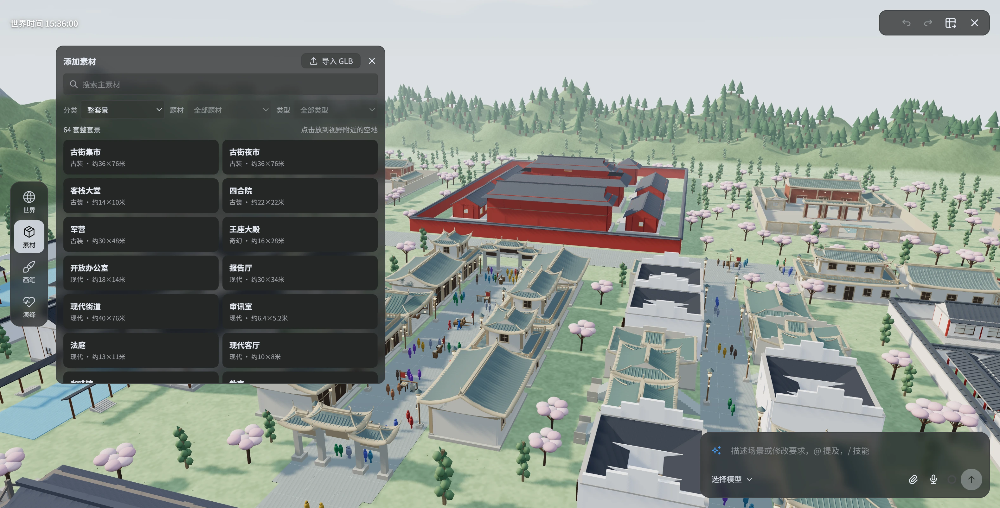

<p>
  <a href="https://github.com/HBAI-Ltd/Toonflow-app">
    
  </a>
  &nbsp;|&nbsp;
  <a href="https://gitee.com/HBAI-Ltd/Toonflow-app">
    
  </a>
  &nbsp;|&nbsp;
  <a href="https://atomgit.com/HBAI-Ltd/Toonflow-app">
    
  </a>
</p>

<p align="center">
  <a href="../../README.md">简体中文</a> |
  <a href="./readmeZhTw.md">繁體中文</a> |
  <a href="./readmeEn.md">English</a> |
  <a href="./readmeJa.md">日本語</a> |
  <a href="./readmeRu.md">Русский</a> |
  <a href="./readmeVi.md">Tiếng Việt</a> |
  <a href="./readmeTh.md">ไทย</a>
  <br />
  <a href="./readmeKo.md">한국어</a> |
  <a href="./readmeHi.md">हिन्दी</a> |
  <a href="./readmeId.md">Bahasa Indonesia</a> |
  <a href="./readmeMs.md">Bahasa Melayu</a> |
  <a href="./readmeFil.md">Filipino</a> |
  <a href="./readmeBn.md">বাংলা</a> |
  <a href="./readmeUr.md">اردو</a>
  <br />
  <a href="./readmeTa.md">தமிழ்</a> |
  <a href="./readmeTe.md">తెలుగు</a> |
  <a href="./readmeMr.md">मराठी</a> |
  <a href="./readmePa.md">ਪੰਜਾਬੀ</a> |
  <strong>العربية</strong> |
  <a href="./readmeFa.md">فارسی</a> |
  <a href="./readmeTr.md">Türkçe</a>
</p>

> 🌐 **واجهة تدعم 22 لغة** · [عرض اللغات المدعومة](#languages)

<div align="center">

<p align="center">
  
</p>

<a href="https://git.io/typing-svg">
  <picture>
    <source media="(prefers-color-scheme: dark)" srcset="https://readme-typing-svg.demolab.com?font=Fira+Code&size=40&duration=3000&pause=1000&color=FFFFFF&center=true&vCenter=true&width=600&lines=Toonflow;AI%20Short%20Drama%20Studio;Turn%20ideas%20into%20stories" />
    
  </picture>
</a>

<p align="center">
  <a href="https://github.com/HBAI-Ltd/Toonflow-app/stargazers">
    
  </a>
  <a href="../../LICENSE">
    
  </a>
  <a href="https://github.com/HBAI-Ltd/Toonflow-app/releases">
    
  </a>
</p>
<p align="center">
  <a href="https://github.com/HBAI-Ltd/Toonflow-app/network/members">
    
  </a>
  <a href="https://atomgit.com/HBAI-Ltd/Toonflow-app">
    
  </a>
  <a href="https://discord.gg/HEjKmpNpAZ">
    
  </a>
</p>
<p align="center">
  <a href="https://github.com/HBAI-Ltd/Toonflow-app/issues">
    
  </a>
  <a href="https://github.com/HBAI-Ltd/Toonflow-app/graphs/contributors">
    
  </a>
  <a href="https://github.com/HBAI-Ltd/Toonflow-app/commits">
    
  </a>
</p>
<p align="center">
  &nbsp;
  &nbsp;
  &nbsp;
  
</p>

<p align="center">
  <a href="https://trendshift.io/repositories/24197?utm_source=trendshift-badge&amp;utm_medium=badge&amp;utm_campaign=badge-trendshift-24197#achievements" target="_blank" rel="noopener noreferrer">
    
  </a>
  <a href="https://trendshift.io/repositories/24197?utm_source=trendshift-badge&amp;utm_medium=badge&amp;utm_campaign=badge-trendshift-24197#achievements" target="_blank" rel="noopener noreferrer">
    
  </a>
  <a href="https://trendshift.io/repositories/24197?utm_source=trendshift-badge&amp;utm_medium=badge&amp;utm_campaign=badge-trendshift-24197#achievements" target="_blank" rel="noopener noreferrer">
    
  </a>
</p>
<p align="center">
  <a href="https://trendshift.io/repositories/24197?utm_source=trendshift-badge&amp;utm_medium=badge&amp;utm_campaign=badge-trendshift-24197#achievements" target="_blank" rel="noopener noreferrer">
    
  </a>
  <a href="https://trendshift.io/repositories/24197?utm_source=trendshift-badge&amp;utm_medium=badge&amp;utm_campaign=badge-trendshift-24197#achievements" target="_blank" rel="noopener noreferrer">
    
  </a>
  <a href="https://trendshift.io/repositories/24197?utm_source=trendshift-badge&amp;utm_medium=badge&amp;utm_campaign=badge-trendshift-24197#achievements" target="_blank" rel="noopener noreferrer">
    
  </a>
</p>
<p align="center">
  <a href="https://trendshift.io/repositories/24197?utm_source=trendshift-badge&amp;utm_medium=badge&amp;utm_campaign=badge-trendshift-24197#achievements" target="_blank" rel="noopener noreferrer">
    
  </a>
</p>

**منصة ذكاء اصطناعي مفتوحة المصدر لإنشاء الأعمال الدرامية القصيرة والقصص المصورة المتحركة والفيديو**

> 🚀 **إنشاء الأعمال الدرامية القصيرة في مكان واحد**: اكتب السيناريوهات، وأدر الأصول، وأنشئ الصور ومقاطع الفيديو، ونظّم سير عملك الإبداعي بالكامل على لوحة لا نهائية.

</div>

<div align="center">
  <table>
    <tr>
      <td width="50%" align="center">
        <a href="../images/gStar.png">
          
        </a>
      </td>
      <td width="50%" align="center">
        <a href="../images/gvp.jpg">
          
        </a>
      </td>
    </tr>
  </table>
</div>

<p align="center">
  <a href="https://github.com/HBAI-Ltd/Toonflow-app/releases">تنزيل</a> ·
  <a href="https://qcn7xdsqgc4z.feishu.cn/docx/RXFqdgR2Xo0dXZxGfd0cZCGgnwf">دليل المستخدم</a> ·
  <a href="https://api.toonflow.net/console/plugIn">سوق الإضافات</a> ·
  <a href="https://qcn7xdsqgc4z.feishu.cn/docx/KNBNd9naqolsy6xjAOCcEAkqnRd">وثائق المطورين</a> ·
  <a href="https://api.toonflow.net/">المنصة الرسمية للنماذج</a>
</p>

<p align="center">
  📺 <a href="https://www.bilibili.com/video/BV1hbpb6xETF">فيديو تعريفي بالمنتج</a> ·
  <a href="https://www.bilibili.com/video/BV1z4sS6NEA3">عرض المعاينة TrumanMap</a>
</p>

<p align="center">🔥 حققت المسلسلات القصيرة المبنية على Toonflow ملايين وعشرات الملايين وأكثر من 100 مليون مشاهدة على Hongguo. <a href="#works">شاهد الأعمال</a></p>

https://github.com/user-attachments/assets/56d81114-7521-454c-9ec9-972567eddda9

---

## 1. 💛 الرعاة والدعم

نشكر الشركاء التاليين على دعم مشروع Toonflow مفتوح المصدر.

<table>
  <tr>
    <td width="50%" valign="top">
      <a href="https://metaso.cn/minimax-h3/?s=toon"> <strong>Metaso</strong></a>
      <br />
      <sub>إنشاء فيديو باستخدام MiniMax H3 بتكلفة مناسبة: فقط ¥0.09 للثانية بدقة 768P و¥0.15 للثانية بدقة 2K، باليوان الصيني (CNY). يدعم دقة 2K الأصلية، ومزامنة الصوت والفيديو، وواجهة API متوافقة مع OpenAI، وComfyUI، واللوحات اللانهائية، دون الحاجة إلى تشغيل وحدة GPU خاصة بك. <a href="https://metaso.cn/minimax-h3/?s=toon">سجّل عبر هذا الرابط المخصص</a> للحصول على أرصدة إضافية وعروض حصرية. للاستفسارات التجارية، تواصل مع metasota12 على WeChat.</sub>
    </td>
    <td width="50%" valign="top">
      <a href="https://go.apimart.ai/gh-toonflow-app"> <strong>APIMart</strong></a>
      <br />
      <sub>نشكر APIMart على رعاية هذا المشروع! APIMart منصة API اقتصادية لإنشاء الصور والفيديو بالذكاء الاصطناعي. تبدأ تكلفة GPT-Image-2 من $0.006 للصورة، أي أكثر من 160 صورة مقابل $1. تستخدم الصور والفيديو واجهة API واحدة غير متزامنة: أرسل المهمة، واحصل على معرّفها، وتلقّ النتائج عبر استدعاء راجع. عالج دفعات من 10,000 صورة دون انتهاء مهلة الطلبات، وبدّل النماذج دون تعديل الشيفرة. ادفع حسب الاستخدام دون رسوم شهرية. <a href="https://go.apimart.ai/gh-toonflow-app">سجّل هنا</a> للبدء.</sub>
    </td>
  </tr>
  <tr>
    <td width="50%" valign="top">
      <a href="https://www.compshare.cn/video-studio?ytag=GPU_YY_YX_git_toonflow"> <strong>CompShare</strong></a>
      <br />
      <sub>تقدم CompShare إنشاء فيديو باستخدام H3 بتكلفة مناسبة، مع تحويل النص إلى فيديو، والتحكم في الإطارين الأول والأخير، وأوضاع مرجعية شاملة. أنشئ مقاطع تصل مدتها إلى 30 ثانية بدقة 2K الأصلية، مع سعر لا يتجاوز CNY 0.08 للثانية بدقة 768P. تدعم الوصول عبر API، ومعالجة عدد كبير من الطلبات المتزامنة للشركات، وإصدار الفواتير ذاتيًا.</sub>
      <br /><br />
      <sub>🎁 <a href="https://www.compshare.cn/video-studio?ytag=GPU_YY_YX_git_toonflow">سجّل عبر هذا الرابط المخصص</a> للحصول على رصيد تجريبي مجاني للمنصة بقيمة CNY 5!</sub>
    </td>
    <td width="50%" valign="top">
      <a href="https://weimeta.cn/console/invite/accept?aff=INV202611191734123p9JeY"> <strong>WEIMETA AI</strong></a>
      <br />
      <sub>تقدّم WEIMETA AI خدمات توليد النصوص والصور والفيديو بالذكاء الاصطناعي بتكلفة مناسبة، وتجمع نماذج رائدة مثل DeepSeek وGLM وKimi وSeedream وSeedance وWan وMiniMax H3. تدعم تحويل النص إلى صورة والصورة إلى صورة والنص إلى فيديو والصورة إلى فيديو عبر واجهة API موحّدة تتيح استخدام نماذج متعددة بمرونة لإنتاج المحتوى في المؤسسات. تعتمد المنصة تشفير نقل البيانات على مستوى المؤسسات وعزل المستأجرين، وقد اجتازت تقييم الأمان الصيني من المستوى الثالث.</sub>
      <br /><br />
      <sub>🎁 <a href="https://weimeta.cn/console/invite/accept?aff=INV202611191734123p9JeY">سجّل عبر هذا الرابط المخصص</a> لتجربة خدمات النماذج متعددة الوسائط من WEIMETA AI. عرض لفترة محدودة: اشحن CNY 100 واحصل على CNY 15 إضافية. للتعاون التجاري عبر WeChat: WeiMeta_AI666</sub>
    </td>
  </tr>
</table>

<details>
<summary><strong>👉 كن راعيًا 👈</strong></summary>

<p align="center">
  
</p>

<p align="center"><sub>وسيلة الاتصال هذه مخصصة للاستفسارات التجارية فقط، ولا تقدم دعمًا تقنيًا. لأسئلة الاستخدام، يرجى الانضمام إلى مجموعات المجتمع. أرسل طلبات الميزات وبلاغات الأخطاء عبر نموذج الملاحظات. شكرًا لتفهمك.</sub></p>

</details>

---

## 2. 🌟 أبرز المزايا

| الميزة | الوصف |
| --- | --- |
| 🎬 **المعاينة المسبقة TrumanMap** | الصق السيناريو لتبني ديكورًا ثلاثي الأبعاد ولوحة قصة وحركة الممثلين بنقرة. |
| 🖼️ **لوحة لا نهائية** | السيناريو والشخصيات والمشاهد والمقاطع مترابطة في لوحة واحدة. |
| 🎥 **توليد الفيديو بالذكاء الاصطناعي** | أشر إلى الأصول بـ @ وولّد لقطة لقطة. |
| 🤖 **مساعد ذكي** | يقرأ اللوحة ويعدّلها؛ يدعم MCP وA2A. |
| 🔧 **أي نموذج تريده** | مزوّدون مدمجون وواجهات API خارجية ونماذج محلية وComfyUI. |
| 🧩 **سوق الإضافات** | عُقد وأدوات ومهارات بنقرة واحدة. |
| 🏠 **نشر محلي** | Windows وmacOS وLinux وAndroid وDocker. |
| 🌐 **متعدد اللغات** | 22 لغة للواجهة. |

**سير العمل**: السيناريو ولوحة القصة ← الشخصيات والمشاهد ← معاينة ثلاثية الأبعاد ← فيديو لقطة لقطة ← مونتاج وتنزيل.

### الأسئلة الشائعة

**ما هو Toonflow؟** منصة مفتوحة المصدر لإنتاج الدراما القصيرة والقصص المصوّرة والفيديو بالذكاء الاصطناعي.

**هل هو مجاني؟** مرخّص بـ MIT ومجاني للاستضافة الذاتية؛ قد تكون واجهات النماذج الخارجية مدفوعة.

**ما النماذج المدعومة؟** Seedance وSeedream وMiniMax وWan وغيرها مدمجة، ويمكن ربط واجهات API خارجية ونماذج محلية وComfyUI. راجع [دليل الاستخدام](https://qcn7xdsqgc4z.feishu.cn/docx/RXFqdgR2Xo0dXZxGfd0cZCGgnwf).

**ما الأنظمة المدعومة؟** Windows وmacOS وLinux وAndroid، إضافة إلى Docker والخوادم.

<a id="languages"></a>

### دعم لغات متعددة

اللغات المدعومة: 简体中文، 繁體中文، English، 日本語، Русский، Tiếng Việt، ไทย، 한국어، हिन्दी، Bahasa Indonesia، Bahasa Melayu، Filipino، বাংলা، اردو، தமிழ்، తెలుగు، मराठी، ਪੰਜਾਬੀ، العربية، فارسی، Türkçe، Português (Brasil).

---

## 3. 📸 أبرز 10 مزايا

<a id="trumanmap"></a>

### الميزة 1 | الصق السيناريو واحصل على معاينة ثلاثية الأبعاد

تقطيع اللقطات وحركة الممثلين تلقائيًا وفق الحوار، مع عرض الصورة والترجمة مباشرة في شاشة المراقبة. 📺 [شاهد العرض](https://www.bilibili.com/video/BV1z4sS6NEA3)

https://github.com/user-attachments/assets/bb2f7bfe-46de-44ff-b3b3-95379f9d4b20

<p align="center">
  <a href="../images/screenshots/trumanMapTimeline.webp"></a>
</p>

<table>
  <tr>
    <td width="50%"><a href="../images/screenshots/trumanMapShot.webp"></a></td>
    <td width="50%"><a href="../images/screenshots/trumanMapStreet.webp"></a></td>
  </tr>
</table>

### الميزة 2 | بلدة مائية في جيانغنان بلا حدود

أسوار وشوارع وقنوات ومعابد وجبال: أكثر من 1,500 عنصر.

<p align="center">
  <a href="../images/screenshots/trumanMapTown.webp"></a>
</p>

<table>
  <tr>
    <td width="50%"><a href="../images/screenshots/trumanMapAerial.webp"></a></td>
    <td width="50%"><a href="../images/screenshots/trumanMapTemple.webp"></a></td>
  </tr>
</table>

### الميزة 3 | 64 ديكورًا جاهزًا + أكثر من 80,000 أصل

<table>
  <tr>
    <td width="50%"><a href="../images/screenshots/trumanMapSets.webp"></a></td>
    <td width="50%"><a href="../images/screenshots/trumanMapAssets.webp"></a></td>
  </tr>
</table>

### الميزة 4 | الطقس والوقت والتضاريس بنقرة

<table>
  <tr>
    <td width="50%"><a href="../images/screenshots/trumanMapRain.webp"></a></td>
    <td width="50%"><a href="../images/screenshots/trumanMapBrush.webp"></a></td>
  </tr>
  <tr>
    <td width="50%"><a href="../images/screenshots/trumanMapWorld.webp"></a></td>
    <td width="50%"><a href="../images/screenshots/trumanMapHome.webp"></a></td>
  </tr>
</table>

### الميزة 5 | صدّر المعاينة مباشرة لتوليد الفيديو

لوحات القصة والمساقط الأربعة وفيديو المعاينة والمسودات وقوائم اللقطات تعود إلى اللوحة بنقرة.

### الميزة 6 | لوحة لا نهائية + مساعد ذكي

<table>
  <tr>
    <td width="50%"><a href="../images/screenshots/canvasNodeMenu.webp"></a></td>
    <td width="50%"><a href="../images/screenshots/canvasAgent.webp"></a></td>
  </tr>
</table>

### الميزة 7 | توليد فيديو بمراجع متعددة

<p align="center">
  <a href="../images/screenshots/videoGenerationNode.webp"></a>
</p>

### الميزة 8 | مستندات السيناريو ومساحة العمل

<p align="center">
  <a href="../images/screenshots/canvasDocument.webp"></a>
</p>

### الميزة 9 | الصفحة الرئيسية ومكتبة الأصول

<table>
  <tr>
    <td width="50%"><a href="../images/screenshots/home.webp"></a></td>
    <td width="50%"><a href="../images/screenshots/assetLibrary.webp"></a></td>
  </tr>
</table>

### الميزة 10 | سوق الإضافات

المزيد من الإضافات في [سوق الإضافات على الويب](https://api.toonflow.net/console/plugIn).

<p align="center">
  <a href="../images/screenshots/pluginMarket.webp"></a>
</p>

---

## 4. 🚀 التنزيل والتثبيت

### 4.1 تثبيت التطبيق

| نظام التشغيل | GitHub |
| --- | --- |
| Windows | [الإصدارات](https://github.com/HBAI-Ltd/Toonflow-app/releases) |
| macOS | [الإصدارات](https://github.com/HBAI-Ltd/Toonflow-app/releases) |
| Android ARM64 | [تنزيل APK](https://github.com/HBAI-Ltd/Toonflow-app/releases/latest) |

يدعم تطبيق Android أجهزة ARM64 فقط. نزّل ملف `toonflow-VERSION-android-arm64.apk` من صفحة الإصدار وثبّته. يتضمن التطبيق خادم Bun محليًا ويمكنه العمل بشكل مستقل، أو يمكنك استخدام «ربط الأجهزة» في الصفحة الرئيسية لمسح رمز QR أو الاتصال يدويًا بجهاز كمبيوتر أو خادم يتيح مشاركة الاتصال عبر الشبكة المحلية أو الإنترنت.

يكتشف مُثبّت Windows وجود WebView2 ويثبّته تلقائيًا. إذا أُغلق التطبيق فورًا بعد التثبيت، فنزّل بيئة التشغيل وثبّتها يدويًا من [صفحة تنزيل WebView2](https://developer.microsoft.com/microsoft-edge/webview2/).

على macOS ‏(Apple Silicon)، اسحب Toonflow إلى مجلد التطبيقات وافتحه مباشرة. لا تحتاج إلى تنفيذ أوامر في الطرفية مسبقًا. إذا عرض macOS تحذيرًا أمنيًا، فاتبع الخطوات التالية بالترتيب.

<details>
<summary><strong>إذا تعذر تثبيت Toonflow أو فتحه على macOS</strong></summary>

**1. السماح بتشغيل Toonflow من إعدادات الخصوصية والأمان**

إذا ظهر تحذير يفيد بتعذر التحقق من المطور أو بأن Apple لا تستطيع فحص التطبيق بحثًا عن برامج ضارة، فحاول أولًا فتح Toonflow. ثم انتقل إلى إعدادات النظام ← الخصوصية والأمان، وابحث عن الرسالة التي تفيد بحظر Toonflow، وانقر على «فتح على أي حال»، وأكّد عند الطلب. راجع [تعليمات Apple الرسمية](https://support.apple.com/zh-cn/102445).

**2. إذا استمرت قيود العزل في منع الفتح، فجرّب إزالة سمة العزل**

بعد التأكد من تنزيل التطبيق من صفحة الإصدارات الرسمية ووجوده في مجلد التطبيقات، نفّذ الأمر التالي في الطرفية وحاول فتحه مجددًا. عدّل المسار إذا اختلف اسم التطبيق أو موضع تثبيته.

```bash
sudo xattr -rd com.apple.quarantine /Applications/toonflow.app
```

**3. حل أخير: السماح مؤقتًا بتشغيل التطبيقات من أي مكان**

إذا لم تنجح الطريقتان السابقتان وكنت تثق بمصدر التطبيق، فجرّب تنفيذ:

```bash
sudo spctl --master-disable
```

ثم افتح إعدادات النظام ← الخصوصية والأمان. ضمن قسم الأمان، اضبط «السماح بالتطبيقات التي تم تنزيلها من» على «أي مكان» إذا كان النظام يتيح هذا الخيار، وأكّد عند الطلب. قد تختلف الخيارات المتاحة ودعم الأوامر بين إصدارات macOS.

يخفف هذا الإجراء القيود الأمنية على جميع التطبيقات. نوصي بعد الانتهاء بإعادة الإعداد إلى «App Store والمطورون المعتمدون».

</details>

لمزيد من التعليمات، راجع [دليل المستخدم](https://qcn7xdsqgc4z.feishu.cn/docx/RXFqdgR2Xo0dXZxGfd0cZCGgnwf).

---

### 4.2 التثبيت باستخدام Docker

ثبّت أولًا Git و[Docker Engine](https://docs.docker.com/engine/install/) وDocker Compose. على Windows وmacOS، يمكنك استخدام Docker Desktop في وضع حاويات Linux. يتضمن المستودع [Dockerfile](../../Dockerfile) و[إعدادات Compose](../../compose.yaml) و[استثناءات البناء](../../.dockerignore). تُبنى الصورة باستخدام Bun 1.4.5 وتتضمن FFmpeg.

<details>
<summary><strong>عرض خطوات التثبيت باستخدام Docker</strong></summary>

استنسخ الشيفرة المصدرية، ثم نفّذ ما يلي في المجلد الجذر للمستودع:

```sh
git clone https://github.com/HBAI-Ltd/Toonflow-app.git
cd Toonflow-app
docker compose up -d --build
```

يثبّت البناء الأول الاعتماديات ويبني العقد والأدوات وWeb وServer المرفقة. بعد بدء التشغيل، افتح `http://127.0.0.1:3000`. للخادم البعيد، استخدم نفق SSH كما هو موضح أدناه في «الوصول والبيانات». يهيئ التشغيل الأول الإضافات المرفقة ويوفر مجلد العمل `myProject`.

تُخزّن الإعدادات والإضافات وملفات المشروعات في وحدة تخزين Docker المسماة `toonflowData`، والمربوطة داخل الحاوية بالمسار `/app/data/`. يتضمن الاسم الفعلي لوحدة التخزين بادئة مشروع Compose. تبقى بياناتك محفوظة عند إيقاف الحاوية أو إعادة بنائها. **لا تستخدم `docker compose down -v`؛ فهذا الأمر يحذف وحدة تخزين البيانات.**

```sh
docker compose logs -f toonflow  # View logs
docker compose stop             # Stop the service
docker compose start            # Start it again
docker compose down             # Remove containers, retaining the data volume
```

لإضافة مجلد مشروع، انقر على «مجلد جديد» في نافذة «اختيار مجلد العمل على الخادم». تدعم النافذة أيضًا إعادة تسمية الملفات والمجلدات وحذفها. ويمكنك بدلًا من ذلك إنشاء مجلد من سطر الأوامر أثناء تشغيل الخدمة:

```sh
docker compose exec toonflow mkdir -p /app/data/workspaces/newProject
```

لإنشاء نسخة احتياطية، أوقف الخدمة أولًا، ثم انسخ البيانات وأعد تشغيلها:

```sh
docker compose stop
docker compose cp toonflow:/app/data ./toonflowBackup
docker compose start
```

</details>

---

### 4.3 التثبيت على الخادم

استخدم هذا الخيار لتشغيل Web وServer مباشرة على خادم Linux. يستخدم المثال التالي Ubuntu / Debian وإصدار المشروع المحدد، [Bun 1.4.5](https://bun.sh/docs/installation).

<details>
<summary><strong>عرض خطوات التثبيت على الخادم</strong></summary>

ثبّت بيئة التشغيل:

```sh
sudo apt-get update
sudo apt-get install -y git curl unzip ffmpeg
curl -fsSL https://bun.com/install | bash -s "bun-v1.4.5"
export PATH="$HOME/.bun/bin:$PATH"
bun --version
```

استنسخ الشيفرة المصدرية وابدأ تشغيل الخدمة:

```sh
git clone https://github.com/HBAI-Ltd/Toonflow-app.git
cd Toonflow-app
bun install --frozen-lockfile

# Build bundled nodes, tools, Web, and Server
bun run build:server
mkdir -p data/workspaces/myProject
bun run start:server
```

عند ظهور «服务启动成功» (بدأ تشغيل الخدمة بنجاح)، افتح `http://127.0.0.1:3000` على الخادم نفسه. يعمل الأمر أعلاه في المقدمة؛ اضغط `Ctrl+C` لإيقافه. للتشغيل عند إقلاع النظام وإدارة العملية، راجع [دليل نشر Bun باستخدام systemd](https://bun.sh/guides/ecosystem/systemd). اجعل مجلد المستودع هو مجلد العمل، واضبط أمر البدء على المسار المطلق لـBun متبوعًا بـ`run start:server`. شغّله بحساب مستخدم لديه صلاحية القراءة والكتابة في ذلك المجلد.

</details>

---

### 4.4 الوصول والبيانات

- تستخدم الخدمة حاليًا المنفذ الثابت `3000`. لا توجد مصادقة مستقلة لتسجيل الدخول إلى واجهة الويب وAPI. عند التثبيت على خادم، قيّد الوصول إلى المنفذ `3000` باستخدام جدار حماية أو مجموعة أمان. يتطلب إتاحة الوصول العام وكيلًا عكسيًا مزودًا بالمصادقة.
- للوصول الشخصي عن بُعد، نفّذ `ssh -N -L 3000:127.0.0.1:3000 username@server-address` على جهازك. أبقِ الاتصال مفتوحًا، ثم انتقل إلى `http://127.0.0.1:3000`. لا حاجة إلى إتاحة منفذ الخادم `3000` على الإنترنت العام.
- في التثبيت المباشر، تُخزّن الإعدادات والإضافات ومساحات العمل افتراضيًا في مجلد `data/` داخل المستودع. مع Docker، تُخزّن في `/app/data/` داخل وحدة تخزين البيانات. احتفظ بالمجلد كاملًا عند النقل أو النسخ الاحتياطي. بعد فتح الصفحة، اختر `myProject` في مساحة العمل على الخادم. أنشئ مجلدات فرعية تحت مجلد `workspaces/` المناسب للمشروعات الإضافية.
- تتضمن طريقتا التثبيت FFmpeg على مستوى النظام. لا يزال عليك إعداد مفاتيح API لخدمات النماذج من الواجهة.

---

### 4.5 النشر السحابي

يوفر شريكنا [AI Galaxy (智星云)](https://www.ai-galaxy.com/) صورة تجارية لـToonflow معتمدة رسميًا، ببيئة جاهزة للاستخدام. للتعليمات، راجع [دليل نشر الصورة بالشرح المصوّر](https://mp.weixin.qq.com/s/lq9X1ovQ1_TKeXMOLgicKg?scene=1).

---

## 5. 🎬 نموذج من الأعمال

<a id="works"></a>

### أعمال ناجحة على Hongguo

🔥 حققت المسلسلات القصيرة المبنية على Toonflow ملايين وعشرات الملايين وأكثر من 100 مليون مشاهدة على Hongguo.

<p align="center">
  
</p>

<p align="center">
  
</p>

### فيديوهات إعلانية

<table>
  <tr>
    <td width="50%"><video src="https://github.com/user-attachments/assets/fccf8b46-b8ec-46cb-9574-9273cd1ee9e4" controls width="100%"></video></td>
    <td width="50%"><video src="https://github.com/user-attachments/assets/b345905e-601f-43be-83a5-305f97a29e44" controls width="100%"></video></td>
  </tr>
  <tr>
    <td width="50%"><video src="https://github.com/user-attachments/assets/fc5880aa-6b9c-4717-af0e-e51f15c4fdc6" controls width="100%"></video></td>
    <td width="50%"><video src="https://github.com/user-attachments/assets/0816e794-f07d-4bc3-89cd-69c67566c3a6" controls width="100%"></video></td>
  </tr>
</table>

### مثال مسلسل قصير

https://github.com/user-attachments/assets/2d9fddac-dfdf-4640-b030-b09d7f7287e9

الفيديو التوضيحي نسخة مضغوطة بدقة 480p.

---

## 6. 👨‍👩‍👧‍👦 مجتمع WeChat

امسح رمز QR للتواصل مع مساعد الدعوة إلى المجموعة:


يمكنك أيضًا النقر على الأيقونة للانضمام إلى Discord:

[](https://discord.gg/HEjKmpNpAZ)

أو استخدم رابط الدعوة: [https://discord.gg/HEjKmpNpAZ](https://discord.gg/HEjKmpNpAZ)

---

## 7. 💌 تواصل معنا

📧 البريد الإلكتروني: [ltlctools@outlook.com](mailto:ltlctools@outlook.com?subject=Toonflow咨询)

---

## 8. 📜 ترخيص المصدر المفتوح

يتوفر Toonflow بموجب [MIT License](../../LICENSE). تظل الاعتماديات والأصول التابعة لأطراف أخرى خاضعة لتراخيصها وإشعارات حقوق النشر الخاصة بها.

[](https://www.star-history.com/#HBAI-Ltd/Toonflow-app&Date)

> **بند عدم الأثر الرجعي**: يظل المستخدمون الذين استخدموا إصدارات أقدم من v1.0.8 بموجب AGPL-3.0 خاضعين لـAGPL-3.0. وتظل الإصدارات من v1.0.8 إلى v1.1.8 خاضعة لـApache-2.0 واتفاقيته الإضافية. لا يسري هذا التغيير في الترخيص على هؤلاء المستخدمين.

---

## 9. 🙏 شكر وتقدير

- **الشركاء**: 算能云 وTencent Hunyuan 3D وAI Galaxy (智星云).
- **المساهمون في المشروع**: شكرًا لكل من ساهم بالشيفرة، وحسّن الوثائق، وشارك الإضافات، وساعد في تشخيص المشكلات وحلها.
- **مستخدمو المجتمع**: شكرًا لكل من يواصل تقديم الملاحظات ومشاركة الأعمال الإبداعية ودعم المشروع.

仰起脸笑的像满月: ساهم بموارد حوسبة للتطوير باستخدام Codex 20x.
Xi'an Zhongxing Digital Intelligence Technology Co., Ltd. (西安中星数字智能科技有限公司): ساهمت بتوقيع التطبيق بشهادة Apple.

<p align="center"><sub>Free code signing provided by <a href="https://signpath.io/">SignPath.io</a>, certificate by <a href="https://signpath.org/">SignPath Foundation</a>.</sub></p>

<div align="center">

حقوق النشر © 2026 北京爱阿科技有限公司

</div>


