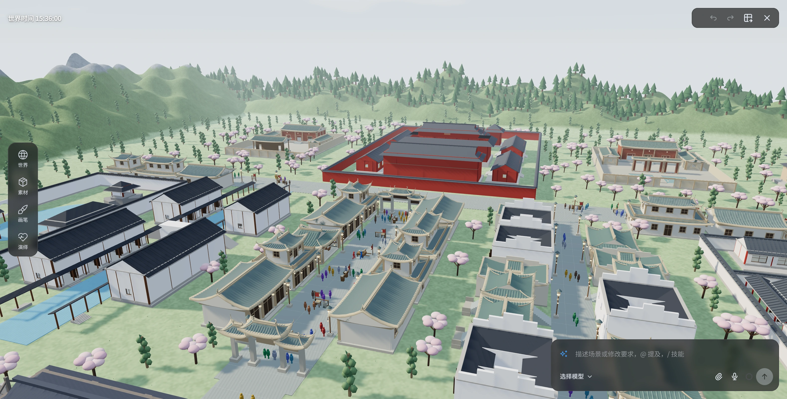

<p>
  <a href="https://github.com/HBAI-Ltd/Toonflow-app">
    
  </a>
 | 
  <a href="https://gitee.com/HBAI-Ltd/Toonflow-app">
    
  </a>
 | 
  <a href="https://atomgit.com/HBAI-Ltd/Toonflow-app">
    
  </a>
</p>

<p align="center">
  <a href="../../README.md">简体中文</a> |
  <a href="./readmeZhTw.md">繁體中文</a> |
  <a href="./readmeEn.md">English</a> |
  <a href="./readmeJa.md">日本語</a> |
  <a href="./readmeRu.md">Русский</a> |
  <a href="./readmeVi.md">Tiếng Việt</a> |
  <a href="./readmeTh.md">ไทย</a>
  <br />
  <a href="./readmeKo.md">한국어</a> |
  <a href="./readmeHi.md">हिन्दी</a> |
  <a href="./readmeId.md">Bahasa Indonesia</a> |
  <a href="./readmeMs.md">Bahasa Melayu</a> |
  <a href="./readmeFil.md">Filipino</a> |
  <strong>বাংলা</strong> |
  <a href="./readmeUr.md">اردو</a>
  <br />
  <a href="./readmeTa.md">தமிழ்</a> |
  <a href="./readmeTe.md">తెలుగు</a> |
  <a href="./readmeMr.md">मराठी</a> |
  <a href="./readmePa.md">ਪੰਜਾਬੀ</a> |
  <a href="./readmeAr.md">العربية</a> |
  <a href="./readmeFa.md">فارسی</a> |
  <a href="./readmeTr.md">Türkçe</a>
</p>

> 🌐 **ইন্টারফেসে 22টি ভাষা** · [সমর্থিত ভাষাগুলো দেখুন](#languages)

<div align="center">

<p align="center">
  
</p>

<a href="https://git.io/typing-svg">
  <picture>
    <source media="(prefers-color-scheme: dark)" srcset="https://readme-typing-svg.demolab.com?font=Fira+Code&size=40&duration=3000&pause=1000&color=FFFFFF&center=true&vCenter=true&width=600&lines=Toonflow;AI%20Short%20Drama%20Studio;Turn%20ideas%20into%20stories" />
    
  </picture>
</a>

<p align="center">
  <a href="https://github.com/HBAI-Ltd/Toonflow-app/stargazers">
    
  </a>
  <a href="../../LICENSE">
    
  </a>
  <a href="https://github.com/HBAI-Ltd/Toonflow-app/releases">
    
  </a>
</p>
<p align="center">
  <a href="https://github.com/HBAI-Ltd/Toonflow-app/network/members">
    
  </a>
  <a href="https://atomgit.com/HBAI-Ltd/Toonflow-app">
    
  </a>
  <a href="https://discord.gg/HEjKmpNpAZ">
    
  </a>
</p>
<p align="center">
  <a href="https://github.com/HBAI-Ltd/Toonflow-app/issues">
    
  </a>
  <a href="https://github.com/HBAI-Ltd/Toonflow-app/graphs/contributors">
    
  </a>
  <a href="https://github.com/HBAI-Ltd/Toonflow-app/commits">
    
  </a>
</p>
<p align="center">
 
 
 
  
</p>

<p align="center">
  <a href="https://trendshift.io/repositories/24197?utm_source=trendshift-badge&amp;utm_medium=badge&amp;utm_campaign=badge-trendshift-24197#achievements" target="_blank" rel="noopener noreferrer">
    
  </a>
  <a href="https://trendshift.io/repositories/24197?utm_source=trendshift-badge&amp;utm_medium=badge&amp;utm_campaign=badge-trendshift-24197#achievements" target="_blank" rel="noopener noreferrer">
    
  </a>
  <a href="https://trendshift.io/repositories/24197?utm_source=trendshift-badge&amp;utm_medium=badge&amp;utm_campaign=badge-trendshift-24197#achievements" target="_blank" rel="noopener noreferrer">
    
  </a>
</p>
<p align="center">
  <a href="https://trendshift.io/repositories/24197?utm_source=trendshift-badge&amp;utm_medium=badge&amp;utm_campaign=badge-trendshift-24197#achievements" target="_blank" rel="noopener noreferrer">
    
  </a>
  <a href="https://trendshift.io/repositories/24197?utm_source=trendshift-badge&amp;utm_medium=badge&amp;utm_campaign=badge-trendshift-24197#achievements" target="_blank" rel="noopener noreferrer">
    
  </a>
  <a href="https://trendshift.io/repositories/24197?utm_source=trendshift-badge&amp;utm_medium=badge&amp;utm_campaign=badge-trendshift-24197#achievements" target="_blank" rel="noopener noreferrer">
    
  </a>
</p>
<p align="center">
  <a href="https://trendshift.io/repositories/24197?utm_source=trendshift-badge&amp;utm_medium=badge&amp;utm_campaign=badge-trendshift-24197#achievements" target="_blank" rel="noopener noreferrer">
    
  </a>
</p>

**স্বল্পদৈর্ঘ্য নাটক, অ্যানিমেটেড কমিকস ও ভিডিও তৈরির জন্য একটি ওপেন-সোর্স AI প্ল্যাটফর্ম**

> 🚀 **স্বল্পদৈর্ঘ্য নাটক তৈরির সব কাজ এক জায়গায়**: চিত্রনাট্য লিখুন, উপকরণ গুছিয়ে রাখুন এবং ছবি ও ভিডিও তৈরি করুন—সম্পূর্ণ সৃজনশীল কাজের ধাপগুলো সাজান একটি অসীম ক্যানভাসে।

</div>

<div align="center">
  <table>
    <tr>
      <td width="50%" align="center">
        <a href="../images/gStar.png">
          
        </a>
      </td>
      <td width="50%" align="center">
        <a href="../images/gvp.jpg">
          
        </a>
      </td>
    </tr>
  </table>
</div>

<p align="center">
<a href="https://github.com/HBAI-Ltd/Toonflow-app/releases">ডাউনলোড</a> ·
<a href="https://qcn7xdsqgc4z.feishu.cn/docx/RXFqdgR2Xo0dXZxGfd0cZCGgnwf"> ব্যবহারকারীর নির্দেশিকা</a> ·
<a href="https://api.toonflow.net/console/plugIn">প্লাগইন মার্কেটপ্লেস</a> ·
<a href="https://qcn7xdsqgc4z.feishu.cn/docx/KNBNd9naqolsy6xjAOCcEAkqnRd">ডেভেলপার ডকুমেন্টেশন</a> ·
<a href="https://api.toonflow.net/">অফিশিয়াল মডেল প্ল্যাটফর্ম</a>
</p>

<p align="center">
  📺 <a href="https://www.bilibili.com/video/BV1hbpb6xETF">পণ্য পরিচিতি ভিডিও</a> ·
  <a href="https://www.bilibili.com/video/BV1z4sS6NEA3">TrumanMap প্রিভিজ ডেমো</a>
</p>

<p align="center">🔥 Toonflow-এর ভিত্তিতে তৈরি শর্ট ড্রামা Hongguo-তে লক্ষ লক্ষ, কোটি কোটি থেকে 10 কোটিরও বেশি ভিউ পেয়েছে। <a href="#works">কাজগুলো দেখুন</a></p>

https://github.com/user-attachments/assets/56d81114-7521-454c-9ec9-972567eddda9

---

## 1. 💛 পৃষ্ঠপোষক ও সহযোগী

Toonflow ওপেন সোর্স প্রকল্পকে সমর্থন করার জন্য নিম্নলিখিত অংশীদারদের ধন্যবাদ৷

<table>
  <tr>
    <td width="50%" valign="top">
<a href="https://metaso.cn/minimax-h3/?s=toon"> <strong>Metaso</strong></a>
      <br />
      <sub>সাশ্রয়ী MiniMax H3 ভিডিও তৈরি: 768P-তে প্রতি সেকেন্ড মাত্র ¥0.09 এবং 2K-তে ¥0.15 (CNY)। নিজস্ব GPU স্থাপন ছাড়াই নেটিভ 2K, একসঙ্গে অডিও ও ভিডিও তৈরি, OpenAI-সামঞ্জস্যপূর্ণ API, ComfyUI এবং অসীম ক্যানভাস সমর্থন করে। বোনাস ক্রেডিট ও বিশেষ সুবিধা পেতে <a href="https://metaso.cn/minimax-h3/?s=toon">এই বিশেষ লিঙ্কে নিবন্ধন করুন</a>। ব্যবসায়িক যোগাযোগের জন্য WeChat-এ metasota12-এর সঙ্গে যোগাযোগ করুন।</sub>
    </td>
    <td width="50%" valign="top">
<a href="https://go.apimart.ai/gh-toonflow-app"> <strong>APIMart</strong></a>
      <br />
      <sub>এই প্রকল্পের পৃষ্ঠপোষকতার জন্য APIMart-কে ধন্যবাদ! AI দিয়ে ছবি ও ভিডিও তৈরির জন্য APIMart একটি সাশ্রয়ী API প্ল্যাটফর্ম। GPT-Image-2-এ প্রতিটি ছবি $0.006 থেকে শুরু—$1-এ 160টির বেশি ছবি। ছবি ও ভিডিও একই অ্যাসিঙ্ক্রোনাস API ব্যবহার করে: কাজ জমা দিন, তার ID পান এবং কলব্যাকের মাধ্যমে ফলাফল নিন। টাইমআউট ছাড়াই একসঙ্গে 10,000 ছবি প্রক্রিয়া করুন এবং কোড না বদলে মডেল পরিবর্তন করুন। মাসিক ফি নেই; ব্যবহারের পরিমাণ অনুযায়ী মূল্য পরিশোধ করুন। শুরু করতে <a href="https://go.apimart.ai/gh-toonflow-app">এখানে নিবন্ধন করুন</a>।</sub>
    </td>
  </tr>
  <tr>
    <td width="50%" valign="top">
<a href="https://www.compshare.cn/video-studio?ytag=GPU_YY_YX_git_toonflow"> <strong>CompShare</strong></a>
      <br />
      <sub>CompShare সাশ্রয়ী H3 ভিডিও তৈরির সুবিধা দেয়, যার মধ্যে রয়েছে লেখা থেকে ভিডিও, প্রথম ও শেষ ফ্রেম নিয়ন্ত্রণ এবং সমন্বিত রেফারেন্স মোড। নেটিভ 2K-তে সর্বোচ্চ 30 সেকেন্ডের ভিডিও তৈরি করুন; 768P-তে প্রতি সেকেন্ড মাত্র CNY 0.08। API সংযোগ, প্রতিষ্ঠানের জন্য একসঙ্গে বহু অনুরোধ প্রক্রিয়াকরণ এবং নিজে ইনভয়েস তৈরির সুবিধা রয়েছে।</sub>
<br /><br />
      <sub>🎁 প্ল্যাটফর্মে বিনামূল্যে চেষ্টা করার জন্য CNY 5 ক্রেডিট পেতে <a href="https://www.compshare.cn/video-studio?ytag=GPU_YY_YX_git_toonflow">এই বিশেষ লিঙ্কে নিবন্ধন করুন</a>!</sub>
    </td>
<td width="50%" valign="top">
      <a href="https://weimeta.cn/console/invite/accept?aff=INV202611191734123p9JeY"> <strong>WEIMETA AI</strong></a>
      <br />
      <sub>WEIMETA AI সাশ্রয়ী মূল্যে AI টেক্সট, ছবি ও ভিডিও তৈরির পরিষেবা দেয় এবং DeepSeek, GLM, Kimi, Seedream, Seedance, Wan, MiniMax H3-এর মতো শীর্ষ মডেল একসাথে আনে। টেক্সট থেকে ছবি, ছবি থেকে ছবি, টেক্সট থেকে ভিডিও ও ছবি থেকে ভিডিও একটি একীভূত API-তে সমর্থিত, যাতে প্রতিষ্ঠানগুলো নমনীয়ভাবে একাধিক মডেল ব্যবহার করতে পারে। প্ল্যাটফর্মটি এন্টারপ্রাইজ-মানের এনক্রিপ্টেড ট্রান্সমিশন ও মাল্টি-টেন্যান্ট আইসোলেশন ব্যবহার করে এবং চীনের লেভেল ৩ নিরাপত্তা মূল্যায়নে উত্তীর্ণ।</sub>
      <br /><br />
      <sub>🎁 WEIMETA AI-এর মাল্টিমোডাল মডেল পরিষেবা ব্যবহার করে দেখতে <a href="https://weimeta.cn/console/invite/accept?aff=INV202611191734123p9JeY">এই বিশেষ লিঙ্কে নিবন্ধন করুন</a>। সীমিত সময়ের অফার: CNY 100 রিচার্জে CNY 15 অতিরিক্ত। ব্যবসায়িক যোগাযোগ WeChat: WeiMeta_AI666</sub>
    </td>
  </tr>
</table>

<details>
<summary><strong>👉 একজন স্পনসর হন 👈</strong></summary>

<p align="center">
  
</p>

<p align="center"><sub>এই যোগাযোগ শুধুমাত্র ব্যবসায়িক অনুসন্ধানের জন্য এবং প্রযুক্তিগত সহায়তা প্রদান করে না। ব্যবহারের প্রশ্নগুলির জন্য, অনুগ্রহ করে কমিউনিটি গ্রুপে যোগ দিন। ফিডব্যাক ফর্মের মাধ্যমে ফিচার অনুরোধ এবং বাগ জমা দিন। আপনার বোঝার জন্য আপনাকে ধন্যবাদ।</sub></p>

</details>

---

## 2. 🌟 বিশেষ সুবিধা

| সক্ষমতা | বিবরণ |
| --- | --- |
| 🎬 **TrumanMap প্রিভিজ** | স্ক্রিপ্ট পেস্ট করলেই এক ক্লিকে 3D সেট, স্টোরিবোর্ড ও ব্লকিং। |
| 🖼️ **অসীম ক্যানভাস** | স্ক্রিপ্ট, চরিত্র, দৃশ্য ও ক্লিপ এক ক্যানভাসে যুক্ত। |
| 🎥 **AI ভিডিও তৈরি** | @ দিয়ে অ্যাসেট যুক্ত করে শট ধরে তৈরি। |
| 🤖 **AI সহকারী** | ক্যানভাস পড়ে ও বদলায়; MCP ও A2A সমর্থিত। |
| 🔧 **যেকোনো মডেল** | বিল্ট-ইন প্রদানকারী, থার্ড-পার্টি API, লোকাল LLM, ComfyUI। |
| 🧩 **প্লাগইন মার্কেট** | নোড, টুল ও স্কিল এক ক্লিকে। |
| 🏠 **লোকাল ডিপ্লয়মেন্ট** | Windows, macOS, Linux, Android, Docker। |
| 🌐 **বহুভাষিক** | ২২টি ইন্টারফেস ভাষা। |

**কাজের ধারা**: স্ক্রিপ্ট ও স্টোরিবোর্ড → চরিত্র ও দৃশ্য → 3D প্রিভিজ → শট ধরে ভিডিও → সম্পাদনা ও ডাউনলোড।

### সাধারণ প্রশ্ন

**Toonflow কী?** AI শর্ট ড্রামা, AI কমিক ও AI ভিডিও তৈরির ওপেন-সোর্স প্ল্যাটফর্ম।

**এটি কি বিনামূল্যে?** MIT লাইসেন্স, নিজে হোস্ট করা বিনামূল্যে; থার্ড-পার্টি মডেল API-তে খরচ হতে পারে।

**কোন মডেল সমর্থিত?** Seedance, Seedream, MiniMax, Wan ইত্যাদি বিল্ট-ইন; থার্ড-পার্টি API, লোকাল LLM ও ComfyUI-ও যুক্ত করা যায়। [ব্যবহার নির্দেশিকা](https://qcn7xdsqgc4z.feishu.cn/docx/RXFqdgR2Xo0dXZxGfd0cZCGgnwf) দেখুন।

**কোন প্ল্যাটফর্ম?** Windows, macOS, Linux, Android, এবং Docker ও সার্ভার।

<a id="languages"></a>

### বহুভাষিক সমর্থন

সমর্থিত ভাষা: 简体中文, 繁體中文, English, 日本語, Русский, Tiếng Việt, ไทย, 한국어, हिन्दी, Bahasa Indonesia, Bahasa Melayu, Filipino, বাংলা, اردو, தமிழ், తెలుగు, मराठी, ਪੰਜਾਬੀ, العربية, فارسی, Türkçe, Português (Brasil)।

---

## 3. 📸 ১০টি প্রধান আকর্ষণ

<a id="trumanmap"></a>

### আকর্ষণ 1 | স্ক্রিপ্ট পেস্ট করুন, 3D প্রিভিজ পান

সংলাপ অনুযায়ী নিজে থেকেই শট ও ব্লকিং; মনিটরে ছবি ও সাবটাইটেল সরাসরি। 📺 [ডেমো দেখুন](https://www.bilibili.com/video/BV1z4sS6NEA3)

https://github.com/user-attachments/assets/bb2f7bfe-46de-44ff-b3b3-95379f9d4b20

<p align="center">
  <a href="../images/screenshots/trumanMapTimeline.webp"></a>
</p>

<table>
  <tr>
    <td width="50%"><a href="../images/screenshots/trumanMapShot.webp"></a></td>
    <td width="50%"><a href="../images/screenshots/trumanMapStreet.webp"></a></td>
  </tr>
</table>

### আকর্ষণ 2 | জিয়াংনানের সীমাহীন জলশহর

নগর-প্রাচীর, রাস্তা, খাল, মন্দির ও পাহাড়: ১,৫০০-এর বেশি বস্তু।

<p align="center">
  <a href="../images/screenshots/trumanMapTown.webp"></a>
</p>

<table>
  <tr>
    <td width="50%"><a href="../images/screenshots/trumanMapAerial.webp"></a></td>
    <td width="50%"><a href="../images/screenshots/trumanMapTemple.webp"></a></td>
  </tr>
</table>

### আকর্ষণ 3 | ৬৪টি তৈরি সেট + ৮০,০০০+ অ্যাসেট

<table>
  <tr>
    <td width="50%"><a href="../images/screenshots/trumanMapSets.webp"></a></td>
    <td width="50%"><a href="../images/screenshots/trumanMapAssets.webp"></a></td>
  </tr>
</table>

### আকর্ষণ 4 | আবহাওয়া, সময় ও ভূখণ্ড এক ক্লিকে

<table>
  <tr>
    <td width="50%"><a href="../images/screenshots/trumanMapRain.webp"></a></td>
    <td width="50%"><a href="../images/screenshots/trumanMapBrush.webp"></a></td>
  </tr>
  <tr>
    <td width="50%"><a href="../images/screenshots/trumanMapWorld.webp"></a></td>
    <td width="50%"><a href="../images/screenshots/trumanMapHome.webp"></a></td>
  </tr>
</table>

### আকর্ষণ 5 | প্রিভিজ সরাসরি ভিডিও তৈরিতে

স্টোরিবোর্ড, চার-দিকের শিট, প্রিভিজ ভিডিও, অ্যানিমেটিক ও শট তালিকা এক ক্লিকে ক্যানভাসে।

### আকর্ষণ 6 | অসীম ক্যানভাস + AI সহকারী

<table>
  <tr>
    <td width="50%"><a href="../images/screenshots/canvasNodeMenu.webp"></a></td>
    <td width="50%"><a href="../images/screenshots/canvasAgent.webp"></a></td>
  </tr>
</table>

### আকর্ষণ 7 | একাধিক রেফারেন্সে ভিডিও তৈরি

<p align="center">
  <a href="../images/screenshots/videoGenerationNode.webp"></a>
</p>

### আকর্ষণ 8 | স্ক্রিপ্ট নথি ও ওয়ার্কস্পেস

<p align="center">
  <a href="../images/screenshots/canvasDocument.webp"></a>
</p>

### আকর্ষণ 9 | হোম ও অ্যাসেট লাইব্রেরি

<table>
  <tr>
    <td width="50%"><a href="../images/screenshots/home.webp"></a></td>
    <td width="50%"><a href="../images/screenshots/assetLibrary.webp"></a></td>
  </tr>
</table>

### আকর্ষণ 10 | প্লাগইন মার্কেট

আরও প্লাগইন [ওয়েব প্লাগইন মার্কেট](https://api.toonflow.net/console/plugIn)-এ।

<p align="center">
  <a href="../images/screenshots/pluginMarket.webp"></a>
</p>

---

## 4. 🚀 ডাউনলোড ও ইনস্টলেশন

### 4.1 অ্যাপ ইনস্টলেশন

| অপারেটিং সিস্টেম | GitHub |
| --- | --- |
| Windows | [রিলিজ](https://github.com/HBAI-Ltd/Toonflow-app/releases) |
| macOS | [রিলিজ](https://github.com/HBAI-Ltd/Toonflow-app/releases) |
| Android ARM64 | [APK ডাউনলোড](https://github.com/HBAI-Ltd/Toonflow-app/releases/latest) |

Android অ্যাপটি শুধু ARM64 ডিভাইস সমর্থন করে। রিলিজ পেজ থেকে `toonflow-VERSION-android-arm64.apk` ডাউনলোড করে ইনস্টল করুন। এতে স্থানীয় Bun ব্যাকএন্ড রয়েছে, তাই এটি স্বাধীনভাবে চলতে পারে। হোম পেজের «ডিভাইস সংযোগ» থেকে QR কোড স্ক্যান করে বা তথ্য লিখে স্থানীয় নেটওয়ার্ক বা ইন্টারনেটে শেয়ারিং চালু থাকা কম্পিউটার বা ব্যাকএন্ডেও সংযোগ করা যায়।

Windows ইনস্টলার স্বয়ংক্রিয়ভাবে WebView2 সনাক্ত করে এবং ইনস্টল করে। ইনস্টলেশনের পরপরই অ্যাপটি বন্ধ হয়ে গেলে, [WebView2 ডাউনলোড পৃষ্ঠা](https://developer.microsoft.com/microsoft-edge/webview2/) থেকে ম্যানুয়ালি রানটাইম ডাউনলোড করুন এবং ইনস্টল করুন।

macOS (Apple Silicon)-এ Toonflow-কে Applications ফোল্ডারে টেনে রেখে সরাসরি খুলুন। আগে থেকে Terminal-এ কোনো কমান্ড চালানোর দরকার নেই। macOS নিরাপত্তা সতর্কতা দেখালে নিচের ধাপগুলো ক্রমানুসারে অনুসরণ করুন।

<details>
<summary><strong>If Toonflow macOS</strong></summary> এ ইনস্টল বা খোলা যাবে না

**1. গোপনীয়তা ও নিরাপত্তায় Toonflow অনুমতি দিন**

ডেভেলপারকে যাচাই করা যাচ্ছে না বা Apple ক্ষতিকর সফ্টওয়্যারের জন্য অ্যাপটি পরীক্ষা করতে পারছে না—এমন সতর্কতা দেখলে প্রথমে Toonflow খোলার চেষ্টা করুন। এরপর System Settings → Privacy & Security-এ গিয়ে Toonflow ব্লক হওয়ার বার্তাটি খুঁজুন, Open Anyway-এ ক্লিক করুন এবং নির্দেশ অনুযায়ী অনুমতি দিন। বিস্তারিত দেখুন [Apple-এর আনুষ্ঠানিক নির্দেশনায়](https://support.apple.com/zh-cn/102445)।

**2. যদি কোয়ারেন্টাইন বিধিনিষেধ এখনও খোলার বাধা দেয়, তাহলে কোয়ারেন্টাইন বৈশিষ্ট্যটি সরানোর চেষ্টা করুন**

অ্যাপটি অফিসিয়াল রিলিজ পৃষ্ঠা থেকে এসেছে এবং অ্যাপ্লিকেশনে রয়েছে তা নিশ্চিত করার পরে, টার্মিনালে নিম্নলিখিত কমান্ডটি চালান এবং এটি আবার খোলার চেষ্টা করুন। অ্যাপের নাম বা ইনস্টলেশনের অবস্থান ভিন্ন হলে পাথ সামঞ্জস্য করুন।

```bash
sudo xattr -rd com.apple.quarantine /Applications/toonflow.app
```

**3. শেষ অবলম্বন: অস্থায়ীভাবে যেকোনো জায়গা থেকে অ্যাপগুলিকে অনুমতি দিন**

যদি প্রথম দুটি পদ্ধতির কোনোটিই কাজ না করে এবং আপনি অ্যাপটির উৎসকে বিশ্বাস করেন, তাহলে চালানোর চেষ্টা করুন:

```bash
sudo spctl --master-disable
```

এরপর System Settings → Privacy & Security খুলুন। Security অংশে “Allow applications downloaded from” বিকল্পটি “Anywhere” করুন, যদি আপনার সিস্টেমে সেটি থাকে, এবং নির্দেশ অনুযায়ী নিশ্চিত করুন। macOS-এর সংস্করণভেদে বিকল্প ও কমান্ডের সমর্থন আলাদা হতে পারে।

এটি সমস্ত অ্যাপের নিরাপত্তা বিধিনিষেধ শিথিল করে। তারপরে, আমরা "App Store এবং চিহ্নিত ডেভেলপারদের" সেটিং পুনরুদ্ধার করার পরামর্শ দিই।

</details>

আরও নির্দেশাবলীর জন্য, [ব্যবহারকারী গাইড](https://qcn7xdsqgc4z.feishu.cn/docx/RXFqdgR2Xo0dXZxGfd0cZCGgnwf) দেখুন।

---

### 4.2 Docker ইনস্টলেশন

প্রথমে Git, [Docker Engine](https://docs.docker.com/engine/install/) এবং Docker Compose ইনস্টল করুন। Windows ও macOS-এ Docker Desktop-এর Linux container mode ব্যবহার করা যায়। রিপোজিটরিতে [Dockerfile](../../Dockerfile), [Compose কনফিগারেশন](../../compose.yaml) এবং [বিল্ড থেকে বাদ দেওয়ার নিয়ম](../../.dockerignore) রয়েছে। ইমেজটি Bun 1.4.3 দিয়ে তৈরি করা হয় এবং এতে FFmpeg অন্তর্ভুক্ত থাকে।

<details>
<summary><strong>Eপ্রসারিত করুন Docker ইনস্টলেশন পদক্ষেপ</strong></summary>

উত্সটি ক্লোন করুন এবং সংগ্রহস্থল রুটে নিম্নলিখিতটি চালান:

```sh
git clone https://github.com/HBAI-Ltd/Toonflow-app.git
cd Toonflow-app
docker compose up -d --build
```

প্রথম বিল্ড নির্ভরতা ইনস্টল করে এবং বান্ডিল নোড, টুল, Web, এবং Server তৈরি করে। একবার শুরু হলে, `http://127.0.0.1:3000` খুলুন। একটি দূরবর্তী হোস্টের জন্য, নীচে "অ্যাক্সেস এবং ডেটা" এর অধীনে বর্ণিত একটি SSH টানেল ব্যবহার করুন৷ প্রথম স্টার্টআপটি বান্ডিল করা প্লাগইনগুলিকে আরম্ভ করে এবং একটি `myProject` কার্যকরী ডিরেক্টরি প্রদান করে।

সেটিংস, প্লাগইন ও প্রকল্পের ফাইল Docker-এর `toonflowData` নামের ভলিউমে থাকে, যা কন্টেইনারের ভেতরে `/app/data/`-এ মাউন্ট করা হয়। প্রকৃত ভলিউম নামের আগে Compose প্রকল্পের নাম যুক্ত থাকে। কন্টেইনার বন্ধ বা পুনর্নির্মাণ করলেও তথ্য অক্ষত থাকে। **`docker compose down -v` চালাবেন না: এই কমান্ড তথ্যের ভলিউম মুছে দেয়।**

```sh
docker compose logs -f toonflow  # View logs
docker compose stop             # Stop the service
docker compose start            # Start it again
docker compose down             # Remove containers, retaining the data volume
```

একটি প্রকল্প ডিরেক্টরি যোগ করতে, "Server ওয়ার্কিং ডিরেক্টরি নির্বাচন করুন" ডায়ালগে "নতুন ফোল্ডার" এ ক্লিক করুন। ডায়ালগটি ফাইল এবং ফোল্ডারগুলির নাম পরিবর্তন এবং মুছে ফেলাকেও সমর্থন করে৷ বিকল্পভাবে, পরিষেবাটি চলাকালীন কমান্ড লাইন থেকে একটি ডিরেক্টরি তৈরি করুন:

```sh
docker compose exec toonflow mkdir -p /app/data/workspaces/newProject
```

একটি ব্যাকআপের জন্য, প্রথমে পরিষেবাটি বন্ধ করুন, ডেটা অনুলিপি করুন, তারপর এটি পুনরায় চালু করুন:

```sh
docker compose stop
docker compose cp toonflow:/app/data ./toonflowBackup
docker compose start
```

</details>

---

### 4.3 সার্ভারে ইনস্টলেশন

সরাসরি Linux সার্ভারে Web এবং Server চালানোর জন্য এই বিকল্পটি ব্যবহার করুন। নীচের উদাহরণটি Ubuntu / Debian এবং প্রকল্পের নির্দিষ্ট সংস্করণ, [Bun 1.4.3](https://bun.sh/docs/installation) ব্যবহার করে৷

<details>
<summary><strong>Eপ্রসারিত সার্ভার ইনস্টলেশন পদক্ষেপ</strong></summary>

রানটাইম পরিবেশ ইনস্টল করুন:

```sh
sudo apt-get update
sudo apt-get install -y git curl unzip ffmpeg
curl -fsSL https://bun.com/install | bash -s "bun-v1.4.3"
export PATH="$HOME/.bun/bin:$PATH"
bun --version
```

উৎস ক্লোন করুন এবং পরিষেবা শুরু করুন:

```sh
git clone https://github.com/HBAI-Ltd/Toonflow-app.git
cd Toonflow-app
bun install --frozen-lockfile

# Build bundled nodes, tools, Web, and Server
bun run build:server
mkdir -p data/workspaces/myProject
bun run start:server
```

“服务启动成功” (পরিষেবা সফলভাবে চালু হয়েছে) দেখালে সার্ভারেই `http://127.0.0.1:3000` খুলুন। উপরের কমান্ডটি ফোরগ্রাউন্ডে চলে; বন্ধ করতে `Ctrl+C` চাপুন। কম্পিউটার চালুর সঙ্গে পরিষেবা চালানো ও প্রক্রিয়া পরিচালনার জন্য [Bun-এর systemd স্থাপন নির্দেশিকা](https://bun.sh/guides/ecosystem/systemd) দেখুন। কাজের ডিরেক্টরি হিসেবে রিপোজিটরির ডিরেক্টরি দিন; চালুর কমান্ড হবে Bun-এর পূর্ণ পাথ, তার পরে `run start:server`। ওই ডিরেক্টরিতে পড়া ও লেখার অনুমতি আছে এমন ব্যবহারকারী হিসেবে চালান।

</details>

---

### 4.4 অ্যাক্সেস এবং ডেটা

- পরিষেবাটি বর্তমানে স্থির পোর্ট `3000` ব্যবহার করে৷ ওয়েব ইন্টারফেস এবং API এর আলাদা লগইন প্রমাণীকরণ নেই। সার্ভার ইনস্টলেশনের জন্য, ফায়ারওয়াল বা নিরাপত্তা গোষ্ঠীর মাধ্যমে `3000` পোর্টে অ্যাক্সেস সীমাবদ্ধ করুন। পাবলিক অ্যাক্সেসের জন্য প্রমাণীকরণ সহ একটি বিপরীত প্রক্সি প্রয়োজন।
- ব্যক্তিগত দূরবর্তী অ্যাক্সেসের জন্য, আপনার নিজের কম্পিউটারে `ssh -N -L 3000:127.0.0.1:3000 username@server-address` চালান। সংযোগ খোলা রাখুন, তারপর `http://127.0.0.1:3000` দেখুন। আপনাকে সার্ভারের পোর্ট `3000` সর্বজনীন ইন্টারনেটে প্রকাশ করার দরকার নেই৷
- সরাসরি ইনস্টলেশনের সাথে, সেটিংস, প্লাগইন এবং ওয়ার্কস্পেস ডিফল্টরূপে রিপোজিটরির `data/` ডিরেক্টরিতে সংরক্ষণ করা হয়। Docker এর সাথে, তারা ডেটা ভলিউমের ভিতরে `/app/data/` এ সংরক্ষণ করা হয়। স্থানান্তরিত বা ব্যাক আপ করার সময় সম্পূর্ণ ডিরেক্টরি সংরক্ষণ করুন। পৃষ্ঠাটি খোলার পরে, সার্ভার ওয়ার্কস্পেসে `myProject` নির্বাচন করুন। অতিরিক্ত প্রকল্পের জন্য সংশ্লিষ্ট `workspaces/` ডিরেক্টরির অধীনে সাবডিরেক্টরি তৈরি করুন।
- উভয় ইনস্টলেশন পদ্ধতি FFmpeg সিস্টেম অন্তর্ভুক্ত। আপনাকে এখনও ইন্টারফেসে মডেল পরিষেবার জন্য API কীগুলি কনফিগার করতে হবে৷

---

### 4.5 ক্লাউড স্থাপনা

আমাদের সহযোগী [AI Galaxy (智星云)](https://www.ai-galaxy.com/) আনুষ্ঠানিক অনুমোদিত বাণিজ্যিক Toonflow ইমেজ দেয়, যাতে আগে থেকেই ব্যবহারের উপযোগী পরিবেশ প্রস্তুত থাকে। নির্দেশনার জন্য [ছবিসহ ইমেজ স্থাপনের নির্দেশিকা](https://mp.weixin.qq.com/s/lq9X1ovQ1_TKeXMOLgicKg?scene=1) দেখুন।

---

## 5. 🎬 উদাহরণ কাজ

<a id="works"></a>

### Hongguo-তে হিট ড্রামা

🔥 Toonflow-এর ভিত্তিতে তৈরি শর্ট ড্রামা Hongguo-তে লক্ষ লক্ষ, কোটি কোটি থেকে 10 কোটিরও বেশি ভিউ পেয়েছে।

<p align="center">
  
</p>

<p align="center">
  
</p>

### বিজ্ঞাপন ভিডিও

<table>
  <tr>
    <td width="50%"><video src="https://github.com/user-attachments/assets/fccf8b46-b8ec-46cb-9574-9273cd1ee9e4" controls width="100%"></video></td>
    <td width="50%"><video src="https://github.com/user-attachments/assets/b345905e-601f-43be-83a5-305f97a29e44" controls width="100%"></video></td>
  </tr>
  <tr>
    <td width="50%"><video src="https://github.com/user-attachments/assets/fc5880aa-6b9c-4717-af0e-e51f15c4fdc6" controls width="100%"></video></td>
    <td width="50%"><video src="https://github.com/user-attachments/assets/0816e794-f07d-4bc3-89cd-69c67566c3a6" controls width="100%"></video></td>
  </tr>
</table>

### শর্ট ড্রামা উদাহরণ

https://github.com/user-attachments/assets/2d9fddac-dfdf-4640-b030-b09d7f7287e9

ডেমো ভিডিওটি 480p-এর সংকুচিত সংস্করণ।

---

## 6. 👨‍👩‍👧‍👦 WeChat কমিউনিটি

গ্রুপ আমন্ত্রণ সহকারীর সাথে যোগাযোগ করতে QR কোড স্ক্যান করুন:


এছাড়াও আপনি Discord এ যোগ দিতে আইকনে ক্লিক করতে পারেন:

[](https://discord.gg/HEjKmpNpAZ) যোগদান করুন

অথবা আমন্ত্রণ লিঙ্ক ব্যবহার করুন: [https://discord.gg/HEjKmpNpAZ](https://discord.gg/HEjKmpNpAZ)

---

## 7. 💌 যোগাযোগ

📧 ইমেইল: [ltlctools@outlook.com](mailto:ltlctools@outlook.com?subject=Toonflow咨询)

---

## 8. 📜 ওপেন-সোর্স লাইসেন্স

Toonflow [MIT License](../../LICENSE) এর অধীনে লাইসেন্সপ্রাপ্ত। তৃতীয় পক্ষের নির্ভরতা এবং সম্পদ তাদের নিজ নিজ লাইসেন্স এবং কপিরাইট নোটিশের সাপেক্ষে থাকে।

[](https://www.star-history.com/#HBAI-Ltd/Toonflow-app&Date)

> **নন-রেট্রোঅ্যাকটিভিটি ক্লজ**: যে ব্যবহারকারীরা AGPL-3.0 এর অধীনে v1.0.8 এর আগে সংস্করণ ব্যবহার করেছেন তারা AGPL-3.0 এর অধীন থাকবে। v1.0.8 থেকে v1.1.8 সংস্করণগুলি Apache-2.0 এবং এর অতিরিক্ত চুক্তির সাপেক্ষে থাকবে। এই ব্যবহারকারীরা এই লাইসেন্স পরিবর্তন দ্বারা আবদ্ধ নয়.

---

## 9. 🙏 কৃতজ্ঞতা

- **অংশীদার**: 算能云, Tencent Hunyuan 3D, এবং AI Galaxy (智星云)।
- **প্রকল্পের অবদানকারীরা**: কোড লেখা, নথি উন্নত করা, প্লাগইন ভাগ করে নেওয়া এবং সমস্যা সমাধানে সাহায্য করা সবাইকে ধন্যবাদ।
- **সম্প্রদায় ব্যবহারকারী**: যারা প্রতিক্রিয়া প্রদান করে চলেছেন, সৃজনশীল কাজ ভাগ করে চলেছেন এবং প্রকল্পটিকে সমর্থন করছেন তাদের প্রত্যেককে ধন্যবাদ৷

仰起脸笑的像满月: উন্নয়নের জন্য Codex 20x কম্পিউটিং সংস্থান দিয়েছেন।
Xi'an Zhongxing Digital Intelligence Technology Co., Ltd. (西安中星数字智能科技有限公司): Apple সার্টিফিকেট দিয়ে অ্যাপ স্বাক্ষরে সহায়তা করেছে।

<p align="center"><sub>Free code signing provided by <a href="https://signpath.io/">SignPath.io</a>, certificate by <a href="https://signpath.org/">SignPath Foundation</a>.</sub></p>

<div align="center">

কপিরাইট © 2026 北京爱阿科技有限公司

</div>


