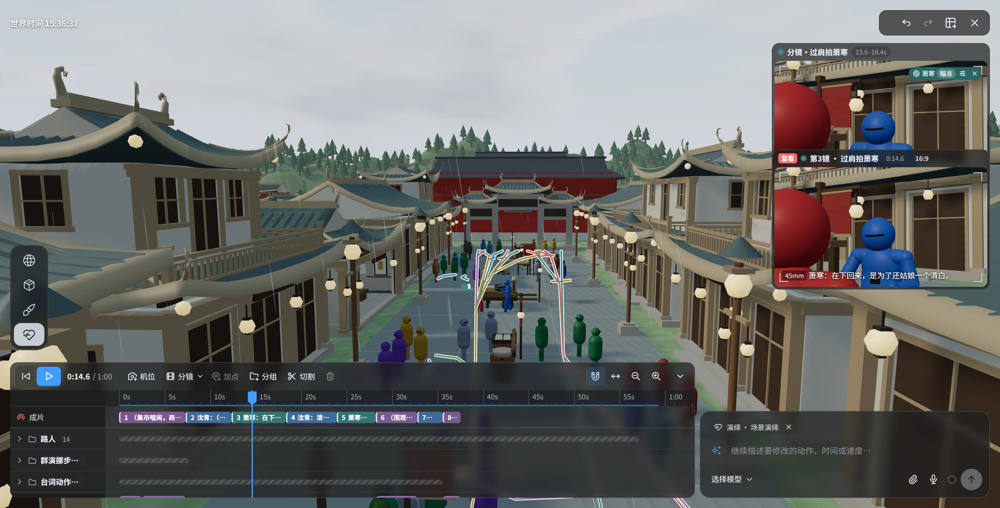
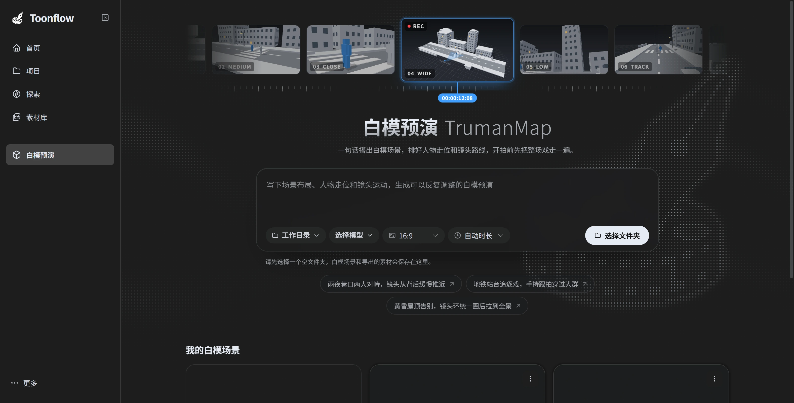
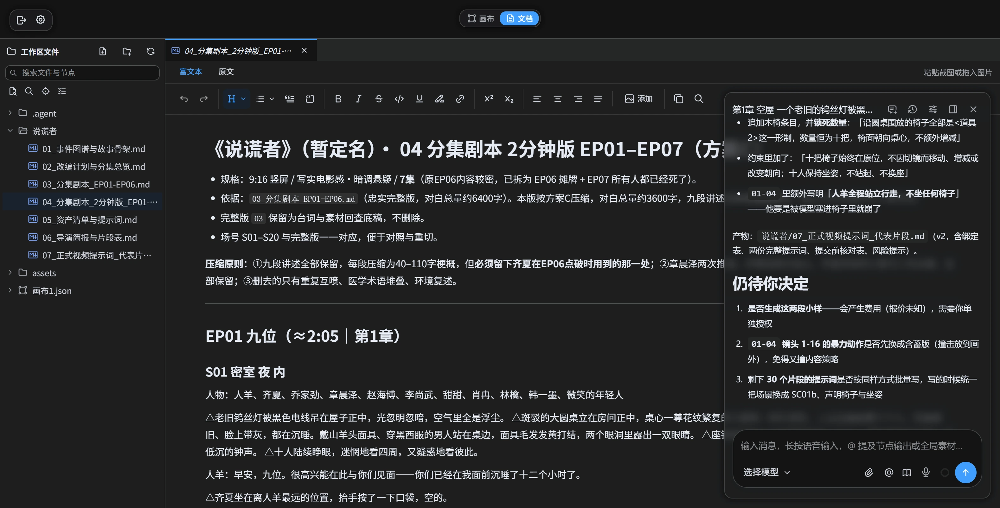

<p>
  <a href="https://github.com/HBAI-Ltd/Toonflow-app">
    
  </a>
  &nbsp;|&nbsp;
  <a href="https://gitee.com/HBAI-Ltd/Toonflow-app">
    
  </a>
  &nbsp;|&nbsp;
  <a href="https://atomgit.com/HBAI-Ltd/Toonflow-app">
    
  </a>
</p>

<p align="center">
  <a href="../../README.md">简体中文</a> |
  <a href="./readmeZhTw.md">繁體中文</a> |
  <strong>English</strong> |
  <a href="./readmeJa.md">日本語</a> |
  <a href="./readmeRu.md">Русский</a> |
  <a href="./readmeVi.md">Tiếng Việt</a> |
  <a href="./readmeTh.md">ไทย</a>
  <br />
  <a href="./readmeKo.md">한국어</a> |
  <a href="./readmeHi.md">हिन्दी</a> |
  <a href="./readmeId.md">Bahasa Indonesia</a> |
  <a href="./readmeMs.md">Bahasa Melayu</a> |
  <a href="./readmeFil.md">Filipino</a> |
  <a href="./readmeBn.md">বাংলা</a> |
  <a href="./readmeUr.md">اردو</a>
  <br />
  <a href="./readmeTa.md">தமிழ்</a> |
  <a href="./readmeTe.md">తెలుగు</a> |
  <a href="./readmeMr.md">मराठी</a> |
  <a href="./readmePa.md">ਪੰਜਾਬੀ</a> |
  <a href="./readmeAr.md">العربية</a> |
  <a href="./readmeFa.md">فارسی</a> |
  <a href="./readmeTr.md">Türkçe</a>
</p>

> 🌐 **22 interface languages** · [View supported languages](#languages)

<div align="center">

<p align="center">
  
</p>

<h1 align="center">Toonflow | Open-Source AI Short Drama, Animated Comic and Video Creation</h1>

<a href="https://git.io/typing-svg">
  <picture>
    <source media="(prefers-color-scheme: dark)" srcset="https://readme-typing-svg.demolab.com?font=Fira+Code&size=40&duration=3000&pause=1000&color=FFFFFF&center=true&vCenter=true&width=600&lines=Toonflow;AI%20Short%20Drama%20Studio;Turn%20ideas%20into%20stories" />
    
  </picture>
</a>

<p align="center">
  <a href="https://github.com/HBAI-Ltd/Toonflow-app/stargazers">
    
  </a>
  <a href="../../LICENSE">
    
  </a>
  <a href="https://github.com/HBAI-Ltd/Toonflow-app/releases">
    
  </a>
</p>
<p align="center">
  <a href="https://github.com/HBAI-Ltd/Toonflow-app/network/members">
    
  </a>
  <a href="https://atomgit.com/HBAI-Ltd/Toonflow-app">
    
  </a>
  <a href="https://discord.gg/HEjKmpNpAZ">
    
  </a>
</p>
<p align="center">
  <a href="https://github.com/HBAI-Ltd/Toonflow-app/issues">
    
  </a>
  <a href="https://github.com/HBAI-Ltd/Toonflow-app/graphs/contributors">
    
  </a>
  <a href="https://github.com/HBAI-Ltd/Toonflow-app/commits">
    
  </a>
</p>
<p align="center">
  &nbsp;
  &nbsp;
  &nbsp;
  
</p>

<p align="center">
  <a href="https://trendshift.io/repositories/24197?utm_source=trendshift-badge&amp;utm_medium=badge&amp;utm_campaign=badge-trendshift-24197#achievements" target="_blank" rel="noopener noreferrer">
    
  </a>
  <a href="https://trendshift.io/repositories/24197?utm_source=trendshift-badge&amp;utm_medium=badge&amp;utm_campaign=badge-trendshift-24197#achievements" target="_blank" rel="noopener noreferrer">
    
  </a>
  <a href="https://trendshift.io/repositories/24197?utm_source=trendshift-badge&amp;utm_medium=badge&amp;utm_campaign=badge-trendshift-24197#achievements" target="_blank" rel="noopener noreferrer">
    
  </a>
</p>
<p align="center">
  <a href="https://trendshift.io/repositories/24197?utm_source=trendshift-badge&amp;utm_medium=badge&amp;utm_campaign=badge-trendshift-24197#achievements" target="_blank" rel="noopener noreferrer">
    
  </a>
  <a href="https://trendshift.io/repositories/24197?utm_source=trendshift-badge&amp;utm_medium=badge&amp;utm_campaign=badge-trendshift-24197#achievements" target="_blank" rel="noopener noreferrer">
    
  </a>
  <a href="https://trendshift.io/repositories/24197?utm_source=trendshift-badge&amp;utm_medium=badge&amp;utm_campaign=badge-trendshift-24197#achievements" target="_blank" rel="noopener noreferrer">
    
  </a>
</p>
<p align="center">
  <a href="https://trendshift.io/repositories/24197?utm_source=trendshift-badge&amp;utm_medium=badge&amp;utm_campaign=badge-trendshift-24197#achievements" target="_blank" rel="noopener noreferrer">
    
  </a>
</p>

Toonflow is an open-source AI creation tool for short dramas, animated comics and short videos. Write scripts and storyboards, manage character and scene references, and generate images and video clips on an infinite canvas. Deploy it locally, connect the model services you choose, and extend your creative workflow with AI agents, MCP and plugins.

</div>

<div align="center">
  <table>
    <tr>
      <td width="50%" align="center">
        <a href="../images/gStar.png">
          
        </a>
      </td>
      <td width="50%" align="center">
        <a href="../images/gvp.jpg">
          
        </a>
      </td>
    </tr>
  </table>
</div>

<p align="center">
  <a href="https://github.com/HBAI-Ltd/Toonflow-app/releases">Download</a> ·
  <a href="https://qcn7xdsqgc4z.feishu.cn/docx/RXFqdgR2Xo0dXZxGfd0cZCGgnwf">User Guide</a> ·
  <a href="https://api.toonflow.net/console/plugIn">Plugin Marketplace</a> ·
  <a href="https://qcn7xdsqgc4z.feishu.cn/docx/KNBNd9naqolsy6xjAOCcEAkqnRd">Developer Documentation</a> ·
  <a href="https://api.toonflow.net/">Official Model Platform</a>
</p>

<p align="center">
  📺 <a href="https://www.bilibili.com/video/BV1hbpb6xETF">Product intro video</a> ·
  <a href="https://www.bilibili.com/video/BV1z4sS6NEA3">TrumanMap previs demo</a>
</p>

<p align="center">🔥 Short dramas built on Toonflow have reached millions, tens of millions, even over 100 million views on Hongguo. <a href="#works">See the works</a></p>

https://github.com/user-attachments/assets/56d81114-7521-454c-9ec9-972567eddda9

---

## 1. 💛 Sponsors and Support

Thank you to the following partners for supporting the Toonflow open-source project.

<table>
  <tr>
    <td width="50%" valign="top">
      <a href="https://metaso.cn/minimax-h3/?s=toon"> <strong>Metaso</strong></a>
      <br />
      <sub>Cost-effective MiniMax H3 video generation: just ¥0.09/second at 768P and ¥0.15/second at 2K (CNY). Supports native 2K, synchronized audio and video, an OpenAI-compatible API, ComfyUI, and infinite canvases, without deploying your own GPU. <a href="https://metaso.cn/minimax-h3/?s=toon">Register through this dedicated link</a> to receive bonus credits and exclusive offers. For business inquiries, contact metasota12 on WeChat.</sub>
    </td>
    <td width="50%" valign="top">
      <a href="https://go.apimart.ai/gh-toonflow-app"> <strong>APIMart</strong></a>
      <br />
      <sub>Thank you to APIMart for sponsoring this project! APIMart is an affordable API platform for AI image and video generation. GPT-Image-2 starts at $0.006 per image, delivering 160+ images for $1. Images and videos share one asynchronous API: submit a task, receive its ID, and get results through a callback. Process batches of 10,000 images without timeouts and switch models without changing code. Pay as you go, with no monthly fees. <a href="https://go.apimart.ai/gh-toonflow-app">Register here</a> to get started.</sub>
    </td>
  </tr>
  <tr>
    <td width="50%" valign="top">
      <a href="https://www.compshare.cn/video-studio?ytag=GPU_YY_YX_git_toonflow"> <strong>CompShare</strong></a>
      <br />
      <sub>CompShare offers cost-effective H3 video generation, including text-to-video, first- and last-frame control, and all-in-one reference modes. Generate videos up to 30 seconds long in native 2K, with 768P priced at just CNY 0.08 per second. Supports API access, high concurrency for enterprises, and self-service invoicing.</sub>
      <br /><br />
      <sub>🎁 <a href="https://www.compshare.cn/video-studio?ytag=GPU_YY_YX_git_toonflow">Register through this dedicated link</a> to receive CNY 5 in free platform trial credits!</sub>
    </td>
    <td width="50%" valign="top">
      <a href="https://weimeta.cn/console/invite/accept?aff=INV202611191734123p9JeY"> <strong>WEIMETA AI</strong></a>
      <br />
      <sub>WEIMETA AI offers cost-effective AI text, image, and video generation, bringing together leading models such as DeepSeek, GLM, Kimi, Seedream, Seedance, Wan, and MiniMax H3. It supports text-to-image, image-to-image, text-to-video, and image-to-video through a single unified API with flexible multi-model access for enterprise AI content creation. The platform uses enterprise-grade encrypted transmission and multi-tenant isolation, and has passed China's MLPS Level 3 security assessment to protect enterprise data and privacy.</sub>
      <br /><br />
      <sub>🎁 <a href="https://weimeta.cn/console/invite/accept?aff=INV202611191734123p9JeY">Register through this dedicated link</a> to try WEIMETA AI's multimodal model services. Limited-time offer: top up CNY 100 and get CNY 15 extra. Business inquiries on WeChat: WeiMeta_AI666</sub>
    </td>
  </tr>
</table>

<details>
<summary><strong>👉 Become a Sponsor 👈</strong></summary>

<p align="center">
  
</p>

<p align="center"><sub>This contact is for business inquiries only and does not provide technical support. For usage questions, please join the community groups. Submit feature requests and bugs through the feedback form. Thank you for your understanding.</sub></p>

</details>

---

## 2. 🌟 Highlights

| Feature | Description |
| --- | --- |
| 🎬 **TrumanMap previs** | Paste a script to build a 3D set, storyboard and blocking in one click. |
| 🖼️ **Infinite canvas** | Link scripts, characters, scenes and clips on one canvas. |
| 🎥 **AI video generation** | @-mention assets and generate shot by shot. |
| 🤖 **AI assistant** | Reads and edits the canvas; supports MCP and A2A. |
| 🔧 **Bring your own models** | Built-in providers, third-party APIs, local LLMs, ComfyUI. |
| 🧩 **Plugin market** | Install nodes, tools and skills in one click. |
| 🏠 **Local deployment** | Windows, macOS, Linux, Android, Docker. |
| 🌐 **Multilingual** | 22 interface languages. |

**Workflow**: Script & storyboard → characters & scenes → 3D previs → shot-by-shot video → edit & download.

### FAQ

**What is Toonflow?** An open-source platform for AI short dramas, AI comics and AI videos.

**Is it free?** MIT-licensed and free to self-host; third-party model APIs may charge.

**Which models are supported?** Built-in Seedance, Seedream, MiniMax, Wan and more, plus third-party APIs, local LLMs and ComfyUI. See the [tutorial](https://qcn7xdsqgc4z.feishu.cn/docx/RXFqdgR2Xo0dXZxGfd0cZCGgnwf).

**Which platforms?** Windows, macOS, Linux, Android, plus Docker and server deployment.

<a id="languages"></a>

### Multilingual support

Supported languages: 简体中文, 繁體中文, English, 日本語, Русский, Tiếng Việt, ไทย, 한국어, हिन्दी, Bahasa Indonesia, Bahasa Melayu, Filipino, বাংলা, اردو, தமிழ், తెలుగు, मराठी, ਪੰਜਾਬੀ, العربية, فارسی, Türkçe, Português (Brasil).

---

## 3. 📸 Top 10 Highlights

<a id="trumanmap"></a>

### Highlight 1 | Paste a script, get a 3D previs

Storyboards and blocking follow your lines; the monitor shows frames and subtitles live. 📺 [Watch the demo](https://www.bilibili.com/video/BV1z4sS6NEA3)

https://github.com/user-attachments/assets/bb2f7bfe-46de-44ff-b3b3-95379f9d4b20

<p align="center">
  <a href="../images/screenshots/trumanMapTimeline.webp"></a>
</p>

<table>
  <tr>
    <td width="50%"><a href="../images/screenshots/trumanMapShot.webp"></a></td>
    <td width="50%"><a href="../images/screenshots/trumanMapStreet.webp"></a></td>
  </tr>
</table>

### Highlight 2 | An endless Jiangnan water town

City walls, streets, canals, temples and mountains: over 1,500 objects.

<p align="center">
  <a href="../images/screenshots/trumanMapTown.webp"></a>
</p>

<table>
  <tr>
    <td width="50%"><a href="../images/screenshots/trumanMapAerial.webp"></a></td>
    <td width="50%"><a href="../images/screenshots/trumanMapTemple.webp"></a></td>
  </tr>
</table>

### Highlight 3 | 64 ready-made sets + 80,000+ assets

<table>
  <tr>
    <td width="50%"><a href="../images/screenshots/trumanMapSets.webp"></a></td>
    <td width="50%"><a href="../images/screenshots/trumanMapAssets.webp"></a></td>
  </tr>
</table>

### Highlight 4 | Weather, time and terrain at a click

<table>
  <tr>
    <td width="50%"><a href="../images/screenshots/trumanMapRain.webp"></a></td>
    <td width="50%"><a href="../images/screenshots/trumanMapBrush.webp"></a></td>
  </tr>
  <tr>
    <td width="50%"><a href="../images/screenshots/trumanMapWorld.webp"></a></td>
    <td width="50%"><a href="../images/screenshots/trumanMapHome.webp"></a></td>
  </tr>
</table>

### Highlight 5 | Export previs straight into video generation

Storyboards, four-view sheets, previs videos, animatics and shot lists go back to the canvas in one click.

### Highlight 6 | Infinite canvas + AI assistant

<table>
  <tr>
    <td width="50%"><a href="../images/screenshots/canvasNodeMenu.webp"></a></td>
    <td width="50%"><a href="../images/screenshots/canvasAgent.webp"></a></td>
  </tr>
</table>

### Highlight 7 | Multi-reference video generation

<p align="center">
  <a href="../images/screenshots/videoGenerationNode.webp"></a>
</p>

### Highlight 8 | Script documents and workspace

<p align="center">
  <a href="../images/screenshots/canvasDocument.webp"></a>
</p>

### Highlight 9 | Home and asset library

<table>
  <tr>
    <td width="50%"><a href="../images/screenshots/home.webp"></a></td>
    <td width="50%"><a href="../images/screenshots/assetLibrary.webp"></a></td>
  </tr>
</table>

### Highlight 10 | Plugin market

More plugins in the [web plugin market](https://api.toonflow.net/console/plugIn).

<p align="center">
  <a href="../images/screenshots/pluginMarket.webp"></a>
</p>

---

## 4. 🚀 Download and Install

### 4.1 Client Installation

| Operating System | GitHub |
| --- | --- |
| Windows | [Release](https://github.com/HBAI-Ltd/Toonflow-app/releases) |
| macOS | [Release](https://github.com/HBAI-Ltd/Toonflow-app/releases) |
| Android ARM64 | [Download APK](https://github.com/HBAI-Ltd/Toonflow-app/releases/latest) |

The Android app supports ARM64 devices only. Download and install `toonflow-VERSION-android-arm64.apk` from the release page. It includes a local Bun backend and can run independently, or use Device Link on the home page to scan a QR code or manually connect to a computer or remote backend with sharing enabled, over a local network or the internet.

The Windows installer automatically detects and installs WebView2. If the app closes immediately after installation, download and install the runtime manually from the [WebView2 download page](https://developer.microsoft.com/microsoft-edge/webview2/).

On macOS (Apple Silicon), drag Toonflow into Applications and open it directly. No terminal commands are required beforehand. If macOS displays a security warning, follow the steps below in order.

<details>
<summary><strong>If Toonflow cannot be installed or opened on macOS</strong></summary>

**1. Allow Toonflow in Privacy & Security**

If you see a warning that the developer cannot be verified or that Apple cannot check the app for malicious software, first try opening Toonflow. Then go to System Settings → Privacy & Security, find the message stating that Toonflow was blocked, click Open Anyway, and confirm as prompted. See [Apple's official instructions](https://support.apple.com/zh-cn/102445).

**2. If quarantine restrictions still prevent opening, try removing the quarantine attribute**

After confirming that the app came from the official release page and is in Applications, run the following command in Terminal and try opening it again. Adjust the path if the app name or installation location differs.

```bash
sudo xattr -rd com.apple.quarantine /Applications/toonflow.app
```

**3. Last resort: temporarily allow apps from anywhere**

If neither of the first two methods works and you trust the source of the app, try running:

```bash
sudo spctl --master-disable
```

Then open System Settings → Privacy & Security. Under Security, set “Allow applications downloaded from” to “Anywhere” if your system offers that option, and confirm as prompted. Available options and command support may vary across macOS versions.

This relaxes security restrictions for all apps. Afterward, we recommend restoring the setting to “App Store and identified developers.”

</details>

For more instructions, see the [User Guide](https://qcn7xdsqgc4z.feishu.cn/docx/RXFqdgR2Xo0dXZxGfd0cZCGgnwf).

---

### 4.2 Docker Installation

Install Git, [Docker Engine](https://docs.docker.com/engine/install/), and Docker Compose first. On Windows and macOS, you can use Docker Desktop in Linux container mode. The repository includes a [Dockerfile](../../Dockerfile), [Compose configuration](../../compose.yaml), and [build exclusions](../../.dockerignore). The image is built with Bun 1.4.3 and includes FFmpeg.

<details>
<summary><strong>Expand Docker installation steps</strong></summary>

Clone the source and run the following in the repository root:

```sh
git clone https://github.com/HBAI-Ltd/Toonflow-app.git
cd Toonflow-app
docker compose up -d --build
```

The first build installs dependencies and builds the bundled nodes, tools, Web, and Server. Once started, open `http://127.0.0.1:3000`. For a remote host, use an SSH tunnel as described under “Access and Data” below. The first startup initializes the bundled plugins and provides a `myProject` working directory.

Settings, plugins, and project files are stored in the Docker named volume `toonflowData`, mounted at `/app/data/` inside the container. The actual volume name includes the Compose project prefix. Stopping or rebuilding the container preserves your data. **Do not use `docker compose down -v`: this command deletes the data volume.**

```sh
docker compose logs -f toonflow  # View logs
docker compose stop             # Stop the service
docker compose start            # Start it again
docker compose down             # Remove containers, retaining the data volume
```

To add a project directory, click “New Folder” in the “Select Server Working Directory” dialog. The dialog also supports renaming and deleting files and folders. Alternatively, create a directory from the command line while the service is running:

```sh
docker compose exec toonflow mkdir -p /app/data/workspaces/newProject
```

For a backup, stop the service first, copy the data, then restart it:

```sh
docker compose stop
docker compose cp toonflow:/app/data ./toonflowBackup
docker compose start
```

</details>

---

### 4.3 Server Installation

Use this option to run Web and Server directly on a Linux server. The example below uses Ubuntu / Debian and the project's specified version, [Bun 1.4.3](https://bun.sh/docs/installation).

<details>
<summary><strong>Expand server installation steps</strong></summary>

Install the runtime environment:

```sh
sudo apt-get update
sudo apt-get install -y git curl unzip ffmpeg
curl -fsSL https://bun.com/install | bash -s "bun-v1.4.3"
export PATH="$HOME/.bun/bin:$PATH"
bun --version
```

Clone the source and start the service:

```sh
git clone https://github.com/HBAI-Ltd/Toonflow-app.git
cd Toonflow-app
bun install --frozen-lockfile

# Build bundled nodes, tools, Web, and Server
bun run build:server
mkdir -p data/workspaces/myProject
bun run start:server
```

When you see “服务启动成功” (service started successfully), open `http://127.0.0.1:3000` on the server itself. The command above runs in the foreground; press `Ctrl+C` to stop it. For startup at boot and process management, see [Bun's systemd deployment guide](https://bun.sh/guides/ecosystem/systemd). Set the working directory to the repository directory and the start command to the absolute path of Bun followed by `run start:server`. Run it as a user with read and write access to that directory.

</details>

---

### 4.4 Access and Data

- The service currently uses the fixed port `3000`. The web interface and API do not have separate login authentication. For server installations, restrict access to port `3000` through a firewall or security group. Public access requires a reverse proxy with authentication.
- For personal remote access, run `ssh -N -L 3000:127.0.0.1:3000 username@server-address` on your own computer. Keep the connection open, then visit `http://127.0.0.1:3000`. You do not need to expose the server's port `3000` to the public internet.
- With direct installation, settings, plugins, and workspaces are stored in the repository's `data/` directory by default. With Docker, they are stored at `/app/data/` inside the data volume. Preserve the entire directory when migrating or backing up. After opening the page, select `myProject` in the server workspace. Create subdirectories under the corresponding `workspaces/` directory for additional projects.
- Both installation methods include system FFmpeg. You still need to configure API keys for model services in the interface.

---

### 4.5 Cloud Deployment

Our partner [AI Galaxy (智星云)](https://www.ai-galaxy.com/) provides an officially authorized commercial Toonflow image with a ready-to-use environment. For instructions, see the [illustrated image deployment guide](https://mp.weixin.qq.com/s/lq9X1ovQ1_TKeXMOLgicKg?scene=1).

---

## 5. 🎬 Example Work

<a id="works"></a>

### Hit Dramas on Hongguo

🔥 Short dramas built on Toonflow have reached millions, tens of millions, even over 100 million views on Hongguo.

<p align="center">
  
</p>

<p align="center">
  
</p>

### Commercials

<table>
  <tr>
    <td width="50%"><video src="https://github.com/user-attachments/assets/fccf8b46-b8ec-46cb-9574-9273cd1ee9e4" controls width="100%"></video></td>
    <td width="50%"><video src="https://github.com/user-attachments/assets/b345905e-601f-43be-83a5-305f97a29e44" controls width="100%"></video></td>
  </tr>
  <tr>
    <td width="50%"><video src="https://github.com/user-attachments/assets/fc5880aa-6b9c-4717-af0e-e51f15c4fdc6" controls width="100%"></video></td>
    <td width="50%"><video src="https://github.com/user-attachments/assets/0816e794-f07d-4bc3-89cd-69c67566c3a6" controls width="100%"></video></td>
  </tr>
</table>

### Short Drama Case

https://github.com/user-attachments/assets/2d9fddac-dfdf-4640-b030-b09d7f7287e9

The demo video is a compressed 480p version.

---

## 6. 👨‍👩‍👧‍👦 WeChat Community

Scan the QR code to contact the group invitation assistant:


You can also click the icon to join Discord:

[](https://discord.gg/HEjKmpNpAZ)

Or use the invitation link: [https://discord.gg/HEjKmpNpAZ](https://discord.gg/HEjKmpNpAZ)

---

## 7. 💌 Contact Us

📧 Email: [ltlctools@outlook.com](mailto:ltlctools@outlook.com?subject=Toonflow咨询)

---

## 8. 📜 Open-Source License

Toonflow is licensed under the [MIT License](../../LICENSE). Third-party dependencies and assets remain subject to their respective licenses and copyright notices.

[](https://www.star-history.com/#HBAI-Ltd/Toonflow-app&Date)

> **Non-retroactivity clause**: Users who used versions before v1.0.8 under AGPL-3.0 remain subject to AGPL-3.0. Versions v1.0.8 through v1.1.8 remain subject to Apache-2.0 and its additional agreement. These users are not bound by this license change.

---

## 9. 🙏 Acknowledgments

- **Partners**: 算能云, Tencent Hunyuan 3D, and AI Galaxy (智星云).
- **Project contributors**: Thank you to everyone who has contributed code, improved documentation, shared plugins, and helped troubleshoot issues.
- **Community users**: Thank you to everyone who continues to provide feedback, share creative work, and support the project.

仰起脸笑的像满月: contributed Codex 20x development compute resources.
Xi'an Zhongxing Digital Intelligence Technology Co., Ltd. (西安中星数字智能科技有限公司): contributed Apple certificate signing.

<p align="center"><sub>Free code signing provided by <a href="https://signpath.io/">SignPath.io</a>, certificate by <a href="https://signpath.org/">SignPath Foundation</a>.</sub></p>

<div align="center">

Copyright © 2026 北京爱阿科技有限公司

</div>


