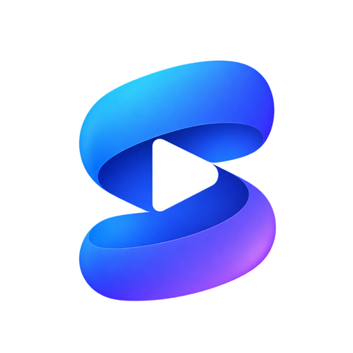
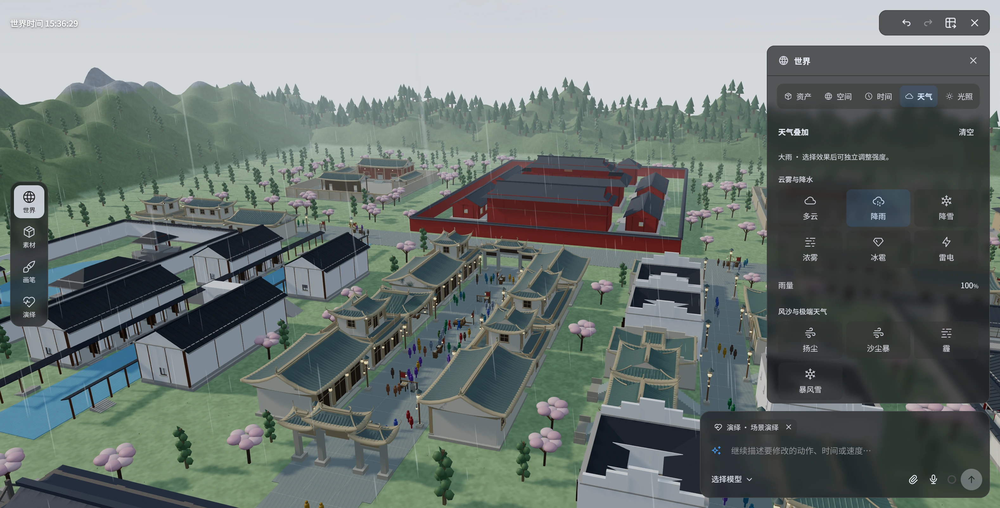

<p>
  <a href="https://github.com/HBAI-Ltd/Toonflow-app">
    
  </a>
  &nbsp;|&nbsp;
  <a href="https://gitee.com/HBAI-Ltd/Toonflow-app">
    
  </a>
  &nbsp;|&nbsp;
  <a href="https://atomgit.com/HBAI-Ltd/Toonflow-app">
    
  </a>
</p>

<p align="center">
  <a href="../../README.md">简体中文</a> |
  <a href="./readmeZhTw.md">繁體中文</a> |
  <a href="./readmeEn.md">English</a> |
  <a href="./readmeJa.md">日本語</a> |
  <a href="./readmeRu.md">Русский</a> |
  <a href="./readmeVi.md">Tiếng Việt</a> |
  <a href="./readmeTh.md">ไทย</a>
  <br />
  <a href="./readmeKo.md">한국어</a> |
  <a href="./readmeHi.md">हिन्दी</a> |
  <a href="./readmeId.md">Bahasa Indonesia</a> |
  <a href="./readmeMs.md">Bahasa Melayu</a> |
  <a href="./readmeFil.md">Filipino</a> |
  <a href="./readmeBn.md">বাংলা</a> |
  <a href="./readmeUr.md">اردو</a>
  <br />
  <a href="./readmeTa.md">தமிழ்</a> |
  <a href="./readmeTe.md">తెలుగు</a> |
  <a href="./readmeMr.md">मराठी</a> |
  <a href="./readmePa.md">ਪੰਜਾਬੀ</a> |
  <a href="./readmeAr.md">العربية</a> |
  <strong>فارسی</strong> |
  <a href="./readmeTr.md">Türkçe</a>
</p>

> 🌐 **رابط کاربری به 22 زبان** · [مشاهدهٔ زبان‌های پشتیبانی‌شده](#languages)

<div align="center">

<p align="center">
  
</p>

<a href="https://git.io/typing-svg">
  <picture>
    <source media="(prefers-color-scheme: dark)" srcset="https://readme-typing-svg.demolab.com?font=Fira+Code&size=40&duration=3000&pause=1000&color=FFFFFF&center=true&vCenter=true&width=600&lines=Toonflow;AI%20Short%20Drama%20Studio;Turn%20ideas%20into%20stories" />
    
  </picture>
</a>

<p align="center">
  <a href="https://github.com/HBAI-Ltd/Toonflow-app/stargazers">
    
  </a>
  <a href="../../LICENSE">
    
  </a>
  <a href="https://github.com/HBAI-Ltd/Toonflow-app/releases">
    
  </a>
</p>
<p align="center">
  <a href="https://github.com/HBAI-Ltd/Toonflow-app/network/members">
    
  </a>
  <a href="https://atomgit.com/HBAI-Ltd/Toonflow-app">
    
  </a>
  <a href="https://discord.gg/HEjKmpNpAZ">
    
  </a>
</p>
<p align="center">
  <a href="https://github.com/HBAI-Ltd/Toonflow-app/issues">
    
  </a>
  <a href="https://github.com/HBAI-Ltd/Toonflow-app/graphs/contributors">
    
  </a>
  <a href="https://github.com/HBAI-Ltd/Toonflow-app/commits">
    
  </a>
</p>
<p align="center">
  &nbsp;
  &nbsp;
  &nbsp;
  
</p>

<p align="center">
  <a href="https://trendshift.io/repositories/24197?utm_source=trendshift-badge&amp;utm_medium=badge&amp;utm_campaign=badge-trendshift-24197#achievements" target="_blank" rel="noopener noreferrer">
    
  </a>
  <a href="https://trendshift.io/repositories/24197?utm_source=trendshift-badge&amp;utm_medium=badge&amp;utm_campaign=badge-trendshift-24197#achievements" target="_blank" rel="noopener noreferrer">
    
  </a>
  <a href="https://trendshift.io/repositories/24197?utm_source=trendshift-badge&amp;utm_medium=badge&amp;utm_campaign=badge-trendshift-24197#achievements" target="_blank" rel="noopener noreferrer">
    
  </a>
</p>
<p align="center">
  <a href="https://trendshift.io/repositories/24197?utm_source=trendshift-badge&amp;utm_medium=badge&amp;utm_campaign=badge-trendshift-24197#achievements" target="_blank" rel="noopener noreferrer">
    
  </a>
  <a href="https://trendshift.io/repositories/24197?utm_source=trendshift-badge&amp;utm_medium=badge&amp;utm_campaign=badge-trendshift-24197#achievements" target="_blank" rel="noopener noreferrer">
    
  </a>
  <a href="https://trendshift.io/repositories/24197?utm_source=trendshift-badge&amp;utm_medium=badge&amp;utm_campaign=badge-trendshift-24197#achievements" target="_blank" rel="noopener noreferrer">
    
  </a>
</p>
<p align="center">
  <a href="https://trendshift.io/repositories/24197?utm_source=trendshift-badge&amp;utm_medium=badge&amp;utm_campaign=badge-trendshift-24197#achievements" target="_blank" rel="noopener noreferrer">
    
  </a>
</p>

**پلتفرم متن‌باز هوش مصنوعی برای ساخت سریال‌های کوتاه، کمیک‌های متحرک و ویدیو**

> 🚀 **ساخت یکپارچهٔ سریال کوتاه**: فیلم‌نامه بنویسید، دارایی‌ها را مدیریت کنید و تصویر و ویدیو بسازید؛ همهٔ مراحل کار خلاقانهٔ شما روی یک بوم بی‌نهایت کنار هم قرار می‌گیرند.

</div>

<div align="center">
  <table>
    <tr>
      <td width="50%" align="center">
        <a href="../images/gStar.png">
          
        </a>
      </td>
      <td width="50%" align="center">
        <a href="../images/gvp.jpg">
          
        </a>
      </td>
    </tr>
  </table>
</div>

<p align="center">
  <a href="https://github.com/HBAI-Ltd/Toonflow-app/releases">دانلود</a> ·
  <a href="https://qcn7xdsqgc4z.feishu.cn/docx/RXFqdgR2Xo0dXZxGfd0cZCGgnwf">راهنمای کاربر</a> ·
  <a href="https://api.toonflow.net/console/plugIn">بازار افزونه‌ها</a> ·
  <a href="https://qcn7xdsqgc4z.feishu.cn/docx/KNBNd9naqolsy6xjAOCcEAkqnRd">مستندات توسعه‌دهندگان</a> ·
  <a href="https://api.toonflow.net/">پلتفرم رسمی مدل‌ها</a>
</p>

<p align="center">
  📺 <a href="https://www.bilibili.com/video/BV1hbpb6xETF">ویدیوی معرفی محصول</a> ·
  <a href="https://www.bilibili.com/video/BV1z4sS6NEA3">دموی پیش‌نمایش TrumanMap</a>
</p>

<p align="center">🔥 سریال‌های کوتاهی که بر پایهٔ Toonflow ساخته شده‌اند در Hongguo میلیون‌ها، ده‌ها میلیون و بیش از 100 میلیون بازدید گرفته‌اند. <a href="#works">دیدن آثار</a></p>

https://github.com/user-attachments/assets/56d81114-7521-454c-9ec9-972567eddda9

---

## 1. 💛 حامیان و پشتیبانی

از شرکای زیر برای حمایت از پروژهٔ متن‌باز Toonflow سپاسگزاریم.

<table>
  <tr>
    <td width="50%" valign="top">
      <a href="https://metaso.cn/minimax-h3/?s=toon"> <strong>Metaso</strong></a>
      <br />
      <sub>تولید مقرون‌به‌صرفهٔ ویدیو با MiniMax H3: فقط ¥0.09 برای هر ثانیه با وضوح 768P و ¥0.15 برای هر ثانیه با وضوح 2K، به یوان چین (CNY). پشتیبانی از 2K بومی، صدای همگام با تصویر، API سازگار با OpenAI، ‏ComfyUI و بوم‌های بی‌نهایت، بدون نیاز به راه‌اندازی GPU شخصی. با <a href="https://metaso.cn/minimax-h3/?s=toon">ثبت‌نام از این پیوند اختصاصی</a> اعتبار هدیه و پیشنهادهای ویژه دریافت کنید. برای امور تجاری در WeChat با metasota12 تماس بگیرید.</sub>
    </td>
    <td width="50%" valign="top">
      <a href="https://go.apimart.ai/gh-toonflow-app"> <strong>APIMart</strong></a>
      <br />
      <sub>از APIMart برای حمایت از این پروژه سپاسگزاریم! APIMart پلتفرمی با API اقتصادی برای تولید تصویر و ویدیو با هوش مصنوعی است. قیمت GPT-Image-2 از $0.006 برای هر تصویر شروع می‌شود؛ یعنی بیش از 160 تصویر با $1. تصویر و ویدیو از یک API ناهمگام مشترک استفاده می‌کنند: کار را ارسال کنید، شناسهٔ آن را بگیرید و نتیجه را از طریق فراخوان بازگشتی دریافت کنید. دسته‌های 10,000 تصویری را بدون پایان مهلت درخواست پردازش کنید و بدون تغییر کد، مدل را عوض کنید. پرداخت بر اساس مصرف و بدون هزینهٔ ماهانه است. برای شروع <a href="https://go.apimart.ai/gh-toonflow-app">اینجا ثبت‌نام کنید</a>.</sub>
    </td>
  </tr>
  <tr>
    <td width="50%" valign="top">
      <a href="https://www.compshare.cn/video-studio?ytag=GPU_YY_YX_git_toonflow"> <strong>CompShare</strong></a>
      <br />
      <sub>CompShare تولید مقرون‌به‌صرفهٔ ویدیو با H3 را ارائه می‌کند؛ از جمله تبدیل متن به ویدیو، کنترل فریم آغاز و پایان و حالت‌های مرجع یکپارچه. ویدیوهایی تا 30 ثانیه با وضوح 2K بومی بسازید؛ قیمت 768P فقط CNY 0.08 در ثانیه است. دسترسی از طریق API، هم‌زمانی بالا برای شرکت‌ها و صدور فاکتور به‌صورت سلف‌سرویس نیز پشتیبانی می‌شود.</sub>
      <br /><br />
      <sub>🎁 با <a href="https://www.compshare.cn/video-studio?ytag=GPU_YY_YX_git_toonflow">ثبت‌نام از این پیوند اختصاصی</a>، اعتبار آزمایشی رایگان پلتفرم به ارزش CNY 5 دریافت کنید!</sub>
    </td>
    <td width="50%" valign="top">
      <a href="https://weimeta.cn/console/invite/accept?aff=INV202611191734123p9JeY"> <strong>WEIMETA AI</strong></a>
      <br />
      <sub>WEIMETA AI خدمات تولید متن، تصویر و ویدیو با هوش مصنوعی را با هزینه‌ای مقرون‌به‌صرفه ارائه می‌دهد و مدل‌های برجسته‌ای مانند DeepSeek، GLM، Kimi، Seedream، Seedance، Wan و MiniMax H3 را گرد هم می‌آورد. تبدیل متن به تصویر، تصویر به تصویر، متن به ویدیو و تصویر به ویدیو را از طریق یک API یکپارچه پشتیبانی می‌کند. این پلتفرم از رمزنگاری انتقال داده در سطح سازمانی و جداسازی چندمستأجری بهره می‌برد و ارزیابی امنیتی سطح ۳ چین را گذرانده است.</sub>
      <br /><br />
      <sub>🎁 با <a href="https://weimeta.cn/console/invite/accept?aff=INV202611191734123p9JeY">ثبت‌نام از این پیوند اختصاصی</a>، خدمات مدل‌های چندوجهی WEIMETA AI را امتحان کنید. پیشنهاد محدود: با شارژ CNY 100، CNY 15 هدیه بگیرید. همکاری تجاری از طریق WeChat: WeiMeta_AI666</sub>
    </td>
  </tr>
</table>

<details>
<summary><strong>👉 حامی پروژه شوید 👈</strong></summary>

<p align="center">
  
</p>

<p align="center"><sub>این راه ارتباطی فقط برای امور تجاری است و پشتیبانی فنی ارائه نمی‌کند. برای پرسش‌های مربوط به استفاده، به گروه‌های جامعه بپیوندید. درخواست قابلیت و گزارش خطا را از طریق فرم بازخورد ارسال کنید. از درک شما سپاسگزاریم.</sub></p>

</details>

---

## 2. 🌟 قابلیت‌های برجسته

| قابلیت | توضیح |
| --- | --- |
| 🎬 **پیش‌نمایش TrumanMap** | فیلمنامه را بچسبانید؛ صحنهٔ سه‌بعدی، استوری‌بورد و میزانسن با یک کلیک. |
| 🖼️ **بوم بی‌پایان** | فیلمنامه، شخصیت‌ها، صحنه‌ها و کلیپ‌ها روی یک بوم به هم وصل‌اند. |
| 🎥 **تولید ویدیو با هوش مصنوعی** | دارایی‌ها را با @ ارجاع دهید و نما به نما بسازید. |
| 🤖 **دستیار هوش مصنوعی** | بوم را می‌خواند و ویرایش می‌کند؛ پشتیبانی از MCP و A2A. |
| 🔧 **هر مدلی** | ارائه‌دهندگان داخلی، API شخص ثالث، مدل‌های محلی، ComfyUI. |
| 🧩 **بازار افزونه** | گره، ابزار و مهارت با یک کلیک. |
| 🏠 **استقرار محلی** | Windows، macOS، Linux، Android، Docker. |
| 🌐 **چندزبانه** | ۲۲ زبان رابط کاربری. |

**روند کار**: فیلمنامه و استوری‌بورد ← شخصیت و صحنه ← پیش‌نمایش سه‌بعدی ← ویدیو نما به نما ← تدوین و دانلود.

### پرسش‌های متداول

**Toonflow چیست؟** پلتفرم متن‌باز برای ساخت درام کوتاه، کمیک و ویدیو با هوش مصنوعی.

**رایگان است؟** با مجوز MIT و رایگان برای میزبانی شخصی؛ API مدل‌های شخص ثالث ممکن است هزینه داشته باشد.

**چه مدل‌هایی؟** Seedance، Seedream، MiniMax، Wan و دیگران داخلی‌اند؛ API شخص ثالث، مدل‌های محلی و ComfyUI هم قابل اتصال‌اند. [راهنمای استفاده](https://qcn7xdsqgc4z.feishu.cn/docx/RXFqdgR2Xo0dXZxGfd0cZCGgnwf) را ببینید.

**چه سیستم‌هایی؟** Windows، macOS، Linux، Android و همچنین Docker و سرور.

<a id="languages"></a>

### پشتیبانی چندزبانه

زبان‌های پشتیبانی‌شده: 简体中文، 繁體中文، English، 日本語، Русский، Tiếng Việt، ไทย، 한국어، हिन्दी، Bahasa Indonesia، Bahasa Melayu، Filipino، বাংলা، اردو، தமிழ்، తెలుగు، मराठी، ਪੰਜਾਬੀ، العربية، فارسی، Türkçe، Português (Brasil).

---

## 3. 📸 ۱۰ ویژگی برجسته

<a id="trumanmap"></a>

### ویژگی 1 | فیلمنامه را بچسبانید، پیش‌نمایش سه‌بعدی بگیرید

نما و میزانسن خودکار بر اساس دیالوگ؛ تصویر و زیرنویس زنده در مانیتور. 📺 [دیدن دمو](https://www.bilibili.com/video/BV1z4sS6NEA3)

https://github.com/user-attachments/assets/bb2f7bfe-46de-44ff-b3b3-95379f9d4b20

<p align="center">
  <a href="../images/screenshots/trumanMapTimeline.webp"></a>
</p>

<table>
  <tr>
    <td width="50%"><a href="../images/screenshots/trumanMapShot.webp"></a></td>
    <td width="50%"><a href="../images/screenshots/trumanMapStreet.webp"></a></td>
  </tr>
</table>

### ویژگی 2 | شهرک آبی بی‌پایان جیانگنان

حصار شهر، کوچه‌ها، کانال‌ها، معابد و کوه‌ها: بیش از ۱٬۵۰۰ شیء.

<p align="center">
  <a href="../images/screenshots/trumanMapTown.webp"></a>
</p>

<table>
  <tr>
    <td width="50%"><a href="../images/screenshots/trumanMapAerial.webp"></a></td>
    <td width="50%"><a href="../images/screenshots/trumanMapTemple.webp"></a></td>
  </tr>
</table>

### ویژگی 3 | ۶۴ صحنهٔ آماده + بیش از ۸۰٬۰۰۰ دارایی

<table>
  <tr>
    <td width="50%"><a href="../images/screenshots/trumanMapSets.webp"></a></td>
    <td width="50%"><a href="../images/screenshots/trumanMapAssets.webp"></a></td>
  </tr>
</table>

### ویژگی 4 | آب‌وهوا، زمان و زمین با یک کلیک

<table>
  <tr>
    <td width="50%"><a href="../images/screenshots/trumanMapRain.webp"></a></td>
    <td width="50%"><a href="../images/screenshots/trumanMapBrush.webp"></a></td>
  </tr>
  <tr>
    <td width="50%"><a href="../images/screenshots/trumanMapWorld.webp"></a></td>
    <td width="50%"><a href="../images/screenshots/trumanMapHome.webp"></a></td>
  </tr>
</table>

### ویژگی 5 | خروجی پیش‌نمایش مستقیم برای تولید ویدیو

استوری‌بورد، نمای چهارطرفه، ویدیوی پیش‌نمایش، انیماتیک و فهرست نماها با یک کلیک به بوم برمی‌گردند.

### ویژگی 6 | بوم بی‌پایان + دستیار هوش مصنوعی

<table>
  <tr>
    <td width="50%"><a href="../images/screenshots/canvasNodeMenu.webp"></a></td>
    <td width="50%"><a href="../images/screenshots/canvasAgent.webp"></a></td>
  </tr>
</table>

### ویژگی 7 | تولید ویدیو با چند مرجع

<p align="center">
  <a href="../images/screenshots/videoGenerationNode.webp"></a>
</p>

### ویژگی 8 | اسناد فیلمنامه و فضای کار

<p align="center">
  <a href="../images/screenshots/canvasDocument.webp"></a>
</p>

### ویژگی 9 | خانه و کتابخانهٔ دارایی

<table>
  <tr>
    <td width="50%"><a href="../images/screenshots/home.webp"></a></td>
    <td width="50%"><a href="../images/screenshots/assetLibrary.webp"></a></td>
  </tr>
</table>

### ویژگی 10 | بازار افزونه

افزونه‌های بیشتر در [بازار افزونهٔ وب](https://api.toonflow.net/console/plugIn).

<p align="center">
  <a href="../images/screenshots/pluginMarket.webp"></a>
</p>

---

## 4. 🚀 دانلود و نصب

### 4.1 نصب برنامه

| سیستم‌عامل | GitHub |
| --- | --- |
| Windows | [نسخه‌های انتشار](https://github.com/HBAI-Ltd/Toonflow-app/releases) |
| macOS | [نسخه‌های انتشار](https://github.com/HBAI-Ltd/Toonflow-app/releases) |
| Android ARM64 | [دانلود APK](https://github.com/HBAI-Ltd/Toonflow-app/releases/latest) |

برنامهٔ Android فقط از دستگاه‌های ARM64 پشتیبانی می‌کند. فایل `toonflow-VERSION-android-arm64.apk` را از صفحهٔ انتشار دانلود و نصب کنید. برنامه یک بک‌اند محلی Bun دارد و می‌تواند مستقل اجرا شود؛ همچنین از طریق «اتصال دستگاه‌ها» در صفحهٔ اصلی، با اسکن کد QR یا ورود دستی اطلاعات، به رایانه یا بک‌اندی با اشتراک‌گذاری فعال در شبکهٔ محلی یا اینترنت متصل می‌شود.

نصب‌کنندهٔ Windows به‌طور خودکار WebView2 را شناسایی و نصب می‌کند. اگر برنامه پس از نصب بلافاصله بسته شد، محیط اجرا را از [صفحهٔ دانلود WebView2](https://developer.microsoft.com/microsoft-edge/webview2/) دریافت و دستی نصب کنید.

در macOS ‏(Apple Silicon)، ‏Toonflow را به پوشهٔ Applications بکشید و مستقیماً باز کنید. نیازی به اجرای دستور در ترمینال از قبل نیست. اگر macOS هشدار امنیتی نشان داد، مراحل زیر را به‌ترتیب دنبال کنید.

<details>
<summary><strong>اگر نصب یا باز کردن Toonflow در macOS ممکن نیست</strong></summary>

**1. در بخش حریم خصوصی و امنیت، اجازهٔ اجرای Toonflow را بدهید**

اگر هشداری دربارهٔ تأیید نشدن توسعه‌دهنده یا ناتوانی Apple در بررسی بدافزار نشان داده شد، ابتدا برای باز کردن Toonflow تلاش کنید. سپس به تنظیمات سیستم ← حریم خصوصی و امنیت بروید، پیام مسدود شدن Toonflow را پیدا کنید، «باز کردن در هر صورت» را بزنید و تأیید کنید. [راهنمای رسمی Apple](https://support.apple.com/zh-cn/102445) را ببینید.

**2. اگر محدودیت قرنطینه همچنان مانع اجراست، ویژگی قرنطینه را حذف کنید**

پس از اطمینان از اینکه برنامه را از صفحهٔ رسمی انتشار دریافت کرده‌اید و در Applications قرار دارد، دستور زیر را در ترمینال اجرا کنید و دوباره برنامه را باز کنید. اگر نام برنامه یا محل نصب متفاوت است، مسیر را تغییر دهید.

```bash
sudo xattr -rd com.apple.quarantine /Applications/toonflow.app
```

**3. آخرین راه: موقتاً به برنامه‌ها از هر منبعی اجازهٔ اجرا بدهید**

اگر دو روش نخست جواب نداد و به منبع برنامه اعتماد دارید، این دستور را امتحان کنید:

```bash
sudo spctl --master-disable
```

سپس تنظیمات سیستم ← حریم خصوصی و امنیت را باز کنید. در بخش امنیت، اگر سیستم این گزینه را دارد، «اجازهٔ اجرای برنامه‌های دریافت‌شده از» را روی «هرجا» قرار دهید و تأیید کنید. گزینه‌های موجود و پشتیبانی از دستورها ممکن است در نسخه‌های مختلف macOS متفاوت باشد.

این کار محدودیت‌های امنیتی را برای همهٔ برنامه‌ها کاهش می‌دهد. پیشنهاد می‌کنیم پس از آن، تنظیم را به «App Store و توسعه‌دهندگان تأییدشده» برگردانید.

</details>

برای توضیحات بیشتر، [راهنمای کاربر](https://qcn7xdsqgc4z.feishu.cn/docx/RXFqdgR2Xo0dXZxGfd0cZCGgnwf) را ببینید.

---

### 4.2 نصب با Docker

ابتدا Git، ‏[Docker Engine](https://docs.docker.com/engine/install/) و Docker Compose را نصب کنید. در Windows و macOS می‌توانید Docker Desktop را در حالت کانتینرهای Linux به کار ببرید. مخزن شامل [Dockerfile](../../Dockerfile)، ‏[پیکربندی Compose](../../compose.yaml) و [موارد مستثنا از ساخت](../../.dockerignore) است. ایمیج با Bun 1.4.3 ساخته می‌شود و FFmpeg را در خود دارد.

<details>
<summary><strong>نمایش مراحل نصب با Docker</strong></summary>

کد منبع را کلون کنید و دستورهای زیر را در ریشهٔ مخزن اجرا کنید:

```sh
git clone https://github.com/HBAI-Ltd/Toonflow-app.git
cd Toonflow-app
docker compose up -d --build
```

در نخستین ساخت، وابستگی‌ها نصب و گره‌ها، ابزارها، Web و Server همراه پروژه ساخته می‌شوند. پس از راه‌اندازی، `http://127.0.0.1:3000` را باز کنید. برای میزبان راه دور، مطابق بخش «دسترسی و داده‌ها» در ادامه از تونل SSH استفاده کنید. نخستین اجرا افزونه‌های همراه را آماده می‌کند و پوشهٔ کاری `myProject` را در اختیارتان می‌گذارد.

تنظیمات، افزونه‌ها و فایل‌های پروژه در والیوم نام‌دار Docker با نام `toonflowData` نگهداری می‌شوند که درون کانتینر به `/app/data/` متصل است. نام واقعی والیوم پیشوند پروژهٔ Compose را نیز دارد. توقف یا ساخت دوبارهٔ کانتینر داده‌ها را حفظ می‌کند. **از `docker compose down -v` استفاده نکنید؛ این دستور والیوم داده‌ها را حذف می‌کند.**

```sh
docker compose logs -f toonflow  # View logs
docker compose stop             # Stop the service
docker compose start            # Start it again
docker compose down             # Remove containers, retaining the data volume
```

برای افزودن پوشهٔ پروژه، در پنجرهٔ «انتخاب پوشهٔ کاری سرور» روی «پوشهٔ جدید» کلیک کنید. این پنجره تغییر نام و حذف فایل‌ها و پوشه‌ها را هم پشتیبانی می‌کند. همچنین می‌توانید هنگام اجرای سرویس، از خط فرمان پوشه بسازید:

```sh
docker compose exec toonflow mkdir -p /app/data/workspaces/newProject
```

برای پشتیبان‌گیری، ابتدا سرویس را متوقف کنید، داده‌ها را کپی کنید و سپس سرویس را دوباره راه بیندازید:

```sh
docker compose stop
docker compose cp toonflow:/app/data ./toonflowBackup
docker compose start
```

</details>

---

### 4.3 نصب روی سرور

برای اجرای مستقیم Web و Server روی سرور Linux از این روش استفاده کنید. مثال زیر بر پایهٔ Ubuntu / Debian و نسخهٔ تعیین‌شدهٔ پروژه، یعنی [Bun 1.4.3](https://bun.sh/docs/installation)، است.

<details>
<summary><strong>نمایش مراحل نصب روی سرور</strong></summary>

محیط اجرا را نصب کنید:

```sh
sudo apt-get update
sudo apt-get install -y git curl unzip ffmpeg
curl -fsSL https://bun.com/install | bash -s "bun-v1.4.3"
export PATH="$HOME/.bun/bin:$PATH"
bun --version
```

کد منبع را کلون و سرویس را راه‌اندازی کنید:

```sh
git clone https://github.com/HBAI-Ltd/Toonflow-app.git
cd Toonflow-app
bun install --frozen-lockfile

# Build bundled nodes, tools, Web, and Server
bun run build:server
mkdir -p data/workspaces/myProject
bun run start:server
```

وقتی پیام «服务启动成功» (سرویس با موفقیت راه‌اندازی شد) را دیدید، `http://127.0.0.1:3000` را روی خود سرور باز کنید. دستور بالا در پیش‌زمینه اجرا می‌شود؛ برای توقف آن `Ctrl+C` را بزنید. برای اجرای خودکار هنگام بوت و مدیریت فرایند، [راهنمای استقرار Bun با systemd](https://bun.sh/guides/ecosystem/systemd) را ببینید. پوشهٔ مخزن را به‌عنوان پوشهٔ کاری و مسیر مطلق Bun به‌همراه `run start:server` را به‌عنوان دستور شروع تعیین کنید. آن را با کاربری اجرا کنید که مجوز خواندن و نوشتن در آن پوشه را دارد.

</details>

---

### 4.4 دسترسی و داده‌ها

- سرویس در حال حاضر از پورت ثابت `3000` استفاده می‌کند. رابط وب و API احراز هویت ورود جداگانه ندارند. در نصب روی سرور، دسترسی به پورت `3000` را با دیوار آتش یا گروه امنیتی محدود کنید. دسترسی عمومی به پراکسی معکوس مجهز به احراز هویت نیاز دارد.
- برای دسترسی شخصی از راه دور، روی رایانهٔ خود `ssh -N -L 3000:127.0.0.1:3000 username@server-address` را اجرا کنید. اتصال را باز نگه دارید و سپس به `http://127.0.0.1:3000` بروید. نیازی نیست پورت `3000` سرور را در اینترنت عمومی باز کنید.
- در نصب مستقیم، تنظیمات، افزونه‌ها و فضاهای کاری به‌طور پیش‌فرض در پوشهٔ `data/` مخزن ذخیره می‌شوند. در Docker، محل آن‌ها `/app/data/` درون والیوم داده است. هنگام جابه‌جایی یا پشتیبان‌گیری، کل پوشه را نگه دارید. پس از باز کردن صفحه، `myProject` را در فضای کاری سرور انتخاب کنید. برای پروژه‌های بیشتر، در پوشهٔ `workspaces/` مربوطه زیرپوشه بسازید.
- هر دو روش نصب، FFmpeg سیستمی را شامل می‌شوند. کلیدهای API سرویس‌های مدل را همچنان باید در رابط کاربری تنظیم کنید.

---

### 4.5 استقرار ابری

شریک ما [AI Galaxy (智星云)](https://www.ai-galaxy.com/) ایمیج تجاری Toonflow را با مجوز رسمی و محیطی آمادهٔ استفاده ارائه می‌کند. برای دستورالعمل‌ها، [راهنمای تصویری استقرار ایمیج](https://mp.weixin.qq.com/s/lq9X1ovQ1_TKeXMOLgicKg?scene=1) را ببینید.

---

## 5. 🎬 نمونهٔ اثر

<a id="works"></a>

### آثار پرطرفدار در Hongguo

🔥 سریال‌های کوتاهی که بر پایهٔ Toonflow ساخته شده‌اند در Hongguo میلیون‌ها، ده‌ها میلیون و بیش از 100 میلیون بازدید گرفته‌اند.

<p align="center">
  
</p>

<p align="center">
  
</p>

### ویدیوهای تبلیغاتی

<table>
  <tr>
    <td width="50%"><video src="https://github.com/user-attachments/assets/fccf8b46-b8ec-46cb-9574-9273cd1ee9e4" controls width="100%"></video></td>
    <td width="50%"><video src="https://github.com/user-attachments/assets/b345905e-601f-43be-83a5-305f97a29e44" controls width="100%"></video></td>
  </tr>
  <tr>
    <td width="50%"><video src="https://github.com/user-attachments/assets/fc5880aa-6b9c-4717-af0e-e51f15c4fdc6" controls width="100%"></video></td>
    <td width="50%"><video src="https://github.com/user-attachments/assets/0816e794-f07d-4bc3-89cd-69c67566c3a6" controls width="100%"></video></td>
  </tr>
</table>

### نمونهٔ سریال کوتاه

https://github.com/user-attachments/assets/2d9fddac-dfdf-4640-b030-b09d7f7287e9

ویدیوی نمایشی نسخهٔ فشرده‌شدهٔ 480p است.

---

## 6. 👨‍👩‍👧‍👦 جامعهٔ WeChat

برای تماس با دستیار دعوت به گروه، کد QR را اسکن کنید:


همچنین می‌توانید با کلیک روی نماد زیر به Discord بپیوندید:

[](https://discord.gg/HEjKmpNpAZ)

یا از پیوند دعوت استفاده کنید: [https://discord.gg/HEjKmpNpAZ](https://discord.gg/HEjKmpNpAZ)

---

## 7. 💌 تماس با ما

📧 ایمیل: [ltlctools@outlook.com](mailto:ltlctools@outlook.com?subject=Toonflow咨询)

---

## 8. 📜 مجوز متن‌باز

Toonflow تحت [MIT License](../../LICENSE) منتشر می‌شود. وابستگی‌ها و دارایی‌های شخص ثالث همچنان تابع مجوزها و اعلامیه‌های حق نشر خود هستند.

[](https://www.star-history.com/#HBAI-Ltd/Toonflow-app&Date)

> **بند عدم عطف به ماسبق**: کاربرانی که نسخه‌های پیش از v1.0.8 را تحت AGPL-3.0 استفاده کرده‌اند، همچنان تابع AGPL-3.0 هستند. نسخه‌های v1.0.8 تا v1.1.8 همچنان تابع Apache-2.0 و توافق‌نامهٔ تکمیلی آن هستند. این تغییر مجوز شامل آن کاربران نمی‌شود.

---

## 9. 🙏 سپاسگزاری

- **شرکا**: 算能云، ‏Tencent Hunyuan 3D و AI Galaxy (智星云).
- **مشارکت‌کنندگان پروژه**: از همهٔ کسانی که کد نوشته‌اند، مستندات را بهبود داده‌اند، افزونه‌ها را به اشتراک گذاشته‌اند و در عیب‌یابی کمک کرده‌اند سپاسگزاریم.
- **کاربران جامعه**: از همهٔ کسانی که پیوسته بازخورد می‌دهند، آثارشان را به اشتراک می‌گذارند و از پروژه حمایت می‌کنند سپاسگزاریم.

仰起脸笑的像满月: منابع پردازشی توسعه با Codex 20x را فراهم کرد.
Xi'an Zhongxing Digital Intelligence Technology Co., Ltd. (西安中星数字智能科技有限公司): امضای برنامه با گواهی Apple را فراهم کرد.

<p align="center"><sub>Free code signing provided by <a href="https://signpath.io/">SignPath.io</a>, certificate by <a href="https://signpath.org/">SignPath Foundation</a>.</sub></p>

<div align="center">

حق نشر © 2026 北京爱阿科技有限公司

</div>


