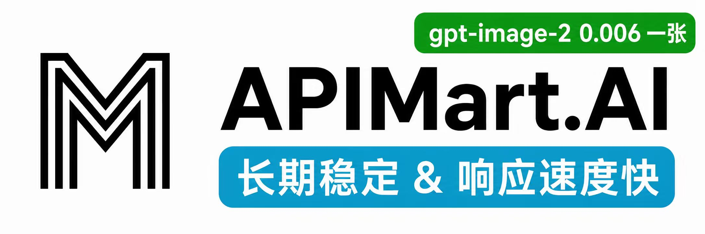
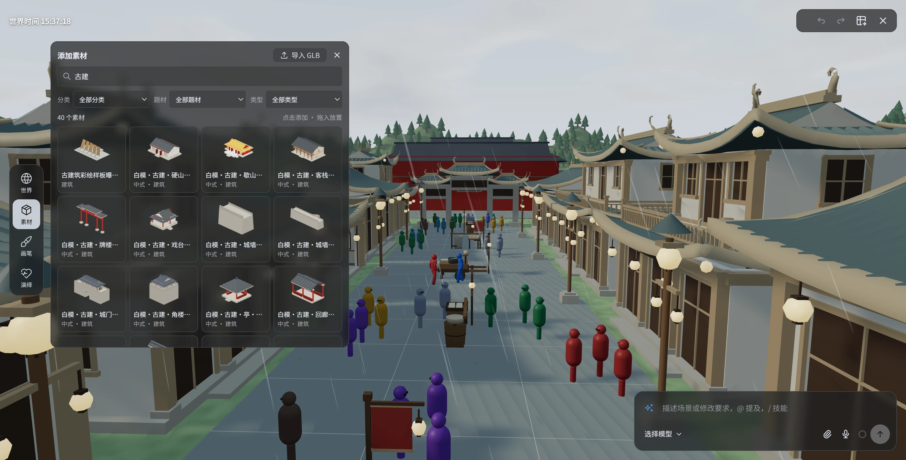
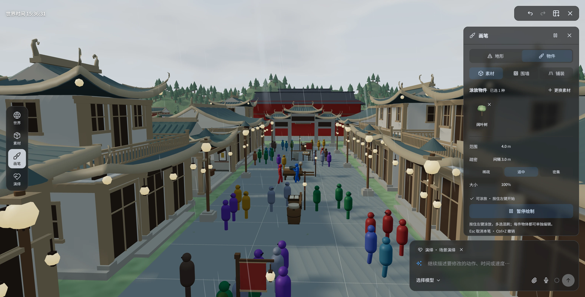

<p>
  <a href="https://github.com/HBAI-Ltd/Toonflow-app">
    
  </a>
  &nbsp;|&nbsp;
  <a href="https://gitee.com/HBAI-Ltd/Toonflow-app">
    
  </a>
  &nbsp;|&nbsp;
  <a href="https://atomgit.com/HBAI-Ltd/Toonflow-app">
    
  </a>
</p>

<p align="center">
  <a href="../../README.md">简体中文</a> |
  <a href="./readmeZhTw.md">繁體中文</a> |
  <a href="./readmeEn.md">English</a> |
  <a href="./readmeJa.md">日本語</a> |
  <a href="./readmeRu.md">Русский</a> |
  <a href="./readmeVi.md">Tiếng Việt</a> |
  <a href="./readmeTh.md">ไทย</a>
  <br />
  <a href="./readmeKo.md">한국어</a> |
  <a href="./readmeHi.md">हिन्दी</a> |
  <a href="./readmeId.md">Bahasa Indonesia</a> |
  <a href="./readmeMs.md">Bahasa Melayu</a> |
  <strong>Filipino</strong> |
  <a href="./readmeBn.md">বাংলা</a> |
  <a href="./readmeUr.md">اردو</a>
  <br />
  <a href="./readmeTa.md">தமிழ்</a> |
  <a href="./readmeTe.md">తెలుగు</a> |
  <a href="./readmeMr.md">मराठी</a> |
  <a href="./readmePa.md">ਪੰਜਾਬੀ</a> |
  <a href="./readmeAr.md">العربية</a> |
  <a href="./readmeFa.md">فارسی</a> |
  <a href="./readmeTr.md">Türkçe</a>
</p>

> 🌐 **Sinusuportahan ang 22 wika ng interface** · [Tingnan ang mga sinusuportahang wika](#languages)

<div align="center">

<p align="center">
  
</p>

<a href="https://git.io/typing-svg">
  <picture>
    <source media="(prefers-color-scheme: dark)" srcset="https://readme-typing-svg.demolab.com?font=Fira+Code&size=40&duration=3000&pause=1000&color=FFFFFF&center=true&vCenter=true&width=600&lines=Toonflow;AI%20Short%20Drama%20Studio;Turn%20ideas%20into%20stories" />
    
  </picture>
</a>

<p align="center">
  <a href="https://github.com/HBAI-Ltd/Toonflow-app/stargazers">
    
  </a>
  <a href="../../LICENSE">
    
  </a>
  <a href="https://github.com/HBAI-Ltd/Toonflow-app/releases">
    
  </a>
</p>
<p align="center">
  <a href="https://github.com/HBAI-Ltd/Toonflow-app/network/members">
    
  </a>
  <a href="https://atomgit.com/HBAI-Ltd/Toonflow-app">
    
  </a>
  <a href="https://discord.gg/HEjKmpNpAZ">
    
  </a>
</p>
<p align="center">
  <a href="https://github.com/HBAI-Ltd/Toonflow-app/issues">
    
  </a>
  <a href="https://github.com/HBAI-Ltd/Toonflow-app/graphs/contributors">
    
  </a>
  <a href="https://github.com/HBAI-Ltd/Toonflow-app/commits">
    
  </a>
</p>
<p align="center">
  &nbsp;
  &nbsp;
  &nbsp;
  
</p>

<p align="center">
  <a href="https://trendshift.io/repositories/24197?utm_source=trendshift-badge&amp;utm_medium=badge&amp;utm_campaign=badge-trendshift-24197#achievements" target="_blank" rel="noopener noreferrer">
    
  </a>
  <a href="https://trendshift.io/repositories/24197?utm_source=trendshift-badge&amp;utm_medium=badge&amp;utm_campaign=badge-trendshift-24197#achievements" target="_blank" rel="noopener noreferrer">
    
  </a>
  <a href="https://trendshift.io/repositories/24197?utm_source=trendshift-badge&amp;utm_medium=badge&amp;utm_campaign=badge-trendshift-24197#achievements" target="_blank" rel="noopener noreferrer">
    
  </a>
</p>
<p align="center">
  <a href="https://trendshift.io/repositories/24197?utm_source=trendshift-badge&amp;utm_medium=badge&amp;utm_campaign=badge-trendshift-24197#achievements" target="_blank" rel="noopener noreferrer">
    
  </a>
  <a href="https://trendshift.io/repositories/24197?utm_source=trendshift-badge&amp;utm_medium=badge&amp;utm_campaign=badge-trendshift-24197#achievements" target="_blank" rel="noopener noreferrer">
    
  </a>
  <a href="https://trendshift.io/repositories/24197?utm_source=trendshift-badge&amp;utm_medium=badge&amp;utm_campaign=badge-trendshift-24197#achievements" target="_blank" rel="noopener noreferrer">
    
  </a>
</p>
<p align="center">
  <a href="https://trendshift.io/repositories/24197?utm_source=trendshift-badge&amp;utm_medium=badge&amp;utm_campaign=badge-trendshift-24197#achievements" target="_blank" rel="noopener noreferrer">
    
  </a>
</p>

**Isang open-source na AI platform para sa maiikling drama, animated na komiks, at paggawa ng video**

> 🚀 **Kumpletong paggawa ng maikling drama**: Sumulat ng iskrip, pamahalaan ang mga asset, at bumuo ng mga larawan at video. Ayusin ang buong proseso ng paglikha sa isang walang-hanggang canvas.

</div>

<div align="center">
  <table>
    <tr>
      <td width="50%" align="center">
        <a href="../images/gStar.png">
          
        </a>
      </td>
      <td width="50%" align="center">
        <a href="../images/gvp.jpg">
          
        </a>
      </td>
    </tr>
  </table>
</div>

<p align="center">
  <a href="https://github.com/HBAI-Ltd/Toonflow-app/releases">I-download</a> ·
  <a href="https://qcn7xdsqgc4z.feishu.cn/docx/RXFqdgR2Xo0dXZxGfd0cZCGgnwf">Gabay sa Paggamit</a> ·
  <a href="https://api.toonflow.net/console/plugIn">Pamilihan ng mga Plugin</a> ·
  <a href="https://qcn7xdsqgc4z.feishu.cn/docx/KNBNd9naqolsy6xjAOCcEAkqnRd">Dokumentasyon para sa mga Developer</a> ·
  <a href="https://api.toonflow.net/">Opisyal na Platform ng mga Modelo</a>
</p>

<p align="center">
  📺 <a href="https://www.bilibili.com/video/BV1hbpb6xETF">Video ng pagpapakilala</a> ·
  <a href="https://www.bilibili.com/video/BV1z4sS6NEA3">Demo ng TrumanMap previs</a>
</p>

<p align="center">🔥 Ang mga short drama na binuo batay sa Toonflow ay umabot na sa milyon-milyon, sampu-sampung milyon, at higit 100 milyong views sa Hongguo. <a href="#works">Tingnan ang mga gawa</a></p>

https://github.com/user-attachments/assets/56d81114-7521-454c-9ec9-972567eddda9

---

## 1. 💛 Mga Sponsor at Suporta

Salamat sa mga sumusunod na katuwang sa pagsuporta sa open-source na proyektong Toonflow.

<table>
  <tr>
    <td width="50%" valign="top">
      <a href="https://metaso.cn/minimax-h3/?s=toon"> <strong>Metaso</strong></a>
      <br />
      <sub>Abot-kayang pagbuo ng video gamit ang MiniMax H3: ¥0.09/segundo lamang sa 768P at ¥0.15/segundo sa 2K (CNY). Sinusuportahan nito ang katutubong 2K, sabay na audio at video, API na tugma sa OpenAI, ComfyUI, at walang-hanggang canvas, nang hindi kailangang mag-deploy ng sariling GPU. <a href="https://metaso.cn/minimax-h3/?s=toon">Magparehistro gamit ang espesyal na link na ito</a> upang makatanggap ng mga bonus credit at eksklusibong alok. Para sa mga usaping pangnegosyo, kontakin ang metasota12 sa WeChat.</sub>
    </td>
    <td width="50%" valign="top">
      <a href="https://go.apimart.ai/gh-toonflow-app"> <strong>APIMart</strong></a>
      <br />
      <sub>Salamat sa APIMart sa pag-sponsor ng proyektong ito! Ang APIMart ay isang abot-kayang API platform para sa pagbuo ng mga larawan at video gamit ang AI. Nagsisimula ang GPT-Image-2 sa $0.006 bawat larawan, o mahigit 160 larawan sa halagang $1. Iisang asynchronous API ang ginagamit para sa larawan at video: magsumite ng gawain, kunin ang ID nito, at tanggapin ang resulta sa pamamagitan ng callback. Magproseso ng mga batch na may 10,000 larawan nang walang timeout, at magpalit ng modelo nang hindi binabago ang code. Magbayad ayon sa paggamit, nang walang buwanang bayarin. <a href="https://go.apimart.ai/gh-toonflow-app">Magparehistro rito</a> upang makapagsimula.</sub>
    </td>
  </tr>
  <tr>
    <td width="50%" valign="top">
      <a href="https://www.compshare.cn/video-studio?ytag=GPU_YY_YX_git_toonflow"> <strong>CompShare</strong></a>
      <br />
      <sub>Nag-aalok ang CompShare ng abot-kayang pagbuo ng H3 video, kabilang ang text-to-video, pagkontrol sa una at huling frame, at mga mode na gumagamit ng pinagsamang sanggunian. Makagawa ng video na hanggang 30 segundo sa katutubong 2K; CNY 0.08 bawat segundo lamang para sa 768P. Sinusuportahan ang paggamit ng API, maramihang sabayang kahilingan para sa mga negosyo, at sariling pagkuha ng invoice.</sub>
      <br /><br />
      <sub>🎁 <a href="https://www.compshare.cn/video-studio?ytag=GPU_YY_YX_git_toonflow">Magparehistro gamit ang espesyal na link na ito</a> upang makatanggap ng CNY 5 na libreng credit para masubukan ang platform!</sub>
    </td>
    <td width="50%" valign="top">
      <a href="https://weimeta.cn/console/invite/accept?aff=INV202611191734123p9JeY"> <strong>WEIMETA AI</strong></a>
      <br />
      <sub>Nag-aalok ang WEIMETA AI ng abot-kayang AI text, image, at video generation, at pinagsasama ang mga nangungunang model gaya ng DeepSeek, GLM, Kimi, Seedream, Seedance, Wan, at MiniMax H3. Sinusuportahan ang text-to-image, image-to-image, text-to-video, at image-to-video sa iisang unified API na may flexible na multi-model access para sa AI content ng mga negosyo. Gumagamit ang platform ng enterprise-grade na encrypted transmission at multi-tenant isolation, at pumasa sa Level 3 security assessment ng China.</sub>
      <br /><br />
      <sub>🎁 <a href="https://weimeta.cn/console/invite/accept?aff=INV202611191734123p9JeY">Magparehistro gamit ang espesyal na link na ito</a> para subukan ang multimodal model services ng WEIMETA AI. Limitadong alok: mag-top up ng CNY 100 at makakuha ng dagdag na CNY 15. Para sa negosyo, sa WeChat: WeiMeta_AI666</sub>
    </td>
  </tr>
</table>

<details>
<summary><strong>👉 Maging Sponsor 👈</strong></summary>

<p align="center">
  
</p>

<p align="center"><sub>Para lamang sa pakikipag-ugnayang pangnegosyo ang contact na ito at hindi ito nagbibigay ng teknikal na suporta. Para sa mga tanong sa paggamit, sumali sa mga grupo ng komunidad. Isumite ang mga mungkahing feature at bug sa feedback form. Salamat sa pag-unawa.</sub></p>

</details>

---

## 2. 🌟 Mga Pangunahing Kakayahan

| Kakayahan | Paliwanag |
| --- | --- |
| 🎬 **TrumanMap previs** | I-paste ang script: 3D set, storyboard at blocking sa isang click. |
| 🖼️ **Walang-hanggang canvas** | Script, karakter, eksena at clip na magkakaugnay. |
| 🎥 **AI video generation** | I-@ ang asset at gumawa kada shot. |
| 🤖 **AI assistant** | Nagbabasa at nag-e-edit ng canvas; may MCP at A2A. |
| 🔧 **Kahit anong model** | Built-in na provider, third-party API, lokal na LLM, ComfyUI. |
| 🧩 **Plugin market** | Mag-install ng node, tool at skill sa isang click. |
| 🏠 **Lokal na deployment** | Windows, macOS, Linux, Android, Docker. |
| 🌐 **Maraming wika** | 22 wika ng interface. |

**Daloy**: Script at storyboard → karakter at eksena → 3D previs → video kada shot → edit at download.

### Mga madalas itanong

**Ano ang Toonflow?** Open-source na platform para sa AI short drama, AI comic at AI video.

**Libre ba?** MIT license at libreng i-self-host; maaaring may bayad ang third-party model API.

**Anong mga model?** Built-in ang Seedance, Seedream, MiniMax, Wan at iba pa; puwede rin ang third-party API, lokal na LLM at ComfyUI. Tingnan ang [gabay](https://qcn7xdsqgc4z.feishu.cn/docx/RXFqdgR2Xo0dXZxGfd0cZCGgnwf).

**Anong mga platform?** Windows, macOS, Linux, Android, pati Docker at server.

<a id="languages"></a>

### Suporta sa maraming wika

Mga sinusuportahang wika: 简体中文, 繁體中文, English, 日本語, Русский, Tiếng Việt, ไทย, 한국어, हिन्दी, Bahasa Indonesia, Bahasa Melayu, Filipino, বাংলা, اردو, தமிழ், తెలుగు, मराठी, ਪੰਜਾਬੀ, العربية, فارسی, Türkçe, Português (Brasil).

---

## 3. 📸 10 Pangunahing Tampok

<a id="trumanmap"></a>

### Tampok 1 | I-paste ang script, may 3D previs agad

Awtomatikong shot at blocking ayon sa linya; live na larawan at subtitle sa monitor. 📺 [Panoorin ang demo](https://www.bilibili.com/video/BV1z4sS6NEA3)

https://github.com/user-attachments/assets/bb2f7bfe-46de-44ff-b3b3-95379f9d4b20

<p align="center">
  <a href="../images/screenshots/trumanMapTimeline.webp"></a>
</p>

<table>
  <tr>
    <td width="50%"><a href="../images/screenshots/trumanMapShot.webp"></a></td>
    <td width="50%"><a href="../images/screenshots/trumanMapStreet.webp"></a></td>
  </tr>
</table>

### Tampok 2 | Walang-katapusang water town ng Jiangnan

Pader ng lungsod, kalye, kanal, templo at bundok: higit 1,500 bagay.

<p align="center">
  <a href="../images/screenshots/trumanMapTown.webp"></a>
</p>

<table>
  <tr>
    <td width="50%"><a href="../images/screenshots/trumanMapAerial.webp"></a></td>
    <td width="50%"><a href="../images/screenshots/trumanMapTemple.webp"></a></td>
  </tr>
</table>

### Tampok 3 | 64 handang set + 80,000+ asset

<table>
  <tr>
    <td width="50%"><a href="../images/screenshots/trumanMapSets.webp"></a></td>
    <td width="50%"><a href="../images/screenshots/trumanMapAssets.webp"></a></td>
  </tr>
</table>

### Tampok 4 | Panahon, oras at lupain sa isang click

<table>
  <tr>
    <td width="50%"><a href="../images/screenshots/trumanMapRain.webp"></a></td>
    <td width="50%"><a href="../images/screenshots/trumanMapBrush.webp"></a></td>
  </tr>
  <tr>
    <td width="50%"><a href="../images/screenshots/trumanMapWorld.webp"></a></td>
    <td width="50%"><a href="../images/screenshots/trumanMapHome.webp"></a></td>
  </tr>
</table>

### Tampok 5 | I-export ang previs diretso sa video

Storyboard, four-view sheet, previs video, animatic at shot list, ibinabalik sa canvas sa isang click.

### Tampok 6 | Walang-hanggang canvas + AI assistant

<table>
  <tr>
    <td width="50%"><a href="../images/screenshots/canvasNodeMenu.webp"></a></td>
    <td width="50%"><a href="../images/screenshots/canvasAgent.webp"></a></td>
  </tr>
</table>

### Tampok 7 | Video mula sa maraming reference

<p align="center">
  <a href="../images/screenshots/videoGenerationNode.webp"></a>
</p>

### Tampok 8 | Mga script document at workspace

<p align="center">
  <a href="../images/screenshots/canvasDocument.webp"></a>
</p>

### Tampok 9 | Home at asset library

<table>
  <tr>
    <td width="50%"><a href="../images/screenshots/home.webp"></a></td>
    <td width="50%"><a href="../images/screenshots/assetLibrary.webp"></a></td>
  </tr>
</table>

### Tampok 10 | Plugin market

Higit pang plugin sa [web plugin market](https://api.toonflow.net/console/plugIn).

<p align="center">
  <a href="../images/screenshots/pluginMarket.webp"></a>
</p>

---

## 4. 🚀 Pag-download at Pag-install

### 4.1 Pag-install ng App

| Operating System | GitHub |
| --- | --- |
| Windows | [Mga Release](https://github.com/HBAI-Ltd/Toonflow-app/releases) |
| macOS | [Mga Release](https://github.com/HBAI-Ltd/Toonflow-app/releases) |
| Android ARM64 | [I-download ang APK](https://github.com/HBAI-Ltd/Toonflow-app/releases/latest) |

ARM64 device lang ang sinusuportahan ng Android app. I-download at i-install ang `toonflow-VERSION-android-arm64.apk` mula sa release page. May kasama itong lokal na Bun backend at maaaring tumakbo nang hiwalay. Maaari ring gamitin ang Koneksyon ng device sa home page para mag-scan ng QR code o manu-manong kumonekta sa computer o backend na may sharing na naka-enable sa lokal na network o internet.

Awtomatikong tinutukoy at ini-install ng Windows installer ang WebView2. Kung agad na nagsasara ang app pagkatapos ng pag-install, manu-manong i-download at i-install ang runtime mula sa [pahina ng pag-download ng WebView2](https://developer.microsoft.com/microsoft-edge/webview2/).

Sa macOS (Apple Silicon), i-drag ang Toonflow papunta sa Applications at buksan ito. Hindi kailangang magpatakbo muna ng mga command sa terminal. Kung may babala sa seguridad ang macOS, sundin ang mga hakbang sa ibaba ayon sa pagkakasunod.

<details>
<summary><strong>Kung hindi ma-install o mabuksan ang Toonflow sa macOS</strong></summary>

**1. Payagan ang Toonflow sa Privacy & Security**

Kung may babalang hindi mapatunayan ang developer o hindi masuri ng Apple kung may mapaminsalang software ang app, subukan munang buksan ang Toonflow. Pagkatapos, pumunta sa System Settings → Privacy & Security, hanapin ang abisong na-block ang Toonflow, piliin ang Open Anyway, at kumpirmahin ayon sa mga tagubilin. Tingnan ang [opisyal na gabay ng Apple](https://support.apple.com/zh-cn/102445).

**2. Kung hinaharang pa rin ng quarantine, subukang alisin ang quarantine attribute**

Kapag nakumpirma mong mula sa opisyal na pahina ng release ang app at nasa Applications na ito, patakbuhin ang sumusunod na command sa Terminal at subukang buksan muli. Baguhin ang path kung iba ang pangalan ng app o lokasyon ng pag-install.

```bash
sudo xattr -rd com.apple.quarantine /Applications/toonflow.app
```

**3. Huling paraan: pansamantalang payagan ang mga app mula sa kahit anong pinagmulan**

Kung hindi gumana ang unang dalawang paraan at pinagkakatiwalaan mo ang pinagmulan ng app, subukang patakbuhin ang:

```bash
sudo spctl --master-disable
```

Pagkatapos, buksan ang System Settings → Privacy & Security. Sa Security, itakda ang “Allow applications downloaded from” sa “Anywhere” kung may ganitong opsyon sa system, at kumpirmahin ayon sa mga tagubilin. Maaaring mag-iba ang mga opsyon at suporta sa command depende sa bersyon ng macOS.

Pinapaluwag nito ang mga paghihigpit sa seguridad para sa lahat ng app. Pagkatapos, inirerekomendang ibalik ang setting sa “App Store and identified developers.”

</details>

Para sa iba pang tagubilin, tingnan ang [Gabay sa Paggamit](https://qcn7xdsqgc4z.feishu.cn/docx/RXFqdgR2Xo0dXZxGfd0cZCGgnwf).

---

### 4.2 Pag-install gamit ang Docker

I-install muna ang Git, [Docker Engine](https://docs.docker.com/engine/install/), at Docker Compose. Sa Windows at macOS, maaaring gamitin ang Docker Desktop sa Linux container mode. Kasama sa repository ang [Dockerfile](../../Dockerfile), [configuration ng Compose](../../compose.yaml), at [mga hindi isinasama sa build](../../.dockerignore). Ginagamit ang Bun 1.4.3 sa pagbuo ng image, at kasama na ang FFmpeg.

<details>
<summary><strong>Tingnan ang mga hakbang sa pag-install gamit ang Docker</strong></summary>

I-clone ang source code at patakbuhin ang sumusunod sa root ng repository:

```sh
git clone https://github.com/HBAI-Ltd/Toonflow-app.git
cd Toonflow-app
docker compose up -d --build
```

Sa unang build, ini-install ang mga dependency at binubuo ang mga kasamang node, tool, Web, at Server. Pagkatapos magsimula, buksan ang `http://127.0.0.1:3000`. Para sa remote na host, gumamit ng SSH tunnel ayon sa seksyong “Pag-access at Data” sa ibaba. Sa unang pagsisimula, inihahanda ang mga kasamang plugin at ang working directory na `myProject`.

Nakaimbak ang mga setting, plugin, at file ng proyekto sa Docker named volume na `toonflowData`, na naka-mount sa `/app/data/` sa loob ng container. Kasama sa aktuwal na pangalan ng volume ang prefix ng proyekto sa Compose. Nananatili ang data kapag itinigil o muling binuo ang container. **Huwag gamitin ang `docker compose down -v`: binubura ng command na ito ang data volume.**

```sh
docker compose logs -f toonflow  # View logs
docker compose stop             # Stop the service
docker compose start            # Start it again
docker compose down             # Remove containers, retaining the data volume
```

Upang magdagdag ng directory para sa proyekto, piliin ang “Bagong Folder” sa dialog na “Piliin ang Working Directory ng Server”. Maaari ring magpalit ng pangalan at magbura ng mga file at folder sa dialog. Maaari ka ring gumawa ng directory mula sa command line habang tumatakbo ang serbisyo:

```sh
docker compose exec toonflow mkdir -p /app/data/workspaces/newProject
```

Para gumawa ng backup, itigil muna ang serbisyo, kopyahin ang data, at pagkatapos ay simulan itong muli:

```sh
docker compose stop
docker compose cp toonflow:/app/data ./toonflowBackup
docker compose start
```

</details>

---

### 4.3 Pag-install sa Server

Gamitin ang paraang ito upang direktang patakbuhin ang Web at Server sa isang Linux server. Ang halimbawa sa ibaba ay para sa Ubuntu / Debian at sa itinakdang bersyon ng proyekto na [Bun 1.4.3](https://bun.sh/docs/installation).

<details>
<summary><strong>Tingnan ang mga hakbang sa pag-install sa server</strong></summary>

I-install ang runtime environment:

```sh
sudo apt-get update
sudo apt-get install -y git curl unzip ffmpeg
curl -fsSL https://bun.com/install | bash -s "bun-v1.4.3"
export PATH="$HOME/.bun/bin:$PATH"
bun --version
```

I-clone ang source code at simulan ang serbisyo:

```sh
git clone https://github.com/HBAI-Ltd/Toonflow-app.git
cd Toonflow-app
bun install --frozen-lockfile

# Build bundled nodes, tools, Web, and Server
bun run build:server
mkdir -p data/workspaces/myProject
bun run start:server
```

Kapag nakita ang “服务启动成功” (matagumpay na nagsimula ang serbisyo), buksan ang `http://127.0.0.1:3000` sa mismong server. Tumatakbo sa foreground ang command sa itaas; pindutin ang `Ctrl+C` upang ihinto ito. Para awtomatikong magsimula sa pag-boot at mapamahalaan ang proseso, tingnan ang [gabay ng Bun sa deployment gamit ang systemd](https://bun.sh/guides/ecosystem/systemd). Itakda ang working directory sa directory ng repository at gamitin bilang startup command ang buong path ng Bun na sinusundan ng `run start:server`. Gumamit ng account na may pahintulot na magbasa at magsulat sa directory na iyon.

</details>

---

### 4.4 Pag-access at Data

- Kasalukuyang ginagamit ng serbisyo ang nakapirming port na `3000`. Walang hiwalay na pagpapatunay sa pag-login ang web interface at API. Sa pag-install sa server, limitahan ang access sa port `3000` sa pamamagitan ng firewall o security group. Kailangan ng reverse proxy na may authentication para sa pampublikong access.
- Para sa personal na remote access, patakbuhin ang `ssh -N -L 3000:127.0.0.1:3000 username@server-address` sa sarili mong computer. Panatilihing bukas ang koneksyon at pumunta sa `http://127.0.0.1:3000`. Hindi kailangang ilantad ang port `3000` ng server sa pampublikong internet.
- Sa direktang pag-install, karaniwang nakaimbak ang mga setting, plugin, at workspace sa directory na `data/` ng repository. Sa Docker, nasa `/app/data/` ang mga ito sa loob ng data volume. Panatilihin ang buong directory kapag naglilipat o gumagawa ng backup. Pagkabukas ng pahina, piliin ang `myProject` sa workspace ng server. Gumawa ng mga subdirectory sa kaukulang `workspaces/` directory para sa iba pang proyekto.
- Kasama ang system FFmpeg sa dalawang paraan ng pag-install. Kailangan pa ring ilagay sa interface ang mga API key para sa mga serbisyo ng modelo.

---

### 4.5 Deployment sa Cloud

Nagbibigay ang katuwang naming [AI Galaxy (智星云)](https://www.ai-galaxy.com/) ng opisyal na awtorisadong komersyal na Toonflow image na may handa nang environment. Tingnan ang [gabay na may mga larawan para sa deployment ng image](https://mp.weixin.qq.com/s/lq9X1ovQ1_TKeXMOLgicKg?scene=1).

---

## 5. 🎬 Halimbawang Gawa

<a id="works"></a>

### Mga Hit na Drama sa Hongguo

🔥 Ang mga short drama na binuo batay sa Toonflow ay umabot na sa milyon-milyon, sampu-sampung milyon, at higit 100 milyong views sa Hongguo.

<p align="center">
  
</p>

<p align="center">
  
</p>

### Mga commercial

<table>
  <tr>
    <td width="50%"><video src="https://github.com/user-attachments/assets/fccf8b46-b8ec-46cb-9574-9273cd1ee9e4" controls width="100%"></video></td>
    <td width="50%"><video src="https://github.com/user-attachments/assets/b345905e-601f-43be-83a5-305f97a29e44" controls width="100%"></video></td>
  </tr>
  <tr>
    <td width="50%"><video src="https://github.com/user-attachments/assets/fc5880aa-6b9c-4717-af0e-e51f15c4fdc6" controls width="100%"></video></td>
    <td width="50%"><video src="https://github.com/user-attachments/assets/0816e794-f07d-4bc3-89cd-69c67566c3a6" controls width="100%"></video></td>
  </tr>
</table>

### Halimbawang short drama

https://github.com/user-attachments/assets/2d9fddac-dfdf-4640-b030-b09d7f7287e9

Ang demo video ay naka-compress na 480p na bersyon.

---

## 6. 👨‍👩‍👧‍👦 Komunidad sa WeChat

I-scan ang QR code upang kontakin ang assistant para sa imbitasyon sa grupo:


Maaari ring i-click ang icon upang sumali sa Discord:

[](https://discord.gg/HEjKmpNpAZ)

O gamitin ang link ng imbitasyon: [https://discord.gg/HEjKmpNpAZ](https://discord.gg/HEjKmpNpAZ)

---

## 7. 💌 Makipag-ugnayan sa Amin

📧 Email: [ltlctools@outlook.com](mailto:ltlctools@outlook.com?subject=Toonflow咨询)

---

## 8. 📜 Lisensya ng Open Source

Ang Toonflow ay nasa ilalim ng [Lisensyang MIT](../../LICENSE). Nananatiling sakop ng kani-kanilang lisensya at abiso sa copyright ang mga third-party dependency at asset.

[](https://www.star-history.com/#HBAI-Ltd/Toonflow-app&Date)

> **Sugnay na hindi retroaktibo**: Ang mga gumamit ng mga bersyon bago ang v1.0.8 sa ilalim ng AGPL-3.0 ay patuloy na sakop ng AGPL-3.0. Ang mga bersyong v1.0.8 hanggang v1.1.8 ay patuloy na sakop ng Apache-2.0 at ng karagdagang kasunduan nito. Hindi sakop ng pagbabagong ito sa lisensya ang mga gumagamit na iyon.

---

## 9. 🙏 Pasasalamat

- **Mga katuwang**: 算能云, Tencent Hunyuan 3D, at AI Galaxy (智星云).
- **Mga nag-aambag sa proyekto**: Salamat sa lahat ng nag-ambag ng code, nagpaunlad ng dokumentasyon, nagbahagi ng mga plugin, at tumulong sa paglutas ng mga problema.
- **Mga kasapi ng komunidad**: Salamat sa lahat ng patuloy na nagbibigay ng feedback, nagbabahagi ng kanilang mga likha, at sumusuporta sa proyekto.

仰起脸笑的像满月: nag-ambag ng mga computing resource na Codex 20x para sa development.
Xi'an Zhongxing Digital Intelligence Technology Co., Ltd. (西安中星数字智能科技有限公司): nag-ambag ng paglagda gamit ang Apple certificate.

<p align="center"><sub>Free code signing provided by <a href="https://signpath.io/">SignPath.io</a>, certificate by <a href="https://signpath.org/">SignPath Foundation</a>.</sub></p>

<div align="center">

Copyright © 2026 北京爱阿科技有限公司

</div>


