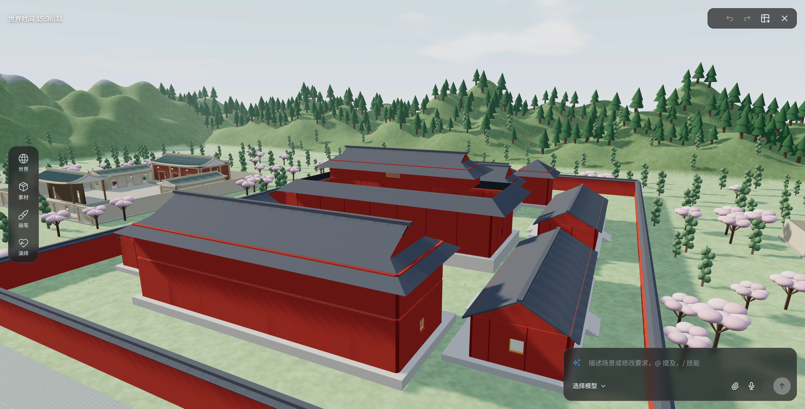

<p>
  <a href="https://github.com/HBAI-Ltd/Toonflow-app">
    
  </a>
  &nbsp;|&nbsp;
  <a href="https://gitee.com/HBAI-Ltd/Toonflow-app">
    
  </a>
  &nbsp;|&nbsp;
  <a href="https://atomgit.com/HBAI-Ltd/Toonflow-app">
    
  </a>
</p>

<p align="center">
  <a href="../../README.md">简体中文</a> |
  <a href="./readmeZhTw.md">繁體中文</a> |
  <a href="./readmeEn.md">English</a> |
  <a href="./readmeJa.md">日本語</a> |
  <a href="./readmeRu.md">Русский</a> |
  <a href="./readmeVi.md">Tiếng Việt</a> |
  <a href="./readmeTh.md">ไทย</a>
  <br />
  <a href="./readmeKo.md">한국어</a> |
  <strong>हिन्दी</strong> |
  <a href="./readmeId.md">Bahasa Indonesia</a> |
  <a href="./readmeMs.md">Bahasa Melayu</a> |
  <a href="./readmeFil.md">Filipino</a> |
  <a href="./readmeBn.md">বাংলা</a> |
  <a href="./readmeUr.md">اردو</a>
  <br />
  <a href="./readmeTa.md">தமிழ்</a> |
  <a href="./readmeTe.md">తెలుగు</a> |
  <a href="./readmeMr.md">मराठी</a> |
  <a href="./readmePa.md">ਪੰਜਾਬੀ</a> |
  <a href="./readmeAr.md">العربية</a> |
  <a href="./readmeFa.md">فارسی</a> |
  <a href="./readmeTr.md">Türkçe</a>
</p>

> 🌐 **22 इंटरफ़ेस भाषाओं का समर्थन** · [समर्थित भाषाएँ देखें](#languages)

<div align="center">

<p align="center">
  
</p>

<a href="https://git.io/typing-svg">
  <picture>
    <source media="(prefers-color-scheme: dark)" srcset="https://readme-typing-svg.demolab.com?font=Fira+Code&size=40&duration=3000&pause=1000&color=FFFFFF&center=true&vCenter=true&width=600&lines=Toonflow;AI%20Short%20Drama%20Studio;Turn%20ideas%20into%20stories" />
    
  </picture>
</a>

<p align="center">
  <a href="https://github.com/HBAI-Ltd/Toonflow-app/stargazers">
    
  </a>
  <a href="../../LICENSE">
    
  </a>
  <a href="https://github.com/HBAI-Ltd/Toonflow-app/releases">
    
  </a>
</p>
<p align="center">
  <a href="https://github.com/HBAI-Ltd/Toonflow-app/network/members">
    
  </a>
  <a href="https://atomgit.com/HBAI-Ltd/Toonflow-app">
    
  </a>
  <a href="https://discord.gg/HEjKmpNpAZ">
    
  </a>
</p>
<p align="center">
  <a href="https://github.com/HBAI-Ltd/Toonflow-app/issues">
    
  </a>
  <a href="https://github.com/HBAI-Ltd/Toonflow-app/graphs/contributors">
    
  </a>
  <a href="https://github.com/HBAI-Ltd/Toonflow-app/commits">
    
  </a>
</p>
<p align="center">
  &nbsp;
  &nbsp;
  &nbsp;
  
</p>

<p align="center">
  <a href="https://trendshift.io/repositories/24197?utm_source=trendshift-badge&amp;utm_medium=badge&amp;utm_campaign=badge-trendshift-24197#achievements" target="_blank" rel="noopener noreferrer">
    
  </a>
  <a href="https://trendshift.io/repositories/24197?utm_source=trendshift-badge&amp;utm_medium=badge&amp;utm_campaign=badge-trendshift-24197#achievements" target="_blank" rel="noopener noreferrer">
    
  </a>
  <a href="https://trendshift.io/repositories/24197?utm_source=trendshift-badge&amp;utm_medium=badge&amp;utm_campaign=badge-trendshift-24197#achievements" target="_blank" rel="noopener noreferrer">
    
  </a>
</p>
<p align="center">
  <a href="https://trendshift.io/repositories/24197?utm_source=trendshift-badge&amp;utm_medium=badge&amp;utm_campaign=badge-trendshift-24197#achievements" target="_blank" rel="noopener noreferrer">
    
  </a>
  <a href="https://trendshift.io/repositories/24197?utm_source=trendshift-badge&amp;utm_medium=badge&amp;utm_campaign=badge-trendshift-24197#achievements" target="_blank" rel="noopener noreferrer">
    
  </a>
  <a href="https://trendshift.io/repositories/24197?utm_source=trendshift-badge&amp;utm_medium=badge&amp;utm_campaign=badge-trendshift-24197#achievements" target="_blank" rel="noopener noreferrer">
    
  </a>
</p>
<p align="center">
  <a href="https://trendshift.io/repositories/24197?utm_source=trendshift-badge&amp;utm_medium=badge&amp;utm_campaign=badge-trendshift-24197#achievements" target="_blank" rel="noopener noreferrer">
    
  </a>
</p>

**लघु नाटकों, एनिमेटेड कॉमिक्स और वीडियो निर्माण के लिए एक ओपन-सोर्स AI प्लेटफ़ॉर्म**

> 🚀 **लघु नाटक बनाने का संपूर्ण समाधान**：पटकथाएँ लिखें, सामग्री व्यवस्थित करें और चित्र व वीडियो बनाएँ—आपकी पूरी रचनात्मक प्रक्रिया एक असीमित कैनवस पर।

</div>

<div align="center">
  <table>
    <tr>
      <td width="50%" align="center">
        <a href="../images/gStar.png">
          
        </a>
      </td>
      <td width="50%" align="center">
        <a href="../images/gvp.jpg">
          
        </a>
      </td>
    </tr>
  </table>
</div>

<p align="center">
  <a href="https://github.com/HBAI-Ltd/Toonflow-app/releases">डाउनलोड</a> ·
  <a href="https://qcn7xdsqgc4z.feishu.cn/docx/RXFqdgR2Xo0dXZxGfd0cZCGgnwf">उपयोगकर्ता मार्गदर्शिका</a> ·
  <a href="https://api.toonflow.net/console/plugIn">प्लगइन मार्केटप्लेस</a> ·
  <a href="https://qcn7xdsqgc4z.feishu.cn/docx/KNBNd9naqolsy6xjAOCcEAkqnRd">डेवलपर दस्तावेज़</a> ·
  <a href="https://api.toonflow.net/">आधिकारिक मॉडल प्लेटफ़ॉर्म</a>
</p>

<p align="center">
  📺 <a href="https://www.bilibili.com/video/BV1hbpb6xETF">उत्पाद परिचय वीडियो</a> ·
  <a href="https://www.bilibili.com/video/BV1z4sS6NEA3">TrumanMap प्रीविज़ डेमो</a>
</p>

<p align="center">🔥 Toonflow पर आधारित शॉर्ट ड्रामा Hongguo पर दसियों लाख, करोड़ों और 10 करोड़ से ज़्यादा व्यूज़ पा चुके हैं। <a href="#works">रचनाएँ देखें</a></p>

https://github.com/user-attachments/assets/56d81114-7521-454c-9ec9-972567eddda9

---

## 1. 💛 प्रायोजक और सहयोग

Toonflow ओपन-सोर्स परियोजना का समर्थन करने वाले निम्नलिखित भागीदारों का धन्यवाद।

<table>
  <tr>
    <td width="50%" valign="top">
      <a href="https://metaso.cn/minimax-h3/?s=toon"> <strong>Metaso</strong></a>
      <br />
      <sub>किफ़ायती MiniMax H3 वीडियो निर्माण: 768P पर केवल ¥0.09/सेकंड और 2K पर ¥0.15/सेकंड (CNY)। अपने GPU की व्यवस्था किए बिना नेटिव 2K, समकालिक ऑडियो और वीडियो, OpenAI-संगत API, ComfyUI और असीमित कैनवस का उपयोग करें। बोनस क्रेडिट और विशेष ऑफ़र पाने के लिए <a href="https://metaso.cn/minimax-h3/?s=toon">इस विशेष लिंक से पंजीकरण करें</a>। व्यावसायिक पूछताछ के लिए WeChat पर metasota12 से संपर्क करें।</sub>
    </td>
    <td width="50%" valign="top">
      <a href="https://go.apimart.ai/gh-toonflow-app"> <strong>APIMart</strong></a>
      <br />
      <sub>इस परियोजना को प्रायोजित करने के लिए APIMart का धन्यवाद! APIMart, AI से चित्र और वीडियो बनाने का एक किफ़ायती API प्लेटफ़ॉर्म है। GPT-Image-2 की कीमत प्रति चित्र $0.006 से शुरू होती है, यानी $1 में 160 से अधिक चित्र। चित्र और वीडियो के लिए एक ही असिंक्रोनस API है: कार्य भेजें, उसकी ID पाएँ और कॉलबैक से परिणाम प्राप्त करें। टाइमआउट के बिना 10,000 चित्रों के बैच संसाधित करें और कोड बदले बिना मॉडल बदलें। मासिक शुल्क के बिना, जितना उपयोग करें उतना भुगतान करें। शुरू करने के लिए <a href="https://go.apimart.ai/gh-toonflow-app">यहाँ पंजीकरण करें</a>।</sub>
    </td>
  </tr>
  <tr>
    <td width="50%" valign="top">
      <a href="https://www.compshare.cn/video-studio?ytag=GPU_YY_YX_git_toonflow"> <strong>CompShare</strong></a>
      <br />
      <sub>CompShare किफ़ायती H3 वीडियो निर्माण प्रदान करता है, जिसमें टेक्स्ट से वीडियो, पहले और अंतिम फ़्रेम का नियंत्रण और संयुक्त संदर्भ मोड शामिल हैं। नेटिव 2K में 30 सेकंड तक के वीडियो बनाएँ; 768P की कीमत केवल CNY 0.08 प्रति सेकंड है। API एक्सेस, उद्यमों के लिए उच्च समवर्ती क्षमता और स्वयं चालान प्राप्त करने की सुविधा उपलब्ध है।</sub>
      <br /><br />
      <sub>🎁 <a href="https://www.compshare.cn/video-studio?ytag=GPU_YY_YX_git_toonflow">इस विशेष लिंक से पंजीकरण करें</a> और प्लेटफ़ॉर्म आज़माने के लिए CNY 5 के मुफ़्त क्रेडिट पाएँ!</sub>
    </td>
    <td width="50%" valign="top">
      <a href="https://weimeta.cn/console/invite/accept?aff=INV202611191734123p9JeY"> <strong>WEIMETA AI</strong></a>
      <br />
      <sub>WEIMETA AI किफ़ायती AI टेक्स्ट, इमेज और वीडियो जनरेशन सेवा देता है, जिसमें DeepSeek, GLM, Kimi, Seedream, Seedance, Wan, MiniMax H3 जैसे प्रमुख मॉडल एक जगह मिलते हैं। यह टेक्स्ट से इमेज, इमेज से इमेज, टेक्स्ट से वीडियो और इमेज से वीडियो को एकीकृत API से सपोर्ट करता है, ताकि उद्यम कई मॉडल लचीले ढंग से इस्तेमाल कर सकें। प्लेटफ़ॉर्म एंटरप्राइज़-स्तरीय एन्क्रिप्टेड ट्रांसमिशन और मल्टी-टेनेंट आइसोलेशन का उपयोग करता है और चीन का लेवल 3 सुरक्षा मूल्यांकन पास कर चुका है।</sub>
      <br /><br />
      <sub>🎁 <a href="https://weimeta.cn/console/invite/accept?aff=INV202611191734123p9JeY">इस विशेष लिंक से पंजीकरण करें</a> और WEIMETA AI की मल्टीमॉडल मॉडल सेवाएँ आज़माएँ। सीमित समय का ऑफ़र: CNY 100 रिचार्ज पर CNY 15 अतिरिक्त। व्यावसायिक संपर्क WeChat: WeiMeta_AI666</sub>
    </td>
  </tr>
</table>

<details>
<summary><strong>👉 प्रायोजक बनें 👈</strong></summary>

<p align="center">
  
</p>

<p align="center"><sub>यह संपर्क केवल व्यावसायिक पूछताछ के लिए है और तकनीकी सहायता नहीं देता। उपयोग संबंधी सवालों के लिए कृपया समुदाय समूहों में शामिल हों। नई सुविधाओं के अनुरोध और बग फ़ीडबैक फ़ॉर्म से भेजें। आपके सहयोग के लिए धन्यवाद।</sub></p>

</details>

---

## 2. 🌟 प्रमुख विशेषताएँ

| क्षमता | विवरण |
| --- | --- |
| 🎬 **TrumanMap प्रीविज़** | स्क्रिप्ट पेस्ट करें, एक क्लिक में 3D सेट, स्टोरीबोर्ड और ब्लॉकिंग। |
| 🖼️ **अनंत कैनवास** | स्क्रिप्ट, किरदार, दृश्य और क्लिप एक कैनवास पर जुड़े। |
| 🎥 **AI वीडियो जनरेशन** | @ से एसेट जोड़ें, शॉट-दर-शॉट बनाएँ। |
| 🤖 **AI सहायक** | कैनवास पढ़ता-बदलता है; MCP और A2A समर्थित। |
| 🔧 **कोई भी मॉडल जोड़ें** | इन-बिल्ट प्रदाता, थर्ड-पार्टी API, लोकल LLM, ComfyUI। |
| 🧩 **प्लगइन मार्केट** | नोड, टूल और स्किल एक क्लिक में। |
| 🏠 **लोकल डिप्लॉयमेंट** | Windows, macOS, Linux, Android, Docker। |
| 🌐 **बहुभाषी** | 22 इंटरफ़ेस भाषाएँ। |

**प्रक्रिया**: स्क्रिप्ट व स्टोरीबोर्ड → किरदार व दृश्य → 3D प्रीविज़ → शॉट-दर-शॉट वीडियो → संपादन व डाउनलोड।

### अक्सर पूछे जाने वाले प्रश्न

**Toonflow क्या है?** AI शॉर्ट ड्रामा, AI कॉमिक और AI वीडियो बनाने का ओपन-सोर्स प्लेटफ़ॉर्म।

**क्या यह मुफ़्त है?** MIT लाइसेंस, खुद होस्ट करना मुफ़्त; थर्ड-पार्टी मॉडल API पर शुल्क लग सकता है।

**कौन-से मॉडल समर्थित हैं?** Seedance, Seedream, MiniMax, Wan आदि इन-बिल्ट हैं; थर्ड-पार्टी API, लोकल LLM और ComfyUI भी जोड़ सकते हैं। [उपयोग गाइड](https://qcn7xdsqgc4z.feishu.cn/docx/RXFqdgR2Xo0dXZxGfd0cZCGgnwf) देखें।

**कौन-से प्लेटफ़ॉर्म?** Windows, macOS, Linux, Android, साथ ही Docker और सर्वर।

<a id="languages"></a>

### बहुभाषी समर्थन

समर्थित भाषाएँ: 简体中文, 繁體中文, English, 日本語, Русский, Tiếng Việt, ไทย, 한국어, हिन्दी, Bahasa Indonesia, Bahasa Melayu, Filipino, বাংলা, اردو, தமிழ், తెలుగు, मराठी, ਪੰਜਾਬੀ, العربية, فارسی, Türkçe, Português (Brasil)।

---

## 3. 📸 10 मुख्य आकर्षण

<a id="trumanmap"></a>

### आकर्षण 1 | स्क्रिप्ट पेस्ट करें, 3D प्रीविज़ पाएँ

संवादों के अनुसार अपने-आप शॉट और ब्लॉकिंग; मॉनिटर पर दृश्य और सबटाइटल लाइव। 📺 [डेमो देखें](https://www.bilibili.com/video/BV1z4sS6NEA3)

https://github.com/user-attachments/assets/bb2f7bfe-46de-44ff-b3b3-95379f9d4b20

<p align="center">
  <a href="../images/screenshots/trumanMapTimeline.webp"></a>
</p>

<table>
  <tr>
    <td width="50%"><a href="../images/screenshots/trumanMapShot.webp"></a></td>
    <td width="50%"><a href="../images/screenshots/trumanMapStreet.webp"></a></td>
  </tr>
</table>

### आकर्षण 2 | जियांगनान का अंतहीन जल-नगर

नगर-दीवारें, गलियाँ, नहरें, मंदिर और पहाड़: 1,500 से अधिक वस्तुएँ।

<p align="center">
  <a href="../images/screenshots/trumanMapTown.webp"></a>
</p>

<table>
  <tr>
    <td width="50%"><a href="../images/screenshots/trumanMapAerial.webp"></a></td>
    <td width="50%"><a href="../images/screenshots/trumanMapTemple.webp"></a></td>
  </tr>
</table>

### आकर्षण 3 | 64 तैयार सेट + 80,000+ एसेट

<table>
  <tr>
    <td width="50%"><a href="../images/screenshots/trumanMapSets.webp"></a></td>
    <td width="50%"><a href="../images/screenshots/trumanMapAssets.webp"></a></td>
  </tr>
</table>

### आकर्षण 4 | मौसम, समय और भू-भाग एक क्लिक में

<table>
  <tr>
    <td width="50%"><a href="../images/screenshots/trumanMapRain.webp"></a></td>
    <td width="50%"><a href="../images/screenshots/trumanMapBrush.webp"></a></td>
  </tr>
  <tr>
    <td width="50%"><a href="../images/screenshots/trumanMapWorld.webp"></a></td>
    <td width="50%"><a href="../images/screenshots/trumanMapHome.webp"></a></td>
  </tr>
</table>

### आकर्षण 5 | प्रीविज़ सीधे वीडियो जनरेशन में

स्टोरीबोर्ड, चार-दृश्य शीट, प्रीविज़ वीडियो, एनिमैटिक और शॉट सूची एक क्लिक में कैनवास पर।

### आकर्षण 6 | अनंत कैनवास + AI सहायक

<table>
  <tr>
    <td width="50%"><a href="../images/screenshots/canvasNodeMenu.webp"></a></td>
    <td width="50%"><a href="../images/screenshots/canvasAgent.webp"></a></td>
  </tr>
</table>

### आकर्षण 7 | बहु-संदर्भ वीडियो जनरेशन

<p align="center">
  <a href="../images/screenshots/videoGenerationNode.webp"></a>
</p>

### आकर्षण 8 | स्क्रिप्ट दस्तावेज़ और वर्कस्पेस

<p align="center">
  <a href="../images/screenshots/canvasDocument.webp"></a>
</p>

### आकर्षण 9 | होम और एसेट लाइब्रेरी

<table>
  <tr>
    <td width="50%"><a href="../images/screenshots/home.webp"></a></td>
    <td width="50%"><a href="../images/screenshots/assetLibrary.webp"></a></td>
  </tr>
</table>

### आकर्षण 10 | प्लगइन मार्केट

अधिक प्लगइन [वेब प्लगइन मार्केट](https://api.toonflow.net/console/plugIn) में।

<p align="center">
  <a href="../images/screenshots/pluginMarket.webp"></a>
</p>

---

## 4. 🚀 डाउनलोड और स्थापना

### 4.1 ऐप स्थापना

| ऑपरेटिंग सिस्टम | GitHub |
| --- | --- |
| Windows | [रिलीज़](https://github.com/HBAI-Ltd/Toonflow-app/releases) |
| macOS | [रिलीज़](https://github.com/HBAI-Ltd/Toonflow-app/releases) |
| Android ARM64 | [APK डाउनलोड](https://github.com/HBAI-Ltd/Toonflow-app/releases/latest) |

Android ऐप केवल ARM64 डिवाइस का समर्थन करता है। रिलीज़ पेज से `toonflow-VERSION-android-arm64.apk` डाउनलोड करके इंस्टॉल करें। इसमें स्थानीय Bun बैकएंड शामिल है और यह स्वतंत्र रूप से चल सकता है। होम पेज पर «डिवाइस कनेक्शन» से QR कोड स्कैन करके या जानकारी दर्ज करके स्थानीय नेटवर्क या इंटरनेट पर शेयरिंग चालू वाले कंप्यूटर या बैकएंड से भी जुड़ सकते हैं।

Windows इंस्टॉलर अपने आप WebView2 का पता लगाकर उसे स्थापित करता है। यदि स्थापना के तुरंत बाद ऐप बंद हो जाता है, तो [WebView2 डाउनलोड पृष्ठ](https://developer.microsoft.com/microsoft-edge/webview2/) से रनटाइम डाउनलोड करके स्वयं स्थापित करें।

macOS (Apple Silicon) पर Toonflow को Applications में खींचें और सीधे खोलें। पहले से कोई टर्मिनल कमांड चलाने की आवश्यकता नहीं है। यदि macOS सुरक्षा चेतावनी दिखाता है, तो नीचे दिए गए चरण क्रम से अपनाएँ।

<details>
<summary><strong>यदि macOS पर Toonflow स्थापित या खोला नहीं जा रहा हो</strong></summary>

**1. गोपनीयता और सुरक्षा में Toonflow को अनुमति दें**

यदि डेवलपर को सत्यापित न कर पाने या Apple द्वारा ऐप में दुर्भावनापूर्ण सॉफ़्टवेयर की जाँच न कर पाने की चेतावनी दिखाई दे, तो पहले Toonflow खोलने का प्रयास करें। फिर सिस्टम सेटिंग्स → गोपनीयता और सुरक्षा में जाएँ, Toonflow को ब्लॉक किए जाने वाला संदेश ढूँढ़ें, “फिर भी खोलें” पर क्लिक करें और निर्देशानुसार पुष्टि करें। [Apple के आधिकारिक निर्देश](https://support.apple.com/zh-cn/102445) देखें।

**2. यदि क्वारंटीन प्रतिबंध अभी भी खोलने से रोक रहे हों, तो क्वारंटीन विशेषता हटाकर देखें**

यह सुनिश्चित करने के बाद कि ऐप आधिकारिक रिलीज़ पृष्ठ से आया है और Applications में रखा है, टर्मिनल में निम्न कमांड चलाएँ और दोबारा खोलें। यदि ऐप का नाम या स्थापना स्थान अलग है, तो पथ बदलें।

```bash
sudo xattr -rd com.apple.quarantine /Applications/toonflow.app
```

**3. अंतिम उपाय: अस्थायी रूप से किसी भी स्रोत के ऐप को अनुमति दें**

यदि पहले दोनों तरीके काम न करें और आपको ऐप के स्रोत पर भरोसा हो, तो यह कमांड आज़माएँ:

```bash
sudo spctl --master-disable
```

फिर सिस्टम सेटिंग्स → गोपनीयता और सुरक्षा खोलें। सुरक्षा के अंतर्गत, यदि आपके सिस्टम में विकल्प उपलब्ध हो, तो “यहाँ से डाउनलोड किए गए ऐप को अनुमति दें” को “कहीं से भी” पर सेट करें और निर्देशानुसार पुष्टि करें। उपलब्ध विकल्प और कमांड का समर्थन macOS के संस्करण के अनुसार बदल सकते हैं।

इससे सभी ऐप के लिए सुरक्षा प्रतिबंध कम हो जाते हैं। इसके बाद सेटिंग को फिर से “App Store और पहचाने गए डेवलपर” पर करने की सलाह दी जाती है।

</details>

अधिक निर्देशों के लिए [उपयोगकर्ता मार्गदर्शिका](https://qcn7xdsqgc4z.feishu.cn/docx/RXFqdgR2Xo0dXZxGfd0cZCGgnwf) देखें।

---

### 4.2 Docker स्थापना

पहले Git, [Docker Engine](https://docs.docker.com/engine/install/) और Docker Compose स्थापित करें। Windows और macOS पर Docker Desktop को Linux कंटेनर मोड में इस्तेमाल कर सकते हैं। रिपॉज़िटरी में [Dockerfile](../../Dockerfile), [Compose कॉन्फ़िगरेशन](../../compose.yaml) और [बिल्ड से बाहर रखी गई फ़ाइलों की सूची](../../.dockerignore) मौजूद हैं। इमेज Bun 1.4.3 से बनती है और इसमें FFmpeg शामिल है।

<details>
<summary><strong>Docker स्थापना के चरण खोलें</strong></summary>

स्रोत कोड क्लोन करें और रिपॉज़िटरी की मूल डायरेक्टरी में यह चलाएँ:

```sh
git clone https://github.com/HBAI-Ltd/Toonflow-app.git
cd Toonflow-app
docker compose up -d --build
```

पहला बिल्ड निर्भरताएँ स्थापित करता है और साथ आए नोड, टूल, Web तथा Server बनाता है। शुरू होने के बाद `http://127.0.0.1:3000` खोलें। दूरस्थ होस्ट के लिए नीचे “पहुँच और डेटा” में बताए अनुसार SSH टनल इस्तेमाल करें। पहली शुरुआत पर साथ आए प्लगइन प्रारंभ होते हैं और `myProject` कार्य डायरेक्टरी उपलब्ध होती है।

सेटिंग्स, प्लगइन और परियोजना फ़ाइलें Docker के `toonflowData` नामित वॉल्यूम में संग्रहीत होती हैं, जो कंटेनर के भीतर `/app/data/` पर माउंट होता है। वास्तविक वॉल्यूम नाम में Compose परियोजना का उपसर्ग शामिल होता है। कंटेनर रोकने या दोबारा बनाने पर आपका डेटा सुरक्षित रहता है। **`docker compose down -v` इस्तेमाल न करें: यह कमांड डेटा वॉल्यूम मिटा देती है।**

```sh
docker compose logs -f toonflow  # View logs
docker compose stop             # Stop the service
docker compose start            # Start it again
docker compose down             # Remove containers, retaining the data volume
```

परियोजना डायरेक्टरी जोड़ने के लिए “सर्वर की कार्य डायरेक्टरी चुनें” संवाद में “नया फ़ोल्डर” पर क्लिक करें। इस संवाद में फ़ाइलों और फ़ोल्डरों का नाम बदलना और उन्हें मिटाना भी संभव है। वैकल्पिक रूप से, सेवा चालू रहते समय कमांड लाइन से डायरेक्टरी बनाएँ:

```sh
docker compose exec toonflow mkdir -p /app/data/workspaces/newProject
```

बैकअप के लिए पहले सेवा रोकें, डेटा कॉपी करें और फिर सेवा शुरू करें:

```sh
docker compose stop
docker compose cp toonflow:/app/data ./toonflowBackup
docker compose start
```

</details>

---

### 4.3 सर्वर स्थापना

Linux सर्वर पर Web और Server सीधे चलाने के लिए यह विकल्प इस्तेमाल करें। नीचे के उदाहरण में Ubuntu / Debian और परियोजना द्वारा निर्धारित [Bun 1.4.3](https://bun.sh/docs/installation) संस्करण का उपयोग किया गया है।

<details>
<summary><strong>सर्वर स्थापना के चरण खोलें</strong></summary>

रनटाइम वातावरण स्थापित करें:

```sh
sudo apt-get update
sudo apt-get install -y git curl unzip ffmpeg
curl -fsSL https://bun.com/install | bash -s "bun-v1.4.3"
export PATH="$HOME/.bun/bin:$PATH"
bun --version
```

स्रोत कोड क्लोन करें और सेवा शुरू करें:

```sh
git clone https://github.com/HBAI-Ltd/Toonflow-app.git
cd Toonflow-app
bun install --frozen-lockfile

# Build bundled nodes, tools, Web, and Server
bun run build:server
mkdir -p data/workspaces/myProject
bun run start:server
```

“服务启动成功” (सेवा सफलतापूर्वक शुरू हुई) दिखाई देने पर सर्वर पर ही `http://127.0.0.1:3000` खोलें। ऊपर की कमांड फ़ोरग्राउंड में चलती है; रोकने के लिए `Ctrl+C` दबाएँ। बूट पर शुरू करने और प्रक्रिया प्रबंधन के लिए [Bun की systemd परिनियोजन मार्गदर्शिका](https://bun.sh/guides/ecosystem/systemd) देखें। कार्य डायरेक्टरी को रिपॉज़िटरी डायरेक्टरी पर सेट करें और स्टार्ट कमांड में Bun का पूर्ण पथ तथा उसके बाद `run start:server` रखें। इसे ऐसे उपयोगकर्ता के रूप में चलाएँ जिसे उस डायरेक्टरी में पढ़ने और लिखने की अनुमति हो।

</details>

---

### 4.4 पहुँच और डेटा

- सेवा फ़िलहाल निश्चित पोर्ट `3000` इस्तेमाल करती है। वेब इंटरफ़ेस और API में अलग लॉगिन प्रमाणीकरण नहीं है। सर्वर स्थापना में फ़ायरवॉल या सुरक्षा समूह से पोर्ट `3000` की पहुँच सीमित करें। सार्वजनिक पहुँच के लिए प्रमाणीकरण वाला रिवर्स प्रॉक्सी आवश्यक है।
- व्यक्तिगत दूरस्थ पहुँच के लिए अपने कंप्यूटर पर `ssh -N -L 3000:127.0.0.1:3000 username@server-address` चलाएँ। कनेक्शन खुला रखें और फिर `http://127.0.0.1:3000` पर जाएँ। सर्वर का पोर्ट `3000` सार्वजनिक इंटरनेट पर खोलने की आवश्यकता नहीं है।
- सीधी स्थापना में सेटिंग्स, प्लगइन और कार्यक्षेत्र डिफ़ॉल्ट रूप से रिपॉज़िटरी की `data/` डायरेक्टरी में रहते हैं। Docker में वे डेटा वॉल्यूम के भीतर `/app/data/` पर संग्रहीत होते हैं। माइग्रेशन या बैकअप के समय पूरी डायरेक्टरी सुरक्षित रखें। पृष्ठ खोलने के बाद सर्वर कार्यक्षेत्र में `myProject` चुनें। अन्य परियोजनाओं के लिए संबंधित `workspaces/` डायरेक्टरी के अंतर्गत उपडायरेक्टरियाँ बनाएँ।
- स्थापना के दोनों तरीकों में सिस्टम FFmpeg शामिल है। मॉडल सेवाओं की API कुंजियाँ आपको इंटरफ़ेस में अलग से कॉन्फ़िगर करनी होंगी।

---

### 4.5 क्लाउड परिनियोजन

हमारा भागीदार [AI Galaxy (智星云)](https://www.ai-galaxy.com/) उपयोग के लिए तैयार वातावरण वाली, आधिकारिक रूप से अधिकृत व्यावसायिक Toonflow इमेज प्रदान करता है। निर्देशों के लिए [चित्रों सहित इमेज परिनियोजन मार्गदर्शिका](https://mp.weixin.qq.com/s/lq9X1ovQ1_TKeXMOLgicKg?scene=1) देखें।

---

## 5. 🎬 निर्मित उदाहरण

<a id="works"></a>

### Hongguo पर हिट ड्रामा

🔥 Toonflow पर आधारित शॉर्ट ड्रामा Hongguo पर दसियों लाख, करोड़ों और 10 करोड़ से ज़्यादा व्यूज़ पा चुके हैं।

<p align="center">
  
</p>

<p align="center">
  
</p>

### विज्ञापन वीडियो

<table>
  <tr>
    <td width="50%"><video src="https://github.com/user-attachments/assets/fccf8b46-b8ec-46cb-9574-9273cd1ee9e4" controls width="100%"></video></td>
    <td width="50%"><video src="https://github.com/user-attachments/assets/b345905e-601f-43be-83a5-305f97a29e44" controls width="100%"></video></td>
  </tr>
  <tr>
    <td width="50%"><video src="https://github.com/user-attachments/assets/fc5880aa-6b9c-4717-af0e-e51f15c4fdc6" controls width="100%"></video></td>
    <td width="50%"><video src="https://github.com/user-attachments/assets/0816e794-f07d-4bc3-89cd-69c67566c3a6" controls width="100%"></video></td>
  </tr>
</table>

### शॉर्ट ड्रामा उदाहरण

https://github.com/user-attachments/assets/2d9fddac-dfdf-4640-b030-b09d7f7287e9

डेमो वीडियो 480p का संपीड़ित संस्करण है।

---

## 6. 👨‍👩‍👧‍👦 WeChat समुदाय

समूह में शामिल होने के लिए निमंत्रण सहायक से संपर्क करने हेतु QR कोड स्कैन करें:


Discord में शामिल होने के लिए आप आइकन पर भी क्लिक कर सकते हैं:

[](https://discord.gg/HEjKmpNpAZ)

या निमंत्रण लिंक इस्तेमाल करें: [https://discord.gg/HEjKmpNpAZ](https://discord.gg/HEjKmpNpAZ)

---

## 7. 💌 हमसे संपर्क करें

📧 ईमेल: [ltlctools@outlook.com](mailto:ltlctools@outlook.com?subject=Toonflow咨询)

---

## 8. 📜 ओपन-सोर्स लाइसेंस

Toonflow [MIT License](../../LICENSE) के अंतर्गत लाइसेंस प्राप्त है। तृतीय-पक्ष निर्भरताओं और संसाधनों पर उनके संबंधित लाइसेंस और कॉपीराइट सूचनाएँ लागू रहती हैं।

[](https://www.star-history.com/#HBAI-Ltd/Toonflow-app&Date)

> **पूर्वव्यापी प्रभाव न होने की शर्त**: जिन उपयोगकर्ताओं ने v1.0.8 से पहले के संस्करण AGPL-3.0 के अंतर्गत इस्तेमाल किए, वे AGPL-3.0 के अधीन ही रहेंगे। v1.0.8 से v1.1.8 तक के संस्करण Apache-2.0 और उसके अतिरिक्त समझौते के अधीन रहेंगे। इन उपयोगकर्ताओं पर लाइसेंस का यह बदलाव लागू नहीं होगा।

---

## 9. 🙏 आभार

- **भागीदार**: 算能云, Tencent Hunyuan 3D और AI Galaxy (智星云)।
- **परियोजना योगदानकर्ता**: कोड लिखने, दस्तावेज़ सुधारने, प्लगइन साझा करने और समस्याएँ सुलझाने में मदद करने वाले सभी लोगों का धन्यवाद।
- **समुदाय के उपयोगकर्ता**: लगातार प्रतिक्रिया देने, अपनी रचनाएँ साझा करने और परियोजना का समर्थन करने वाले सभी लोगों का धन्यवाद।

仰起脸笑的像满月: विकास के लिए Codex 20x कंप्यूटिंग संसाधन प्रदान किए।
Xi'an Zhongxing Digital Intelligence Technology Co., Ltd. (西安中星数字智能科技有限公司): Apple प्रमाणपत्र से साइनिंग में योगदान दिया।

<p align="center"><sub>Free code signing provided by <a href="https://signpath.io/">SignPath.io</a>, certificate by <a href="https://signpath.org/">SignPath Foundation</a>.</sub></p>

<div align="center">

कॉपीराइट © 2026 北京爱阿科技有限公司

</div>


