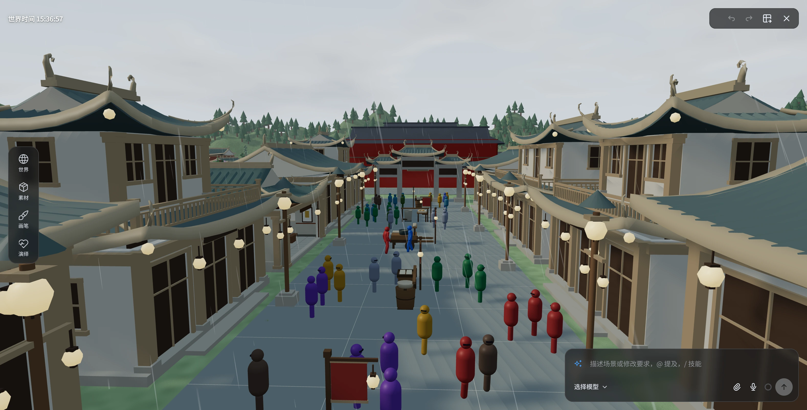
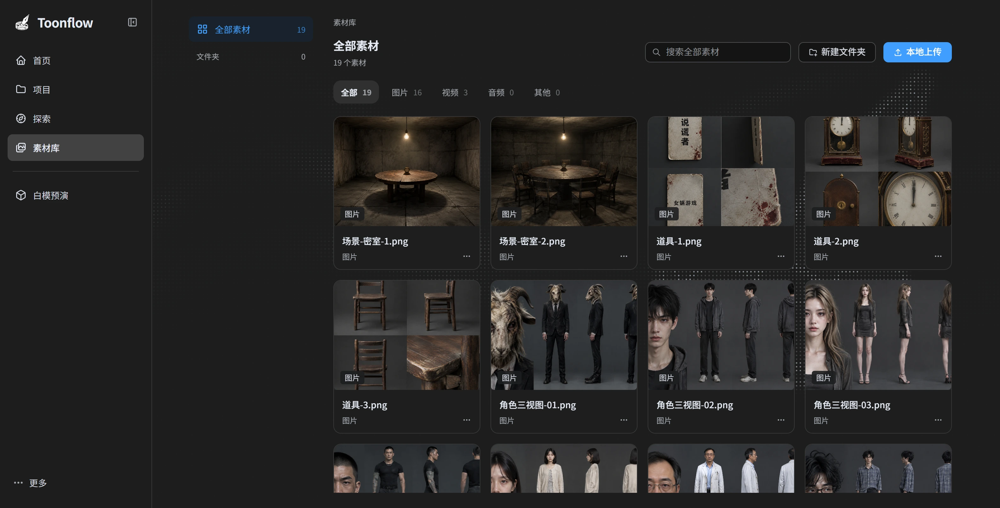

<p>
  <a href="https://github.com/HBAI-Ltd/Toonflow-app">
    
  </a>
  &nbsp;|&nbsp;
  <a href="https://gitee.com/HBAI-Ltd/Toonflow-app">
    
  </a>
  &nbsp;|&nbsp;
  <a href="https://atomgit.com/HBAI-Ltd/Toonflow-app">
    
  </a>
</p>

<p align="center">
  <a href="../../README.md">简体中文</a> |
  <a href="./readmeZhTw.md">繁體中文</a> |
  <a href="./readmeEn.md">English</a> |
  <a href="./readmeJa.md">日本語</a> |
  <a href="./readmeRu.md">Русский</a> |
  <a href="./readmeVi.md">Tiếng Việt</a> |
  <a href="./readmeTh.md">ไทย</a>
  <br />
  <strong>한국어</strong> |
  <a href="./readmeHi.md">हिन्दी</a> |
  <a href="./readmeId.md">Bahasa Indonesia</a> |
  <a href="./readmeMs.md">Bahasa Melayu</a> |
  <a href="./readmeFil.md">Filipino</a> |
  <a href="./readmeBn.md">বাংলা</a> |
  <a href="./readmeUr.md">اردو</a>
  <br />
  <a href="./readmeTa.md">தமிழ்</a> |
  <a href="./readmeTe.md">తెలుగు</a> |
  <a href="./readmeMr.md">मराठी</a> |
  <a href="./readmePa.md">ਪੰਜਾਬੀ</a> |
  <a href="./readmeAr.md">العربية</a> |
  <a href="./readmeFa.md">فارسی</a> |
  <a href="./readmeTr.md">Türkçe</a>
</p>

> 🌐 **22개 인터페이스 언어 지원** · [지원 언어 보기](#languages)

<div align="center">

<p align="center">
  
</p>

<a href="https://git.io/typing-svg">
  <picture>
    <source media="(prefers-color-scheme: dark)" srcset="https://readme-typing-svg.demolab.com?font=Fira+Code&size=40&duration=3000&pause=1000&color=FFFFFF&center=true&vCenter=true&width=600&lines=Toonflow;AI%20Short%20Drama%20Studio;Turn%20ideas%20into%20stories" />
    
  </picture>
</a>

<p align="center">
  <a href="https://github.com/HBAI-Ltd/Toonflow-app/stargazers">
    
  </a>
  <a href="../../LICENSE">
    
  </a>
  <a href="https://github.com/HBAI-Ltd/Toonflow-app/releases">
    
  </a>
</p>
<p align="center">
  <a href="https://github.com/HBAI-Ltd/Toonflow-app/network/members">
    
  </a>
  <a href="https://atomgit.com/HBAI-Ltd/Toonflow-app">
    
  </a>
  <a href="https://discord.gg/HEjKmpNpAZ">
    
  </a>
</p>
<p align="center">
  <a href="https://github.com/HBAI-Ltd/Toonflow-app/issues">
    
  </a>
  <a href="https://github.com/HBAI-Ltd/Toonflow-app/graphs/contributors">
    
  </a>
  <a href="https://github.com/HBAI-Ltd/Toonflow-app/commits">
    
  </a>
</p>
<p align="center">
  &nbsp;
  &nbsp;
  &nbsp;
  
</p>

<p align="center">
  <a href="https://trendshift.io/repositories/24197?utm_source=trendshift-badge&amp;utm_medium=badge&amp;utm_campaign=badge-trendshift-24197#achievements" target="_blank" rel="noopener noreferrer">
    
  </a>
  <a href="https://trendshift.io/repositories/24197?utm_source=trendshift-badge&amp;utm_medium=badge&amp;utm_campaign=badge-trendshift-24197#achievements" target="_blank" rel="noopener noreferrer">
    
  </a>
  <a href="https://trendshift.io/repositories/24197?utm_source=trendshift-badge&amp;utm_medium=badge&amp;utm_campaign=badge-trendshift-24197#achievements" target="_blank" rel="noopener noreferrer">
    
  </a>
</p>
<p align="center">
  <a href="https://trendshift.io/repositories/24197?utm_source=trendshift-badge&amp;utm_medium=badge&amp;utm_campaign=badge-trendshift-24197#achievements" target="_blank" rel="noopener noreferrer">
    
  </a>
  <a href="https://trendshift.io/repositories/24197?utm_source=trendshift-badge&amp;utm_medium=badge&amp;utm_campaign=badge-trendshift-24197#achievements" target="_blank" rel="noopener noreferrer">
    
  </a>
  <a href="https://trendshift.io/repositories/24197?utm_source=trendshift-badge&amp;utm_medium=badge&amp;utm_campaign=badge-trendshift-24197#achievements" target="_blank" rel="noopener noreferrer">
    
  </a>
</p>
<p align="center">
  <a href="https://trendshift.io/repositories/24197?utm_source=trendshift-badge&amp;utm_medium=badge&amp;utm_campaign=badge-trendshift-24197#achievements" target="_blank" rel="noopener noreferrer">
    
  </a>
</p>

**숏드라마, 모션 코믹스, 영상 제작을 위한 오픈 소스 AI 플랫폼**

> 🚀 **한곳에서 완성하는 숏드라마 제작**：대본 작성, 자산 관리, 이미지·영상 생성을 통합하고, 무한 캔버스에서 전체 제작 과정을 구성하세요.

</div>

<div align="center">
  <table>
    <tr>
      <td width="50%" align="center">
        <a href="../images/gStar.png">
          
        </a>
      </td>
      <td width="50%" align="center">
        <a href="../images/gvp.jpg">
          
        </a>
      </td>
    </tr>
  </table>
</div>

<p align="center">
  <a href="https://github.com/HBAI-Ltd/Toonflow-app/releases">다운로드</a> ·
  <a href="https://qcn7xdsqgc4z.feishu.cn/docx/RXFqdgR2Xo0dXZxGfd0cZCGgnwf">사용 가이드</a> ·
  <a href="https://api.toonflow.net/console/plugIn">플러그인 마켓</a> ·
  <a href="https://qcn7xdsqgc4z.feishu.cn/docx/KNBNd9naqolsy6xjAOCcEAkqnRd">개발자 문서</a> ·
  <a href="https://api.toonflow.net/">공식 모델 플랫폼</a>
</p>

<p align="center">
  📺 <a href="https://www.bilibili.com/video/BV1hbpb6xETF">제품 소개 영상</a> ·
  <a href="https://www.bilibili.com/video/BV1z4sS6NEA3">TrumanMap 프리비즈 데모</a>
</p>

<p align="center">🔥 Toonflow를 기반으로 만든 숏드라마가 훙궈(红果)에서 수백만, 수천만, 1억 회 이상 조회수를 기록했습니다. <a href="#works">작품 보기</a></p>

https://github.com/user-attachments/assets/56d81114-7521-454c-9ec9-972567eddda9

---

## 1. 💛 후원과 지원

Toonflow 오픈 소스 프로젝트를 지원해 주시는 다음 파트너 여러분께 감사드립니다.

<table>
  <tr>
    <td width="50%" valign="top">
      <a href="https://metaso.cn/minimax-h3/?s=toon"> <strong>Metaso</strong></a>
      <br />
      <sub>합리적인 비용의 MiniMax H3 영상 생성: 768P는 초당 단 ¥0.09, 2K는 초당 ¥0.15(CNY)입니다. 네이티브 2K, 영상·음성 동기화, OpenAI 호환 API, ComfyUI, 무한 캔버스를 지원하며 GPU를 직접 구축할 필요가 없습니다. <a href="https://metaso.cn/minimax-h3/?s=toon">전용 링크로 가입</a>하면 보너스 크레딧과 특별 혜택을 받을 수 있습니다. 비즈니스 문의는 WeChat의 metasota12로 연락해 주세요.</sub>
    </td>
    <td width="50%" valign="top">
      <a href="https://go.apimart.ai/gh-toonflow-app"> <strong>APIMart</strong></a>
      <br />
      <sub>프로젝트를 후원해 주신 APIMart에 감사드립니다! APIMart는 AI 이미지·영상 생성용 저렴한 API 플랫폼입니다. GPT-Image-2는 이미지당 $0.006부터 시작하여 $1로 160장 이상을 생성할 수 있습니다. 이미지와 영상에 하나의 비동기 API를 사용하며, 작업을 제출해 ID를 받은 뒤 콜백으로 결과를 받습니다. 이미지 10,000장을 일괄 처리해도 시간 초과가 없으며 코드 수정 없이 모델을 변경할 수 있습니다. 월정액 없이 사용한 만큼만 결제합니다. <a href="https://go.apimart.ai/gh-toonflow-app">여기에서 가입</a>하여 시작하세요.</sub>
    </td>
  </tr>
  <tr>
    <td width="50%" valign="top">
      <a href="https://www.compshare.cn/video-studio?ytag=GPU_YY_YX_git_toonflow"> <strong>CompShare</strong></a>
      <br />
      <sub>CompShare는 텍스트 기반 영상 생성, 첫 프레임·마지막 프레임 제어, 통합 참조 모드를 포함한 합리적인 H3 영상 생성 서비스를 제공합니다. 최대 30초 길이의 네이티브 2K 영상을 생성할 수 있으며 768P는 초당 단 CNY 0.08입니다. API 사용, 기업용 높은 동시 처리량, 셀프서비스 청구서 발급을 지원합니다.</sub>
      <br /><br />
      <sub>🎁 <a href="https://www.compshare.cn/video-studio?ytag=GPU_YY_YX_git_toonflow">전용 링크로 가입</a>하면 CNY 5 상당의 무료 체험 크레딧을 드립니다!</sub>
    </td>
    <td width="50%" valign="top">
      <a href="https://weimeta.cn/console/invite/accept?aff=INV202611191734123p9JeY"> <strong>WEIMETA AI</strong></a>
      <br />
      <sub>WEIMETA AI는 DeepSeek, GLM, Kimi, Seedream, Seedance, Wan, MiniMax H3 등 주요 모델을 모아 가성비 높은 AI 텍스트·이미지·영상 생성 서비스를 제공합니다. 텍스트-이미지, 이미지-이미지, 텍스트-영상, 이미지-영상을 지원하며 통합 API로 여러 모델을 유연하게 호출해 기업용 AI 콘텐츠 제작에 활용할 수 있습니다. 기업급 데이터 암호화 전송과 멀티테넌트 격리를 적용했고 중국 등급보호 3급 보안 평가를 통과했습니다.</sub>
      <br /><br />
      <sub>🎁 <a href="https://weimeta.cn/console/invite/accept?aff=INV202611191734123p9JeY">전용 링크로 가입</a>하면 WEIMETA AI 멀티모달 모델 서비스를 체험할 수 있습니다. 기간 한정으로 100위안 충전 시 15위안을 추가로 드립니다. 비즈니스 문의 WeChat: WeiMeta_AI666</sub>
    </td>
  </tr>
</table>

<details>
<summary><strong>👉 후원 참여하기 👈</strong></summary>

<p align="center">
  
</p>

<p align="center"><sub>이 연락처는 비즈니스 문의 전용이며 기술 지원은 제공하지 않습니다. 사용 관련 질문은 커뮤니티 그룹에서, 기능 요청과 버그 제보는 피드백 양식으로 보내 주세요. 양해해 주셔서 감사합니다.</sub></p>

</details>

---

## 2. 🌟 주요 기능

| 기능 | 설명 |
| --- | --- |
| 🎬 **TrumanMap 프리비즈** | 대본을 붙여 넣으면 3D 세트, 콘티, 동선을 한 번에. |
| 🖼️ **무한 캔버스** | 대본, 캐릭터, 장면, 영상 클립을 연결해 재사용. |
| 🎥 **AI 영상 생성** | @로 에셋을 참조해 컷 단위로 생성. |
| 🤖 **AI 어시스턴트** | 캔버스를 직접 읽고 수정, MCP와 A2A 지원. |
| 🔧 **자유로운 모델 연결** | 내장 공급자, 외부 API, 로컬 LLM, ComfyUI. |
| 🧩 **플러그인 마켓** | 노드, 도구, 스킬을 원클릭 설치. |
| 🏠 **로컬 배포** | Windows, macOS, Linux, Android, Docker. |
| 🌐 **다국어** | 22개 인터페이스 언어. |

**제작 흐름**: 대본·콘티 → 캐릭터와 장면 → 3D 프리비즈 → 컷별 영상 생성 → 편집·다운로드.

### 자주 묻는 질문

**Toonflow란?** AI 숏드라마, AI 웹툰 영상, AI 영상을 만드는 오픈소스 플랫폼입니다.

**무료인가요?** MIT 라이선스로 무료 자체 배포가 가능하며, 외부 모델 API는 유료일 수 있습니다.

**어떤 모델을 지원하나요?** Seedance, Seedream, MiniMax, Wan 등을 내장하고 외부 API, 로컬 LLM, ComfyUI도 연결할 수 있습니다. [사용 가이드](https://qcn7xdsqgc4z.feishu.cn/docx/RXFqdgR2Xo0dXZxGfd0cZCGgnwf)를 참고하세요.

**지원 플랫폼은?** Windows, macOS, Linux, Android, Docker 및 서버 배포.

<a id="languages"></a>

### 다국어 지원

지원 언어: 简体中文, 繁體中文, English, 日本語, Русский, Tiếng Việt, ไทย, 한국어, हिन्दी, Bahasa Indonesia, Bahasa Melayu, Filipino, বাংলা, اردو, தமிழ், తెలుగు, मराठी, ਪੰਜਾਬੀ, العربية, فارسی, Türkçe, Português (Brasil).

---

## 3. 📸 10가지 하이라이트

<a id="trumanmap"></a>

### 하이라이트 1 | 대본만 붙이면 3D 프리비즈

대사에 맞춰 자동으로 컷을 나누고 동선을 짜며, 모니터에 화면과 자막이 실시간으로 표시됩니다. 📺 [데모 영상 보기](https://www.bilibili.com/video/BV1z4sS6NEA3)

https://github.com/user-attachments/assets/bb2f7bfe-46de-44ff-b3b3-95379f9d4b20

<p align="center">
  <a href="../images/screenshots/trumanMapTimeline.webp"></a>
</p>

<table>
  <tr>
    <td width="50%"><a href="../images/screenshots/trumanMapShot.webp"></a></td>
    <td width="50%"><a href="../images/screenshots/trumanMapStreet.webp"></a></td>
  </tr>
</table>

### 하이라이트 2 | 끝이 보이지 않는 강남 수향 마을

성벽, 거리, 수로, 사찰, 산까지 1,500개 이상의 오브젝트.

<p align="center">
  <a href="../images/screenshots/trumanMapTown.webp"></a>
</p>

<table>
  <tr>
    <td width="50%"><a href="../images/screenshots/trumanMapAerial.webp"></a></td>
    <td width="50%"><a href="../images/screenshots/trumanMapTemple.webp"></a></td>
  </tr>
</table>

### 하이라이트 3 | 64개 세트 + 8만 개 이상의 에셋

<table>
  <tr>
    <td width="50%"><a href="../images/screenshots/trumanMapSets.webp"></a></td>
    <td width="50%"><a href="../images/screenshots/trumanMapAssets.webp"></a></td>
  </tr>
</table>

### 하이라이트 4 | 날씨, 시간, 지형을 원클릭으로

<table>
  <tr>
    <td width="50%"><a href="../images/screenshots/trumanMapRain.webp"></a></td>
    <td width="50%"><a href="../images/screenshots/trumanMapBrush.webp"></a></td>
  </tr>
  <tr>
    <td width="50%"><a href="../images/screenshots/trumanMapWorld.webp"></a></td>
    <td width="50%"><a href="../images/screenshots/trumanMapHome.webp"></a></td>
  </tr>
</table>

### 하이라이트 5 | 프리비즈를 바로 영상 생성에

콘티, 4면도, 화이트 모델 영상, 프리비즈, 샷 리스트를 원클릭으로 캔버스에 보냅니다.

### 하이라이트 6 | 무한 캔버스 + AI 어시스턴트

<table>
  <tr>
    <td width="50%"><a href="../images/screenshots/canvasNodeMenu.webp"></a></td>
    <td width="50%"><a href="../images/screenshots/canvasAgent.webp"></a></td>
  </tr>
</table>

### 하이라이트 7 | 다중 레퍼런스 영상 생성

<p align="center">
  <a href="../images/screenshots/videoGenerationNode.webp"></a>
</p>

### 하이라이트 8 | 대본 문서와 작업 폴더

<p align="center">
  <a href="../images/screenshots/canvasDocument.webp"></a>
</p>

### 하이라이트 9 | 홈과 에셋 라이브러리

<table>
  <tr>
    <td width="50%"><a href="../images/screenshots/home.webp"></a></td>
    <td width="50%"><a href="../images/screenshots/assetLibrary.webp"></a></td>
  </tr>
</table>

### 하이라이트 10 | 플러그인 마켓

더 많은 플러그인은 [웹 플러그인 마켓](https://api.toonflow.net/console/plugIn)에서.

<p align="center">
  <a href="../images/screenshots/pluginMarket.webp"></a>
</p>

---

## 4. 🚀 다운로드 및 설치

### 4.1 앱 설치

| 운영 체제 | GitHub |
| --- | --- |
| Windows | [릴리스](https://github.com/HBAI-Ltd/Toonflow-app/releases) |
| macOS | [릴리스](https://github.com/HBAI-Ltd/Toonflow-app/releases) |
| Android ARM64 | [APK 다운로드](https://github.com/HBAI-Ltd/Toonflow-app/releases/latest) |

Android 앱은 ARM64 기기만 지원합니다. 릴리스 페이지에서 `toonflow-VERSION-android-arm64.apk`를 다운로드하여 설치하세요. 로컬 Bun 백엔드가 포함되어 독립적으로 실행할 수 있습니다. 홈 화면의 ‘기기 연결’에서 QR 코드를 스캔하거나 연결 정보를 직접 입력하여 공유가 켜진 컴퓨터나 원격 백엔드에 LAN 또는 인터넷을 통해 연결할 수 있습니다.

Windows 설치 프로그램은 WebView2를 자동으로 감지하고 설치합니다. 설치 후 앱이 바로 종료되면 [WebView2 다운로드 페이지](https://developer.microsoft.com/microsoft-edge/webview2/)에서 런타임을 직접 다운로드하여 설치하세요.

macOS(Apple Silicon)에서는 Toonflow를 응용 프로그램 폴더로 끌어다 놓고 바로 실행하세요. 미리 터미널 명령을 실행할 필요는 없습니다. macOS에서 보안 경고가 표시되면 아래 순서대로 진행하세요.

<details>
<summary><strong>macOS에서 Toonflow를 설치하거나 실행할 수 없는 경우</strong></summary>

**1. 개인정보 보호 및 보안에서 Toonflow 허용**

개발자를 확인할 수 없거나 Apple이 악성 소프트웨어 여부를 확인할 수 없다는 경고가 나오면 먼저 Toonflow 실행을 시도하세요. 그런 다음 시스템 설정 → 개인정보 보호 및 보안에서 Toonflow가 차단되었다는 메시지를 찾아 ‘확인 없이 열기’를 누르고 안내에 따라 확인하세요. [Apple 공식 안내](https://support.apple.com/zh-cn/102445)를 참고하세요.

**2. 격리 제한 때문에 여전히 실행되지 않으면 격리 속성 제거 시도**

공식 릴리스 페이지에서 받은 앱이며 응용 프로그램 폴더에 있는지 확인한 뒤 터미널에서 다음 명령을 실행하고 다시 열어 보세요. 앱 이름이나 설치 위치가 다르면 경로를 수정하세요.

```bash
sudo xattr -rd com.apple.quarantine /Applications/toonflow.app
```

**3. 마지막 방법: 일시적으로 모든 출처의 앱 허용**

앞의 두 방법이 모두 실패했고 앱의 출처를 신뢰한다면 다음 명령을 실행해 보세요.

```bash
sudo spctl --master-disable
```

이후 시스템 설정 → 개인정보 보호 및 보안을 여세요. 시스템에서 해당 옵션을 제공한다면 보안의 ‘다음에서 다운로드한 응용 프로그램 허용’을 ‘모든 곳’으로 설정하고 안내에 따라 확인하세요. 사용 가능한 옵션과 명령 지원 여부는 macOS 버전에 따라 다를 수 있습니다.

이 설정은 모든 앱에 대한 보안 제한을 완화합니다. 작업 후에는 ‘App Store 및 확인된 개발자’로 되돌리는 것을 권장합니다.

</details>

자세한 내용은 [사용 가이드](https://qcn7xdsqgc4z.feishu.cn/docx/RXFqdgR2Xo0dXZxGfd0cZCGgnwf)를 참고하세요.

---

### 4.2 Docker 설치

먼저 Git, [Docker Engine](https://docs.docker.com/engine/install/), Docker Compose를 설치하세요. Windows와 macOS에서는 Linux 컨테이너 모드의 Docker Desktop을 사용할 수 있습니다. 저장소에는 [Dockerfile](../../Dockerfile), [Compose 설정](../../compose.yaml), [빌드 제외 설정](../../.dockerignore)이 포함되어 있습니다. 이미지는 Bun 1.4.5로 빌드되며 FFmpeg를 포함합니다.

<details>
<summary><strong>Docker 설치 단계 펼치기</strong></summary>

소스를 복제한 뒤 저장소 루트에서 다음 명령을 실행하세요.

```sh
git clone https://github.com/HBAI-Ltd/Toonflow-app.git
cd Toonflow-app
docker compose up -d --build
```

첫 빌드에서는 의존성을 설치하고 기본 제공 노드, 도구, Web, Server를 빌드합니다. 실행 후 `http://127.0.0.1:3000`에 접속하세요. 원격 호스트는 아래 ‘접속과 데이터’에 설명된 SSH 터널을 사용하세요. 첫 실행 시 기본 플러그인이 초기화되고 `myProject` 작업 디렉터리가 제공됩니다.

설정, 플러그인, 프로젝트 파일은 Docker의 명명된 볼륨 `toonflowData`에 저장되며 컨테이너 내부의 `/app/data/`에 마운트됩니다. 실제 볼륨 이름에는 Compose 프로젝트 접두사가 붙습니다. 컨테이너를 중지하거나 다시 빌드해도 데이터는 유지됩니다. **`docker compose down -v`는 사용하지 마세요. 이 명령은 데이터 볼륨을 삭제합니다.**

```sh
docker compose logs -f toonflow  # View logs
docker compose stop             # Stop the service
docker compose start            # Start it again
docker compose down             # Remove containers, retaining the data volume
```

프로젝트 디렉터리를 추가하려면 ‘서버 작업 디렉터리 선택’ 대화상자에서 ‘새 폴더’를 누르세요. 이 대화상자에서 파일과 폴더의 이름 변경 및 삭제도 가능합니다. 서비스 실행 중 명령줄에서 디렉터리를 만들어도 됩니다.

```sh
docker compose exec toonflow mkdir -p /app/data/workspaces/newProject
```

백업하려면 먼저 서비스를 중지하고 데이터를 복사한 다음 다시 시작하세요.

```sh
docker compose stop
docker compose cp toonflow:/app/data ./toonflowBackup
docker compose start
```

</details>

---

### 4.3 서버 설치

Linux 서버에서 Web과 Server를 직접 실행하는 방식입니다. 아래 예시는 Ubuntu / Debian과 프로젝트 지정 버전인 [Bun 1.4.5](https://bun.sh/docs/installation)를 사용합니다.

<details>
<summary><strong>서버 설치 단계 펼치기</strong></summary>

런타임 환경을 설치하세요.

```sh
sudo apt-get update
sudo apt-get install -y git curl unzip ffmpeg
curl -fsSL https://bun.com/install | bash -s "bun-v1.4.5"
export PATH="$HOME/.bun/bin:$PATH"
bun --version
```

소스를 복제하고 서비스를 시작하세요.

```sh
git clone https://github.com/HBAI-Ltd/Toonflow-app.git
cd Toonflow-app
bun install --frozen-lockfile

# Build bundled nodes, tools, Web, and Server
bun run build:server
mkdir -p data/workspaces/myProject
bun run start:server
```

‘服务启动成功’(서비스 시작 성공)가 표시되면 서버 자체에서 `http://127.0.0.1:3000`에 접속하세요. 위 명령은 포그라운드로 실행되며 `Ctrl+C`로 중지할 수 있습니다. 부팅 시 자동 시작과 프로세스 관리는 [Bun의 systemd 배포 가이드](https://bun.sh/guides/ecosystem/systemd)를 참고하세요. 작업 디렉터리는 저장소 디렉터리로, 시작 명령은 Bun의 절대 경로 뒤에 `run start:server`를 붙여 설정하세요. 해당 디렉터리에 읽기·쓰기 권한이 있는 사용자로 실행하세요.

</details>

---

### 4.4 접속과 데이터

- 서비스는 현재 고정 포트 `3000`을 사용합니다. 웹 인터페이스와 API에는 별도의 로그인 인증이 없습니다. 서버에 설치할 때는 방화벽이나 보안 그룹으로 포트 `3000`의 접근을 제한하세요. 인터넷에 공개하려면 인증 기능을 갖춘 리버스 프록시가 필요합니다.
- 개인용 원격 접속은 자신의 컴퓨터에서 `ssh -N -L 3000:127.0.0.1:3000 username@server-address`를 실행하세요. 연결을 유지한 상태로 `http://127.0.0.1:3000`에 접속하면 됩니다. 서버의 `3000` 포트를 인터넷에 공개할 필요가 없습니다.
- 직접 설치하면 설정, 플러그인, 작업 공간은 기본적으로 저장소의 `data/` 디렉터리에 저장됩니다. Docker에서는 데이터 볼륨 안의 `/app/data/`에 저장됩니다. 이전하거나 백업할 때 디렉터리 전체를 보존하세요. 페이지를 연 뒤 서버 작업 공간에서 `myProject`를 선택하세요. 다른 프로젝트를 추가하려면 해당 `workspaces/` 디렉터리 아래에 하위 디렉터리를 만드세요.
- 두 설치 방식 모두 시스템 FFmpeg를 포함합니다. 모델 서비스의 API 키는 인터페이스에서 별도로 설정해야 합니다.

---

### 4.5 클라우드 배포

파트너 [AI Galaxy(智星云)](https://www.ai-galaxy.com/)는 실행 환경이 준비된 공식 승인 Toonflow 상용 이미지를 제공합니다. 사용법은 [이미지 배포 그림 가이드](https://mp.weixin.qq.com/s/lq9X1ovQ1_TKeXMOLgicKg?scene=1)를 참고하세요.

---

## 5. 🎬 제작 예시

<a id="works"></a>

### 훙궈 인기 작품

🔥 Toonflow를 기반으로 만든 숏드라마가 훙궈(红果)에서 수백만, 수천만, 1억 회 이상 조회수를 기록했습니다.

<p align="center">
  
</p>

<p align="center">
  
</p>

### 광고 영상

<table>
  <tr>
    <td width="50%"><video src="https://github.com/user-attachments/assets/fccf8b46-b8ec-46cb-9574-9273cd1ee9e4" controls width="100%"></video></td>
    <td width="50%"><video src="https://github.com/user-attachments/assets/b345905e-601f-43be-83a5-305f97a29e44" controls width="100%"></video></td>
  </tr>
  <tr>
    <td width="50%"><video src="https://github.com/user-attachments/assets/fc5880aa-6b9c-4717-af0e-e51f15c4fdc6" controls width="100%"></video></td>
    <td width="50%"><video src="https://github.com/user-attachments/assets/0816e794-f07d-4bc3-89cd-69c67566c3a6" controls width="100%"></video></td>
  </tr>
</table>

### 숏드라마 사례

https://github.com/user-attachments/assets/2d9fddac-dfdf-4640-b030-b09d7f7287e9

데모 영상은 480p로 압축한 버전입니다.

---

## 6. 👨‍👩‍👧‍👦 WeChat 커뮤니티

QR 코드를 스캔하여 그룹 초대 도우미에게 연락하세요.


아래 아이콘을 눌러 Discord에 참여할 수도 있습니다.

[](https://discord.gg/HEjKmpNpAZ)

초대 링크로도 참여할 수 있습니다: [https://discord.gg/HEjKmpNpAZ](https://discord.gg/HEjKmpNpAZ)

---

## 7. 💌 문의

📧 이메일: [ltlctools@outlook.com](mailto:ltlctools@outlook.com?subject=Toonflow咨询)

---

## 8. 📜 오픈 소스 라이선스

Toonflow는 [MIT License](../../LICENSE)로 배포됩니다. 타사 의존성과 자산에는 각각의 라이선스와 저작권 고지가 적용됩니다.

[](https://www.star-history.com/#HBAI-Ltd/Toonflow-app&Date)

> **소급 적용 제외 조항**: v1.0.8 이전 버전을 AGPL-3.0으로 사용한 이용자에게는 계속 AGPL-3.0이 적용됩니다. v1.0.8부터 v1.1.8까지의 버전에는 Apache-2.0 및 추가 약정이 계속 적용됩니다. 이 이용자들에게 이번 라이선스 변경은 적용되지 않습니다.

---

## 9. 🙏 감사의 말

- **파트너**: 算能云, Tencent Hunyuan 3D, AI Galaxy(智星云).
- **프로젝트 기여자**: 코드 작성, 문서 개선, 플러그인 공유, 문제 해결에 도움을 주신 모든 분께 감사합니다.
- **커뮤니티 이용자**: 꾸준히 의견을 보내고, 창작물을 공유하며, 프로젝트를 지원해 주시는 모든 분께 감사합니다.

仰起脸笑的像满月: Codex 20x 개발용 컴퓨팅 자원을 제공했습니다.
Xi'an Zhongxing Digital Intelligence Technology Co., Ltd.(西安中星数字智能科技有限公司): Apple 인증서 서명을 지원했습니다.

<p align="center"><sub>Free code signing provided by <a href="https://signpath.io/">SignPath.io</a>, certificate by <a href="https://signpath.org/">SignPath Foundation</a>.</sub></p>

<div align="center">

저작권 © 2026 北京爱阿科技有限公司

</div>


