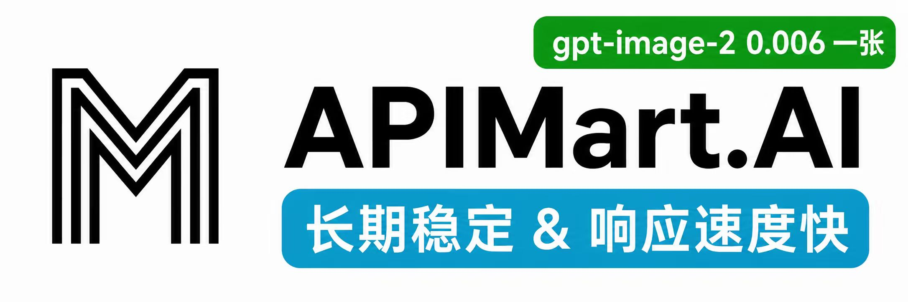

<p>
  <a href="https://github.com/HBAI-Ltd/Toonflow-app">
    
  </a>
 | 
  <a href="https://gitee.com/HBAI-Ltd/Toonflow-app">
    
  </a>
 | 
  <a href="https://atomgit.com/HBAI-Ltd/Toonflow-app">
    
  </a>
</p>

<p align="center">
  <a href="../../README.md">简体中文</a> |
  <a href="./readmeZhTw.md">繁體中文</a> |
  <a href="./readmeEn.md">English</a> |
  <a href="./readmeJa.md">日本語</a> |
  <a href="./readmeRu.md">Русский</a> |
  <a href="./readmeVi.md">Tiếng Việt</a> |
  <a href="./readmeTh.md">ไทย</a>
  <br />
  <a href="./readmeKo.md">한국어</a> |
  <a href="./readmeHi.md">हिन्दी</a> |
  <a href="./readmeId.md">Bahasa Indonesia</a> |
  <a href="./readmeMs.md">Bahasa Melayu</a> |
  <a href="./readmeFil.md">Filipino</a> |
  <a href="./readmeBn.md">বাংলা</a> |
  <a href="./readmeUr.md">اردو</a>
  <br />
  <strong>தமிழ்</strong> |
  <a href="./readmeTe.md">తెలుగు</a> |
  <a href="./readmeMr.md">मराठी</a> |
  <a href="./readmePa.md">ਪੰਜਾਬੀ</a> |
  <a href="./readmeAr.md">العربية</a> |
  <a href="./readmeFa.md">فارسی</a> |
  <a href="./readmeTr.md">Türkçe</a>
</p>

> 🌐 **21 இடைமுக மொழிகள்** · [ஆதரிக்கப்படும் மொழிகளைக் காண்க](#languages)

<div align="center">

<p align="center">
  
</p>

<a href="https://git.io/typing-svg">
  <picture>
    <source media="(prefers-color-scheme: dark)" srcset="https://readme-typing-svg.demolab.com?font=Fira+Code&size=40&duration=3000&pause=1000&color=FFFFFF&center=true&vCenter=true&width=600&lines=Toonflow;AI%20Short%20Drama%20Studio;Turn%20ideas%20into%20stories" />
    
  </picture>
</a>

<p align="center">
  <a href="https://github.com/HBAI-Ltd/Toonflow-app/stargazers">
    
  </a>
  <a href="../../LICENSE">
    
  </a>
  <a href="https://github.com/HBAI-Ltd/Toonflow-app/releases">
    
  </a>
</p>
<p align="center">
  <a href="https://github.com/HBAI-Ltd/Toonflow-app/network/members">
    
  </a>
  <a href="https://atomgit.com/HBAI-Ltd/Toonflow-app">
    
  </a>
  <a href="https://discord.gg/HEjKmpNpAZ">
    
  </a>
</p>
<p align="center">
  <a href="https://github.com/HBAI-Ltd/Toonflow-app/issues">
    
  </a>
  <a href="https://github.com/HBAI-Ltd/Toonflow-app/graphs/contributors">
    
  </a>
  <a href="https://github.com/HBAI-Ltd/Toonflow-app/commits">
    
  </a>
</p>
<p align="center">
 
 
 
  
</p>

<p align="center">
  <a href="https://trendshift.io/repositories/24197?utm_source=trendshift-badge&amp;utm_medium=badge&amp;utm_campaign=badge-trendshift-24197#achievements" target="_blank" rel="noopener noreferrer">
    
  </a>
  <a href="https://trendshift.io/repositories/24197?utm_source=trendshift-badge&amp;utm_medium=badge&amp;utm_campaign=badge-trendshift-24197#achievements" target="_blank" rel="noopener noreferrer">
    
  </a>
  <a href="https://trendshift.io/repositories/24197?utm_source=trendshift-badge&amp;utm_medium=badge&amp;utm_campaign=badge-trendshift-24197#achievements" target="_blank" rel="noopener noreferrer">
    
  </a>
</p>
<p align="center">
  <a href="https://trendshift.io/repositories/24197?utm_source=trendshift-badge&amp;utm_medium=badge&amp;utm_campaign=badge-trendshift-24197#achievements" target="_blank" rel="noopener noreferrer">
    
  </a>
  <a href="https://trendshift.io/repositories/24197?utm_source=trendshift-badge&amp;utm_medium=badge&amp;utm_campaign=badge-trendshift-24197#achievements" target="_blank" rel="noopener noreferrer">
    
  </a>
  <a href="https://trendshift.io/repositories/24197?utm_source=trendshift-badge&amp;utm_medium=badge&amp;utm_campaign=badge-trendshift-24197#achievements" target="_blank" rel="noopener noreferrer">
    
  </a>
</p>
<p align="center">
  <a href="https://trendshift.io/repositories/24197?utm_source=trendshift-badge&amp;utm_medium=badge&amp;utm_campaign=badge-trendshift-24197#achievements" target="_blank" rel="noopener noreferrer">
    
  </a>
</p>

**குறுநாடகங்கள், அனிமேஷன் காமிக்ஸ் மற்றும் வீடியோக்களை உருவாக்குவதற்கான திறந்த மூல AI தளம்**

> 🚀 **குறுநாடக உருவாக்கத்தின் அனைத்துப் பணிகளும் ஒரே இடத்தில்**: திரைக்கதை எழுதுதல், படைப்பு வளங்களை நிர்வகித்தல், படங்களையும் வீடியோக்களையும் உருவாக்குதல் என உங்கள் முழுப் படைப்புப் பணியையும் எல்லையற்ற கேன்வாஸில் ஒருங்கிணைக்கலாம்.

</div>

<div align="center">
  <table>
    <tr>
      <td width="50%" align="center">
        <a href="../images/gStar.png">
          
        </a>
      </td>
      <td width="50%" align="center">
        <a href="../images/gvp.jpg">
          
        </a>
      </td>
    </tr>
  </table>
</div>

<p align="center">
<a href="https://github.com/HBAI-Ltd/Toonflow-app/releases">பதிவிறக்கம்</a> ·
<a href="https://qcn7xdsqgc4z.feishu.cn/docx/RXFqdgR2Xo0dXZxGfd0cZCGgnwf">பயனர் வழிகாட்டி</a> ·
<a href="https://api.toonflow.net/console/plugIn">செருகுநிரல் சந்தை</a> ·
<a href="https://qcn7xdsqgc4z.feishu.cn/docx/KNBNd9naqolsy6xjAOCcEAkqnRd"> டெவலப்பர் ஆவணம்</a> ·
<a href="https://api.toonflow.net/">அதிகாரப்பூர்வ மாதிரி இயங்குதளம்</a>
</p>

---

## 1. 💛 ஆதரவாளர்களும் பங்களிப்பும்

Toonflow திறந்த மூல திட்டத்திற்கு ஆதரவளித்த பின்வரும் கூட்டாளர்களுக்கு நன்றி.

<table>
  <tr>
    <td width="50%" valign="top">
<a href="https://metaso.cn/minimax-h3/?s=toon"> <strong>Metaso</strong></a>
      <br />
      <sub>சிக்கனமான MiniMax H3 வீடியோ உருவாக்கம்: 768P-க்கு வினாடிக்கு ¥0.09, 2K-க்கு வினாடிக்கு ¥0.15 (CNY) மட்டுமே. உங்கள் சொந்த GPU அமைப்பை நிறுவாமல் நேட்டிவ் 2K, ஒத்திசைந்த ஒலி மற்றும் ஒளி, OpenAI-இணக்கமான API, ComfyUI மற்றும் எல்லையற்ற கேன்வாஸ் ஆகியவற்றைப் பயன்படுத்தலாம். கூடுதல் கிரெடிட்களையும் சிறப்புச் சலுகைகளையும் பெற <a href="https://metaso.cn/minimax-h3/?s=toon">இந்தச் சிறப்பு இணைப்பின் வழியாகப் பதிவு செய்யவும்</a>. வணிகத் தொடர்புகளுக்கு WeChat-இல் metasota12-ஐ அணுகவும்.</sub>
    </td>
    <td width="50%" valign="top">
<a href="https://go.apimart.ai/gh-toonflow-app"> <strong>APIMart</strong></a>
      <br />
      <sub>இந்தத் திட்டத்தை ஆதரித்த APIMart-க்கு நன்றி! AI மூலம் படங்களையும் வீடியோக்களையும் உருவாக்க APIMart ஒரு சிக்கனமான API தளத்தை வழங்குகிறது. GPT-Image-2-இல் ஒரு படத்தின் விலை $0.006 முதல்; $1-க்கு 160+ படங்களைப் பெறலாம். படங்களுக்கும் வீடியோக்களுக்கும் ஒரே ஒத்திசைவற்ற API: பணியைச் சமர்ப்பித்து அதன் ID-ஐப் பெற்று, callback மூலம் முடிவுகளைப் பெறலாம். நேரக்கெடு முடிவடையும் பிழைகள் இல்லாமல் 10,000 படங்களைத் தொகுதியாகச் செயலாக்கலாம்; குறியீட்டை மாற்றாமல் மாதிரிகளை மாற்றலாம். மாதக் கட்டணம் இல்லை; பயன்படுத்திய அளவுக்கு மட்டும் செலுத்துங்கள். தொடங்க <a href="https://go.apimart.ai/gh-toonflow-app">இங்கே பதிவு செய்யவும்</a>.</sub>
    </td>
  </tr>
  <tr>
    <td width="50%" valign="top">
<a href="https://www.compshare.cn/video-studio?ytag=GPU_YY_YX_git_toonflow"> <strong>CompShare</strong></a>
      <br />
      <sub>CompShare சிக்கனமான H3 வீடியோ உருவாக்கத்தை வழங்குகிறது. உரையிலிருந்து வீடியோ, முதல் மற்றும் கடைசி ஃபிரேம் கட்டுப்பாடு, ஒருங்கிணைந்த குறிப்புப் பட முறைகள் ஆகியவை இதில் உள்ளன. நேட்டிவ் 2K-இல் அதிகபட்சம் 30 வினாடி வீடியோக்களை உருவாக்கலாம்; 768P-க்கு வினாடிக்கு CNY 0.08 மட்டுமே. API இணைப்பு, நிறுவனங்களுக்கான அதிக எண்ணிக்கையிலான ஒரேநேரக் கோரிக்கைகள் மற்றும் சுயசேவை விலைப்பட்டியல் வசதிகளும் உள்ளன.</sub>
<br /><br />
      <sub>🎁 தளத்தை இலவசமாக முயற்சிக்க CNY 5 கிரெடிட் பெற <a href="https://www.compshare.cn/video-studio?ytag=GPU_YY_YX_git_toonflow">இந்தச் சிறப்பு இணைப்பின் வழியாகப் பதிவு செய்யவும்</a>!</sub>
    </td>
<td width="50%" valign="top"></td>
  </tr>
</table>

<details>
<summary><strong>👉 ஸ்பான்சராகுங்கள் 👈</strong></summary>

<p align="center">
  
</p>

<p align="center"><sub>இந்த தொடர்பு வணிக விசாரணைகளுக்கு மட்டுமே மற்றும் தொழில்நுட்ப ஆதரவை வழங்காது. பயன்பாட்டு கேள்விகளுக்கு, சமூக குழுக்களில் சேரவும். கருத்துப் படிவத்தின் மூலம் அம்சக் கோரிக்கைகள் மற்றும் பிழைகளைச் சமர்ப்பிக்கவும். உங்கள் புரிதலுக்கு நன்றி.</sub></p>

</details>

---

## 2. 🌟 சிறப்பம்சங்கள்

Toonflow என்பது குறுநாடகங்கள், அனிமேஷன் காமிக்ஸ் மற்றும் குறுகிய வீடியோக்களை உருவாக்குவதற்கான திறந்த மூல AI தளம். திரைக்கதைகள், படைப்பு வளங்கள் மற்றும் வீடியோ கிளிப்புகள் அனைத்தையும் ஒரே எல்லையற்ற கேன்வாஸில் ஒருங்கிணைக்கிறது.

| திறன் | விளக்கம் |
| --- | --- |
| 🏠 **உங்கள் சாதனத்தில் நிறுவுதல்** | திட்டங்களையும் படைப்பு வளங்களையும் உங்கள் சாதனத்திலோ சேவையகத்திலோ வைத்திருக்கலாம். டெஸ்க்டாப், Android, Docker மற்றும் சேவையக நிறுவல் முறைகள் உள்ளன. |
| 🖼️ **எல்லையற்ற கேன்வாஸ்** | ஸ்கிரிப்ட்கள், கதாபாத்திரங்கள், காட்சிகள் மற்றும் வீடியோ கிளிப்புகள் ஆகியவற்றை ஒரே கேன்வாஸில் ஒழுங்கமைக்கவும். |
| 🔌 **MCP** | MCP மூலம் வெளிப்புற கருவிகள் மற்றும் சேவைகளை இணைக்கவும். |
| 🧩 **செருகுநிரல் சந்தை** | [செருகுநிரல் சந்தை](https://api.toonflow.net/console/plugIn) மூலம் முனைகள், கருவிகள் மற்றும் படைப்பு வசதிகளைச் சேர்க்கலாம். |
| 🤖 **திறந்த Agent அமைப்பு** | ப்ராம்ப்ட்கள், கருவிகள் மற்றும் A2A-ஐ அணுகி Agent-இன் செயல்பாட்டை மாற்றியமைக்கவும், வெளிப்புற Agent-களுடன் இணைந்து செயல்படவும் முடியும். |
| 🔧 **நெகிழ்வான மாதிரி ஒருங்கிணைப்பு** | மூன்றாம் தரப்பு APIகளை உள்ளமைக்கவும் அல்லது உள்ளூர் ComfyUI நிகழ்வுகள் மற்றும் LLMs ஐ இணைக்கவும். |
| 🌐 **பன்மொழி ஆதரவு** | பயனர் இடைமுகத்தில் 21 மொழிகளை ஆதரிக்கிறது. |

<a id="languages"></a>

### பன்மொழி ஆதரவு

ஆதரிக்கப்படும் மொழிகள்: 简体中文, 繁體中文, English, 日本語, Русский, Tiếng Việt, ไทย, 한국어, हिन्दी, Bahasa Indonesia, Bahasa Melayu, Filipino, বাংলা, اردو, தமிழ், తెలుగు, मराठी, ਪੰਜਾਬੀ, العربية, فارسی, Türkçe.

---

## 3. 📸 ஸ்கிரீன்ஷாட்கள்

<div align="center">

<a href="../images/screenshots/projectHome.png"></a><br /><sub>திட்ட முகப்பும் யோசனை உருவாக்கமும்</sub>

<a href="../images/screenshots/quickStart.png"></a><br /><sub>முதல் தொடக்கமும் விரைவு அமைப்பும்</sub>

<a href="../images/screenshots/canvasDark.png"></a><br /><sub>படைப்புக் கேன்வாஸ் · இருண்ட தோற்றம்</sub>

<a href="../images/screenshots/canvasLight.png"></a><br /><sub>படைப்புக் கேன்வாஸ் · வெளிர் தோற்றம்</sub>

<a href="../images/screenshots/assetCanvas.png"></a><br /><sub>கதாபாத்திரங்கள், காட்சிகள் மற்றும் பொருட்களுக்கான வளங்கள்</sub>

<a href="../images/screenshots/directorStudio.png"></a><br /><sub>3D இயக்குநர் அரங்கமும் காட்சிப் பதிவு முன்னோட்டமும்</sub>

<a href="../images/screenshots/characterImageGeneration.png"></a><br /><sub>கதாபாத்திரத்தின் மூன்று கோணத் தோற்றங்களும் பட உருவாக்கமும்</sub>

<a href="../images/screenshots/videoGeneration.png"></a><br /><sub>பல குறிப்புப் படங்களுடன் வீடியோ உருவாக்கம்</sub>

<a href="../images/screenshots/nodeMenu.png"></a><br /><sub>முனை மெனுவும் குழுவாக்கச் செயல்களும்</sub>

<a href="../images/screenshots/pluginMarket.png"></a><br /><sub>செருகுநிரல் சந்தை</sub>

</div>

---

## 4. 🚀 பதிவிறக்கம் செய்து நிறுவவும்

### 4.1 செயலி நிறுவல்

| இயக்க முறைமை | GitHub |
| --- | --- |
| Windows | [வெளியீடு](https://github.com/HBAI-Ltd/Toonflow-app/releases) |
| macOS | [வெளியீடு](https://github.com/HBAI-Ltd/Toonflow-app/releases) |
| Android ARM64 | [APK பதிவிறக்கம்](https://github.com/HBAI-Ltd/Toonflow-app/releases/latest) |

Android செயலி ARM64 சாதனங்களை மட்டுமே ஆதரிக்கிறது. வெளியீட்டுப் பக்கத்திலிருந்து `toonflow-VERSION-android-arm64.apk` கோப்பைப் பதிவிறக்கி நிறுவவும். உள்ளூர் Bun பின்தளம் உள்ளடங்கியுள்ளதால் தனியாக இயங்க முடியும். முகப்புப் பக்கத்தில் உள்ள «சாதன இணைப்பு» மூலம் QR குறியீட்டை ஸ்கேன் செய்தோ இணைப்பு விவரங்களை உள்ளீடு செய்தோ உள்ளூர் வலையமைப்பு அல்லது இணையத்தில் பகிர்வு இயக்கப்பட்டுள்ள கணினி அல்லது பின்தளத்துடன் இணைக்கலாம்.

Windows நிறுவி தானாகவே WebView2 கண்டறிந்து நிறுவுகிறது. நிறுவிய பின் ஆப்ஸ் உடனடியாக மூடப்பட்டால், [WebView2 டவுன்லோட் பக்கம்](https://developer.microsoft.com/microsoft-edge/webview2/) இலிருந்து இயக்க நேரத்தை கைமுறையாக பதிவிறக்கி நிறுவவும்.

macOS (Apple Silicon)-இல் Toonflow-ஐ Applications கோப்புறைக்கு இழுத்துச் சென்று நேரடியாகத் திறக்கலாம். அதற்கு முன் Terminal கட்டளைகளை இயக்கத் தேவையில்லை. macOS பாதுகாப்பு எச்சரிக்கை காட்டினால், கீழுள்ள படிகளை வரிசையாகப் பின்பற்றவும்.

<details>
<summary><strong>macOS-இல் Toonflow-ஐ நிறுவவோ திறக்கவோ முடியாவிட்டால்</strong></summary>

**1. தனியுரிமை மற்றும் பாதுகாப்பில் Toonflow ஐ அனுமதிக்கவும்**

டெவலப்பரைச் சரிபார்க்க முடியவில்லை அல்லது Apple தீங்கிழைக்கும் மென்பொருளுக்கான பயன்பாட்டைச் சரிபார்க்க முடியாது என்ற எச்சரிக்கையை நீங்கள் கண்டால், முதலில் Toonflow ஐத் திறக்க முயற்சிக்கவும். பின்னர் கணினி அமைப்புகள் → தனியுரிமை & பாதுகாப்பு என்பதற்குச் சென்று, Toonflow தடுக்கப்பட்ட செய்தியைக் கண்டறிந்து, எப்படியும் திற என்பதைக் கிளிக் செய்து, கேட்கப்பட்டதை உறுதிப்படுத்தவும். [Apple இன் அதிகாரப்பூர்வ வழிமுறைகளைப் பார்க்கவும்](https://support.apple.com/zh-cn/102445).

**2. தனிமைப்படுத்தப்பட்ட கட்டுப்பாடுகள் இன்னும் திறப்பதைத் தடுக்கிறது என்றால், தனிமைப்படுத்தப்பட்ட பண்புக்கூறை அகற்ற முயற்சிக்கவும்**

பயன்பாடு அதிகாரப்பூர்வ வெளியீட்டுப் பக்கத்திலிருந்து வந்தது மற்றும் பயன்பாடுகளில் உள்ளது என்பதை உறுதிசெய்த பிறகு, பின்வரும் கட்டளையை டெர்மினலில் இயக்கி, அதை மீண்டும் திறக்க முயற்சிக்கவும். பயன்பாட்டின் பெயர் அல்லது நிறுவல் இடம் வேறுபட்டால் பாதையை சரிசெய்யவும்.

```bash
sudo xattr -rd com.apple.quarantine /Applications/toonflow.app
```

**3. கடைசி முயற்சி: எங்கிருந்தும் ஆப்ஸை தற்காலிகமாக அனுமதி**

முதல் இரண்டு முறைகளில் எதுவுமே வேலை செய்யவில்லை என்றால், பயன்பாட்டின் மூலத்தை நீங்கள் நம்பினால், இயக்க முயற்சிக்கவும்:

```bash
sudo spctl --master-disable
```

பின்னர் கணினி அமைப்புகள் → தனியுரிமை & பாதுகாப்பு என்பதைத் திறக்கவும். பாதுகாப்பின் கீழ், உங்கள் கணினி அந்த விருப்பத்தை வழங்கினால், "பதிவிறக்கம் செய்யப்பட்ட பயன்பாடுகளை அனுமதி" என்பதை "எங்கேயும்" என அமைத்து, கேட்கப்பட்டதை உறுதிப்படுத்தவும். macOS பதிப்புகளில் கிடைக்கும் விருப்பங்களும் கட்டளை ஆதரவும் மாறுபடலாம்.

இது அனைத்து ஆப்ஸிற்கான பாதுகாப்பு கட்டுப்பாடுகளை தளர்த்துகிறது. பின்னர், அமைப்பை "App Store மற்றும் அடையாளம் காணப்பட்ட டெவலப்பர்கள்" க்கு மீட்டமைக்க பரிந்துரைக்கிறோம்.

</details>

மேலும் வழிமுறைகளுக்கு, [பயனர் வழிகாட்டி](https://qcn7xdsqgc4z.feishu.cn/docx/RXFqdgR2Xo0dXZxGfd0cZCGgnwf) ஐப் பார்க்கவும்.

---

### 4.2 Docker நிறுவல்

முதலில் Git, [Docker Engine](https://docs.docker.com/engine/install/) மற்றும் Docker Compose-ஐ நிறுவவும். Windows மற்றும் macOS-இல் Docker Desktop-இன் Linux container முறையைப் பயன்படுத்தலாம். இந்தக் களஞ்சியத்தில் [Dockerfile](../../Dockerfile), [Compose அமைப்பு](../../compose.yaml) மற்றும் [உருவாக்கத்திலிருந்து விலக்கப்படும் கோப்புகளின் விதிகள்](../../.dockerignore) உள்ளன. இமேஜ் Bun 1.4.3-ஐக் கொண்டு உருவாக்கப்படுகிறது; FFmpeg-ஐயும் உள்ளடக்கியது.

<details>
<summary><strong>Docker நிறுவல் படிகளை விரிவாக்கு</strong></summary>

மூலத்தை குளோன் செய்து பின்வருவனவற்றை களஞ்சிய மூலத்தில் இயக்கவும்:

```sh
git clone https://github.com/HBAI-Ltd/Toonflow-app.git
cd Toonflow-app
docker compose up -d --build
```

முதல் உருவாக்கம் சார்புகளை நிறுவுகிறது மற்றும் தொகுக்கப்பட்ட முனைகள், கருவிகள், Web மற்றும் Server ஆகியவற்றை உருவாக்குகிறது. தொடங்கியதும், `http://127.0.0.1:3000`ஐத் திறக்கவும். ரிமோட் ஹோஸ்டுக்கு, கீழே உள்ள "அணுகல் மற்றும் தரவு" என்பதன் கீழ் விவரிக்கப்பட்டுள்ளபடி SSH சுரங்கப்பாதையைப் பயன்படுத்தவும். முதல் தொடக்கமானது தொகுக்கப்பட்ட செருகுநிரல்களை துவக்குகிறது மற்றும் `myProject` வேலை செய்யும் கோப்பகத்தை வழங்குகிறது.

அமைப்புகள், செருகுநிரல்கள் மற்றும் திட்டக் கோப்புகள் `toonflowData` என்ற Docker volume-இல் சேமிக்கப்படுகின்றன. அது கொள்கலனுக்குள் `/app/data/`-இல் இணைக்கப்படுகிறது. உண்மையான volume பெயருக்கு முன் Compose திட்டப் பெயர் இருக்கும். கொள்கலனை நிறுத்தினாலும் மீண்டும் உருவாக்கினாலும் தரவு பாதுகாக்கப்படும். **`docker compose down -v` கட்டளையைப் பயன்படுத்த வேண்டாம்: அது தரவு volume-ஐ நீக்கிவிடும்.**

```sh
docker compose logs -f toonflow  # View logs
docker compose stop             # Stop the service
docker compose start            # Start it again
docker compose down             # Remove containers, retaining the data volume
```

திட்டக் கோப்பகத்தைச் சேர்க்க, "Server பணிக் கோப்பகத்தைத் தேர்ந்தெடு" உரையாடலில் உள்ள "புதிய கோப்புறை" என்பதைக் கிளிக் செய்யவும். கோப்புகள் மற்றும் கோப்புறைகளை மறுபெயரிடுதல் மற்றும் நீக்குதல் ஆகியவற்றை உரையாடல் ஆதரிக்கிறது. மாற்றாக, சேவை இயங்கும் போது கட்டளை வரியிலிருந்து ஒரு கோப்பகத்தை உருவாக்கவும்:

```sh
docker compose exec toonflow mkdir -p /app/data/workspaces/newProject
```

காப்புப்பிரதிக்கு, முதலில் சேவையை நிறுத்தி, தரவை நகலெடுத்து, மறுதொடக்கம் செய்யுங்கள்:

```sh
docker compose stop
docker compose cp toonflow:/app/data ./toonflowBackup
docker compose start
```

</details>

---

### 4.3 Server நிறுவல்

Web மற்றும் Server ஆகியவற்றை நேரடியாக Linux சர்வரில் இயக்க இந்த விருப்பத்தைப் பயன்படுத்தவும். கீழே உள்ள எடுத்துக்காட்டு Ubuntu / Debian மற்றும் திட்டத்தின் குறிப்பிட்ட பதிப்பான [Bun 1.4.3](https://bun.sh/docs/installation) ஐப் பயன்படுத்துகிறது.

<details>
<summary><strong> சேவையக நிறுவல் படிகளை விரிவாக்கு</strong></summary>

இயக்க நேர சூழலை நிறுவவும்:

```sh
sudo apt-get update
sudo apt-get install -y git curl unzip ffmpeg
curl -fsSL https://bun.com/install | bash -s "bun-v1.4.3"
export PATH="$HOME/.bun/bin:$PATH"
bun --version
```

மூலத்தை குளோன் செய்து சேவையைத் தொடங்கவும்:

```sh
git clone https://github.com/HBAI-Ltd/Toonflow-app.git
cd Toonflow-app
bun install --frozen-lockfile

# Build bundled nodes, tools, Web, and Server
bun run build:server
mkdir -p data/workspaces/myProject
bun run start:server
```

“服务启动成功” (சேவை வெற்றிகரமாகத் தொடங்கியது) என்ற செய்தி தெரிந்ததும், சேவையகத்திலேயே `http://127.0.0.1:3000`-ஐத் திறக்கவும். மேலுள்ள கட்டளை foreground-இல் இயங்கும்; நிறுத்த `Ctrl+C` அழுத்தவும். கணினி தொடங்கும்போது தானாக இயக்கவும் செயல்முறையை நிர்வகிக்கவும் [Bun-இன் systemd நிறுவல் வழிகாட்டியைப்](https://bun.sh/guides/ecosystem/systemd) பார்க்கவும். பணிக் கோப்பகமாகக் களஞ்சியக் கோப்பகத்தை அமைக்கவும்; தொடக்கக் கட்டளையில் Bun-இன் முழுப் பாதையைத் தொடர்ந்து `run start:server` இருக்க வேண்டும். அந்தக் கோப்பகத்தைப் படிக்கவும் எழுதவும் அனுமதியுள்ள பயனராக இயக்கவும்.

</details>

---

### 4.4 அணுகல் மற்றும் தரவு

- சேவை தற்போது நிலையான `3000` போர்ட்டைப் பயன்படுத்துகிறது. வலை இடைமுகத்திற்கும் API-க்கும் தனியான உள்நுழைவு சரிபார்ப்பு இல்லை. சேவையகத்தில் நிறுவும்போது firewall அல்லது security group மூலம் `3000` போர்ட்டை அணுகக்கூடியவர்களைக் கட்டுப்படுத்தவும். பொது இணைய அணுகலுக்கு அங்கீகார வசதியுள்ள reverse proxy தேவை.
- தனிப்பட்ட தொலைநிலை அணுகலுக்கு, உங்கள் கணினியில் `ssh -N -L 3000:127.0.0.1:3000 username@server-address` இயக்கவும். இணைப்பைத் திறந்தபடியே வைத்து `http://127.0.0.1:3000`-க்குச் செல்லவும். சேவையகத்தின் `3000` போர்ட்டைப் பொது இணையத்திற்குத் திறக்கத் தேவையில்லை.
- நேரடி நிறுவலில், அமைப்புகள், செருகுநிரல்கள் மற்றும் பணியிடங்கள் முன்னிருப்பாக களஞ்சியத்தின் `data/` கோப்பகத்தில் சேமிக்கப்படும். Docker உடன், அவை தரவு தொகுதிக்குள் `/app/data/` இல் சேமிக்கப்படும். நகர்த்தும்போது அல்லது காப்புப் பிரதி எடுக்கும்போது முழு கோப்பகத்தையும் பாதுகாக்கவும். பக்கத்தைத் திறந்த பிறகு, சர்வர் பணியிடத்தில் `myProject` என்பதைத் தேர்ந்தெடுக்கவும். கூடுதல் திட்டங்களுக்கு தொடர்புடைய `workspaces/` கோப்பகத்தின் கீழ் துணை அடைவுகளை உருவாக்கவும்.
- இரண்டு நிறுவல் முறைகளிலும் FFmpeg அமைப்பு அடங்கும். இடைமுகத்தில் மாதிரி சேவைகளுக்கான API விசைகளை நீங்கள் இன்னும் உள்ளமைக்க வேண்டும்.

---

### 4.5 கிளவுட் வரிசைப்படுத்தல்

எங்கள் கூட்டாளர் [AI Galaxy (智星云)](https://www.ai-galaxy.com/) அதிகாரப்பூர்வமாக அனுமதிக்கப்பட்ட வணிக Toonflow இமேஜை வழங்குகிறது; அதில் பயன்படுத்தத் தயாரான சூழல் உள்ளது. செயல்முறைக்கு [படங்களுடன் கூடிய இமேஜ் நிறுவல் வழிகாட்டியைப்](https://mp.weixin.qq.com/s/lq9X1ovQ1_TKeXMOLgicKg?scene=1) பார்க்கவும்.

---

## 5. 🎬 மாதிரிப் படைப்பு

https://github.com/user-attachments/assets/2d9fddac-dfdf-4640-b030-b09d7f7287e9

### தயாரிப்பு விவரங்கள்

| பொருள் | அசல் களஞ்சியத்தில் பதிவு செய்யப்பட்டது |
| --- | --- |
| உற்பத்தி நேரம் மற்றும் இறுதி நீளம் | சுமார் 2 நிமிட வீடியோவிற்கு, தோராயமாக 2 மணிநேர வேலை. |
| வீடியோ மாதிரி | Seedance 2.0 |
| பட மாதிரி | GPT Image 2 |
| மொழி மாதிரி | Claude Opus 4.6 |
| மாதிரி API செலவுகள் | தோராயமாக ¥130 CNY (சீன யுவான்): மொழிக்கு சுமார் ¥10, வீடியோவிற்கு ¥120 மற்றும் படங்களுக்கு ¥1 க்கும் குறைவானது. |

இவை இந்த மாதிரிக்காகப் பதிவுசெய்யப்பட்ட செலவுகள்; ஒரு கணிப்பிற்காக மட்டுமே வழங்கப்படுகின்றன. உண்மையான செலவு மாதிரிச் சேவை, உருவாக்கும் முயற்சிகளின் எண்ணிக்கை மற்றும் அளவுருக்களைப் பொறுத்தது. மாதிரி வீடியோ சுருக்கப்பட்ட 480p பதிப்பாகும்.

---

## 6. 👨‍👩‍👧‍👦 WeChat சமூகம்

குழு அழைப்பிதழ் உதவியாளரைத் தொடர்புகொள்ள QR குறியீட்டை ஸ்கேன் செய்யவும்:


Discord இல் சேர ஐகானையும் கிளிக் செய்யலாம்:

[](https://discord.gg/HEjKmpNpAZ) இல் சேரவும்

அல்லது அழைப்பிதழ் இணைப்பைப் பயன்படுத்தவும்: [https://discord.gg/HEjKmpNpAZ](https://discord.gg/HEjKmpNpAZ)

---

## 7. 💌 எங்களை தொடர்பு கொள்ளவும்

📧 மின்னஞ்சல்: [ltlctools@outlook.com](mailto:ltlctools@outlook.com?subject=Toonflow咨询)

---

## 8. 📜 திறந்த மூல உரிமம்

Toonflow ஆனது [MIT License](../../LICENSE) இன் கீழ் உரிமம் பெற்றது. மூன்றாம் தரப்பு சார்புகள் மற்றும் சொத்துக்கள் அந்தந்த உரிமங்கள் மற்றும் பதிப்புரிமை அறிவிப்புகளுக்கு உட்பட்டவை.

[](https://www.star-history.com/#HBAI-Ltd/Toonflow-app&Date)

> **முந்தைய பதிப்புகளுக்குப் பொருந்தாத மாற்றம்**: v1.0.8-க்கு முந்தைய பதிப்புகளை AGPL-3.0-இன் கீழ் பயன்படுத்தியவர்களுக்கு AGPL-3.0 தொடர்ந்து பொருந்தும். v1.0.8 முதல் v1.1.8 வரையிலான பதிப்புகளுக்கு Apache-2.0 மற்றும் அதன் கூடுதல் ஒப்பந்தம் தொடர்ந்து பொருந்தும். இந்த உரிம மாற்றம் அவர்களைப் பாதிக்காது.

---

## 9. 🙏 நன்றிகள்

- **பார்ட்னர்கள்**: 算能云, Tencent Hunyuan 3D, மற்றும் AI Galaxy (智星云).
- **திட்டப் பங்களிப்பாளர்கள்**: குறியீடு எழுதிய, ஆவணங்களை மேம்படுத்திய, செருகுநிரல்களைப் பகிர்ந்த மற்றும் சிக்கல்களைத் தீர்க்க உதவிய அனைவருக்கும் நன்றி.
- **சமூகப் பயனர்கள்**: தொடர்ந்து கருத்து வழங்க, ஆக்கப்பூர்வமான பணிகளைப் பகிர்ந்து, திட்டத்திற்கு ஆதரவளிக்கும் அனைவருக்கும் நன்றி.

仰起脸笑的像满月: மேம்பாட்டிற்கான Codex 20x கணினி வளங்களை வழங்கினார்.
Xi'an Zhongxing Digital Intelligence Technology Co., Ltd. (西安中星数字智能科技有限公司): Apple சான்றிதழ் மூலம் பயன்பாட்டைக் கையொப்பமிட ஆதரவளித்தது.

<div align="center">

பதிப்புரிமை © 2026 北京爱阿科技有限公司

</div>


