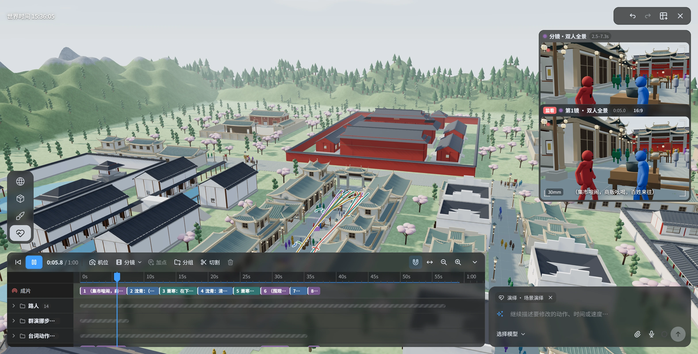

<p>
  <a href="https://github.com/HBAI-Ltd/Toonflow-app">
    
  </a>
 | 
  <a href="https://gitee.com/HBAI-Ltd/Toonflow-app">
    
  </a>
 | 
  <a href="https://atomgit.com/HBAI-Ltd/Toonflow-app">
    
  </a>
</p>

<p align="center">
  <a href="../../README.md">简体中文</a> |
  <a href="./readmeZhTw.md">繁體中文</a> |
  <a href="./readmeEn.md">English</a> |
  <a href="./readmeJa.md">日本語</a> |
  <a href="./readmeRu.md">Русский</a> |
  <a href="./readmeVi.md">Tiếng Việt</a> |
  <a href="./readmeTh.md">ไทย</a>
  <br />
  <a href="./readmeKo.md">한국어</a> |
  <a href="./readmeHi.md">हिन्दी</a> |
  <a href="./readmeId.md">Bahasa Indonesia</a> |
  <a href="./readmeMs.md">Bahasa Melayu</a> |
  <a href="./readmeFil.md">Filipino</a> |
  <a href="./readmeBn.md">বাংলা</a> |
  <a href="./readmeUr.md">اردو</a>
  <br />
  <a href="./readmeTa.md">தமிழ்</a> |
  <strong>తెలుగు</strong> |
  <a href="./readmeMr.md">मराठी</a> |
  <a href="./readmePa.md">ਪੰਜਾਬੀ</a> |
  <a href="./readmeAr.md">العربية</a> |
  <a href="./readmeFa.md">فارسی</a> |
  <a href="./readmeTr.md">Türkçe</a>
</p>

> 🌐 **22 ఇంటర్‌ఫేస్ భాషలు** · [మద్దతు ఉన్న భాషలను వీక్షించండి](#languages)

<div align="center">

<p align="center">
  
</p>

<a href="https://git.io/typing-svg">
  <picture>
    <source media="(prefers-color-scheme: dark)" srcset="https://readme-typing-svg.demolab.com?font=Fira+Code&size=40&duration=3000&pause=1000&color=FFFFFF&center=true&vCenter=true&width=600&lines=Toonflow;AI%20Short%20Drama%20Studio;Turn%20ideas%20into%20stories" />
    
  </picture>
</a>

<p align="center">
  <a href="https://github.com/HBAI-Ltd/Toonflow-app/stargazers">
    
  </a>
  <a href="../../LICENSE">
    
  </a>
  <a href="https://github.com/HBAI-Ltd/Toonflow-app/releases">
    
  </a>
</p>
<p align="center">
  <a href="https://github.com/HBAI-Ltd/Toonflow-app/network/members">
    
  </a>
  <a href="https://atomgit.com/HBAI-Ltd/Toonflow-app">
    
  </a>
  <a href="https://discord.gg/HEjKmpNpAZ">
    
  </a>
</p>
<p align="center">
  <a href="https://github.com/HBAI-Ltd/Toonflow-app/issues">
    
  </a>
  <a href="https://github.com/HBAI-Ltd/Toonflow-app/graphs/contributors">
    
  </a>
  <a href="https://github.com/HBAI-Ltd/Toonflow-app/commits">
    
  </a>
</p>
<p align="center">
 
 
 
  
</p>

<p align="center">
  <a href="https://trendshift.io/repositories/24197?utm_source=trendshift-badge&amp;utm_medium=badge&amp;utm_campaign=badge-trendshift-24197#achievements" target="_blank" rel="noopener noreferrer">
    
  </a>
  <a href="https://trendshift.io/repositories/24197?utm_source=trendshift-badge&amp;utm_medium=badge&amp;utm_campaign=badge-trendshift-24197#achievements" target="_blank" rel="noopener noreferrer">
    
  </a>
  <a href="https://trendshift.io/repositories/24197?utm_source=trendshift-badge&amp;utm_medium=badge&amp;utm_campaign=badge-trendshift-24197#achievements" target="_blank" rel="noopener noreferrer">
    
  </a>
</p>
<p align="center">
  <a href="https://trendshift.io/repositories/24197?utm_source=trendshift-badge&amp;utm_medium=badge&amp;utm_campaign=badge-trendshift-24197#achievements" target="_blank" rel="noopener noreferrer">
    
  </a>
  <a href="https://trendshift.io/repositories/24197?utm_source=trendshift-badge&amp;utm_medium=badge&amp;utm_campaign=badge-trendshift-24197#achievements" target="_blank" rel="noopener noreferrer">
    
  </a>
  <a href="https://trendshift.io/repositories/24197?utm_source=trendshift-badge&amp;utm_medium=badge&amp;utm_campaign=badge-trendshift-24197#achievements" target="_blank" rel="noopener noreferrer">
    
  </a>
</p>
<p align="center">
  <a href="https://trendshift.io/repositories/24197?utm_source=trendshift-badge&amp;utm_medium=badge&amp;utm_campaign=badge-trendshift-24197#achievements" target="_blank" rel="noopener noreferrer">
    
  </a>
</p>

**లఘు నాటకాలు, యానిమేటెడ్ కామిక్స్, వీడియోల సృష్టికి ఓపెన్ సోర్స్ AI వేదిక**

> 🚀 **లఘు నాటకాల సృష్టికి అవసరమైనవన్నీ ఒకే చోట**: స్క్రిప్ట్‌లు రాయండి, సృజనాత్మక వనరులను నిర్వహించండి, చిత్రాలు మరియు వీడియోలను సృష్టించండి. మీ మొత్తం పని క్రమాన్ని అనంతమైన కాన్వాస్‌పై అమర్చుకోండి.

</div>

<div align="center">
  <table>
    <tr>
      <td width="50%" align="center">
        <a href="../images/gStar.png">
          
        </a>
      </td>
      <td width="50%" align="center">
        <a href="../images/gvp.jpg">
          
        </a>
      </td>
    </tr>
  </table>
</div>

<p align="center">
<a href="https://github.com/HBAI-Ltd/Toonflow-app/releases">డౌన్‌లోడ్</a> ·
<a href="https://qcn7xdsqgc4z.feishu.cn/docx/RXFqdgR2Xo0dXZxGfd0cZCGgnwf">వినియోగదారు మార్గదర్శిని</a> ·
<a href="https://api.toonflow.net/console/plugIn">ప్లగిన్ మార్కెట్‌ప్లేస్</a> ·
<a href="https://qcn7xdsqgc4z.feishu.cn/docx/KNBNd9naqolsy6xjAOCcEAkqnRd"> డెవలపర్ డాక్యుమెంటేషన్</a> ·
<a href="https://api.toonflow.net/">అధికారిక మోడల్ వేదిక</a>
</p>

<p align="center">
  📺 <a href="https://www.bilibili.com/video/BV1hbpb6xETF">ఉత్పత్తి పరిచయ వీడియో</a> ·
  <a href="https://www.bilibili.com/video/BV1z4sS6NEA3">TrumanMap ప్రీవిజ్ డెమో</a>
</p>

<p align="center">🔥 Toonflow ఆధారంగా రూపొందిన షార్ట్ డ్రామాలు Hongguo లో లక్షల నుంచి కోట్ల వరకు, 10 కోట్లకు పైగా వీక్షణలు సాధించాయి. <a href="#works">రచనలు చూడండి</a></p>

https://github.com/user-attachments/assets/56d81114-7521-454c-9ec9-972567eddda9

---

## 1. 💛 స్పాన్సర్లు మరియు మద్దతు

Toonflow ఓపెన్ సోర్స్ ప్రాజెక్ట్‌కు మద్దతు ఇచ్చినందుకు క్రింది భాగస్వాములకు ధన్యవాదాలు.

<table>
  <tr>
    <td width="50%" valign="top">
<a href="https://metaso.cn/minimax-h3/?s=toon"> <strong>Metaso</strong></a>
      <br />
      <sub>తక్కువ ఖర్చుతో MiniMax H3 వీడియో సృష్టి: 768P వద్ద సెకనుకు ¥0.09, 2K వద్ద సెకనుకు ¥0.15 (CNY) మాత్రమే. సొంత GPU ఏర్పాటు చేయాల్సిన అవసరం లేకుండా నేటివ్ 2K, సమకాలీకరించిన ఆడియో మరియు వీడియో, OpenAI-అనుకూల API, ComfyUI, అనంతమైన కాన్వాస్‌లను ఉపయోగించవచ్చు. బోనస్ క్రెడిట్‌లు, ప్రత్యేక ఆఫర్‌ల కోసం <a href="https://metaso.cn/minimax-h3/?s=toon">ఈ ప్రత్యేక లింక్ ద్వారా నమోదు చేసుకోండి</a>. వ్యాపార విషయాల కోసం WeChatలో metasota12ను సంప్రదించండి.</sub>
    </td>
    <td width="50%" valign="top">
<a href="https://go.apimart.ai/gh-toonflow-app"> <strong>APIMart</strong></a>
      <br />
      <sub>ఈ ప్రాజెక్టును స్పాన్సర్ చేసిన APIMartకు ధన్యవాదాలు! AIతో చిత్రాలు, వీడియోలు సృష్టించడానికి APIMart తక్కువ ధరలో API సేవలను అందిస్తుంది. GPT-Image-2లో చిత్రం ధర $0.006 నుంచి ప్రారంభమవుతుంది; $1కు 160+ చిత్రాలు పొందవచ్చు. చిత్రాలు, వీడియోలకు ఒకే అసింక్రోనస్ API: పనిని సమర్పించి దాని ID పొందండి; callback ద్వారా ఫలితాలు అందుకోండి. టైమ్‌అవుట్‌లు లేకుండా 10,000 చిత్రాల బ్యాచ్‌లను ప్రాసెస్ చేయవచ్చు; కోడ్ మార్చకుండానే మోడల్‌లను మార్చవచ్చు. నెలవారీ రుసుము లేదు; ఉపయోగించిన మేరకే చెల్లించండి. ప్రారంభించడానికి <a href="https://go.apimart.ai/gh-toonflow-app">ఇక్కడ నమోదు చేసుకోండి</a>.</sub>
    </td>
  </tr>
  <tr>
    <td width="50%" valign="top">
<a href="https://www.compshare.cn/video-studio?ytag=GPU_YY_YX_git_toonflow"> <strong>CompShare</strong></a>
      <br />
      <sub>CompShare తక్కువ ఖర్చుతో H3 వీడియో సృష్టిని అందిస్తుంది. టెక్స్ట్ నుంచి వీడియో, మొదటి మరియు చివరి ఫ్రేమ్ నియంత్రణ, సమగ్ర రిఫరెన్స్ మోడ్‌లు ఇందులో ఉన్నాయి. నేటివ్ 2Kలో గరిష్టంగా 30 సెకన్ల వీడియోలను సృష్టించవచ్చు; 768P ధర సెకనుకు CNY 0.08 మాత్రమే. API అనుసంధానం, సంస్థల కోసం ఒకేసారి పెద్ద సంఖ్యలో అభ్యర్థనలను ప్రాసెస్ చేసే సామర్థ్యం, స్వయంగా ఇన్‌వాయిస్ పొందే సదుపాయం ఉన్నాయి.</sub>
<br /><br />
      <sub>🎁 ప్లాట్‌ఫారమ్‌ను ఉచితంగా ప్రయత్నించడానికి CNY 5 క్రెడిట్‌లు పొందాలంటే <a href="https://www.compshare.cn/video-studio?ytag=GPU_YY_YX_git_toonflow">ఈ ప్రత్యేక లింక్ ద్వారా నమోదు చేసుకోండి</a>!</sub>
    </td>
<td width="50%" valign="top">
      <a href="https://weimeta.cn/console/invite/accept?aff=INV202611191734123p9JeY"> <strong>WEIMETA AI</strong></a>
      <br />
      <sub>WEIMETA AI తక్కువ ఖర్చుతో AI టెక్స్ట్, ఇమేజ్, వీడియో జనరేషన్ సేవలను అందిస్తుంది; DeepSeek, GLM, Kimi, Seedream, Seedance, Wan, MiniMax H3 వంటి ప్రముఖ మోడళ్లను ఒకేచోట కలుపుతుంది. టెక్స్ట్ నుండి ఇమేజ్, ఇమేజ్ నుండి ఇమేజ్, టెక్స్ట్ నుండి వీడియో, ఇమేజ్ నుండి వీడియోను ఏకీకృత API ద్వారా సపోర్ట్ చేస్తుంది. ఎంటర్‌ప్రైజ్ స్థాయి ఎన్‌క్రిప్టెడ్ ట్రాన్స్‌మిషన్, మల్టీ-టెనెంట్ ఐసోలేషన్ ఉపయోగిస్తుంది; చైనా లెవల్ 3 భద్రతా మూల్యాంకనంలో ఉత్తీర్ణమైంది.</sub>
      <br /><br />
      <sub>🎁 WEIMETA AI మల్టీమోడల్ మోడల్ సేవలను ప్రయత్నించడానికి <a href="https://weimeta.cn/console/invite/accept?aff=INV202611191734123p9JeY">ఈ ప్రత్యేక లింక్ ద్వారా నమోదు చేసుకోండి</a>. పరిమిత కాల ఆఫర్: CNY 100 రీఛార్జ్‌పై CNY 15 అదనం. వ్యాపార సంప్రదింపులకు WeChat: WeiMeta_AI666</sub>
    </td>
  </tr>
</table>

<details>
<summary><strong>👉 స్పాన్సర్ అవ్వండి 👈</strong></summary>

<p align="center">
  
</p>

<p align="center"><sub>ఈ పరిచయం వ్యాపార విచారణల కోసం మాత్రమే మరియు సాంకేతిక మద్దతును అందించదు. వినియోగ ప్రశ్నల కోసం, దయచేసి సంఘం సమూహాలలో చేరండి. ఫీడ్‌బ్యాక్ ఫారమ్ ద్వారా ఫీచర్ అభ్యర్థనలు మరియు బగ్‌లను సమర్పించండి. మీ అవగాహనకు ధన్యవాదాలు.</sub></p>

</details>

---

## 2. 🌟 ముఖ్యాంశాలు

| సామర్థ్యం | వివరణ |
| --- | --- |
| 🎬 **TrumanMap ప్రీవిజ్** | స్క్రిప్ట్ పేస్ట్ చేస్తే ఒక్క క్లిక్‌లో 3D సెట్, స్టోరీబోర్డ్, బ్లాకింగ్. |
| 🖼️ **అనంత కాన్వాస్** | స్క్రిప్ట్, పాత్రలు, సన్నివేశాలు, క్లిప్‌లు ఒకే కాన్వాస్‌పై. |
| 🎥 **AI వీడియో జనరేషన్** | @ తో అసెట్‌లను సూచించి షాట్ వారీగా. |
| 🤖 **AI సహాయకుడు** | కాన్వాస్‌ను చదివి మారుస్తుంది; MCP, A2A మద్దతు. |
| 🔧 **ఏ మోడల్ అయినా** | అంతర్నిర్మిత ప్రొవైడర్లు, థర్డ్-పార్టీ API, లోకల్ LLM, ComfyUI. |
| 🧩 **ప్లగిన్ మార్కెట్** | నోడ్‌లు, టూల్స్, స్కిల్స్ ఒక్క క్లిక్‌లో. |
| 🏠 **లోకల్ డిప్లాయ్‌మెంట్** | Windows, macOS, Linux, Android, Docker. |
| 🌐 **బహుభాషా** | 22 ఇంటర్‌ఫేస్ భాషలు. |

**ప్రక్రియ**: స్క్రిప్ట్ & స్టోరీబోర్డ్ → పాత్రలు & సన్నివేశాలు → 3D ప్రీవిజ్ → షాట్ వారీ వీడియో → ఎడిట్ & డౌన్‌లోడ్.

### తరచుగా అడిగే ప్రశ్నలు

**Toonflow అంటే ఏమిటి?** AI షార్ట్ డ్రామాలు, AI కామిక్స్, AI వీడియోల కోసం ఓపెన్-సోర్స్ ప్లాట్‌ఫారమ్.

**ఇది ఉచితమా?** MIT లైసెన్స్, సొంతంగా హోస్ట్ చేయడం ఉచితం; థర్డ్-పార్టీ మోడల్ API కి ఛార్జీ ఉండవచ్చు.

**ఏ మోడల్స్?** Seedance, Seedream, MiniMax, Wan మొదలైనవి అంతర్నిర్మితం; థర్డ్-పార్టీ API, లోకల్ LLM, ComfyUI కూడా కలపవచ్చు. [వినియోగ గైడ్](https://qcn7xdsqgc4z.feishu.cn/docx/RXFqdgR2Xo0dXZxGfd0cZCGgnwf) చూడండి.

**ఏ ప్లాట్‌ఫారమ్‌లు?** Windows, macOS, Linux, Android, అలాగే Docker, సర్వర్.

<a id="languages"></a>

### బహుభాషా మద్దతు

మద్దతు ఉన్న భాషలు: 简体中文, 繁體中文, English, 日本語, Русский, Tiếng Việt, ไทย, 한국어, हिन्दी, Bahasa Indonesia, Bahasa Melayu, Filipino, বাংলা, اردو, தமிழ், తెలుగు, मराठी, ਪੰਜਾਬੀ, العربية, فارسی, Türkçe, Português (Brasil).

---

## 3. 📸 10 ముఖ్య ఆకర్షణలు

<a id="trumanmap"></a>

### ఆకర్షణ 1 | స్క్రిప్ట్ పేస్ట్ చేయండి, 3D ప్రీవిజ్ పొందండి

సంభాషణల ప్రకారం ఆటోమేటిక్ షాట్లు, బ్లాకింగ్; మానిటర్‌లో దృశ్యం, సబ్‌టైటిల్స్ ప్రత్యక్షంగా. 📺 [డెమో చూడండి](https://www.bilibili.com/video/BV1z4sS6NEA3)

https://github.com/user-attachments/assets/bb2f7bfe-46de-44ff-b3b3-95379f9d4b20

<p align="center">
  <a href="../images/screenshots/trumanMapTimeline.webp"></a>
</p>

<table>
  <tr>
    <td width="50%"><a href="../images/screenshots/trumanMapShot.webp"></a></td>
    <td width="50%"><a href="../images/screenshots/trumanMapStreet.webp"></a></td>
  </tr>
</table>

### ఆకర్షణ 2 | అంతులేని జియాంగ్నాన్ జలనగరం

నగర గోడలు, వీధులు, కాలువలు, ఆలయాలు, పర్వతాలు: 1,500కు పైగా వస్తువులు.

<p align="center">
  <a href="../images/screenshots/trumanMapTown.webp"></a>
</p>

<table>
  <tr>
    <td width="50%"><a href="../images/screenshots/trumanMapAerial.webp"></a></td>
    <td width="50%"><a href="../images/screenshots/trumanMapTemple.webp"></a></td>
  </tr>
</table>

### ఆకర్షణ 3 | 64 సిద్ధ సెట్లు + 80,000+ అసెట్లు

<table>
  <tr>
    <td width="50%"><a href="../images/screenshots/trumanMapSets.webp"></a></td>
    <td width="50%"><a href="../images/screenshots/trumanMapAssets.webp"></a></td>
  </tr>
</table>

### ఆకర్షణ 4 | వాతావరణం, సమయం, భూభాగం ఒక్క క్లిక్‌లో

<table>
  <tr>
    <td width="50%"><a href="../images/screenshots/trumanMapRain.webp"></a></td>
    <td width="50%"><a href="../images/screenshots/trumanMapBrush.webp"></a></td>
  </tr>
  <tr>
    <td width="50%"><a href="../images/screenshots/trumanMapWorld.webp"></a></td>
    <td width="50%"><a href="../images/screenshots/trumanMapHome.webp"></a></td>
  </tr>
</table>

### ఆకర్షణ 5 | ప్రీవిజ్ నేరుగా వీడియో జనరేషన్‌కు

స్టోరీబోర్డ్, నాలుగు-వైపుల షీట్, ప్రీవిజ్ వీడియో, యానిమాటిక్, షాట్ జాబితా ఒక్క క్లిక్‌లో కాన్వాస్‌కు.

### ఆకర్షణ 6 | అనంత కాన్వాస్ + AI సహాయకుడు

<table>
  <tr>
    <td width="50%"><a href="../images/screenshots/canvasNodeMenu.webp"></a></td>
    <td width="50%"><a href="../images/screenshots/canvasAgent.webp"></a></td>
  </tr>
</table>

### ఆకర్షణ 7 | బహుళ రిఫరెన్స్ వీడియో జనరేషన్

<p align="center">
  <a href="../images/screenshots/videoGenerationNode.webp"></a>
</p>

### ఆకర్షణ 8 | స్క్రిప్ట్ పత్రాలు & వర్క్‌స్పేస్

<p align="center">
  <a href="../images/screenshots/canvasDocument.webp"></a>
</p>

### ఆకర్షణ 9 | హోమ్ & అసెట్ లైబ్రరీ

<table>
  <tr>
    <td width="50%"><a href="../images/screenshots/home.webp"></a></td>
    <td width="50%"><a href="../images/screenshots/assetLibrary.webp"></a></td>
  </tr>
</table>

### ఆకర్షణ 10 | ప్లగిన్ మార్కెట్

మరిన్ని ప్లగిన్లు [వెబ్ ప్లగిన్ మార్కెట్](https://api.toonflow.net/console/plugIn)లో.

<p align="center">
  <a href="../images/screenshots/pluginMarket.webp"></a>
</p>

---

## 4. 🚀 డౌన్‌లోడ్ చేసి ఇన్‌స్టాల్ చేయండి

### 4.1 యాప్ ఇన్‌స్టాలేషన్

| ఆపరేటింగ్ సిస్టమ్ | GitHub |
| --- | --- |
| Windows | [విడుదల](https://github.com/HBAI-Ltd/Toonflow-app/releases) |
| macOS | [విడుదల](https://github.com/HBAI-Ltd/Toonflow-app/releases) |
| Android ARM64 | [APK డౌన్‌లోడ్](https://github.com/HBAI-Ltd/Toonflow-app/releases/latest) |

Android యాప్ ARM64 పరికరాలకు మాత్రమే మద్దతు ఇస్తుంది. విడుదల పేజీ నుంచి `toonflow-VERSION-android-arm64.apk`ను డౌన్‌లోడ్ చేసి ఇన్‌స్టాల్ చేయండి. ఇందులో స్థానిక Bun బ్యాకెండ్ ఉంది కాబట్టి స్వతంత్రంగా నడుస్తుంది. హోమ్ పేజీలోని «పరికరాల అనుసంధానం» ద్వారా QR కోడ్ స్కాన్ చేసి లేదా కనెక్షన్ వివరాలను నమోదు చేసి స్థానిక నెట్‌వర్క్ లేదా ఇంటర్నెట్‌లో షేరింగ్ ప్రారంభించిన కంప్యూటర్ లేదా బ్యాకెండ్‌కు కనెక్ట్ కావచ్చు.

Windows ఇన్‌స్టాలర్ స్వయంచాలకంగా WebView2ని గుర్తించి, ఇన్‌స్టాల్ చేస్తుంది. ఇన్‌స్టాలేషన్ తర్వాత యాప్ వెంటనే మూసివేయబడితే, [WebView2 డౌన్‌లోడ్ పేజీ](https://developer.microsoft.com/microsoft-edge/webview2/) నుండి రన్‌టైమ్‌ను మాన్యువల్‌గా డౌన్‌లోడ్ చేసి, ఇన్‌స్టాల్ చేయండి.

macOS (Apple Silicon)లో Toonflowను Applications ఫోల్డర్‌లోకి లాగి, నేరుగా తెరవండి. ముందుగా Terminal ఆదేశాలు అమలు చేయాల్సిన అవసరం లేదు. macOS భద్రతా హెచ్చరిక చూపితే క్రింది దశలను వరుసగా అనుసరించండి.

<details>
<summary><strong>macOSలో Toonflowను ఇన్‌స్టాల్ చేయలేకపోయినా తెరవలేకపోయినా</strong></summary>

**1. గోప్యత & భద్రతలో Toonflowని అనుమతించండి**

డెవలపర్‌ని ధృవీకరించడం సాధ్యం కాదని లేదా Apple హానికరమైన సాఫ్ట్‌వేర్ కోసం యాప్‌ని తనిఖీ చేయలేదని మీకు హెచ్చరిక కనిపిస్తే, ముందుగా Toonflowని తెరవడానికి ప్రయత్నించండి. ఆపై సిస్టమ్ సెట్టింగ్‌లు → గోప్యత & భద్రతకు వెళ్లి, Toonflow బ్లాక్ చేయబడిందని తెలిపే సందేశాన్ని కనుగొని, ఏమైనప్పటికీ తెరువు క్లిక్ చేసి, ప్రాంప్ట్ చేసినట్లు నిర్ధారించండి. [Apple యొక్క అధికారిక సూచనలు](https://support.apple.com/zh-cn/102445) చూడండి.

**2. క్వారంటైన్ పరిమితులు ఇప్పటికీ తెరవకుండా నిరోధించినట్లయితే, క్వారంటైన్ లక్షణాన్ని తీసివేయడానికి ప్రయత్నించండి**

యాప్ అధికారిక విడుదల పేజీ నుండి వచ్చిందని మరియు అప్లికేషన్‌లలో ఉందని నిర్ధారించిన తర్వాత, కింది ఆదేశాన్ని టెర్మినల్‌లో అమలు చేసి, దాన్ని మళ్లీ తెరవడానికి ప్రయత్నించండి. యాప్ పేరు లేదా ఇన్‌స్టాలేషన్ స్థానం భిన్నంగా ఉంటే మార్గాన్ని సర్దుబాటు చేయండి.

```bash
sudo xattr -rd com.apple.quarantine /Applications/toonflow.app
```

**3. చివరి ప్రయత్నం: ఎక్కడి నుండైనా యాప్‌లను తాత్కాలికంగా అనుమతించండి**

మొదటి రెండు పద్ధతుల్లో ఏదీ పని చేయకపోతే మరియు మీరు యాప్ మూలాన్ని విశ్వసిస్తే, అమలు చేయడానికి ప్రయత్నించండి:

```bash
sudo spctl --master-disable
```

ఆపై సిస్టమ్ సెట్టింగ్‌లు → గోప్యత & భద్రతను తెరవండి. భద్రత కింద, మీ సిస్టమ్ ఆ ఎంపికను అందిస్తే, “అప్లికేషన్‌లను డౌన్‌లోడ్ చేయడాన్ని అనుమతించు”ని “ఎక్కడైనా” సెట్ చేసి, ప్రాంప్ట్ చేసినట్లు నిర్ధారించండి. macOS సంస్కరణల్లో అందుబాటులో ఉన్న ఎంపికలు మరియు కమాండ్ మద్దతు మారవచ్చు.

ఇది అన్ని యాప్‌ల కోసం భద్రతా పరిమితులను సడలిస్తుంది. ఆ తర్వాత, "App Store మరియు గుర్తించబడిన డెవలపర్‌లకు" సెట్టింగ్‌ని పునరుద్ధరించాలని మేము సిఫార్సు చేస్తున్నాము.

</details>

మరిన్ని సూచనల కోసం, [యూజర్ గైడ్](https://qcn7xdsqgc4z.feishu.cn/docx/RXFqdgR2Xo0dXZxGfd0cZCGgnwf) చూడండి.

---

### 4.2 Docker ఇన్‌స్టాలేషన్

ముందుగా Git, [Docker Engine](https://docs.docker.com/engine/install/), Docker Composeను ఇన్‌స్టాల్ చేయండి. Windows, macOSలో Docker Desktopను Linux container modeలో ఉపయోగించవచ్చు. రిపోజిటరీలో [Dockerfile](../../Dockerfile), [Compose కాన్ఫిగరేషన్](../../compose.yaml), [బిల్డ్ నుంచి మినహాయించే నియమాలు](../../.dockerignore) ఉన్నాయి. ఇమేజ్‌ను Bun 1.4.5తో నిర్మిస్తారు; ఇందులో FFmpeg కూడా ఉంటుంది.

<details>
<summary><strong>Docker ఇన్‌స్టాలేషన్ దశలను విస్తరించండి</strong></summary>

మూలాన్ని క్లోన్ చేయండి మరియు రిపోజిటరీ రూట్‌లో కింది వాటిని అమలు చేయండి:

```sh
git clone https://github.com/HBAI-Ltd/Toonflow-app.git
cd Toonflow-app
docker compose up -d --build
```

మొదటి బిల్డ్ డిపెండెన్సీలను ఇన్‌స్టాల్ చేస్తుంది మరియు బండిల్ చేసిన నోడ్‌లు, టూల్స్, Web మరియు Serverని నిర్మిస్తుంది. ప్రారంభించిన తర్వాత, `http://127.0.0.1:3000`ని తెరవండి. రిమోట్ హోస్ట్ కోసం, దిగువ “యాక్సెస్ మరియు డేటా” క్రింద వివరించిన విధంగా SSH సొరంగం ఉపయోగించండి. మొదటి స్టార్టప్ బండిల్ చేసిన ప్లగిన్‌లను ప్రారంభిస్తుంది మరియు `myProject` వర్కింగ్ డైరెక్టరీని అందిస్తుంది.

సెట్టింగ్‌లు, ప్లగిన్‌లు, ప్రాజెక్టు ఫైల్‌లు `toonflowData` అనే Docker volumeలో నిల్వ ఉంటాయి. కంటైనర్‌లో ఇది `/app/data/` వద్ద మౌంట్ అవుతుంది. అసలు volume పేరు ముందు Compose ప్రాజెక్టు పేరు చేరుతుంది. కంటైనర్‌ను ఆపినా, మళ్లీ నిర్మించినా డేటా అలాగే ఉంటుంది. **`docker compose down -v` ఉపయోగించవద్దు: ఈ ఆదేశం డేటా volumeను తొలగిస్తుంది.**

```sh
docker compose logs -f toonflow  # View logs
docker compose stop             # Stop the service
docker compose start            # Start it again
docker compose down             # Remove containers, retaining the data volume
```

ప్రాజెక్ట్ డైరెక్టరీని జోడించడానికి, "Server వర్కింగ్ డైరెక్టరీని ఎంచుకోండి" డైలాగ్‌లో "కొత్త ఫోల్డర్" క్లిక్ చేయండి. డైలాగ్ ఫైల్‌లు మరియు ఫోల్డర్‌ల పేరు మార్చడానికి మరియు తొలగించడానికి కూడా మద్దతు ఇస్తుంది. ప్రత్యామ్నాయంగా, సేవ నడుస్తున్నప్పుడు కమాండ్ లైన్ నుండి డైరెక్టరీని సృష్టించండి:

```sh
docker compose exec toonflow mkdir -p /app/data/workspaces/newProject
```

బ్యాకప్ కోసం, ముందుగా సేవను ఆపివేసి, డేటాను కాపీ చేసి, ఆపై దాన్ని పునఃప్రారంభించండి:

```sh
docker compose stop
docker compose cp toonflow:/app/data ./toonflowBackup
docker compose start
```

</details>

---

### 4.3 Server ఇన్‌స్టాలేషన్

Web మరియు Server నేరుగా Linux సర్వర్‌లో అమలు చేయడానికి ఈ ఎంపికను ఉపయోగించండి. దిగువ ఉదాహరణ Ubuntu / Debian మరియు ప్రాజెక్ట్ యొక్క పేర్కొన్న సంస్కరణను ఉపయోగిస్తుంది, [Bun 1.4.5](https://bun.sh/docs/installation).

<details>
<summary><strong> సర్వర్ ఇన్‌స్టాలేషన్ దశలను విస్తరించండి</strong></summary>

రన్‌టైమ్ వాతావరణాన్ని ఇన్‌స్టాల్ చేయండి:

```sh
sudo apt-get update
sudo apt-get install -y git curl unzip ffmpeg
curl -fsSL https://bun.com/install | bash -s "bun-v1.4.5"
export PATH="$HOME/.bun/bin:$PATH"
bun --version
```

మూలాన్ని క్లోన్ చేసి, సేవను ప్రారంభించండి:

```sh
git clone https://github.com/HBAI-Ltd/Toonflow-app.git
cd Toonflow-app
bun install --frozen-lockfile

# Build bundled nodes, tools, Web, and Server
bun run build:server
mkdir -p data/workspaces/myProject
bun run start:server
```

“服务启动成功” (సేవ విజయవంతంగా ప్రారంభమైంది) కనిపించిన తర్వాత సర్వర్‌లోనే `http://127.0.0.1:3000` తెరవండి. పై ఆదేశం foregroundలో నడుస్తుంది; ఆపడానికి `Ctrl+C` నొక్కండి. కంప్యూటర్ ప్రారంభమైనప్పుడు సేవను స్వయంగా నడపడం, ప్రాసెస్ నిర్వహణ కోసం [Bun systemd ఏర్పాటు మార్గదర్శిని](https://bun.sh/guides/ecosystem/systemd) చూడండి. పని డైరెక్టరీగా రిపోజిటరీ డైరెక్టరీని ఇవ్వండి. ప్రారంభ ఆదేశంలో ముందుగా Bun పూర్తి పాత్, దాని తర్వాత `run start:server` ఉండాలి. ఆ డైరెక్టరీలో చదవడానికి, రాయడానికి అనుమతి ఉన్న వినియోగదారుగా నడపండి.

</details>

---

### 4.4 యాక్సెస్ మరియు డేటా

- సేవ ప్రస్తుతం స్థిర పోర్ట్ `3000`ని ఉపయోగిస్తోంది. వెబ్ ఇంటర్‌ఫేస్ మరియు APIకి ప్రత్యేక లాగిన్ ప్రమాణీకరణ లేదు. సర్వర్ ఇన్‌స్టాలేషన్‌ల కోసం, ఫైర్‌వాల్ లేదా సెక్యూరిటీ గ్రూప్ ద్వారా పోర్ట్ `3000`కి యాక్సెస్‌ని పరిమితం చేయండి. పబ్లిక్ యాక్సెస్‌కి ప్రామాణీకరణతో కూడిన రివర్స్ ప్రాక్సీ అవసరం.
- వ్యక్తిగత రిమోట్ యాక్సెస్ కోసం, మీ స్వంత కంప్యూటర్‌లో `ssh -N -L 3000:127.0.0.1:3000 username@server-address`ని అమలు చేయండి. కనెక్షన్‌ని తెరిచి ఉంచండి, ఆపై `http://127.0.0.1:3000`ని సందర్శించండి. మీరు సర్వర్ యొక్క పోర్ట్ `3000`ని పబ్లిక్ ఇంటర్నెట్‌కు బహిర్గతం చేయవలసిన అవసరం లేదు.
- డైరెక్ట్ ఇన్‌స్టాలేషన్‌తో, సెట్టింగ్‌లు, ప్లగిన్‌లు మరియు వర్క్‌స్పేస్‌లు డిఫాల్ట్‌గా రిపోజిటరీ `data/` డైరెక్టరీలో నిల్వ చేయబడతాయి. Dockerతో, అవి డేటా వాల్యూమ్ లోపల `/app/data/` వద్ద నిల్వ చేయబడతాయి. మైగ్రేట్ చేసేటప్పుడు లేదా బ్యాకప్ చేస్తున్నప్పుడు మొత్తం డైరెక్టరీని భద్రపరచండి. పేజీని తెరిచిన తర్వాత, సర్వర్ వర్క్‌స్పేస్‌లో `myProject`ని ఎంచుకోండి. అదనపు ప్రాజెక్ట్‌ల కోసం సంబంధిత `workspaces/` డైరెక్టరీ క్రింద ఉప డైరెక్టరీలను సృష్టించండి.
- రెండు ఇన్‌స్టాలేషన్ పద్ధతులలో సిస్టమ్ FFmpeg ఉన్నాయి. మీరు ఇప్పటికీ ఇంటర్‌ఫేస్‌లో మోడల్ సేవల కోసం API కీలను కాన్ఫిగర్ చేయాలి.

---

### 4.5 క్లౌడ్ విస్తరణ

మా భాగస్వామి [AI Galaxy (智星云)](https://www.ai-galaxy.com/) అధికారిక అనుమతి పొందిన వాణిజ్య Toonflow ఇమేజ్‌ను అందిస్తుంది. అందులో ఉపయోగించడానికి సిద్ధమైన వాతావరణం ఉంటుంది. దశల కోసం [చిత్రాలతో కూడిన ఇమేజ్ ఏర్పాటు మార్గదర్శిని](https://mp.weixin.qq.com/s/lq9X1ovQ1_TKeXMOLgicKg?scene=1) చూడండి.

---

## 5. 🎬 నమూనా సృష్టి

<a id="works"></a>

### Hongguo లో హిట్ డ్రామాలు

🔥 Toonflow ఆధారంగా రూపొందిన షార్ట్ డ్రామాలు Hongguo లో లక్షల నుంచి కోట్ల వరకు, 10 కోట్లకు పైగా వీక్షణలు సాధించాయి.

<p align="center">
  
</p>

<p align="center">
  
</p>

### ప్రకటన వీడియోలు

<table>
  <tr>
    <td width="50%"><video src="https://github.com/user-attachments/assets/fccf8b46-b8ec-46cb-9574-9273cd1ee9e4" controls width="100%"></video></td>
    <td width="50%"><video src="https://github.com/user-attachments/assets/b345905e-601f-43be-83a5-305f97a29e44" controls width="100%"></video></td>
  </tr>
  <tr>
    <td width="50%"><video src="https://github.com/user-attachments/assets/fc5880aa-6b9c-4717-af0e-e51f15c4fdc6" controls width="100%"></video></td>
    <td width="50%"><video src="https://github.com/user-attachments/assets/0816e794-f07d-4bc3-89cd-69c67566c3a6" controls width="100%"></video></td>
  </tr>
</table>

### షార్ట్ డ్రామా ఉదాహరణ

https://github.com/user-attachments/assets/2d9fddac-dfdf-4640-b030-b09d7f7287e9

డెమో వీడియో 480pకి కుదించిన వెర్షన్.

---

## 6. 👨‍👩‍👧‍👦 WeChat సంఘం

సమూహ ఆహ్వాన సహాయకుడిని సంప్రదించడానికి QR కోడ్‌ని స్కాన్ చేయండి:


మీరు Discordలో చేరడానికి చిహ్నాన్ని కూడా క్లిక్ చేయవచ్చు:

[](https://discord.gg/HEjKmpNpAZ)లో చేరండి

లేదా ఆహ్వాన లింక్‌ని ఉపయోగించండి: [https://discord.gg/HEjKmpNpAZ](https://discord.gg/HEjKmpNpAZ)

---

## 7. 💌 మమ్మల్ని సంప్రదించండి

📧 ఇమెయిల్: [ltlctools@outlook.com](mailto:ltlctools@outlook.com?subject=Toonflow咨询)

---

## 8. 📜 ఓపెన్ సోర్స్ లైసెన్స్

Toonflow [MIT License](../../LICENSE) కింద లైసెన్స్ పొందింది. థర్డ్-పార్టీ డిపెండెన్సీలు మరియు ఆస్తులు వాటి సంబంధిత లైసెన్స్‌లు మరియు కాపీరైట్ నోటీసులకు లోబడి ఉంటాయి.

[](https://www.star-history.com/#HBAI-Ltd/Toonflow-app&Date)

> **నాన్-రెట్రోయాక్టివిటీ నిబంధన**: AGPL-3.0 కింద v1.0.8కి ముందు వెర్షన్‌లను ఉపయోగించిన వినియోగదారులు AGPL-3.0కి లోబడి ఉంటారు. v1.0.8 నుండి v1.1.8 సంస్కరణలు Apache-2.0 మరియు దాని అదనపు ఒప్పందానికి లోబడి ఉంటాయి. ఈ వినియోగదారులు ఈ లైసెన్స్ మార్పుకు కట్టుబడి ఉండరు.

---

## 9. 🙏 కృతజ్ఞతలు

- **భాగస్వాములు**: 算能云, Tencent Hunyuan 3D, మరియు AI Galaxy (智星云).
- **ప్రాజెక్టు సహకారులు**: కోడ్ రాసిన, డాక్యుమెంటేషన్ మెరుగుపరిచిన, ప్లగిన్‌లు పంచుకున్న, సమస్యల పరిష్కారానికి సహాయపడిన ప్రతి ఒక్కరికీ ధన్యవాదాలు.
- **కమ్యూనిటీ వినియోగదారులు**: అభిప్రాయాన్ని అందించడం, సృజనాత్మక పనిని భాగస్వామ్యం చేయడం మరియు ప్రాజెక్ట్‌కు మద్దతు ఇవ్వడం కొనసాగించే ప్రతి ఒక్కరికీ ధన్యవాదాలు.

仰起脸笑的像满月: అభివృద్ధి కోసం Codex 20x కంప్యూటింగ్ వనరులను అందించారు.
Xi'an Zhongxing Digital Intelligence Technology Co., Ltd. (西安中星数字智能科技有限公司): Apple సర్టిఫికెట్‌తో యాప్ సంతకానికి సహకరించింది.

<p align="center"><sub>Free code signing provided by <a href="https://signpath.io/">SignPath.io</a>, certificate by <a href="https://signpath.org/">SignPath Foundation</a>.</sub></p>

<div align="center">

కాపీరైట్ © 2026 北京爱阿科技有限公司

</div>


