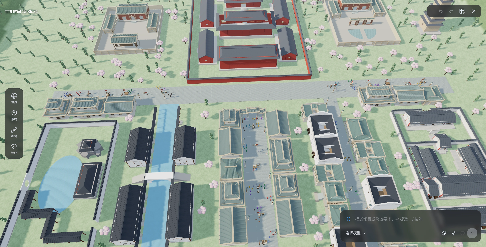

<p>
  <a href="https://github.com/HBAI-Ltd/Toonflow-app">
    
  </a>
  &nbsp;|&nbsp;
  <a href="https://gitee.com/HBAI-Ltd/Toonflow-app">
    
  </a>
  &nbsp;|&nbsp;
  <a href="https://atomgit.com/HBAI-Ltd/Toonflow-app">
    
  </a>
</p>

<p align="center">
  <a href="../../README.md">简体中文</a> |
  <a href="./readmeZhTw.md">繁體中文</a> |
  <a href="./readmeEn.md">English</a> |
  <a href="./readmeJa.md">日本語</a> |
  <a href="./readmeRu.md">Русский</a> |
  <a href="./readmeVi.md">Tiếng Việt</a> |
  <a href="./readmeTh.md">ไทย</a>
  <br />
  <a href="./readmeKo.md">한국어</a> |
  <a href="./readmeHi.md">हिन्दी</a> |
  <a href="./readmeId.md">Bahasa Indonesia</a> |
  <a href="./readmeMs.md">Bahasa Melayu</a> |
  <a href="./readmeFil.md">Filipino</a> |
  <a href="./readmeBn.md">বাংলা</a> |
  <a href="./readmeUr.md">اردو</a>
  <br />
  <a href="./readmeTa.md">தமிழ்</a> |
  <a href="./readmeTe.md">తెలుగు</a> |
  <a href="./readmeMr.md">मराठी</a> |
  <a href="./readmePa.md">ਪੰਜਾਬੀ</a> |
  <a href="./readmeAr.md">العربية</a> |
  <a href="./readmeFa.md">فارسی</a> |
  <strong>Türkçe</strong>
</p>

> 🌐 **22 arayüz dili** · [Desteklenen dilleri görüntüleyin](#languages)

<div align="center">

<p align="center">
  
</p>

<a href="https://git.io/typing-svg">
  <picture>
    <source media="(prefers-color-scheme: dark)" srcset="https://readme-typing-svg.demolab.com?font=Fira+Code&size=40&duration=3000&pause=1000&color=FFFFFF&center=true&vCenter=true&width=600&lines=Toonflow;AI%20Short%20Drama%20Studio;Turn%20ideas%20into%20stories" />
    
  </picture>
</a>

<p align="center">
  <a href="https://github.com/HBAI-Ltd/Toonflow-app/stargazers">
    
  </a>
  <a href="../../LICENSE">
    
  </a>
  <a href="https://github.com/HBAI-Ltd/Toonflow-app/releases">
    
  </a>
</p>
<p align="center">
  <a href="https://github.com/HBAI-Ltd/Toonflow-app/network/members">
    
  </a>
  <a href="https://atomgit.com/HBAI-Ltd/Toonflow-app">
    
  </a>
  <a href="https://discord.gg/HEjKmpNpAZ">
    
  </a>
</p>
<p align="center">
  <a href="https://github.com/HBAI-Ltd/Toonflow-app/issues">
    
  </a>
  <a href="https://github.com/HBAI-Ltd/Toonflow-app/graphs/contributors">
    
  </a>
  <a href="https://github.com/HBAI-Ltd/Toonflow-app/commits">
    
  </a>
</p>
<p align="center">
  &nbsp;
  &nbsp;
  &nbsp;
  
</p>

<p align="center">
  <a href="https://trendshift.io/repositories/24197?utm_source=trendshift-badge&amp;utm_medium=badge&amp;utm_campaign=badge-trendshift-24197#achievements" target="_blank" rel="noopener noreferrer">
    
  </a>
  <a href="https://trendshift.io/repositories/24197?utm_source=trendshift-badge&amp;utm_medium=badge&amp;utm_campaign=badge-trendshift-24197#achievements" target="_blank" rel="noopener noreferrer">
    
  </a>
  <a href="https://trendshift.io/repositories/24197?utm_source=trendshift-badge&amp;utm_medium=badge&amp;utm_campaign=badge-trendshift-24197#achievements" target="_blank" rel="noopener noreferrer">
    
  </a>
</p>
<p align="center">
  <a href="https://trendshift.io/repositories/24197?utm_source=trendshift-badge&amp;utm_medium=badge&amp;utm_campaign=badge-trendshift-24197#achievements" target="_blank" rel="noopener noreferrer">
    
  </a>
  <a href="https://trendshift.io/repositories/24197?utm_source=trendshift-badge&amp;utm_medium=badge&amp;utm_campaign=badge-trendshift-24197#achievements" target="_blank" rel="noopener noreferrer">
    
  </a>
  <a href="https://trendshift.io/repositories/24197?utm_source=trendshift-badge&amp;utm_medium=badge&amp;utm_campaign=badge-trendshift-24197#achievements" target="_blank" rel="noopener noreferrer">
    
  </a>
</p>
<p align="center">
  <a href="https://trendshift.io/repositories/24197?utm_source=trendshift-badge&amp;utm_medium=badge&amp;utm_campaign=badge-trendshift-24197#achievements" target="_blank" rel="noopener noreferrer">
    
  </a>
</p>

**Kısa dramalar, hareketli çizgi romanlar ve video üretimi için açık kaynaklı yapay zekâ platformu**

> 🚀 **Kısa drama üretimi tek bir yerde**: Senaryo yazın, varlıkları yönetin, görsel ve video üretin; tüm yaratıcı iş akışınızı sonsuz bir tuval üzerinde düzenleyin.

</div>

<div align="center">
  <table>
    <tr>
      <td width="50%" align="center">
        <a href="../images/gStar.png">
          
        </a>
      </td>
      <td width="50%" align="center">
        <a href="../images/gvp.jpg">
          
        </a>
      </td>
    </tr>
  </table>
</div>

<p align="center">
  <a href="https://github.com/HBAI-Ltd/Toonflow-app/releases">İndir</a> ·
  <a href="https://qcn7xdsqgc4z.feishu.cn/docx/RXFqdgR2Xo0dXZxGfd0cZCGgnwf">Kullanıcı Kılavuzu</a> ·
  <a href="https://api.toonflow.net/console/plugIn">Eklenti Pazarı</a> ·
  <a href="https://qcn7xdsqgc4z.feishu.cn/docx/KNBNd9naqolsy6xjAOCcEAkqnRd">Geliştirici Belgeleri</a> ·
  <a href="https://api.toonflow.net/">Resmî Model Platformu</a>
</p>

<p align="center">
  📺 <a href="https://www.bilibili.com/video/BV1hbpb6xETF">Ürün tanıtım videosu</a> ·
  <a href="https://www.bilibili.com/video/BV1z4sS6NEA3">TrumanMap ön görselleştirme demosu</a>
</p>

<p align="center">🔥 Toonflow tabanlı kısa diziler Hongguo'da milyonlarca, on milyonlarca ve 100 milyonu aşan izlenmeye ulaştı. <a href="#works">Eserleri gör</a></p>

https://github.com/user-attachments/assets/56d81114-7521-454c-9ec9-972567eddda9

---

## 1. 💛 Sponsorlar ve Destek

Toonflow açık kaynak projesini destekleyen aşağıdaki iş ortaklarına teşekkür ederiz.

<table>
  <tr>
    <td width="50%" valign="top">
      <a href="https://metaso.cn/minimax-h3/?s=toon"> <strong>Metaso</strong></a>
      <br />
      <sub>Uygun maliyetli MiniMax H3 video üretimi: 768P için saniyede yalnızca ¥0.09, 2K için ¥0.15 (CNY, Çin yuanı). Kendi GPU altyapınızı kurmadan doğal 2K çözünürlük, eşzamanlı ses ve video, OpenAI uyumlu API, ComfyUI ve sonsuz tuval desteği sunar. Ek kredi ve özel fırsatlardan yararlanmak için <a href="https://metaso.cn/minimax-h3/?s=toon">bu özel bağlantı üzerinden kaydolun</a>. Ticari sorularınız için WeChat üzerinden metasota12 ile iletişime geçin.</sub>
    </td>
    <td width="50%" valign="top">
      <a href="https://go.apimart.ai/gh-toonflow-app"> <strong>APIMart</strong></a>
      <br />
      <sub>Bu projeye sponsor olan APIMart’a teşekkür ederiz! APIMart, yapay zekâyla görsel ve video üretimi için uygun fiyatlı bir API platformudur. GPT-Image-2 görsel başına $0.006’dan başlar; $1 ile 160’tan fazla görsel üretilebilir. Görseller ve videolar aynı asenkron API’yi kullanır: görevi gönderin, kimliğini alın ve sonuçları geri çağrı yoluyla edinin. 10,000 görsellik toplu işleri zaman aşımı olmadan işleyin, kodu değiştirmeden model değiştirin. Aylık ücret olmadan kullandıkça ödeyin. Başlamak için <a href="https://go.apimart.ai/gh-toonflow-app">buradan kaydolun</a>.</sub>
    </td>
  </tr>
  <tr>
    <td width="50%" valign="top">
      <a href="https://www.compshare.cn/video-studio?ytag=GPU_YY_YX_git_toonflow"> <strong>CompShare</strong></a>
      <br />
      <sub>CompShare, metinden video üretimi, ilk ve son kare kontrolü ve hepsi bir arada referans modları dâhil olmak üzere uygun maliyetli H3 video üretimi sunar. Doğal 2K çözünürlükte 30 saniyeye kadar videolar üretin; 768P için fiyat saniyede yalnızca CNY 0.08’dir. API erişimi, kurumlar için yüksek eşzamanlılık ve kendi kendine fatura oluşturma olanağı sağlar.</sub>
      <br /><br />
      <sub>🎁 Platformu denemek için CNY 5 değerinde ücretsiz kredi almak üzere <a href="https://www.compshare.cn/video-studio?ytag=GPU_YY_YX_git_toonflow">bu özel bağlantı üzerinden kaydolun</a>!</sub>
    </td>
    <td width="50%" valign="top">
      <a href="https://weimeta.cn/console/invite/accept?aff=INV202611191734123p9JeY"> <strong>WEIMETA AI</strong></a>
      <br />
      <sub>WEIMETA AI, DeepSeek, GLM, Kimi, Seedream, Seedance, Wan ve MiniMax H3 gibi önde gelen modelleri bir araya getirerek uygun maliyetli yapay zekâ metin, görsel ve video üretim hizmeti sunar. Metinden görsele, görselden görsele, metinden videoya ve görselden videoya üretimi tek bir birleşik API ile destekler ve kurumsal içerik üretimi için çoklu modelleri esnekçe kullanmanızı sağlar. Platform kurumsal düzeyde şifreli veri iletimi ve çok kiracılı yalıtım kullanır; Çin'in 3. seviye güvenlik değerlendirmesini geçmiştir.</sub>
      <br /><br />
      <sub>🎁 WEIMETA AI'nin çok modlu model hizmetlerini denemek için <a href="https://weimeta.cn/console/invite/accept?aff=INV202611191734123p9JeY">bu özel bağlantı üzerinden kaydolun</a>. Sınırlı süreli kampanya: CNY 100 yüklemeye CNY 15 ek bakiye. İş birliği için WeChat: WeiMeta_AI666</sub>
    </td>
  </tr>
</table>

<details>
<summary><strong>👉 Sponsor Olun 👈</strong></summary>

<p align="center">
  
</p>

<p align="center"><sub>Bu iletişim kanalı yalnızca ticari görüşmeler içindir; teknik destek sunmaz. Kullanımla ilgili sorularınız için topluluk gruplarına katılın. Özellik isteklerini ve hata bildirimlerini geri bildirim formuyla iletin. Anlayışınız için teşekkür ederiz.</sub></p>

</details>

---

## 2. 🌟 Öne Çıkan Özellikler

| Özellik | Açıklama |
| --- | --- |
| 🎬 **TrumanMap ön görselleştirme** | Senaryoyu yapıştırın; 3D set, storyboard ve blocking tek tıkla. |
| 🖼️ **Sonsuz tuval** | Senaryo, karakter, sahne ve klipler tek tuvalde bağlı. |
| 🎥 **Yapay zekâ ile video** | Varlıkları @ ile anın, çekim çekim üretin. |
| 🤖 **Yapay zekâ asistanı** | Tuvali okur ve düzenler; MCP ve A2A destekli. |
| 🔧 **İstediğiniz model** | Yerleşik sağlayıcılar, üçüncü taraf API, yerel LLM, ComfyUI. |
| 🧩 **Eklenti pazarı** | Düğüm, araç ve beceriler tek tıkla. |
| 🏠 **Yerel kurulum** | Windows, macOS, Linux, Android, Docker. |
| 🌐 **Çok dilli** | 22 arayüz dili. |

**İş akışı**: Senaryo ve storyboard → karakter ve sahne → 3D ön görselleştirme → çekim çekim video → kurgu ve indirme.

### Sık sorulan sorular

**Toonflow nedir?** Yapay zekâ ile kısa dizi, çizgi roman ve video üretmek için açık kaynaklı platform.

**Ücretsiz mi?** MIT lisanslı, kendi sunucunuzda ücretsiz; üçüncü taraf model API'leri ücretli olabilir.

**Hangi modeller?** Seedance, Seedream, MiniMax, Wan ve diğerleri yerleşik; üçüncü taraf API, yerel LLM ve ComfyUI da bağlanabilir. [Kullanım kılavuzu](https://qcn7xdsqgc4z.feishu.cn/docx/RXFqdgR2Xo0dXZxGfd0cZCGgnwf) sayfasına bakın.

**Hangi platformlar?** Windows, macOS, Linux, Android ile Docker ve sunucu.

<a id="languages"></a>

### Çoklu dil desteği

Desteklenen diller: 简体中文, 繁體中文, English, 日本語, Русский, Tiếng Việt, ไทย, 한국어, हिन्दी, Bahasa Indonesia, Bahasa Melayu, Filipino, বাংলা, اردو, தமிழ், తెలుగు, मराठी, ਪੰਜਾਬੀ, العربية, فارسی, Türkçe, Português (Brasil).

---

## 3. 📸 10 Öne Çıkan Özellik

<a id="trumanmap"></a>

### Özellik 1 | Senaryoyu yapıştırın, 3D ön görselleştirme hazır

Çekimler ve blocking repliklere göre otomatik; monitörde görüntü ve altyazı canlı. 📺 [Demoyu izleyin](https://www.bilibili.com/video/BV1z4sS6NEA3)

https://github.com/user-attachments/assets/bb2f7bfe-46de-44ff-b3b3-95379f9d4b20

<p align="center">
  <a href="../images/screenshots/trumanMapTimeline.webp"></a>
</p>

<table>
  <tr>
    <td width="50%"><a href="../images/screenshots/trumanMapShot.webp"></a></td>
    <td width="50%"><a href="../images/screenshots/trumanMapStreet.webp"></a></td>
  </tr>
</table>

### Özellik 2 | Uçsuz bucaksız bir Jiangnan su kasabası

Surlar, sokaklar, kanallar, tapınaklar ve dağlar: 1.500'den fazla nesne.

<p align="center">
  <a href="../images/screenshots/trumanMapTown.webp"></a>
</p>

<table>
  <tr>
    <td width="50%"><a href="../images/screenshots/trumanMapAerial.webp"></a></td>
    <td width="50%"><a href="../images/screenshots/trumanMapTemple.webp"></a></td>
  </tr>
</table>

### Özellik 3 | 64 hazır set + 80.000+ varlık

<table>
  <tr>
    <td width="50%"><a href="../images/screenshots/trumanMapSets.webp"></a></td>
    <td width="50%"><a href="../images/screenshots/trumanMapAssets.webp"></a></td>
  </tr>
</table>

### Özellik 4 | Hava, zaman ve arazi tek tıkla

<table>
  <tr>
    <td width="50%"><a href="../images/screenshots/trumanMapRain.webp"></a></td>
    <td width="50%"><a href="../images/screenshots/trumanMapBrush.webp"></a></td>
  </tr>
  <tr>
    <td width="50%"><a href="../images/screenshots/trumanMapWorld.webp"></a></td>
    <td width="50%"><a href="../images/screenshots/trumanMapHome.webp"></a></td>
  </tr>
</table>

### Özellik 5 | Ön görselleştirmeyi doğrudan videoya aktarın

Storyboard, dört görünüş, ön görselleştirme videosu, animatik ve çekim listesi tek tıkla tuvale döner.

### Özellik 6 | Sonsuz tuval + yapay zekâ asistanı

<table>
  <tr>
    <td width="50%"><a href="../images/screenshots/canvasNodeMenu.webp"></a></td>
    <td width="50%"><a href="../images/screenshots/canvasAgent.webp"></a></td>
  </tr>
</table>

### Özellik 7 | Çok referanslı video üretimi

<p align="center">
  <a href="../images/screenshots/videoGenerationNode.webp"></a>
</p>

### Özellik 8 | Senaryo belgeleri ve çalışma alanı

<p align="center">
  <a href="../images/screenshots/canvasDocument.webp"></a>
</p>

### Özellik 9 | Ana sayfa ve varlık kütüphanesi

<table>
  <tr>
    <td width="50%"><a href="../images/screenshots/home.webp"></a></td>
    <td width="50%"><a href="../images/screenshots/assetLibrary.webp"></a></td>
  </tr>
</table>

### Özellik 10 | Eklenti pazarı

Daha fazla eklenti için [web eklenti pazarı](https://api.toonflow.net/console/plugIn).

<p align="center">
  <a href="../images/screenshots/pluginMarket.webp"></a>
</p>

---

## 4. 🚀 İndirme ve Kurulum

### 4.1 Uygulama Kurulumu

| İşletim Sistemi | GitHub |
| --- | --- |
| Windows | [Sürümler](https://github.com/HBAI-Ltd/Toonflow-app/releases) |
| macOS | [Sürümler](https://github.com/HBAI-Ltd/Toonflow-app/releases) |
| Android ARM64 | [APK indir](https://github.com/HBAI-Ltd/Toonflow-app/releases/latest) |

Android uygulaması yalnızca ARM64 cihazları destekler. Sürüm sayfasından `toonflow-VERSION-android-arm64.apk` dosyasını indirip yükleyin. Uygulama yerel bir Bun arka ucu içerir ve bağımsız çalışabilir. Ana sayfadaki Cihaz Bağlantısı ile QR kodunu tarayarak veya bağlantı bilgilerini elle girerek paylaşımı etkinleştirilmiş bir bilgisayara veya uzak arka uca yerel ağ ya da internet üzerinden bağlanabilirsiniz.

Windows yükleyicisi WebView2’yi otomatik olarak algılar ve kurar. Uygulama kurulumdan hemen sonra kapanırsa çalışma zamanını [WebView2 indirme sayfasından](https://developer.microsoft.com/microsoft-edge/webview2/) indirip elle kurun.

macOS (Apple Silicon) üzerinde Toonflow’u Uygulamalar klasörüne sürükleyip doğrudan açın. Önceden terminal komutu çalıştırmanız gerekmez. macOS bir güvenlik uyarısı gösterirse aşağıdaki adımları sırayla uygulayın.

<details>
<summary><strong>Toonflow macOS üzerinde kurulamıyor veya açılamıyorsa</strong></summary>

**1. Gizlilik ve Güvenlik bölümünde Toonflow’a izin verin**

Geliştiricinin doğrulanamadığını veya Apple’ın uygulamayı kötü amaçlı yazılımlara karşı denetleyemediğini belirten bir uyarı görürseniz önce Toonflow’u açmayı deneyin. Ardından Sistem Ayarları → Gizlilik ve Güvenlik bölümüne gidin, Toonflow’un engellendiğini belirten mesajı bulun, Yine de Aç’a tıklayın ve istenen onayı verin. [Apple’ın resmî yönergelerine](https://support.apple.com/zh-cn/102445) bakın.

**2. Karantina kısıtlaması hâlâ açılmasını engelliyorsa karantina niteliğini kaldırmayı deneyin**

Uygulamanın resmî sürüm sayfasından geldiğini ve Uygulamalar klasöründe bulunduğunu doğruladıktan sonra Terminal’de aşağıdaki komutu çalıştırıp yeniden açmayı deneyin. Uygulama adı veya kurulum konumu farklıysa yolu buna göre değiştirin.

```bash
sudo xattr -rd com.apple.quarantine /Applications/toonflow.app
```

**3. Son çare: her kaynaktan uygulamalara geçici olarak izin verin**

İlk iki yöntem işe yaramazsa ve uygulamanın kaynağına güveniyorsanız şu komutu deneyin:

```bash
sudo spctl --master-disable
```

Ardından Sistem Ayarları → Gizlilik ve Güvenlik’i açın. Sisteminiz bu seçeneği sunuyorsa Güvenlik bölümündeki “Şuradan indirilen uygulamalara izin ver” ayarını “Herhangi Bir Yer” olarak değiştirin ve istenen onayı verin. Kullanılabilir seçenekler ve komut desteği macOS sürümüne göre değişebilir.

Bu işlem tüm uygulamalar için güvenlik kısıtlamalarını gevşetir. İşiniz bittiğinde ayarı “App Store ve kimliği belirli geliştiriciler” seçeneğine döndürmenizi öneririz.

</details>

Daha fazla bilgi için [Kullanıcı Kılavuzu’na](https://qcn7xdsqgc4z.feishu.cn/docx/RXFqdgR2Xo0dXZxGfd0cZCGgnwf) bakın.

---

### 4.2 Docker Kurulumu

Önce Git, [Docker Engine](https://docs.docker.com/engine/install/) ve Docker Compose’u kurun. Windows ve macOS üzerinde Docker Desktop’ı Linux konteyner modunda kullanabilirsiniz. Depoda [Dockerfile](../../Dockerfile), [Compose yapılandırması](../../compose.yaml) ve [derleme dışında tutulan dosyaların listesi](../../.dockerignore) bulunur. İmaj Bun 1.4.3 ile oluşturulur ve FFmpeg içerir.

<details>
<summary><strong>Docker kurulum adımlarını göster</strong></summary>

Kaynak kodu klonlayın ve deponun kök dizininde şu komutları çalıştırın:

```sh
git clone https://github.com/HBAI-Ltd/Toonflow-app.git
cd Toonflow-app
docker compose up -d --build
```

İlk derleme bağımlılıkları kurar ve birlikte gelen düğümleri, araçları, Web’i ve Server’ı derler. Başladıktan sonra `http://127.0.0.1:3000` adresini açın. Uzak bir sunucu için aşağıdaki “Erişim ve Veriler” bölümünde anlatılan SSH tünelini kullanın. İlk başlatma, birlikte gelen eklentileri hazırlar ve `myProject` adlı bir çalışma dizini sağlar.

Ayarlar, eklentiler ve proje dosyaları, konteyner içinde `/app/data/` konumuna bağlanan `toonflowData` adlı Docker biriminde saklanır. Gerçek birim adı Compose proje önekini de içerir. Konteyneri durdurmak veya yeniden oluşturmak verilerinizi korur. **`docker compose down -v` kullanmayın: bu komut veri birimini siler.**

```sh
docker compose logs -f toonflow  # View logs
docker compose stop             # Stop the service
docker compose start            # Start it again
docker compose down             # Remove containers, retaining the data volume
```

Proje dizini eklemek için “Sunucu Çalışma Dizinini Seç” penceresinde “Yeni Klasör”e tıklayın. Bu pencere dosya ve klasörleri yeniden adlandırmayı ve silmeyi de destekler. Alternatif olarak hizmet çalışırken komut satırından bir dizin oluşturabilirsiniz:

```sh
docker compose exec toonflow mkdir -p /app/data/workspaces/newProject
```

Yedek almak için önce hizmeti durdurun, verileri kopyalayın ve ardından hizmeti yeniden başlatın:

```sh
docker compose stop
docker compose cp toonflow:/app/data ./toonflowBackup
docker compose start
```

</details>

---

### 4.3 Sunucu Kurulumu

Web ve Server’ı doğrudan bir Linux sunucusunda çalıştırmak için bu yöntemi kullanın. Aşağıdaki örnek Ubuntu / Debian’ı ve projenin belirlediği [Bun 1.4.3](https://bun.sh/docs/installation) sürümünü kullanır.

<details>
<summary><strong>Sunucu kurulum adımlarını göster</strong></summary>

Çalışma ortamını kurun:

```sh
sudo apt-get update
sudo apt-get install -y git curl unzip ffmpeg
curl -fsSL https://bun.com/install | bash -s "bun-v1.4.3"
export PATH="$HOME/.bun/bin:$PATH"
bun --version
```

Kaynak kodu klonlayın ve hizmeti başlatın:

```sh
git clone https://github.com/HBAI-Ltd/Toonflow-app.git
cd Toonflow-app
bun install --frozen-lockfile

# Build bundled nodes, tools, Web, and Server
bun run build:server
mkdir -p data/workspaces/myProject
bun run start:server
```

“服务启动成功” (hizmet başarıyla başlatıldı) mesajını gördüğünüzde sunucunun kendisinde `http://127.0.0.1:3000` adresini açın. Yukarıdaki komut ön planda çalışır; durdurmak için `Ctrl+C` tuşlarına basın. Sistem açılışında başlatma ve süreç yönetimi için [Bun’ın systemd dağıtım kılavuzuna](https://bun.sh/guides/ecosystem/systemd) bakın. Çalışma dizinini depo dizini, başlatma komutunu ise Bun’ın mutlak yolunun ardından `run start:server` gelecek şekilde ayarlayın. Dizin üzerinde okuma ve yazma yetkisi olan bir kullanıcıyla çalıştırın.

</details>

---

### 4.4 Erişim ve Veriler

- Hizmet şu anda sabit `3000` portunu kullanır. Web arayüzünde ve API’de ayrı bir oturum açma doğrulaması yoktur. Sunucu kurulumlarında güvenlik duvarı veya güvenlik grubu kullanarak `3000` portuna erişimi kısıtlayın. İnternetten herkese açık erişim için kimlik doğrulama sağlayan bir ters vekil gerekir.
- Kişisel uzaktan erişim için kendi bilgisayarınızda `ssh -N -L 3000:127.0.0.1:3000 username@server-address` komutunu çalıştırın. Bağlantıyı açık tutun ve `http://127.0.0.1:3000` adresine gidin. Sunucunun `3000` portunu internete açmanız gerekmez.
- Doğrudan kurulumda ayarlar, eklentiler ve çalışma alanları varsayılan olarak deponun `data/` dizininde saklanır. Docker’da ise veri birimi içindeki `/app/data/` konumunda bulunurlar. Taşıma veya yedekleme sırasında dizinin tamamını koruyun. Sayfayı açtıktan sonra sunucu çalışma alanında `myProject` dizinini seçin. Ek projeler için ilgili `workspaces/` dizini altında alt dizinler oluşturun.
- Her iki kurulum yöntemi de sistem FFmpeg’ini içerir. Model hizmetlerine ait API anahtarlarını yine de arayüzden yapılandırmanız gerekir.

---

### 4.5 Buluta Dağıtım

İş ortağımız [AI Galaxy (智星云)](https://www.ai-galaxy.com/), kullanıma hazır bir ortam içeren, resmî olarak yetkilendirilmiş ticari Toonflow imajı sunar. Yönergeler için [görselli imaj dağıtım kılavuzuna](https://mp.weixin.qq.com/s/lq9X1ovQ1_TKeXMOLgicKg?scene=1) bakın.

---

## 5. 🎬 Örnek Çalışma

<a id="works"></a>

### Hongguo'daki Hit Diziler

🔥 Toonflow tabanlı kısa diziler Hongguo'da milyonlarca, on milyonlarca ve 100 milyonu aşan izlenmeye ulaştı.

<p align="center">
  
</p>

<p align="center">
  
</p>

### Reklam filmleri

<table>
  <tr>
    <td width="50%"><video src="https://github.com/user-attachments/assets/fccf8b46-b8ec-46cb-9574-9273cd1ee9e4" controls width="100%"></video></td>
    <td width="50%"><video src="https://github.com/user-attachments/assets/b345905e-601f-43be-83a5-305f97a29e44" controls width="100%"></video></td>
  </tr>
  <tr>
    <td width="50%"><video src="https://github.com/user-attachments/assets/fc5880aa-6b9c-4717-af0e-e51f15c4fdc6" controls width="100%"></video></td>
    <td width="50%"><video src="https://github.com/user-attachments/assets/0816e794-f07d-4bc3-89cd-69c67566c3a6" controls width="100%"></video></td>
  </tr>
</table>

### Kısa dizi örneği

https://github.com/user-attachments/assets/2d9fddac-dfdf-4640-b030-b09d7f7287e9

Demo videosu 480p'ye sıkıştırılmış sürümdür.

---

## 6. 👨‍👩‍👧‍👦 WeChat Topluluğu

Gruba davet asistanıyla iletişime geçmek için QR kodunu tarayın:


Simgeye tıklayarak Discord’a da katılabilirsiniz:

[](https://discord.gg/HEjKmpNpAZ)

Veya davet bağlantısını kullanın: [https://discord.gg/HEjKmpNpAZ](https://discord.gg/HEjKmpNpAZ)

---

## 7. 💌 Bize Ulaşın

📧 E-posta: [ltlctools@outlook.com](mailto:ltlctools@outlook.com?subject=Toonflow咨询)

---

## 8. 📜 Açık Kaynak Lisansı

Toonflow, [MIT License](../../LICENSE) kapsamında lisanslanmıştır. Üçüncü taraf bağımlılıklar ve varlıklar kendi lisanslarına ve telif hakkı bildirimlerine tabi olmaya devam eder.

[](https://www.star-history.com/#HBAI-Ltd/Toonflow-app&Date)

> **Geriye yürümezlik maddesi**: v1.0.8 öncesi sürümleri AGPL-3.0 kapsamında kullanan kullanıcılar AGPL-3.0’a tabi olmaya devam eder. v1.0.8 ile v1.1.8 arasındaki sürümler Apache-2.0’a ve ek sözleşmesine tabi olmaya devam eder. Bu lisans değişikliği söz konusu kullanıcılar için geçerli değildir.

---

## 9. 🙏 Teşekkürler

- **İş ortakları**: 算能云, Tencent Hunyuan 3D ve AI Galaxy (智星云).
- **Projeye katkıda bulunanlar**: Kod yazan, belgeleri iyileştiren, eklenti paylaşan ve sorunları çözmeye yardımcı olan herkese teşekkür ederiz.
- **Topluluk kullanıcıları**: Geri bildirim vermeye, yaratıcı çalışmalarını paylaşmaya ve projeyi desteklemeye devam eden herkese teşekkür ederiz.

仰起脸笑的像满月: Codex 20x geliştirme hesaplama kaynakları sağladı.
Xi'an Zhongxing Digital Intelligence Technology Co., Ltd. (西安中星数字智能科技有限公司): Apple sertifikasıyla imzalama desteği sağladı.

<p align="center"><sub>Free code signing provided by <a href="https://signpath.io/">SignPath.io</a>, certificate by <a href="https://signpath.org/">SignPath Foundation</a>.</sub></p>

<div align="center">

Telif Hakkı © 2026 北京爱阿科技有限公司

</div>


