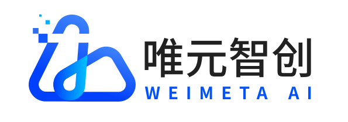

<p>
  <a href="https://github.com/HBAI-Ltd/Toonflow-app">
    
  </a>
  &nbsp;|&nbsp;
  <a href="https://gitee.com/HBAI-Ltd/Toonflow-app">
    
  </a>
  &nbsp;|&nbsp;
  <a href="https://atomgit.com/HBAI-Ltd/Toonflow-app">
    
  </a>
</p>

<p align="center">
  <a href="../../README.md">简体中文</a> |
  <a href="./readmeZhTw.md">繁體中文</a> |
  <a href="./readmeEn.md">English</a> |
  <a href="./readmeJa.md">日本語</a> |
  <a href="./readmeRu.md">Русский</a> |
  <a href="./readmeVi.md">Tiếng Việt</a> |
  <a href="./readmeTh.md">ไทย</a>
  <br />
  <a href="./readmeKo.md">한국어</a> |
  <a href="./readmeHi.md">हिन्दी</a> |
  <a href="./readmeId.md">Bahasa Indonesia</a> |
  <a href="./readmeMs.md">Bahasa Melayu</a> |
  <a href="./readmeFil.md">Filipino</a> |
  <a href="./readmeBn.md">বাংলা</a> |
  <strong>اردو</strong>
  <br />
  <a href="./readmeTa.md">தமிழ்</a> |
  <a href="./readmeTe.md">తెలుగు</a> |
  <a href="./readmeMr.md">मराठी</a> |
  <a href="./readmePa.md">ਪੰਜਾਬੀ</a> |
  <a href="./readmeAr.md">العربية</a> |
  <a href="./readmeFa.md">فارسی</a> |
  <a href="./readmeTr.md">Türkçe</a>
</p>

> 🌐 **22 زبانوں میں انٹرفیس** · [دستیاب زبانیں دیکھیں](#languages)

<div align="center">

<p align="center">
  
</p>

<a href="https://git.io/typing-svg">
  <picture>
    <source media="(prefers-color-scheme: dark)" srcset="https://readme-typing-svg.demolab.com?font=Fira+Code&size=40&duration=3000&pause=1000&color=FFFFFF&center=true&vCenter=true&width=600&lines=Toonflow;AI%20Short%20Drama%20Studio;Turn%20ideas%20into%20stories" />
    
  </picture>
</a>

<p align="center">
  <a href="https://github.com/HBAI-Ltd/Toonflow-app/stargazers">
    
  </a>
  <a href="../../LICENSE">
    
  </a>
  <a href="https://github.com/HBAI-Ltd/Toonflow-app/releases">
    
  </a>
</p>
<p align="center">
  <a href="https://github.com/HBAI-Ltd/Toonflow-app/network/members">
    
  </a>
  <a href="https://atomgit.com/HBAI-Ltd/Toonflow-app">
    
  </a>
  <a href="https://discord.gg/HEjKmpNpAZ">
    
  </a>
</p>
<p align="center">
  <a href="https://github.com/HBAI-Ltd/Toonflow-app/issues">
    
  </a>
  <a href="https://github.com/HBAI-Ltd/Toonflow-app/graphs/contributors">
    
  </a>
  <a href="https://github.com/HBAI-Ltd/Toonflow-app/commits">
    
  </a>
</p>
<p align="center">
  &nbsp;
  &nbsp;
  &nbsp;
  
</p>

<p align="center">
  <a href="https://trendshift.io/repositories/24197?utm_source=trendshift-badge&amp;utm_medium=badge&amp;utm_campaign=badge-trendshift-24197#achievements" target="_blank" rel="noopener noreferrer">
    
  </a>
  <a href="https://trendshift.io/repositories/24197?utm_source=trendshift-badge&amp;utm_medium=badge&amp;utm_campaign=badge-trendshift-24197#achievements" target="_blank" rel="noopener noreferrer">
    
  </a>
  <a href="https://trendshift.io/repositories/24197?utm_source=trendshift-badge&amp;utm_medium=badge&amp;utm_campaign=badge-trendshift-24197#achievements" target="_blank" rel="noopener noreferrer">
    
  </a>
</p>
<p align="center">
  <a href="https://trendshift.io/repositories/24197?utm_source=trendshift-badge&amp;utm_medium=badge&amp;utm_campaign=badge-trendshift-24197#achievements" target="_blank" rel="noopener noreferrer">
    
  </a>
  <a href="https://trendshift.io/repositories/24197?utm_source=trendshift-badge&amp;utm_medium=badge&amp;utm_campaign=badge-trendshift-24197#achievements" target="_blank" rel="noopener noreferrer">
    
  </a>
  <a href="https://trendshift.io/repositories/24197?utm_source=trendshift-badge&amp;utm_medium=badge&amp;utm_campaign=badge-trendshift-24197#achievements" target="_blank" rel="noopener noreferrer">
    
  </a>
</p>
<p align="center">
  <a href="https://trendshift.io/repositories/24197?utm_source=trendshift-badge&amp;utm_medium=badge&amp;utm_campaign=badge-trendshift-24197#achievements" target="_blank" rel="noopener noreferrer">
    
  </a>
</p>

**مختصر ڈراموں، متحرک کامکس اور ویڈیو تخلیق کے لیے اوپن سورس AI پلیٹ فارم**

> 🚀 **مختصر ڈرامے بنانے کا مکمل انتظام ایک جگہ**: اسکرپٹ لکھیں، اثاثوں کا انتظام کریں اور تصاویر و ویڈیوز بنائیں؛ اپنا پورا تخلیقی کام ایک لامحدود کینوس پر ترتیب دیں۔

</div>

<div align="center">
  <table>
    <tr>
      <td width="50%" align="center">
        <a href="../images/gStar.png">
          
        </a>
      </td>
      <td width="50%" align="center">
        <a href="../images/gvp.jpg">
          
        </a>
      </td>
    </tr>
  </table>
</div>

<p align="center">
  <a href="https://github.com/HBAI-Ltd/Toonflow-app/releases">ڈاؤن لوڈ</a> ·
  <a href="https://qcn7xdsqgc4z.feishu.cn/docx/RXFqdgR2Xo0dXZxGfd0cZCGgnwf">صارف رہنما</a> ·
  <a href="https://api.toonflow.net/console/plugIn">پلگ اِن مارکیٹ</a> ·
  <a href="https://qcn7xdsqgc4z.feishu.cn/docx/KNBNd9naqolsy6xjAOCcEAkqnRd">ڈویلپر دستاویزات</a> ·
  <a href="https://api.toonflow.net/">آفیشل ماڈل پلیٹ فارم</a>
</p>

<p align="center">
  📺 <a href="https://www.bilibili.com/video/BV1hbpb6xETF">تعارفی ویڈیو</a> ·
  <a href="https://www.bilibili.com/video/BV1z4sS6NEA3">TrumanMap پری ویز ڈیمو</a>
</p>

<p align="center">🔥 Toonflow کی بنیاد پر بنے مختصر ڈراموں نے Hongguo پر لاکھوں، کروڑوں اور 10 کروڑ سے زیادہ ویوز حاصل کیے ہیں۔ <a href="#works">کام دیکھیں</a></p>

https://github.com/user-attachments/assets/56d81114-7521-454c-9ec9-972567eddda9

---

## 1. 💛 اسپانسرز اور معاونت

Toonflow کے اوپن سورس منصوبے کی معاونت کرنے والے درج ذیل شراکت داروں کا شکریہ۔

<table>
  <tr>
    <td width="50%" valign="top">
      <a href="https://metaso.cn/minimax-h3/?s=toon"> <strong>Metaso</strong></a>
      <br />
      <sub>MiniMax H3 سے کم لاگت میں ویڈیو بنائیں: 768P پر صرف ¥0.09 فی سیکنڈ اور 2K پر ¥0.15 فی سیکنڈ، چینی یوآن (CNY) میں۔ اصل 2K، ہم آہنگ آڈیو اور ویڈیو، OpenAI کے ساتھ ہم آہنگ API، ‏ComfyUI اور لامحدود کینوس کی سہولت، اپنا GPU چلانے کی ضرورت کے بغیر۔ اضافی کریڈٹ اور خصوصی پیشکشوں کے لیے <a href="https://metaso.cn/minimax-h3/?s=toon">اس مخصوص لنک سے رجسٹر ہوں</a>۔ کاروباری رابطے کے لیے WeChat پر metasota12 سے بات کریں۔</sub>
    </td>
    <td width="50%" valign="top">
      <a href="https://go.apimart.ai/gh-toonflow-app"> <strong>APIMart</strong></a>
      <br />
      <sub>اس منصوبے کی اسپانسرشپ پر APIMart کا شکریہ! APIMart، AI سے تصاویر اور ویڈیوز بنانے کے لیے کم قیمت API پلیٹ فارم ہے۔ GPT-Image-2 کی قیمت $0.006 فی تصویر سے شروع ہوتی ہے، یعنی $1 میں 160 سے زیادہ تصاویر۔ تصاویر اور ویڈیوز کے لیے ایک ہی غیر ہم وقت API ہے: کام بھیجیں، اس کی ID حاصل کریں اور نتیجہ کال بیک کے ذریعے وصول کریں۔ ٹائم آؤٹ کے بغیر 10,000 تصاویر کے بیچ پراسیس کریں اور کوڈ بدلے بغیر ماڈل تبدیل کریں۔ صرف استعمال کے مطابق ادائیگی، کوئی ماہانہ فیس نہیں۔ شروع کرنے کے لیے <a href="https://go.apimart.ai/gh-toonflow-app">یہاں رجسٹر ہوں</a>۔</sub>
    </td>
  </tr>
  <tr>
    <td width="50%" valign="top">
      <a href="https://www.compshare.cn/video-studio?ytag=GPU_YY_YX_git_toonflow"> <strong>CompShare</strong></a>
      <br />
      <sub>CompShare کم لاگت میں H3 ویڈیو جنریشن فراہم کرتا ہے، جس میں متن سے ویڈیو، پہلے اور آخری فریم کا کنٹرول اور جامع ریفرنس موڈ شامل ہیں۔ اصل 2K میں 30 سیکنڈ تک کی ویڈیوز بنائیں؛ 768P کی قیمت صرف CNY 0.08 فی سیکنڈ ہے۔ API رسائی، اداروں کے لیے بیک وقت بڑی تعداد میں درخواستیں چلانے اور خود انوائس حاصل کرنے کی سہولت بھی موجود ہے۔</sub>
      <br /><br />
      <sub>🎁 <a href="https://www.compshare.cn/video-studio?ytag=GPU_YY_YX_git_toonflow">اس مخصوص لنک سے رجسٹر ہوں</a> اور پلیٹ فارم آزمانے کے لیے CNY 5 کا مفت کریڈٹ حاصل کریں!</sub>
    </td>
    <td width="50%" valign="top">
      <a href="https://weimeta.cn/console/invite/accept?aff=INV202611191734123p9JeY"> <strong>WEIMETA AI</strong></a>
      <br />
      <sub>WEIMETA AI کم خرچ AI متن، تصویر اور ویڈیو بنانے کی سروس فراہم کرتا ہے اور DeepSeek، GLM، Kimi، Seedream، Seedance، Wan اور MiniMax H3 جیسے نمایاں ماڈلز کو یکجا کرتا ہے۔ متن سے تصویر، تصویر سے تصویر، متن سے ویڈیو اور تصویر سے ویڈیو ایک متحد API کے ذریعے دستیاب ہیں تاکہ ادارے لچک کے ساتھ متعدد ماڈلز استعمال کر سکیں۔ پلیٹ فارم ادارہ جاتی سطح کی خفیہ کاری اور ملٹی ٹیننٹ علیحدگی استعمال کرتا ہے اور چین کی لیول 3 سیکیورٹی جانچ میں کامیاب ہے۔</sub>
      <br /><br />
      <sub>🎁 <a href="https://weimeta.cn/console/invite/accept?aff=INV202611191734123p9JeY">اس مخصوص لنک سے رجسٹر ہوں</a> اور WEIMETA AI کی ملٹی موڈل ماڈل سروسز آزمائیں۔ محدود وقت کی پیشکش: CNY 100 ری چارج پر CNY 15 اضافی۔ کاروباری رابطہ WeChat: WeiMeta_AI666</sub>
    </td>
  </tr>
</table>

<details>
<summary><strong>👉 اسپانسر بنیں 👈</strong></summary>

<p align="center">
  
</p>

<p align="center"><sub>یہ رابطہ صرف کاروباری معاملات کے لیے ہے، تکنیکی معاونت کے لیے نہیں۔ استعمال سے متعلق سوالات کے لیے کمیونٹی گروپس میں شامل ہوں۔ نئی خصوصیات کی درخواستیں اور خرابیوں کی رپورٹ فیڈبیک فارم کے ذریعے بھیجیں۔ آپ کے تعاون کا شکریہ۔</sub></p>

</details>

---

## 2. 🌟 نمایاں خصوصیات

| صلاحیت | تفصیل |
| --- | --- |
| 🎬 **TrumanMap پری ویز** | اسکرپٹ پیسٹ کریں، ایک کلک میں 3D سیٹ، اسٹوری بورڈ اور بلاکنگ۔ |
| 🖼️ **لامحدود کینوس** | اسکرپٹ، کردار، مناظر اور کلپس ایک کینوس پر جڑے۔ |
| 🎥 **AI ویڈیو تخلیق** | @ سے اثاثے جوڑیں، شاٹ بہ شاٹ بنائیں۔ |
| 🤖 **AI معاون** | کینوس پڑھتا اور بدلتا ہے؛ MCP اور A2A کی سہولت۔ |
| 🔧 **کوئی بھی ماڈل** | بلٹ اِن فراہم کنندگان، تھرڈ پارٹی API، لوکل LLM، ComfyUI۔ |
| 🧩 **پلگ اِن مارکیٹ** | نوڈ، ٹول اور اسکل ایک کلک میں۔ |
| 🏠 **لوکل تنصیب** | Windows، macOS، Linux، Android، Docker۔ |
| 🌐 **کثیر لسانی** | 22 انٹرفیس زبانیں۔ |

**طریقۂ کار**: اسکرپٹ و اسٹوری بورڈ ← کردار و مناظر ← 3D پری ویز ← شاٹ بہ شاٹ ویڈیو ← ایڈٹ و ڈاؤن لوڈ۔

### عام سوالات

**Toonflow کیا ہے؟** AI مختصر ڈراموں، AI کامکس اور AI ویڈیوز کے لیے اوپن سورس پلیٹ فارم۔

**کیا یہ مفت ہے؟** MIT لائسنس، خود ہوسٹ کرنا مفت؛ تھرڈ پارٹی ماڈل API پر فیس ہو سکتی ہے۔

**کون سے ماڈل؟** Seedance، Seedream، MiniMax، Wan وغیرہ بلٹ اِن؛ تھرڈ پارٹی API، لوکل LLM اور ComfyUI بھی جوڑ سکتے ہیں۔ [استعمال کی رہنمائی](https://qcn7xdsqgc4z.feishu.cn/docx/RXFqdgR2Xo0dXZxGfd0cZCGgnwf) دیکھیں۔

**کون سے پلیٹ فارم؟** Windows، macOS، Linux، Android، نیز Docker اور سرور۔

<a id="languages"></a>

### کثیر لسانی معاونت

دستیاب زبانیں: 简体中文، 繁體中文، English، 日本語، Русский، Tiếng Việt، ไทย، 한국어، हिन्दी، Bahasa Indonesia، Bahasa Melayu، Filipino، বাংলা، اردو، தமிழ்، తెలుగు، मराठी، ਪੰਜਾਬੀ، العربية، فارسی، Türkçe، Português (Brasil)۔

---

## 3. 📸 دس نمایاں خصوصیات

<a id="trumanmap"></a>

### نمایاں 1 | اسکرپٹ پیسٹ کریں، 3D پری ویز پائیں

مکالموں کے مطابق خودکار شاٹ اور بلاکنگ؛ مانیٹر پر تصویر اور سب ٹائٹل براہِ راست۔ 📺 [ڈیمو دیکھیں](https://www.bilibili.com/video/BV1z4sS6NEA3)

https://github.com/user-attachments/assets/bb2f7bfe-46de-44ff-b3b3-95379f9d4b20

<p align="center">
  <a href="../images/screenshots/trumanMapTimeline.webp"></a>
</p>

<table>
  <tr>
    <td width="50%"><a href="../images/screenshots/trumanMapShot.webp"></a></td>
    <td width="50%"><a href="../images/screenshots/trumanMapStreet.webp"></a></td>
  </tr>
</table>

### نمایاں 2 | جیانگنان کا لامتناہی آبی قصبہ

شہر کی فصیل، گلیاں، نہریں، مندر اور پہاڑ: 1,500 سے زائد اشیا۔

<p align="center">
  <a href="../images/screenshots/trumanMapTown.webp"></a>
</p>

<table>
  <tr>
    <td width="50%"><a href="../images/screenshots/trumanMapAerial.webp"></a></td>
    <td width="50%"><a href="../images/screenshots/trumanMapTemple.webp"></a></td>
  </tr>
</table>

### نمایاں 3 | 64 تیار سیٹ + 80,000 سے زائد اثاثے

<table>
  <tr>
    <td width="50%"><a href="../images/screenshots/trumanMapSets.webp"></a></td>
    <td width="50%"><a href="../images/screenshots/trumanMapAssets.webp"></a></td>
  </tr>
</table>

### نمایاں 4 | موسم، وقت اور زمین ایک کلک میں

<table>
  <tr>
    <td width="50%"><a href="../images/screenshots/trumanMapRain.webp"></a></td>
    <td width="50%"><a href="../images/screenshots/trumanMapBrush.webp"></a></td>
  </tr>
  <tr>
    <td width="50%"><a href="../images/screenshots/trumanMapWorld.webp"></a></td>
    <td width="50%"><a href="../images/screenshots/trumanMapHome.webp"></a></td>
  </tr>
</table>

### نمایاں 5 | پری ویز سیدھا ویڈیو تخلیق میں

اسٹوری بورڈ، چار رخی شیٹ، پری ویز ویڈیو، اینیمیٹک اور شاٹ فہرست ایک کلک میں کینوس پر۔

### نمایاں 6 | لامحدود کینوس + AI معاون

<table>
  <tr>
    <td width="50%"><a href="../images/screenshots/canvasNodeMenu.webp"></a></td>
    <td width="50%"><a href="../images/screenshots/canvasAgent.webp"></a></td>
  </tr>
</table>

### نمایاں 7 | متعدد حوالوں سے ویڈیو

<p align="center">
  <a href="../images/screenshots/videoGenerationNode.webp"></a>
</p>

### نمایاں 8 | اسکرپٹ دستاویزات اور ورک اسپیس

<p align="center">
  <a href="../images/screenshots/canvasDocument.webp"></a>
</p>

### نمایاں 9 | ہوم اور اثاثہ لائبریری

<table>
  <tr>
    <td width="50%"><a href="../images/screenshots/home.webp"></a></td>
    <td width="50%"><a href="../images/screenshots/assetLibrary.webp"></a></td>
  </tr>
</table>

### نمایاں 10 | پلگ اِن مارکیٹ

مزید پلگ اِن [ویب پلگ اِن مارکیٹ](https://api.toonflow.net/console/plugIn) میں۔

<p align="center">
  <a href="../images/screenshots/pluginMarket.webp"></a>
</p>

---

## 4. 🚀 ڈاؤن لوڈ اور تنصیب

### 4.1 ایپ کی تنصیب

| آپریٹنگ سسٹم | GitHub |
| --- | --- |
| Windows | [ریلیز](https://github.com/HBAI-Ltd/Toonflow-app/releases) |
| macOS | [ریلیز](https://github.com/HBAI-Ltd/Toonflow-app/releases) |
| Android ARM64 | [APK ڈاؤن لوڈ](https://github.com/HBAI-Ltd/Toonflow-app/releases/latest) |

Android ایپ صرف ARM64 آلات کو سپورٹ کرتی ہے۔ ریلیز کے صفحے سے `toonflow-VERSION-android-arm64.apk` ڈاؤن لوڈ کرکے نصب کریں۔ اس میں مقامی Bun بیک اینڈ شامل ہے اور یہ آزادانہ طور پر چل سکتی ہے۔ ہوم صفحے پر «آلات کا اتصال» سے QR کوڈ اسکین کرکے یا معلومات درج کرکے مقامی نیٹ ورک یا انٹرنیٹ پر شیئرنگ فعال رکھنے والے کمپیوٹر یا بیک اینڈ سے بھی جڑ سکتے ہیں۔

Windows انسٹالر خودکار طور پر WebView2 کا پتہ لگا کر اسے نصب کرتا ہے۔ اگر تنصیب کے فوراً بعد ایپ بند ہو جائے تو [WebView2 ڈاؤن لوڈ صفحے](https://developer.microsoft.com/microsoft-edge/webview2/) سے رن ٹائم ڈاؤن لوڈ کر کے خود نصب کریں۔

macOS ‏(Apple Silicon) پر Toonflow کو Applications فولڈر میں گھسیٹ کر منتقل کریں اور براہِ راست کھولیں۔ پہلے سے ٹرمینل میں کوئی کمانڈ چلانے کی ضرورت نہیں۔ اگر macOS سیکیورٹی وارننگ دکھائے تو درج ذیل مراحل اسی ترتیب سے انجام دیں۔

<details>
<summary><strong>اگر macOS پر Toonflow نصب یا کھولا نہ جا سکے</strong></summary>

**1. رازداری اور سیکیورٹی کی ترتیبات میں Toonflow کو اجازت دیں**

اگر یہ وارننگ آئے کہ ڈویلپر کی تصدیق نہیں ہو سکتی یا Apple ایپ میں نقصان دہ سافٹ ویئر کی جانچ نہیں کر سکتا، تو پہلے Toonflow کھولنے کی کوشش کریں۔ پھر سسٹم کی ترتیبات ← رازداری اور سیکیورٹی میں جائیں، Toonflow کو روکے جانے کا پیغام تلاش کریں، «پھر بھی کھولیں» پر کلک کریں اور ہدایت کے مطابق تصدیق کریں۔ [Apple کی آفیشل ہدایات](https://support.apple.com/zh-cn/102445) دیکھیں۔

**2. اگر قرنطینہ کی پابندی اب بھی کھولنے سے روکے تو قرنطینہ وصف ہٹا کر دیکھیں**

تصدیق کریں کہ ایپ آفیشل ریلیز صفحے سے حاصل کی گئی ہے اور Applications میں موجود ہے۔ پھر ٹرمینل میں درج ذیل کمانڈ چلائیں اور دوبارہ کھولنے کی کوشش کریں۔ اگر ایپ کا نام یا تنصیب کا مقام مختلف ہو تو پاتھ اسی حساب سے بدلیں۔

```bash
sudo xattr -rd com.apple.quarantine /Applications/toonflow.app
```

**3. آخری حل: عارضی طور پر کسی بھی ذریعے کی ایپس کو اجازت دیں**

اگر پہلے دونوں طریقے کام نہ کریں اور آپ کو ایپ کے ذریعے پر اعتماد ہو تو یہ کمانڈ چلائیں:

```bash
sudo spctl --master-disable
```

پھر سسٹم کی ترتیبات ← رازداری اور سیکیورٹی کھولیں۔ سیکیورٹی کے حصے میں، اگر یہ اختیار دستیاب ہو، تو «یہاں سے ڈاؤن لوڈ کی گئی ایپس کو اجازت دیں» کو «کہیں سے بھی» پر مقرر کریں اور ہدایت کے مطابق تصدیق کریں۔ macOS کے مختلف ورژنز میں دستیاب اختیارات اور کمانڈز کی معاونت مختلف ہو سکتی ہے۔

اس سے تمام ایپس کے لیے سیکیورٹی پابندیاں نرم ہو جاتی ہیں۔ کام مکمل ہونے کے بعد ترتیب کو دوبارہ «App Store اور شناخت شدہ ڈویلپرز» پر لانے کی سفارش کرتے ہیں۔

</details>

مزید ہدایات کے لیے [صارف رہنما](https://qcn7xdsqgc4z.feishu.cn/docx/RXFqdgR2Xo0dXZxGfd0cZCGgnwf) دیکھیں۔

---

### 4.2 Docker کے ذریعے تنصیب

پہلے Git، ‏[Docker Engine](https://docs.docker.com/engine/install/) اور Docker Compose نصب کریں۔ Windows اور macOS پر Docker Desktop کو Linux کنٹینر موڈ میں استعمال کیا جا سکتا ہے۔ ریپوزٹری میں [Dockerfile](../../Dockerfile)، ‏[Compose کی ترتیب](../../compose.yaml) اور [بلڈ سے خارج فائلوں کی فہرست](../../.dockerignore) موجود ہیں۔ امیج Bun 1.4.3 سے بنتی ہے اور اس میں FFmpeg شامل ہے۔

<details>
<summary><strong>Docker کی تنصیب کے مراحل کھولیں</strong></summary>

سورس کوڈ کلون کریں اور ریپوزٹری کے بنیادی فولڈر میں یہ کمانڈز چلائیں:

```sh
git clone https://github.com/HBAI-Ltd/Toonflow-app.git
cd Toonflow-app
docker compose up -d --build
```

پہلی بلڈ میں انحصاری پیکیجز نصب ہوتے ہیں اور ساتھ فراہم کردہ نوڈز، ٹولز، Web اور Server بنائے جاتے ہیں۔ چلنے کے بعد `http://127.0.0.1:3000` کھولیں۔ دور دراز ہوسٹ کے لیے نیچے «رسائی اور ڈیٹا» میں بیان کردہ SSH ٹنل استعمال کریں۔ پہلی بار چلنے پر ساتھ آنے والے پلگ اِن تیار ہوتے ہیں اور `myProject` نام کا ورکنگ فولڈر فراہم کیا جاتا ہے۔

ترتیبات، پلگ اِن اور منصوبے کی فائلیں Docker کے `toonflowData` نامی والیوم میں محفوظ ہوتی ہیں، جو کنٹینر کے اندر `/app/data/` پر ماؤنٹ ہوتا ہے۔ والیوم کے اصل نام میں Compose منصوبے کا سابقہ بھی شامل ہوتا ہے۔ کنٹینر روکنے یا دوبارہ بنانے سے ڈیٹا محفوظ رہتا ہے۔ **`docker compose down -v` استعمال نہ کریں: یہ کمانڈ ڈیٹا والیوم حذف کر دیتی ہے۔**

```sh
docker compose logs -f toonflow  # View logs
docker compose stop             # Stop the service
docker compose start            # Start it again
docker compose down             # Remove containers, retaining the data volume
```

منصوبے کا فولڈر شامل کرنے کے لیے «سرور کا ورکنگ فولڈر منتخب کریں» ڈائیلاگ میں «نیا فولڈر» پر کلک کریں۔ اس ڈائیلاگ سے فائلوں اور فولڈرز کا نام بدلنا اور انہیں حذف کرنا بھی ممکن ہے۔ متبادل طور پر سروس چلتے ہوئے کمانڈ لائن سے فولڈر بنائیں:

```sh
docker compose exec toonflow mkdir -p /app/data/workspaces/newProject
```

بیک اپ کے لیے پہلے سروس روکیں، ڈیٹا کاپی کریں اور پھر سروس دوبارہ چلائیں:

```sh
docker compose stop
docker compose cp toonflow:/app/data ./toonflowBackup
docker compose start
```

</details>

---

### 4.3 سرور پر تنصیب

Linux سرور پر Web اور Server براہِ راست چلانے کے لیے یہ طریقہ استعمال کریں۔ درج ذیل مثال Ubuntu / Debian اور منصوبے کے مقرر کردہ ورژن، [Bun 1.4.3](https://bun.sh/docs/installation)، پر مبنی ہے۔

<details>
<summary><strong>سرور پر تنصیب کے مراحل کھولیں</strong></summary>

رن ٹائم ماحول نصب کریں:

```sh
sudo apt-get update
sudo apt-get install -y git curl unzip ffmpeg
curl -fsSL https://bun.com/install | bash -s "bun-v1.4.3"
export PATH="$HOME/.bun/bin:$PATH"
bun --version
```

سورس کوڈ کلون کریں اور سروس چلائیں:

```sh
git clone https://github.com/HBAI-Ltd/Toonflow-app.git
cd Toonflow-app
bun install --frozen-lockfile

# Build bundled nodes, tools, Web, and Server
bun run build:server
mkdir -p data/workspaces/myProject
bun run start:server
```

جب «服务启动成功» (سروس کامیابی سے شروع ہو گئی) نظر آئے تو خود سرور پر `http://127.0.0.1:3000` کھولیں۔ اوپر کی کمانڈ سامنے چلتی رہتی ہے؛ اسے روکنے کے لیے `Ctrl+C` دبائیں۔ بوٹ کے وقت خودکار آغاز اور پروسیس کے انتظام کے لیے [Bun کی systemd تنصیب کی رہنمائی](https://bun.sh/guides/ecosystem/systemd) دیکھیں۔ ورکنگ فولڈر کو ریپوزٹری کا فولڈر مقرر کریں اور آغاز کی کمانڈ میں Bun کا مکمل پاتھ، پھر `run start:server` لکھیں۔ اسے ایسے صارف کے طور پر چلائیں جسے اس فولڈر میں پڑھنے اور لکھنے کی اجازت ہو۔

</details>

---

### 4.4 رسائی اور ڈیٹا

- سروس فی الحال مستقل پورٹ `3000` استعمال کرتی ہے۔ ویب انٹرفیس اور API میں علیحدہ لاگ اِن تصدیق نہیں ہے۔ سرور پر تنصیب کی صورت میں فائر وال یا سیکیورٹی گروپ کے ذریعے پورٹ `3000` تک رسائی محدود کریں۔ عوامی رسائی کے لیے تصدیق کے نظام سے لیس ریورس پراکسی ضروری ہے۔
- ذاتی ریموٹ رسائی کے لیے اپنے کمپیوٹر پر `ssh -N -L 3000:127.0.0.1:3000 username@server-address` چلائیں۔ کنکشن کھلا رکھیں، پھر `http://127.0.0.1:3000` پر جائیں۔ سرور کا پورٹ `3000` عوامی انٹرنیٹ پر کھولنے کی ضرورت نہیں۔
- براہِ راست تنصیب میں ترتیبات، پلگ اِن اور ورک اسپیسز عموماً ریپوزٹری کے `data/` فولڈر میں محفوظ ہوتے ہیں۔ Docker میں یہ ڈیٹا والیوم کے اندر `/app/data/` میں ہوتے ہیں۔ منتقلی یا بیک اپ کے وقت پورا فولڈر محفوظ رکھیں۔ صفحہ کھولنے کے بعد سرور کی ورک اسپیس میں `myProject` منتخب کریں۔ مزید منصوبوں کے لیے متعلقہ `workspaces/` فولڈر کے اندر ذیلی فولڈرز بنائیں۔
- دونوں طریقوں میں سسٹم کا FFmpeg شامل ہے۔ ماڈل سروسز کی API کلیدیں اب بھی انٹرفیس میں ترتیب دینا ضروری ہیں۔

---

### 4.5 کلاؤڈ پر تنصیب

ہمارا شراکت دار [AI Galaxy (智星云)](https://www.ai-galaxy.com/) Toonflow کی باضابطہ طور پر مجاز تجارتی امیج، استعمال کے لیے تیار ماحول کے ساتھ فراہم کرتا ہے۔ ہدایات کے لیے [امیج کی تنصیب کی تصویری رہنمائی](https://mp.weixin.qq.com/s/lq9X1ovQ1_TKeXMOLgicKg?scene=1) دیکھیں۔

---

## 5. 🎬 نمونہ کام

<a id="works"></a>

### Hongguo پر مقبول ڈرامے

🔥 Toonflow کی بنیاد پر بنے مختصر ڈراموں نے Hongguo پر لاکھوں، کروڑوں اور 10 کروڑ سے زیادہ ویوز حاصل کیے ہیں۔

<p align="center">
  
</p>

<p align="center">
  
</p>

### اشتہاری ویڈیوز

<table>
  <tr>
    <td width="50%"><video src="https://github.com/user-attachments/assets/fccf8b46-b8ec-46cb-9574-9273cd1ee9e4" controls width="100%"></video></td>
    <td width="50%"><video src="https://github.com/user-attachments/assets/b345905e-601f-43be-83a5-305f97a29e44" controls width="100%"></video></td>
  </tr>
  <tr>
    <td width="50%"><video src="https://github.com/user-attachments/assets/fc5880aa-6b9c-4717-af0e-e51f15c4fdc6" controls width="100%"></video></td>
    <td width="50%"><video src="https://github.com/user-attachments/assets/0816e794-f07d-4bc3-89cd-69c67566c3a6" controls width="100%"></video></td>
  </tr>
</table>

### مختصر ڈراما مثال

https://github.com/user-attachments/assets/2d9fddac-dfdf-4640-b030-b09d7f7287e9

ڈیمو ویڈیو 480p کا کمپریسڈ ورژن ہے۔

---

## 6. 👨‍👩‍👧‍👦 WeChat کمیونٹی

گروپ میں دعوت دینے والے معاون سے رابطے کے لیے QR کوڈ اسکین کریں:


آپ آئیکن پر کلک کر کے Discord میں بھی شامل ہو سکتے ہیں:

[](https://discord.gg/HEjKmpNpAZ)

یا دعوت کا لنک استعمال کریں: [https://discord.gg/HEjKmpNpAZ](https://discord.gg/HEjKmpNpAZ)

---

## 7. 💌 ہم سے رابطہ کریں

📧 ای میل: [ltlctools@outlook.com](mailto:ltlctools@outlook.com?subject=Toonflow咨询)

---

## 8. 📜 اوپن سورس لائسنس

Toonflow، ‏[MIT License](../../LICENSE) کے تحت دستیاب ہے۔ تھرڈ پارٹی انحصاری پیکیجز اور اثاثوں پر ان کے اپنے لائسنس اور حقوقِ اشاعت کے نوٹس لاگو رہتے ہیں۔

[](https://www.star-history.com/#HBAI-Ltd/Toonflow-app&Date)

> **ماضی پر اطلاق نہ ہونے کی شق**: جن صارفین نے v1.0.8 سے پہلے کے ورژن AGPL-3.0 کے تحت استعمال کیے، ان پر AGPL-3.0 ہی لاگو رہے گا۔ v1.0.8 سے v1.1.8 تک کے ورژنز پر Apache-2.0 اور اس کا اضافی معاہدہ لاگو رہیں گے۔ لائسنس کی یہ تبدیلی ان صارفین پر لاگو نہیں ہوتی۔

---

## 9. 🙏 اظہارِ تشکر

- **شراکت دار**: 算能云، ‏Tencent Hunyuan 3D اور AI Galaxy (智星云)۔
- **منصوبے میں حصہ لینے والے**: ہر اس شخص کا شکریہ جس نے کوڈ لکھا، دستاویزات بہتر بنائیں، پلگ اِن شیئر کیے اور مسائل کی تشخیص و حل میں مدد کی۔
- **کمیونٹی کے صارفین**: ہر اس شخص کا شکریہ جو مسلسل رائے دیتا ہے، اپنا تخلیقی کام شیئر کرتا ہے اور منصوبے کی حمایت کرتا ہے۔

仰起脸笑的像满月: ‏Codex 20x کے ذریعے ڈویلپمنٹ کے لیے کمپیوٹنگ وسائل فراہم کیے۔
Xi'an Zhongxing Digital Intelligence Technology Co., Ltd. (西安中星数字智能科技有限公司): ‏Apple سرٹیفکیٹ سے دستخط کی سہولت فراہم کی۔

<p align="center"><sub>Free code signing provided by <a href="https://signpath.io/">SignPath.io</a>, certificate by <a href="https://signpath.org/">SignPath Foundation</a>.</sub></p>

<div align="center">

حقوقِ اشاعت © 2026 北京爱阿科技有限公司

</div>


