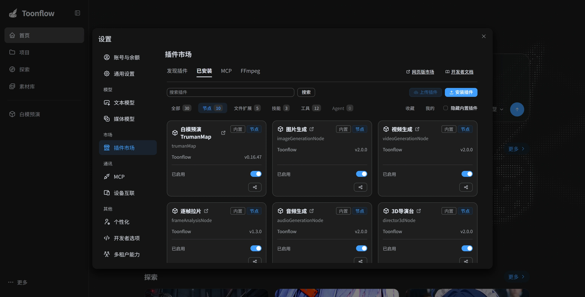

<p>
  <a href="https://github.com/HBAI-Ltd/Toonflow-app">
    
  </a>
  &nbsp;|&nbsp;
  <a href="https://gitee.com/HBAI-Ltd/Toonflow-app">
    
  </a>
  &nbsp;|&nbsp;
  <a href="https://atomgit.com/HBAI-Ltd/Toonflow-app">
    
  </a>
</p>

<p align="center">
  <a href="../../README.md">简体中文</a> |
  <strong>繁體中文</strong> |
  <a href="./readmeEn.md">English</a> |
  <a href="./readmeJa.md">日本語</a> |
  <a href="./readmeRu.md">Русский</a> |
  <a href="./readmeVi.md">Tiếng Việt</a> |
  <a href="./readmeTh.md">ไทย</a>
  <br />
  <a href="./readmeKo.md">한국어</a> |
  <a href="./readmeHi.md">हिन्दी</a> |
  <a href="./readmeId.md">Bahasa Indonesia</a> |
  <a href="./readmeMs.md">Bahasa Melayu</a> |
  <a href="./readmeFil.md">Filipino</a> |
  <a href="./readmeBn.md">বাংলা</a> |
  <a href="./readmeUr.md">اردو</a>
  <br />
  <a href="./readmeTa.md">தமிழ்</a> |
  <a href="./readmeTe.md">తెలుగు</a> |
  <a href="./readmeMr.md">मराठी</a> |
  <a href="./readmePa.md">ਪੰਜਾਬੀ</a> |
  <a href="./readmeAr.md">العربية</a> |
  <a href="./readmeFa.md">فارسی</a> |
  <a href="./readmeTr.md">Türkçe</a>
</p>

> 🌐 **支援 22 種介面語言** · [查看支援的語言](#languages)

<div align="center">

<p align="center">
  
</p>

<a href="https://git.io/typing-svg">
  <picture>
    <source media="(prefers-color-scheme: dark)" srcset="https://readme-typing-svg.demolab.com?font=Fira+Code&size=40&duration=3000&pause=1000&color=FFFFFF&center=true&vCenter=true&width=600&lines=Toonflow;AI%20%E7%9F%AD%E5%8A%87%E5%B7%A5%E5%BB%A0;%E8%AE%93%E9%9D%88%E6%84%9F%E6%88%90%E7%82%BA%E7%9C%8B%E5%BE%97%E8%A6%8B%E7%9A%84%E6%95%85%E4%BA%8B" />
    
  </picture>
</a>

<p align="center">
  <a href="https://github.com/HBAI-Ltd/Toonflow-app/stargazers">
    
  </a>
  <a href="../../LICENSE">
    
  </a>
  <a href="https://github.com/HBAI-Ltd/Toonflow-app/releases">
    
  </a>
</p>
<p align="center">
  <a href="https://github.com/HBAI-Ltd/Toonflow-app/network/members">
    
  </a>
  <a href="https://atomgit.com/HBAI-Ltd/Toonflow-app">
    
  </a>
  <a href="https://discord.gg/HEjKmpNpAZ">
    
  </a>
</p>
<p align="center">
  <a href="https://github.com/HBAI-Ltd/Toonflow-app/issues">
    
  </a>
  <a href="https://github.com/HBAI-Ltd/Toonflow-app/graphs/contributors">
    
  </a>
  <a href="https://github.com/HBAI-Ltd/Toonflow-app/commits">
    
  </a>
</p>
<p align="center">
  &nbsp;
  &nbsp;
  &nbsp;
  
</p>

<p align="center">
  <a href="https://trendshift.io/repositories/24197?utm_source=trendshift-badge&amp;utm_medium=badge&amp;utm_campaign=badge-trendshift-24197#achievements" target="_blank" rel="noopener noreferrer">
    
  </a>
  <a href="https://trendshift.io/repositories/24197?utm_source=trendshift-badge&amp;utm_medium=badge&amp;utm_campaign=badge-trendshift-24197#achievements" target="_blank" rel="noopener noreferrer">
    
  </a>
  <a href="https://trendshift.io/repositories/24197?utm_source=trendshift-badge&amp;utm_medium=badge&amp;utm_campaign=badge-trendshift-24197#achievements" target="_blank" rel="noopener noreferrer">
    
  </a>
</p>
<p align="center">
  <a href="https://trendshift.io/repositories/24197?utm_source=trendshift-badge&amp;utm_medium=badge&amp;utm_campaign=badge-trendshift-24197#achievements" target="_blank" rel="noopener noreferrer">
    
  </a>
  <a href="https://trendshift.io/repositories/24197?utm_source=trendshift-badge&amp;utm_medium=badge&amp;utm_campaign=badge-trendshift-24197#achievements" target="_blank" rel="noopener noreferrer">
    
  </a>
  <a href="https://trendshift.io/repositories/24197?utm_source=trendshift-badge&amp;utm_medium=badge&amp;utm_campaign=badge-trendshift-24197#achievements" target="_blank" rel="noopener noreferrer">
    
  </a>
</p>
<p align="center">
  <a href="https://trendshift.io/repositories/24197?utm_source=trendshift-badge&amp;utm_medium=badge&amp;utm_campaign=badge-trendshift-24197#achievements" target="_blank" rel="noopener noreferrer">
    
  </a>
</p>

**開源 AI 短劇與動態漫畫影片創作平台**

> 🚀 **一站式短劇創作**：整合劇本創作、素材管理、圖像與影片生成，在無限畫布中安排完整的創作流程。

</div>

<div align="center">
  <table>
    <tr>
      <td width="50%" align="center">
        <a href="../images/gStar.png">
          
        </a>
      </td>
      <td width="50%" align="center">
        <a href="../images/gvp.jpg">
          
        </a>
      </td>
    </tr>
  </table>
</div>

<p align="center">
  <a href="https://github.com/HBAI-Ltd/Toonflow-app/releases">下載桌面版</a> ·
  <a href="https://qcn7xdsqgc4z.feishu.cn/docx/RXFqdgR2Xo0dXZxGfd0cZCGgnwf">使用教學</a> ·
  <a href="https://api.toonflow.net/console/plugIn">外掛市集</a> ·
  <a href="https://qcn7xdsqgc4z.feishu.cn/docx/KNBNd9naqolsy6xjAOCcEAkqnRd">開發者文件</a> ·
  <a href="https://api.toonflow.net/">官方模型平台</a>
</p>

<p align="center">
  📺 <a href="https://www.bilibili.com/video/BV1hbpb6xETF">產品介紹影片</a> ·
  <a href="https://www.bilibili.com/video/BV1z4sS6NEA3">白模預演示範影片</a>
</p>

<p align="center">🔥 基於 Toonflow 打造的短劇已在紅果收穫百萬、千萬到破億播放。<a href="#works">看作品</a></p>

https://github.com/user-attachments/assets/56d81114-7521-454c-9ec9-972567eddda9

---

## 1. 💛 贊助與支持

感謝以下合作夥伴對 Toonflow 開源專案的支持。

<table>
  <tr>
    <td width="50%" valign="top">
      <a href="https://metaso.cn/minimax-h3/?s=toon"> <strong>秘塔</strong></a>
      <br />
      <sub>提供高性價比的 MiniMax H3 影片生成服務：768P 僅人民幣 0.09 元/秒，2K 僅人民幣 0.15 元/秒；支援原生 2K、影音同步，API 相容 OpenAI 協定，同時支援 ComfyUI、無限畫布，無需自行部署 GPU。透過<a href="https://metaso.cn/minimax-h3/?s=toon">專屬連結註冊</a>即可領取贈送額度及專屬優惠，商務洽談可加微信 metasota12。</sub>
    </td>
    <td width="50%" valign="top">
      <a href="https://go.apimart.ai/gh-toonflow-app"> <strong>APIMart</strong></a>
      <br />
      <sub>感謝 APIMart 贊助本專案！專注於 AI 圖片與影片生成的平價 API 平台，GPT-Image-2 每張低至 $0.006，1 美元可生成 160+ 張圖片；圖片與影片共用一套非同步 API，提交任務取得 ID，透過回呼取得結果，批次處理上萬張也不逾時，切換模型無需修改程式碼，按用量計費、無月費。透過此<a href="https://go.apimart.ai/gh-toonflow-app">註冊連結</a>註冊即可使用。</sub>
    </td>
  </tr>
  <tr>
    <td width="50%" valign="top">
      <a href="https://www.compshare.cn/video-studio?ytag=GPU_YY_YX_git_toonflow"> <strong>優雲智算</strong></a>
      <br />
      <sub>優雲智算提供高性價比 H3 影片生成服務，涵蓋文字生成影片、首尾影格及全能參考。支援最長 30 秒影片、原生 2K 畫質，768P 僅人民幣 0.08 元/秒。支援 API 呼叫、企業高併發、自助開立發票。</sub>
      <br /><br />
      <sub>🎁 透過<a href="https://www.compshare.cn/video-studio?ytag=GPU_YY_YX_git_toonflow">專屬連結註冊</a>，即可獲得免費人民幣 5 元平台體驗金！</sub>
    </td>
    <td width="50%" valign="top">
      <a href="https://weimeta.cn/console/invite/accept?aff=INV202611191734123p9JeY"> <strong>唯元智創（WEIMETA AI）</strong></a>
      <br />
      <sub>唯元智創提供高性價比 AI 文字、圖像與影片生成服務，聚合 DeepSeek、GLM、Kimi、Seedream、Seedance、Wan、MiniMax H3 等主流模型，支援文生圖、圖生圖、文生影片、圖生影片。提供統一 API 接入，支援多模型靈活呼叫，滿足企業級 AI 內容創作需求。平台採用企業級資料加密傳輸與多租戶隔離技術，通過等保三級安全測評，保障企業資料安全與隱私。</sub>
      <br /><br />
      <sub>🎁 透過<a href="https://weimeta.cn/console/invite/accept?aff=INV202611191734123p9JeY">專屬連結註冊</a>，即可體驗 WEIMETA AI 多模態模型服務，限時儲值 100 送 15。商務洽談請加微信：WeiMeta_AI666</sub>
    </td>
  </tr>
</table>

<details>
<summary><strong>👉成為贊助商👈</strong></summary>

<p align="center">
  
</p>

<p align="center"><sub>此聯絡方式僅供商務合作洽談，不提供問題解答。使用問題歡迎在交流群交流，需求與 BUG 可透過回饋表提交。感謝理解。</sub></p>

</details>

---

## 2. 🌟 亮點

| 能力 | 說明 |
| --- | --- |
| 🎬 **白模預演** | 貼上劇本，一鍵 3D 搭景、分鏡、排走位。 |
| 🖼️ **無限畫布** | 劇本、角色、場景、影片片段連線複用。 |
| 🎥 **AI 影片生成** | @ 引用資產，按鏡頭出片。 |
| 🤖 **AI 助手** | 直接讀寫畫布，支援 MCP 與 A2A。 |
| 🔧 **自由接入模型** | 線上供應商、第三方 API、本地大模型、ComfyUI。 |
| 🧩 **外掛市場** | 節點、工具、技能一鍵安裝。 |
| 🏠 **本地部署** | Windows、macOS、Linux、Android、Docker。 |
| 🌐 **多語言** | 22 種介面語言。 |

**創作流程**: 劇本分鏡 → 角色與場景 → 白模預演 → 按鏡頭生成影片 → 剪輯下載。

### 常見問題

**Toonflow 是什麼？** 開源的 AI 短劇、AI 漫劇與 AI 影片創作平台。

**免費嗎？** MIT 開源，可免費自行部署；第三方模型 API 可能收費。

**支援哪些模型？** 內建 Seedance、Seedream、MiniMax、Wan 等，也能接第三方 API、本地大模型和 ComfyUI，詳見[使用教學](https://qcn7xdsqgc4z.feishu.cn/docx/RXFqdgR2Xo0dXZxGfd0cZCGgnwf)。

**支援哪些系統？** Windows、macOS、Linux、Android，以及 Docker 和伺服器部署。

<a id="languages"></a>

### 多語言支援

支援的語言：简体中文、繁體中文、English、日本語、Русский、Tiếng Việt、ไทย、한국어、हिन्दी、Bahasa Indonesia、Bahasa Melayu、Filipino、বাংলা、اردو、தமிழ்、తెలుగు、मराठी、ਪੰਜਾਬੀ、العربية、فارسی、Türkçe、Português (Brasil)。

---

## 3. 📸 十大看點

<a id="trumanmap"></a>

### 看點 1｜貼上劇本，一鍵 3D 預演

按台詞自動分鏡、排走位，監看窗即時出畫面和字幕。 📺 [看示範影片](https://www.bilibili.com/video/BV1z4sS6NEA3)

https://github.com/user-attachments/assets/bb2f7bfe-46de-44ff-b3b3-95379f9d4b20

<p align="center">
  <a href="../images/screenshots/trumanMapTimeline.webp"></a>
</p>

<table>
  <tr>
    <td width="50%"><a href="../images/screenshots/trumanMapShot.webp"></a></td>
    <td width="50%"><a href="../images/screenshots/trumanMapStreet.webp"></a></td>
  </tr>
</table>

### 看點 2｜一座看不到邊的江南古鎮

城牆、街巷、水鄉、寺廟、遠山，1500 多件物體。

<p align="center">
  <a href="../images/screenshots/trumanMapTown.webp"></a>
</p>

<table>
  <tr>
    <td width="50%"><a href="../images/screenshots/trumanMapAerial.webp"></a></td>
    <td width="50%"><a href="../images/screenshots/trumanMapTemple.webp"></a></td>
  </tr>
</table>

### 看點 3｜64 套整套景 + 8 萬多件素材

<table>
  <tr>
    <td width="50%"><a href="../images/screenshots/trumanMapSets.webp"></a></td>
    <td width="50%"><a href="../images/screenshots/trumanMapAssets.webp"></a></td>
  </tr>
</table>

### 看點 4｜天氣、時間、地形隨手改

<table>
  <tr>
    <td width="50%"><a href="../images/screenshots/trumanMapRain.webp"></a></td>
    <td width="50%"><a href="../images/screenshots/trumanMapBrush.webp"></a></td>
  </tr>
  <tr>
    <td width="50%"><a href="../images/screenshots/trumanMapWorld.webp"></a></td>
    <td width="50%"><a href="../images/screenshots/trumanMapHome.webp"></a></td>
  </tr>
</table>

### 看點 5｜預演直接匯出給影片生成

分鏡圖、四視圖、白模影片、預演小樣、鏡頭表，一鍵匯回畫布。

### 看點 6｜無限畫布 + AI 助手

<table>
  <tr>
    <td width="50%"><a href="../images/screenshots/canvasNodeMenu.webp"></a></td>
    <td width="50%"><a href="../images/screenshots/canvasAgent.webp"></a></td>
  </tr>
</table>

### 看點 7｜多參考影片生成

<p align="center">
  <a href="../images/screenshots/videoGenerationNode.webp"></a>
</p>

### 看點 8｜劇本文件與工作區

<p align="center">
  <a href="../images/screenshots/canvasDocument.webp"></a>
</p>

### 看點 9｜首頁與素材庫

<table>
  <tr>
    <td width="50%"><a href="../images/screenshots/home.webp"></a></td>
    <td width="50%"><a href="../images/screenshots/assetLibrary.webp"></a></td>
  </tr>
</table>

### 看點 10｜外掛市場

更多外掛見[網頁版外掛市場](https://api.toonflow.net/console/plugIn)。

<p align="center">
  <a href="../images/screenshots/pluginMarket.webp"></a>
</p>

---

## 4. 🚀 下載與安裝

### 4.1 用戶端安裝

| 作業系統 | GitHub |
| --- | --- |
| Windows | [發行版本](https://github.com/HBAI-Ltd/Toonflow-app/releases) |
| macOS | [發行版本](https://github.com/HBAI-Ltd/Toonflow-app/releases) |
| Android ARM64 | [下載 APK](https://github.com/HBAI-Ltd/Toonflow-app/releases/latest) |

Android 版僅支援 ARM64 裝置，下載發行頁面的 `toonflow-版本號-android-arm64.apk` 安裝。手機內建本機 Bun 後端，可獨立執行；也可從首頁「裝置互聯」掃描 QR Code 或手動連接已開啟共享的電腦或遠端後端（支援區域網路與公開網路）。

Windows 安裝程式會自動偵測並安裝 WebView2；如果安裝後開啟時閃退，請前往 [WebView2 下載頁面](https://developer.microsoft.com/microsoft-edge/webview2/) 手動安裝執行階段。

macOS（Apple Silicon）將 Toonflow 拖入「應用程式」後直接開啟即可，無需事先執行終端機指令。若遇到系統安全提示，請依以下順序處理。

<details>
<summary><strong>macOS 無法安裝或開啟時的處理方式</strong></summary>

**1. 在「隱私權與安全性」中允許 Toonflow**

如果提示「無法驗證開發者」或「Apple 無法檢查 App 是否包含惡意軟體」，先嘗試開啟 Toonflow，再前往「系統設定 → 隱私權與安全性」，找到 Toonflow 被阻擋的提示，按一下「強制打開」，並依提示確認。詳見 [Apple 官方說明](https://support.apple.com/zh-cn/102445)。

**2. 仍因系統隔離限制無法開啟時，再嘗試移除隔離屬性**

確認應用程式來自官方發行頁面，並已放入「應用程式」後，在終端機執行以下指令，再重新開啟。若應用程式名稱或安裝位置不同，請調整路徑。

```bash
sudo xattr -rd com.apple.quarantine /Applications/toonflow.app
```

**3. 最後手段：暫時允許任何來源的 App**

前兩種方式均無效，且確認應用程式來源可信時，可嘗試在終端機執行：

```bash
sudo spctl --master-disable
```

接著開啟「系統設定 → 隱私權與安全性」，在「安全性」中的「允許從以下來源下載的 App」選擇「任何來源」（若系統提供此選項），並依提示確認。不同 macOS 版本的選項與指令支援情況可能不同。

此操作會放寬所有 App 的安全限制。完成後建議將允許來源恢復為「App Store 和已識別的開發者」。

</details>

更多操作說明請參閱[使用教學](https://qcn7xdsqgc4z.feishu.cn/docx/RXFqdgR2Xo0dXZxGfd0cZCGgnwf)。

---

### 4.2 Docker 安裝

先安裝 Git、[Docker Engine](https://docs.docker.com/engine/install/) 和 Docker Compose；Windows / macOS 可使用 Docker Desktop 的 Linux 容器模式。儲存庫提供 [Dockerfile](../../Dockerfile)、[Compose 設定](../../compose.yaml) 和[建置排除規則](../../.dockerignore)，以 Bun 1.4.3 建置，映像檔內含 FFmpeg。

<details>
<summary><strong>展開 Docker 安裝步驟</strong></summary>

複製原始碼後，在儲存庫根目錄執行：

```sh
git clone https://github.com/HBAI-Ltd/Toonflow-app.git
cd Toonflow-app
docker compose up -d --build
```

首次建置會安裝相依套件，並編譯內建節點、工具、Web 與 Server。啟動後造訪 `http://127.0.0.1:3000`；遠端主機可依下方「存取與資料說明」透過 SSH 通道存取。首次啟動會初始化內建外掛，並提供 `myProject` 工作目錄。

設定、外掛與專案檔案儲存在 Docker 具名磁碟區 `toonflowData` 中，掛載至容器的 `/app/data/`。磁碟區的實際名稱帶有 Compose 專案前綴；停止或重建容器會保留資料，**請勿使用 `docker compose down -v`，此指令會刪除資料磁碟區**。

```sh
docker compose logs -f toonflow  # 查看記錄
docker compose stop             # 停止服務
docker compose start            # 再次啟動
docker compose down             # 刪除容器，保留資料磁碟區
```

需要增加專案目錄時，可在頁面的「選擇伺服器工作目錄」對話框中按一下「新增資料夾」。對話框也支援檔案與資料夾的重新命名、刪除。也可在服務執行期間透過命令列建立：

```sh
docker compose exec toonflow mkdir -p /app/data/workspaces/newProject
```

備份時先停止服務，複製完成後再啟動：

```sh
docker compose stop
docker compose cp toonflow:/app/data ./toonflowBackup
docker compose start
```

</details>

---

### 4.3 伺服器安裝

適用於直接在 Linux 伺服器上執行 Web 與 Server。以下以 Ubuntu / Debian 為例，使用專案指定的 [Bun 1.4.3](https://bun.sh/docs/installation)。

<details>
<summary><strong>展開伺服器安裝步驟</strong></summary>

安裝執行環境：

```sh
sudo apt-get update
sudo apt-get install -y git curl unzip ffmpeg
curl -fsSL https://bun.com/install | bash -s "bun-v1.4.3"
export PATH="$HOME/.bun/bin:$PATH"
bun --version
```

複製原始碼並啟動：

```sh
git clone https://github.com/HBAI-Ltd/Toonflow-app.git
cd Toonflow-app
bun install --frozen-lockfile

# 建置內建節點、工具、Web 與 Server
bun run build:server
mkdir -p data/workspaces/myProject
bun run start:server
```

看到「服务启动成功」（服務啟動成功）後，可在伺服器本機造訪 `http://127.0.0.1:3000`。上述指令以前景方式執行，按 `Ctrl+C` 停止；需要開機自動啟動與程序管理時，可參考 [Bun 的 systemd 部署指南](https://bun.sh/guides/ecosystem/systemd)，將工作目錄設為儲存庫目錄，啟動指令設為 Bun 的絕對路徑加上 `run start:server`，並使用有權讀寫該目錄的使用者執行。

</details>

---

### 4.4 存取與資料說明

- 目前服務使用固定連接埠 `3000`，功能頁面與 API 沒有獨立的登入驗證。安裝在伺服器上時，請透過防火牆或安全群組限制 `3000` 連接埠的存取來源；公開網路存取需設定具備身分驗證的反向代理。
- 個人遠端使用可在自己的電腦上執行 `ssh -N -L 3000:127.0.0.1:3000 用户名@服务器地址`（將 `用户名@服务器地址` 替換為實際的使用者名稱與伺服器位址），保持連線後開啟 `http://127.0.0.1:3000`，無需將伺服器的 `3000` 連接埠對公開網路開放。
- 直接安裝時，設定、外掛與工作區預設儲存在儲存庫的 `data/`；Docker 安裝則儲存在資料磁碟區內的 `/app/data/`。遷移或備份時請完整保留。進入頁面後選擇伺服器工作區內的 `myProject`，更多專案可在對應的 `workspaces/` 下建立子目錄。
- 兩種安裝方式均包含系統 FFmpeg。模型服務的 API Key 仍需在頁面內設定。

---

### 4.5 雲端平台部署

合作平台[智星雲](https://www.ai-galaxy.com/)提供官方授權的 Toonflow 商用映像檔，可直接使用預先安裝的環境。具體步驟請參閱[映像檔部署圖文教學](https://mp.weixin.qq.com/s/lq9X1ovQ1_TKeXMOLgicKg?scene=1)。

---

## 5. 🎬 作品範例

<a id="works"></a>

### 紅果熱播作品

🔥 基於 Toonflow 打造的短劇已在紅果收穫百萬、千萬到破億播放。

<p align="center">
  
</p>

<p align="center">
  
</p>

### 廣告片

<table>
  <tr>
    <td width="50%"><video src="https://github.com/user-attachments/assets/fccf8b46-b8ec-46cb-9574-9273cd1ee9e4" controls width="100%"></video></td>
    <td width="50%"><video src="https://github.com/user-attachments/assets/b345905e-601f-43be-83a5-305f97a29e44" controls width="100%"></video></td>
  </tr>
  <tr>
    <td width="50%"><video src="https://github.com/user-attachments/assets/fc5880aa-6b9c-4717-af0e-e51f15c4fdc6" controls width="100%"></video></td>
    <td width="50%"><video src="https://github.com/user-attachments/assets/0816e794-f07d-4bc3-89cd-69c67566c3a6" controls width="100%"></video></td>
  </tr>
</table>

### 短劇案例

https://github.com/user-attachments/assets/2d9fddac-dfdf-4640-b030-b09d7f7287e9

示範影片為壓縮後的 480p 版本。

---

## 6. 👨‍👩‍👧‍👦 微信交流群

入群小幫手：


也可以點擊圖示加入 Discord：

[](https://discord.gg/HEjKmpNpAZ)

或點擊邀請連結：[https://discord.gg/HEjKmpNpAZ](https://discord.gg/HEjKmpNpAZ)

---

## 7. 💌 聯絡我們

📧 電子郵件：[ltlctools@outlook.com](mailto:ltlctools@outlook.com?subject=Toonflow咨询)

---

## 8. 📜 開源授權

Toonflow 採用 [MIT 授權條款](../../LICENSE)。第三方相依套件與素材遵循各自的授權及著作權聲明。

[](https://www.star-history.com/#HBAI-Ltd/Toonflow-app&Date)

> **不溯及既往條款**：在 v1.0.8 發布前依 AGPL-3.0 使用的使用者，繼續適用 AGPL-3.0；v1.0.8 ~ v1.1.8 繼續適用 Apache-2.0 與附加協議，不受本次授權變更影響。

---

## 9. 🙏 致謝

- **合作夥伴**：算能雲、騰訊混元 3D、智星雲。
- **專案貢獻者**：感謝所有參與程式碼開發、文件完善、外掛分享與問題排查的貢獻者。
- **社群使用者**：感謝所有持續提供回饋、分享創作成果並支持專案發展的使用者。

仰起脸笑的像满月：提供 Codex 20x 開發運算資源。
西安中星数字智能科技有限公司：提供 Apple 憑證簽署。

<p align="center"><sub>Free code signing provided by <a href="https://signpath.io/">SignPath.io</a>, certificate by <a href="https://signpath.org/">SignPath Foundation</a>.</sub></p>

<div align="center">

Copyright © 2026 北京爱阿科技有限公司

</div>


