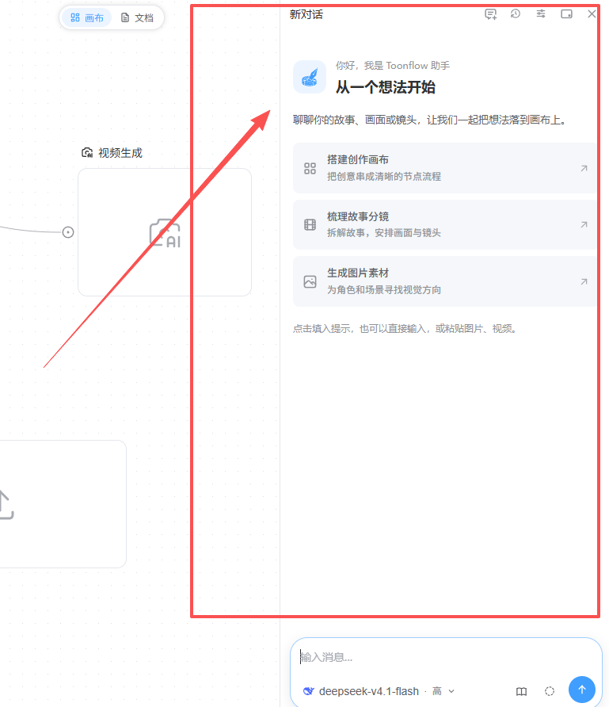
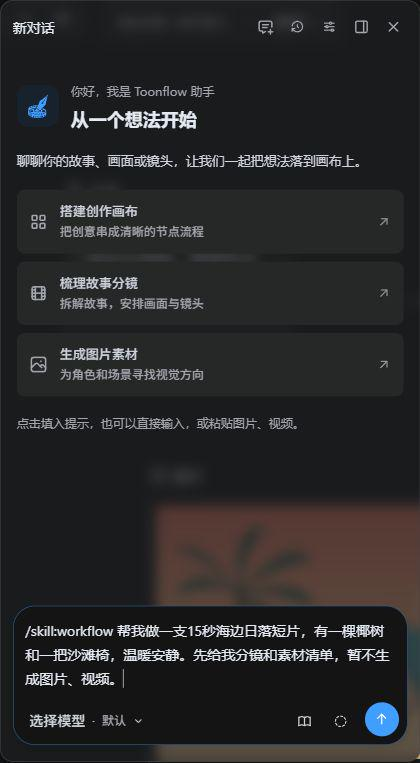

# 使用教程

## 1｜无限画布

### 1.1 新建项目和画布

1. 在 Toonflow 首页点击“添加项目”→“选择空文件夹”，选择或新建“海边日落”空文件夹。浏览器版可在“选择服务器工作目录”弹窗中点击“新建文件夹”，输入名称并确认，进入新文件夹后点击“选择此目录”。

2. 进入项目后，点击左上角“画布1”旁的下拉箭头，再点击列表顶部的加号。输入“日落练习”，按 Enter。

3. 以后从这个列表切换画布；点击画布旁的编辑图标可以改名。继续旧项目时，从首页点击项目卡片，或用“导入项目”选择原文件夹。

### 1.2 新建节点

1. 把鼠标放到画布空白处，按 Tab或在画布空白处双击，即可快速新建节点

2. 可以直接将图片，视频，音频等直接拖入

### 1.3 放入文字、图片、视频和音频

#### 1.3.1 文本节点：

用来展示文本信息，文本信息点击‘’编辑‘’可以手动输入或模型生成

示例：点击文本节点内的“编辑”，输入“海边日落，一棵椰树旁放着一把空沙滩椅，暖橙色天空，海面平静”，关闭编辑窗口。以后再次点击“编辑”即可修改。

语言模型生成方式：

我们可以输入自然语言或者结构化的提示词,让语言模型完成对应的文本生成任务,在开始之前我们第一次配置好了语言模型就可以选取对应的模型进行使用,生成结果会在文本节点框中显示

#### 1.3.2图片节点：

点击图片节点中央的上传图标，选择海边参考图。选中节点后，可点击上方“全屏”查看，或点击“替换图片”换一张。

图像模型生成:

图片生成器中接入了全能图片模型=、Seedream5.0/4.5等,用户也可以自行接入

支持各种文生、图生、多图参考融合、图像编辑任务

方法1: 可以在对话框中生成图片素材

方法2: 右键添加图片生成节点,两个节点链接,生成任务就会显示在图片节点框中

#### 1.3.3视频节点：

添加“视频”节点，点击中央上传图标选择文件。

上传后点击播放、拖动进度条查看；点击“截取视频帧”，可将当前帧、首帧或尾帧放成图片节点。

#### 1.3.4音频节点：

添加“音频”节点，点击上传图标选择声音文件，再点击播放试听。图片、视频、音频也可以直接从电脑拖到画布，单个文件不超过 100 MB。

#### 1.3.5右侧对话框

剧本拆解、剧本资产管理、分镜头调整、提示词合成、批量生图、批量生视频串成一条完整流程

### 1.4 工作流的搭建

基于已有的文本、图像、视频、音频 4 类节点，我们可以通过连线的方式，自由搭建出所需要的任务工作流，方便之后快速进行复杂任务一键自动执行或者分发

#### 1.4.1生成一张图片

1. 按 Tab 添加“图片生成”。从参考图片右侧的圆点拖到图片生成节点左侧的圆点，松开鼠标；再把文本节点连到同一个输入圆点。

2. 在图像生成器中，输入生成需求「参考图1的的色调，按照文字描述生成海边日落画面，保留一棵椰树和一把沙滩椅生成一张图片」，选择生图模型、设置图像比例、最后点击生成

3. 点击“选择模型”，选择支持参考图的图片模型；点击旁边的比例与尺寸区域，选择需要的选项，再点击向上箭头“生成图片”。

4. 图片出现后，点击上方“全屏”检查。连接的文本会一起参与生成；要换画面，先修改文本或提示词，再点击生成。

#### 1.4.2再让画面动起来

### 1.5 平移、缩放、复制和分组

1. 按住空格拖动画布，按住 Ctrl 滚动滚轮缩放。按 H 切换抓手，按 V 切回移动工具；找不到内容时按 Ctrl + 0。

2. 右键节点选择“创建副本”，在副本上尝试新提示词，保留原来的结果。删除时选“删除节点”；误操作可按 Ctrl + Z 撤销。

3. 按 V，在空白处拖出选框，

- 对于搭建好的工作流，可全选后点击右键进行打组。打组后可进行整体拖动选中多个节点后点击“打组”。拖动分组可一起移动，选中分组后点“解组”拆开。

4. 选中有结果的节点，点击上方“下载”图标保存图片或视频。画布修改会自动保存，下次打开原项目即可继续。

## 2｜画布实用工具

### 提供了一系列实用&功能，方便大家快速进行图像、视频的编辑处理。

### 2.1 素材库

1. 右键结果节点，选择“保存到素材库”，填写完整文件名、选择位置，再点击“保存”。

2. 点击画布左下角“素材库”，搜索刚才的名称。点击预览按钮查看内容，把文件拖回画布即可复用。

3. 点击素材库顶部“新建文件夹”，按角色、场景或集数整理。右键素材还能重命名、移动或下载。

4. 画布变大后，可点击左下角地图图标定位内容，或点击“整理画布”自动排布节点；需要恢复时点击弹出的“撤销整理”。

### 2.2 3D 导演台

导演台是一个 3D 构图节点，帮助用户用摆积木的方式搭建故事空间，通过多视角截图，快速得到可被 AI 图像/视频模型准确理解的构图参考

1. 按 Tab 添加“3D 导演台”，点击节点预览打开。先点“设置 → 添加人偶”，用一个简单人物练习取景。

2. 点击三维画面进入取景，用鼠标调整朝向，WASD 移动，空格上升、Shift 下降，滚轮调焦。

3. 点击“添加关键帧”记录取景，按 Esc 退出。想生成动画时，在右侧选择文本模型、输入场景和运镜要求，再点击“生成方案”。

4. 点击关键帧的导出按钮生成图片节点，或点击“导出视频节点”保存动画。导出期间保持当前窗口可见，完成后回画布查看。

[观看演示视频（00:31）](https://internal-api-drive-stream.feishu.cn/space/api/box/stream/download/video/JzFcbRKdto4U4HxknEacFebxnse/?quality=480p&data_version=7690477045290699708&mount_point=docx_file)

#### 1.基础使用步骤

1.新建''3D导演台''节点,点击「打开导演台」进入3D空间

2.连接节点生成模型

3.在对话框描述模型动作和运镜要求

## 3｜视频合成

对话可以是agent

[观看演示视频（02:45）](https://internal-api-drive-stream.feishu.cn/space/api/box/stream/download/video/DDVdbRTs0oA09uxJRNScfPbfnIc/?quality=1080p&data_version=7690785145216879573&mount_point=docx_file)

## 4｜插件市场

1. 点击“设置 → 插件市场”，在“发现插件”搜索需要的功能，点击卡片阅读说明，再点击“安装”。页面要求验证时，填写 TF-Router API Key 并点击“保存并继续”。

2. 安装后切到“已安装”查看；卡片有“配置”时，先填写需要的内容并保存。已有本地插件文件，可点击这里的“安装插件”导入；市场显示“更新”时可更新该插件。

3. 节点装好后，在画布右键菜单或 Tab 菜单中使用；技能在助手输入区的书本按钮中选择；工具由助手根据你的要求调用。

4. 例如，安装画布节点可增加制作方式，安装技能可补充创作流程，安装工具可增加搜索或文件操作能力。Agent 类别显示“测试阶段，暂未开放”时，先使用已有类别。

## 5｜Agent 助手

### 4.1 选择模型和技能

1. 打开项目中的 Toonflow Agent。面板关闭时，点击页面上的“Toonflow Agent”按钮重新打开。

2. 点击输入框下方的模型名称，选择已配置的文本模型；点击书本形状的“选择技能”，选择 /skill:workflow（视频制作工作流）。也可以输入 /，从列表选择技能。

3. 选中后，输入框会出现技能指令，直接在后面补充任务。要提供参考图，可把图片粘贴到输入区，再填写要求。

### 4.2 说清需求，确认后继续

1. 输入：“帮我做一支 15 秒海边日落短片，画面里有一棵椰树和一把沙滩椅，温暖安静。先给我分镜和素材清单，暂不生成图片、视频。”点击发送。

2. 助手提问时，在卡片中填写选项并点击“提交回答”。读完方案后，可以回复：“保留三个镜头，先生成第一个镜头的图片”，逐步推进。

3. 满意后继续说：“使用这张图片生成视频，椰树叶轻轻摇动。”需要修改时指出具体节点和内容，例如“只调暗天空，保留椰树与椅子的位置”。

4. 点击助手顶部“历史对话”找回之前的制作记录；开始另一件事时点击“新建对话”。回到旧对话后说明从哪个镜头继续，已有素材可以接着使用。

你只需要安装和登录一次，后面继续用自然语言描述创作需求

最后的最后

亲爱的 ToonFlow 用户：

距离上一次更新，已经过去了三个月，今天Toonflow 2.0 正式发布了。

很抱歉，让大家等了这么久。

今天，我们终于带着承诺回来赴约更新了。

ToonFlow 是一个完全免费、全开源的项目。从第一天起，我们想做的事就很简单：把「小说 → 角色 → 剧本 → 分镜 → 成片」这条路修通，再修短一点，让有故事、有想法的人不必被复杂的工具和流程挡在门外。

只是这三个月，我们不得不停下来，先想办法让开发继续下去。

这段时间，持续的支出已经让我们难以维系开发。我们尝试了各种办法，但始终没能缓解资金压力。我们仍然想把 ToonFlow 做下去，只是为爱发电，也得先吃饱饭。

这期间，一位和我们一起做核心开发的伙伴选择了离开，去追求更适合自己的发展。我们理解。一起坚持了这么久，告别时难免不舍。那段时间，面对迟迟没有缓解的困境，我们也曾情绪低落，也问过自己还能坚持多久。只是想到 ToonFlow 还有没做完的事，还是想再试一试。

最困难的时候，我们也想过，要不要给 API 加一点价，甚至把模型调用限定在 TF-Router 上。这样做，或许能减轻一些压力。

但最终，我们没有加价，也没有限制接入方式。

所以，新版本依然可以自由接入第三方 API，不强制绑定渠道，也不限制大家的选择。TF-Router 会是一个选项，但不会是唯一的路。

在这里也要认真说声谢谢：这次开发所用的 Codex 算力，都是群友们东拼西凑出来的。在我们连开发支出都困难的时候，是大家的帮忙，让后面的工作得以继续。

所以，今天能交出这份更新，真的离不开你们。

之前那封信里答应大家的事，我们也一直记着。这次，终于把它们带来了：

ToonFlow 的开源协议从 Apache-2.0 更换为 MIT License。

无论个人创作还是商业使用，都不需要额外向我们申请授权；只需按 MIT 协议的要求保留版权及许可声明。我们希望，大家可以更安心、更自由地使用它，也可以在它的基础上，做出自己的东西。

自由扩展的插件系统，也来了。

节点、工具、技能……你需要的能力，不必再全部等着我们来更新。我们先迈出这一步，把继续创造的空间留给每一个有想法的人。

核心创作流程已经完整跑通。

从小说到角色，从剧本到分镜，再到成片，我们终于走完了最核心的那段路，也在核心创作体验上向行业标杆 LibTV 对齐。

眼下的困难还没有完全解决，但我们仍然会努力保证今后的更新节奏。

但这次更新，我们总算做完了。让大家等了三个月，终于有了一份交代。

谢谢那些在断更期间还愿意等一等的人，谢谢帮忙反馈、出主意、凑算力的人，也谢谢每一个还记得 ToonFlow 的人。

隔了三个月，还能继续和大家说 ToonFlow 的新进展，我们真的很高兴。

祝你们创作顺利，也愿我们能继续活下去。

谢谢大家

